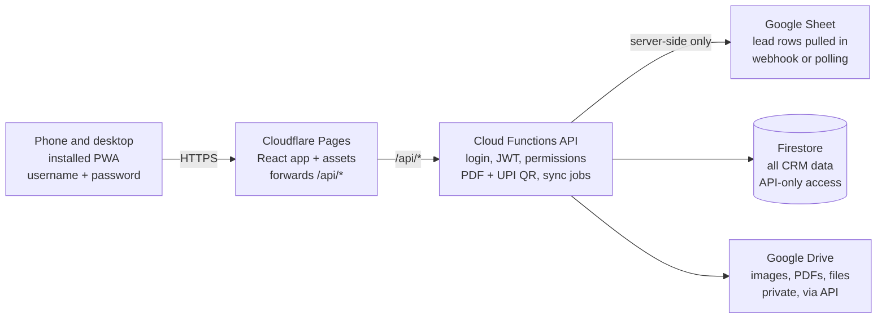

# SaleSphere CRM — Solution Design (source document)

| Version | Date | Author | Change |
|---|---|---|---|
| 1.0 | 2026-11-13 | Product owner (supplied as PDF) | Original design, transcribed to Markdown for traceability |

> Source input supplied by the product owner as `SaleSphere-CRM-Solution-Design.pdf` (18 pages). This is a faithful transcription used as the reference for the BRD, FRD, UX, solution and HLD phases. Do not edit; raise changes via `/sdlc:change-request`.

## 1. Product overview

SaleSphere is a single-company app, installed fresh for each client, that takes a business from first enquiry to money in the bank: **Lead → Quotation → Sales/Project Order → Invoice → Payment**, with every step visible in a **Customer 360** view. It runs as a desktop web app and as an installable mobile PWA that feels native, from one codebase. Every label, number series, tax rule, template and workflow is configurable, so the same product can be installed for any business type.

**Primary users:** owner/admin, sales executive (mostly on mobile), accounts/finance, project/operations manager.

**Core outcomes**
- No lead is lost: Google Sheet / web form / Meta / IndiaMART leads land in the CRM automatically, are assigned instantly and are chased with one-tap Call, WhatsApp and Email.
- Quote-to-cash in minutes: a won quotation converts to an order, the order to one or many invoices, and each invoice carries a UPI QR pre-filled with the exact amount due.
- One screen per customer: orders, outstanding, payments, conversations and documents in a single Customer 360.
- Resellable: each client gets a separate fresh install (own config in Git, own Firebase database, own Cloudflare site, own Google Drive) with its own branding, masters and templates.

**Document flow**
1. Lead captured (Sheet / form / manual / API) → auto-deduplicated and assigned.
2. Lead qualified → converted to Customer + Contact (+ optional Opportunity/Deal).
3. Quotation created from products/services → sent as PDF link via WhatsApp/Email → versioned revisions → customer accepts online.
4. Accepted quotation → Sales Order or Project Order (with milestones/tasks).
5. Order → Invoice (full, partial, milestone-based or recurring) → Proforma optional.
6. Payment recorded (UPI, bank, cash, cheque, card, gateway) → auto-allocated to invoices → receipt sent → outstanding updated in Customer 360.

## 2. Deployment model: one fresh install per client

Every client gets its own isolated copy: a fresh deployment from one shared Git codebase, its own Firebase project, its own Cloudflare Pages site and its own Google Drive folder. Nothing is shared between clients.

The browser never touches Firestore or Drive directly; the API checks the login token on every call. Code for all clients lives in one Git repo and CI deploys it to each client's Cloudflare and Firebase projects.

### 2.1 Stack per client

| Layer | Choice | What each client gets |
|---|---|---|
| Code | One Git repo; `main` = the product; `clients/<client-id>/` = config, logo, env | Own config folder and deploy pipeline, no code fork |
| Frontend | React + TypeScript PWA (Vite, Tailwind, shadcn/ui) on Cloudflare Pages | Own Pages project on its domain, e.g. `crm.clientname.com` |
| API | Cloud Functions for Firebase (2nd gen, Node.js, Admin SDK); Cloudflare forwards `/api/*` | Deployed into the client's Firebase project |
| Database | Cloud Firestore, region `asia-south1` (Mumbai) | Own Firebase project on Blaze plan |
| Login | Built into the app: users + hashed passwords in Firestore, JWT sessions; Firebase Auth not used | Own user list, first admin created at install |
| Files | Google Drive via Drive API | Own Drive folder in the client's Google account |
| Scheduled jobs | Cloud Scheduler + Functions: Sheet sync, reminders, PDF rendering, scores | Runs inside the client's project |
| Secrets | Google Secret Manager: JWT key, Drive token, WhatsApp/gateway keys | Separate keys per client |

### 2.2 Fresh install for a new client
1. Add `clients/<client-id>/config.json` (company name, colours, domain, modules on/off, industry template, locale, tax mode) + logo files.
2. Run `npm run provision -- <client-id>`: uses a new Firebase project, enables Firestore, deploys rules, indexes, functions and secrets.
3. Create the Cloudflare Pages project with `CLIENT_ID=<client-id>`, attach domain, point `/api/*` to the Functions URL.
4. Seed: industry masters, number series, default roles, first admin with one-time password (must change at first login).
5. Client admin connects Google Drive (one-time OAuth), lead Google Sheet, UPI ID, bank, logo, footer → go live.

**Updates:** each release is a Git tag (e.g. `v1.4.0`). GitHub Actions deploys a tag to all or chosen clients and runs versioned Firestore data-migration scripts per client. Client-specific needs go into config and feature flags, never a code fork.

### 2.3 Login and user management (no Firebase Auth)
- `users`: username (unique, lower-case), full name, phone, email, role, team, territory, active flag, password hash, failed attempts, locked-until, must-change-password, last login, optional 2FA secret.
- Passwords hashed with Argon2id (or bcrypt cost 12) inside the API; never stored/logged in plain text.
- Login → 15-minute access JWT + refresh token in httpOnly, Secure, SameSite=Strict cookie. Refresh tokens stored hashed in `sessions` (revocable).
- Lock 15 min after 5 wrong passwords; login rate-limited at Cloudflare; password rules set by admin.
- Admin: create user, set role/team, reset password (forces change), deactivate, view active sessions, force logout.
- Self-service: change password, optional authenticator-app 2FA, own login history.
- Firestore rules deny all direct browser access; every read/write goes through the API. Every login and data change goes to `auditLog`.

### 2.4 File storage in Google Drive
- Folder tree: `SaleSphere – <Client>/Customers/<code – name>/{Quotations, Orders, Invoices, Payments, Documents}`, plus `/Company` (logo, signature, stamp) and `/Exports`.
- Uploads browser → API → Drive (resumable). Firestore keeps Drive file ID, name, type, size, owning record.
- Quotation, invoice, receipt PDFs rendered by the API, saved in the customer folder, regenerated on change.
- Files private; shown via API after permission check; images use Drive thumbnails.
- Customers get an expiring signed link, never a public Drive link.
- Drive account: client's own Google account via one-time OAuth; refresh token in Secret Manager. (Service account only works with a Workspace Shared Drive.)

### 2.5 What each client can configure

| Area | What can be changed |
|---|---|
| Branding | App name, logo, favicon, colours, PWA icon & splash, email sender name |
| Terminology | Rename modules: Lead → Enquiry, Order → Job/Project, Customer → Client |
| Custom fields | Text, number, date, dropdown, multi-select, file, formula; on Lead, Customer, Quote, Order, Invoice |
| Pipelines | Multiple pipelines with own stages, probabilities and SLA timers |
| Numbering | Prefix, financial-year reset, padding: `QT/25-26/0001`, `INV/25-26/0001` |
| Tax | GST (CGST/SGST/IGST by place of supply), VAT, or no tax; HSN/SAC; TDS/TCS |
| Currency & locale | Base currency, multi-currency quotes, date format, Lakh/Crore or Million |
| Templates | Quotation, invoice, receipt, proforma, challan layouts; email and WhatsApp templates |
| Workflows | Approval rules, auto-assignment, reminders, escalations |
| Roles | Custom roles with module-, field- and record-level permissions |
| Integrations | Google Sheets, Google Drive, WhatsApp Business API, SMTP/Gmail, payment gateway, Tally/Zoho Books export |

## 3. Modules and features

### 3.1 Lead management
- Sources: Google Sheet sync, website form/embed, Meta Lead Ads, IndiaMART/JustDial/TradeIndia, WhatsApp click-to-chat, CSV import, REST API/webhook, manual entry, missed-call number.
- Auto-dedupe on phone (E.164) and email; duplicates merge with a "re-enquired" activity.
- Auto-assignment: round-robin, territory/pincode, product interest, source, or load (fewest open leads).
- Kanban and list views; saved filters per user; bulk assign, bulk WhatsApp, bulk status.
- Stages (configurable): New → Contacted → Interested → Site Visit/Demo → Quotation Sent → Negotiation → Won / Lost (with reason) / Junk.
- Activity timeline: calls, WhatsApp, emails, notes, stage changes, files — time-stamped with user.
- Follow-up scheduler with reminders (push, email, WhatsApp to the executive) and overdue escalation.

### 3.2 Google Sheet lead sync
New sheet rows become leads within about a minute.

Setup (Settings → Integrations → Google Sheets):
1. Connect Google account (OAuth, read-only Sheets scope) or share the sheet with the service-account email.
2. Pick spreadsheet and tab; preview first 5 rows.
3. Map columns to CRM fields (drag-and-drop); defaults for missing fields (source, pipeline, owner rule).
4. Sync mode: near-real-time (Apps Script `onChange` webhook → API) or polling every 1–5 min.
5. Optional write-back of `CRM Lead ID`, `Status`, `Assigned To`.

| Sheet column | CRM field | Notes |
|---|---|---|
| Timestamp | Enquiry date | SLA timer |
| Full Name | Lead name | Optional first/last split |
| Phone | Mobile | Normalised to +91XXXXXXXXXX; dedupe key |
| Email | Email | Second dedupe key |
| Company | Company | Creates Account on conversion |
| City / Pincode | Location | Territory assignment |
| Product / Service Interested | Interest | Maps to Product master |
| Budget | Expected value | Pipeline value |
| Source / Campaign | Lead source, UTM | From ad form or default per sheet |
| Message / Requirement | Notes | Copied to first activity |
| CRM Lead ID | (write-back) | Prevents re-import |
| CRM Status | (write-back) | Updated on stage change |

Reliability: row imported once (row hash + CRM Lead ID); failed rows → "Import errors" queue with reason; sync log shows rows read/created/merged/failed per run.

### 3.3 One-tap follow-up actions

| Button | What it does | What gets tracked |
|---|---|---|
| Call | Opens dialer (`tel:`); on return, quick sheet asks outcome: Connected / No answer / Busy / Wrong number + note + next follow-up | Call log with duration (Android via call-log permission in wrapped app; otherwise manual), outcome, next date |
| WhatsApp | Opens `wa.me/<number>?text=` with a chosen template filled with name/amount | Template sent, time; with WhatsApp Business API: delivery/read status and replies |
| Email | In-CRM composer with templates and attachments via SMTP/Gmail | Sent, opened, link clicked |
| SMS / Directions | Optional SMS template; Google Maps to address | Visit check-in with GPS and time |

Call outcomes are configurable and can auto-move the stage (e.g. 3 × No answer → "Unreachable" + reminder in 2 days).

### 3.4 Quotations
- Line items from Product/Service master: qty, unit, rate, discount (% or amount), tax, HSN/SAC; free-text lines and section headings.
- Optional items, alternates, bundles; terms, validity, payment terms from masters.
- Versioning (R0, R1, R2) with compare view; approval above discount threshold.
- Share as PDF or secure web link; customer can Accept / Request changes / Reject online; optional e-signature.
- Track views ("opened 3 times, last 2 h ago").
- One click: Quotation → Sales Order / Project Order / Proforma Invoice.

### 3.5 Sales orders and project orders
- Sales Order: items, delivery schedule, partial deliveries, delivery challan, dispatch status.
- Project Order: milestones with % or fixed billing, tasks, team, dates, progress %, site photos, change orders that update value.
- Status: Confirmed → In Progress → Delivered/Completed → Closed; On hold / Cancelled with reason.
- Billing schedule auto-generated from milestones (e.g. 40% advance, 50% on delivery, 10% on handover).

### 3.6 Invoices
- Types: Tax Invoice, Proforma, Advance/Receipt voucher, Credit Note, Debit Note, Recurring (AMC, subscriptions).
- Created from an order (full, selected items, or milestone) so invoiced vs pending always reconciles.
- GST: place of supply → CGST+SGST vs IGST; e-invoice (IRN/QR) and e-way bill hooks above threshold.
- Due date from payment terms; reminders before/after due via WhatsApp/Email with QR/link.
- Branded PDF (§7) with UPI QR carrying exact balance due.

### 3.7 Payments
- Record: date, amount, mode (UPI, NEFT/RTGS/IMPS, cash, cheque, card, gateway), reference/UTR, bank account, TDS deducted.
- Allocation: one or many invoices, oldest-first auto, or on-account advance.
- Gateway links (Razorpay/Cashfree/PhonePe PG/Stripe) with webhook auto-reconciliation.
- UPI QR: customer pays; executive enters UTR or uploads screenshot; optional bank-statement import auto-matches by amount + UTR.
- Cheque tracking: received → deposited → cleared/bounced.
- Receipts auto-generated and sent; refunds and write-offs with approval.

## 4. Customer 360
**Header strip:** name, company, tags, owner, customer since, health score badge; Call / WhatsApp / Email / New Quote buttons.

**KPI tiles:** Lifetime value · Total invoiced · Total received · Outstanding · Overdue (with ageing) · Active orders · Open quotations · Average days to pay.

| Tab | Contents |
|---|---|
| Overview | Health score, next follow-up, AI relationship summary, recent activity, upcoming milestones/due dates |
| Orders | Active/completed/on-hold orders with value, invoiced %, received %, progress bar |
| Quotations | All versions with status (sent, viewed, accepted, expired) and win/loss |
| Invoices | Due date, paid, balance, ageing bucket (0–30, 31–60, 61–90, 90+); resend with QR |
| Payments | Every receipt with mode, UTR, allocation; advances; TDS |
| Ledger / Statement | Running statement; share as PDF/WhatsApp for any date range |
| Activities | Calls, WhatsApp, emails, visits, notes |
| Contacts | Multiple contacts with roles and their own buttons |
| Documents | Quotes, POs, invoices, drawings, KYC/GST certificate |
| Tickets / Service | Optional: complaints, AMC visits, warranty |

Optional customer portal: customer sees own quotes, invoices, statement and pays via UPI/gateway.

## 5. Intelligent features
Rules first, LLM where language is involved.

| Feature | How it works | Benefit |
|---|---|---|
| Lead score (0–100) | Source quality, budget, response speed, engagement, fit with past wins | Call hot leads first |
| Speed-to-lead alert | Not contacted within SLA (e.g. 15 min) → push to owner, then escalate | Higher contact rate |
| Next-best-action | Suggestions based on stage and signals | Less guesswork |
| Best time to call | Learns from connected-call history | Fewer missed calls |
| AI call/visit notes | Voice note → transcript + summary + follow-up date | Faster mobile logging |
| WhatsApp/email drafts | One-tap drafts in English/Hindi/regional | Consistent tone |
| Smart quote builder | Suggests items/prices from similar won quotes; margin floor flag | Faster, safer quotes |
| Win probability & forecast | Weighted pipeline + monthly forecast | Reliable targets |
| Payment prediction | Likely pay date, late-payment risk | Prioritised collections |
| Collections assistant | Daily chase list with WhatsApp message + QR | Lower DSO |
| Customer health score | Overdue, order activity, complaints, response time | Spot churn early |
| Duplicate & data hygiene | Fuzzy match on name/phone/GSTIN; GSTIN lookup | Clean data |
| Upsell / renewal nudges | AMC expiry, repeat cycles, cross-sell | More revenue per customer |
| Ask-your-CRM | Natural-language questions → table + chart | Answers without reports |
| Anomaly alerts | Unusual discount, lead-source drop, sync failures | Catch problems early |
| Daily briefing | Morning push: follow-ups, hot leads, dues, milestones | Focused start |

## 6. Master data
All masters live in the client's Firestore, importable from Excel, pre-filled by the industry template.

| Group | Master | Key fields |
|---|---|---|
| Company | Company profile | Legal name, trade name, GSTIN, PAN, CIN, address, state code, phone, email, website |
| Company | Branches / GST registrations | Branch name, GSTIN, address, default numbering series |
| Company | Bank accounts | Bank, A/c no., IFSC, branch, type, show on invoice |
| Company | UPI IDs | VPA, payee name, linked bank, default |
| Company | Financial year | Start/end, lock period |
| Branding | Logo & signature | Logo (light/dark), signatory image, stamp |
| Branding | Invoice header/footer | Header layout, footer text, declaration, jurisdiction, thank-you |
| Branding | Document templates | Template per doc type, colour, font, column visibility |
| Sales | Lead sources | Name, channel, cost per lead, active |
| Sales | Pipelines & stages | Stage, order, probability %, SLA hours, required fields |
| Sales | Lost / junk reasons | Reason, category |
| Sales | Call outcomes | Outcome, auto next action, auto stage change |
| Sales | Territories | Region, pincodes/cities, team |
| Sales | Industries / segments | Name |
| Sales | Tags | Name, colour |
| Catalogue | Products / services | Code, name, description, HSN/SAC, unit, rate, cost, tax rate, image, category |
| Catalogue | Categories & brands | Name, parent |
| Catalogue | Units of measure | Nos, Sq.ft, Kg, Hours, Lot; conversions |
| Catalogue | Price lists | Name, customer group, validity, item rates |
| Tax & finance | Tax rates | GST 0/5/12/18/28%, cess, VAT; inclusive/exclusive |
| Tax & finance | TDS / TCS sections | Section, rate, threshold |
| Tax & finance | Currencies & rates | Code, symbol, exchange rate |
| Tax & finance | Payment terms | Name, days, advance %, milestones |
| Tax & finance | Payment modes | Mode; needs reference (Y/N) |
| Documents | Number series | Doc type, prefix, FY reset, next number |
| Documents | Terms & conditions | Name, doc type, text |
| Documents | Message templates | Channel, trigger, variables (`{{name}}`, `{{amount}}`, `{{due_date}}`, `{{pay_link}}`) |
| Projects | Milestone templates | Name, % of value, trigger |
| Projects | Task templates | Name, duration, role |
| People | Users | Name, phone, email, role, team, territory, targets |
| People | Roles & permissions | Module/field/record access, discount limit, approval rights |
| People | Teams | Name, manager, members |
| People | Targets | User/team, period, revenue, leads, conversions |
| Customers | Customer groups | Name, price list, credit limit, credit days |
| Customers | Customer types | Individual, business, government |
| Geography | Country / State / City | State GST code drives CGST+SGST vs IGST |

## 7. Invoice design and UPI QR
A4 layout, top to bottom:
1. Header band: logo (left), legal name, address, GSTIN, phone/email (right); thin accent rule.
2. Title row: "TAX INVOICE" + Original/Duplicate; invoice no., date, due date, order/PO ref, place of supply.
3. Bill To / Ship To cards.
4. Items table: #, description, HSN/SAC, qty, unit, rate, discount, taxable value, GST %, amount; zebra rows, right-aligned numbers.
5. Totals (right): sub-total, discount, CGST/SGST or IGST, round-off, **Grand Total** in bold accent, amount in words.
6. Payment block (left of totals): **Scan to pay** UPI QR with amount printed, UPI ID, bank details, Amount paid / Balance due if partly paid.
7. Terms from T&C master; authorised signatory with signature/stamp.
8. Footer: declaration, jurisdiction, thank-you, website/social, page x of y; e-invoice IRN QR when applicable.

Same layout drives quotation, proforma and receipt templates. The payment block becomes a **PAID** stamp once balance is zero.

**UPI QR generation**
- Trigger: invoice PDF/web view rendered and an active UPI ID exists (default, or per branch/invoice).
- Amount: balance due = grand total − payments allocated − credit notes; recomputed on every render. For order-level advance requests, the milestone/advance amount.
- Payload (NPCI UPI deep link): `upi://pay?pa=acme@okhdfcbank&pn=Acme%20Interiors&am=48380.00&cu=INR&tn=INV%2F25-26%2F0142&tr=INV2526-0142` — `pa` UPI ID, `pn` payee name, `am` balance due (2 dp), `cu` INR, `tn` note with invoice no., `tr` reference for matching.
- Rendered server-side as SVG/PNG QR (ECC level M) in the PDF; same link is a "Pay via UPI" button in web view and WhatsApp message.
- Hidden when balance due is 0 (PAID stamp) or QR is turned off for the template.
- Reconciliation: UTR entered or matched from bank statement / gateway webhook against `tr` + amount → auto-allocated.

## 8. Web and mobile app experience
One responsive React codebase → desktop web app + installable PWA; optional Capacitor wrapper for Play Store/App Store and Android call-log reading.

**Mobile:** installable with client icon/name/splash (manifest generated from config); bottom tabs Home · Leads · Customers · Sales · More; floating "+" quick add; swipe right → Call, left → WhatsApp; offline cache + queued notes/call outcomes/payments; push notifications (lead assigned, follow-up due, quote viewed, payment received); native share; camera for site photos, cheques, visiting-card OCR → lead; dark mode, 44 px targets, skeletons, haptics.

**Desktop:** left sidebar; global search (Ctrl/Cmd + K) by name, phone, GSTIN or number; split view; inline editing; shortcuts; role dashboards, report builder, Excel/PDF export.

| Screen | Highlights |
|---|---|
| Home dashboard | Today's follow-ups, hot leads, overdue invoices, collections this month, pipeline by stage, target vs achieved |
| Leads list / Kanban | Source chips, score badge, SLA timer, one-tap actions |
| Lead detail | Timeline, follow-up sheet, convert button, quote shortcut |
| Customer 360 | KPI tiles, tabs from §4 |
| Quote builder | Item search, live totals, margin indicator, preview, send via WhatsApp |
| Order / Project | Milestones, tasks, progress, billing schedule |
| Invoice view | PDF preview, QR, share, record payment |
| Record payment | Amount pre-filled with balance, mode, UTR, allocation |
| Collections | Ageing buckets, bulk reminders |
| Reports | Sales, pipeline, source ROI, collections, executive performance, GST summary |
| Settings | Masters, templates, integrations, users/roles, branding |

## 9. Firestore data model, roles and roadmap

### 9.1 Collections
No tenant ID (one database per client). Every document carries `createdBy`, `createdAt`, `updatedAt` and a `custom` map.

| Collection | Holds | Notes |
|---|---|---|
| `users`, `roles`, `teams`, `sessions` | Login, permissions, sessions | Hashes only; sessions revocable |
| `leads` (+ `activities`) | Lead data, stage, owner, score, next follow-up | Indexed on phone and email |
| `customers` (+ `contacts`, `addresses`, `activities`) | Customer master and timeline | Running totals maintained by triggers → Customer 360 in one read |
| `quotations` | Header + items + version link | Revisions point to original |
| `orders` (+ `tasks`) | Items, milestones, billing schedule, progress | Links to quotation |
| `invoices` | Items, taxes, totals, `balanceDue` | Recalculated on every payment/credit note |
| `payments` | Amount, mode, UTR, allocations | Allocations update balances in one transaction |
| `creditNotes` | Linked invoice, amount | Reduces balance due |
| `masters/{type}/items` | All masters | One sub-collection per master |
| `counters` | One doc per number series | Transactional increment; no duplicate numbers |
| `files` | Drive file metadata, linked record | File stays in Drive |
| `sheetSync`, `syncRuns`, `importErrors` | Sheet connection, run log, failed rows | Row hash prevents re-import |
| `settings` | Company profile, branding, footer, integrations | Single docs |
| `auditLog` | Logins and every create/update/delete with before/after | Read-only for admins |

Reports: Firestore count/sum for dashboards; daily summary docs by scheduled Function for heavier reports; optional BigQuery export.

**Cost per client:** Cloudflare Pages free plan; Firebase Blaze usage beyond free quota with a budget alert at install; free Google account = 15 GB shared across Drive/Gmail/Photos.

### 9.2 Default roles

| Role | Access |
|---|---|
| Admin | All modules, settings, users, masters |
| Sales Manager | Team's leads, quotes, approvals, reports |
| Sales Executive | Own leads/customers, create quotes, record payments (if allowed) |
| Accounts | Invoices, payments, credit notes, ledgers, GST reports |
| Project Manager | Orders, milestones, tasks, site updates |
| Viewer / Auditor | Read-only |

Developer keeps Git, Firebase and Cloudflare deploy access; an app support login only with client consent.

### 9.3 Delivery roadmap
1. **Phase 1 — MVP (8–10 weeks):** install script and client config, built-in login and user management, masters, leads + Google Sheet sync, Call/WhatsApp/Email buttons, quotations, orders, invoices with UPI QR, payments, Customer 360, Google Drive files, PWA.
2. **Phase 2 (6 weeks):** project orders with milestones, WhatsApp Business API, payment gateway, reminders, reports, customer portal.
3. **Phase 3 (6 weeks):** intelligent features, e-invoice/e-way bill, Tally export.
4. **Phase 4:** one-command install, release dashboard, industry template library, Play Store/App Store apps.

**Open questions in source:** target industries; WhatsApp API cost; first payment gateway; Gmail vs Workspace. *(Answered by product owner on 2026-11-13 — see `docs/STATUS.md`.)*
