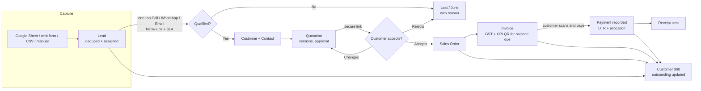

# Business Requirements Document (BRD) — SaleSphere CRM

| Version | Date | Author | Change |
|---|---|---|---|
| 0.1 | 2026-11-13 | Claude (techno-functional consultant) | Initial draft from approved brief v1.0 and source solution design |
| 0.2 | 2026-11-13 | Claude (techno-functional consultant) | QA review fixes (reviews/BRD-review-v0.1.md): F-01–F-05, F-07, F-08, F-10–F-14, F-16 |
| 1.0 | 2026-11-13 | Claude (techno-functional consultant) | G1 approved; Q-016–Q-020 answered; A-006–A-012 accepted |

**Sources:** [`00-project-brief.md`](../00-project-brief.md) (G0 approved 2026-11-13) · [`00-source/SaleSphere-Solution-Design.md`](../00-source/SaleSphere-Solution-Design.md) (cited as *SD §x*).

---

## 1. Executive summary

Indian small businesses and freelancers receive enquiries through Google Sheets fed by ad tools and web forms, through WhatsApp and through phone calls, but they lack a disciplined way to respond, quote, invoice and collect. Leads are missed or duplicated, quotes and invoices are typed by hand, customers pay the wrong amount to a hand-typed UPI ID, and the owner does not know who owes what until month-end.

**SaleSphere** is a configurable lead-to-cash CRM — **Lead → Quotation → Sales Order → Invoice → Payment** — with a **Customer 360** view. It runs as a desktop web app and as an installable mobile app from one codebase. Every invoice carries a UPI QR code for the exact balance due. The product owner installs SaleSphere **separately for each client**, from one shared codebase with no client-specific fork: each client has its own database, website and Google Drive, and its own branding, masters and templates.

**Expected value:**
- **Clients:** no lost leads, first contact within 15 minutes, quotes in under 5 minutes, invoices with a payable QR in under 1 minute, and faster collections.
- **Product owner:** a resellable product that can be installed for a new client in one working day and upgraded for all clients from one release.

## 2. Business context

### 2.1 Background
The product owner is an independent developer building SaleSphere to install and support for paying SMB and freelancer clients in India. The full intended product is described in the product owner's solution design (SD), which includes a four-phase roadmap (SD §9.3). This BRD covers the business requirements for the **MVP** (release 1), as agreed at Gate G0, and lists later phases for context.

### 2.2 Problem statement
For SMBs and freelancers in India:
1. **Lost and slow leads.** Enquiries pile up in Google Sheets and WhatsApp. No one is assigned, first contact is late, follow-ups are forgotten and duplicates go unnoticed.
2. **Manual quote-to-invoice.** Quotes and invoices are built in Word, Excel or Tally. Converting a quote to an order and then to an invoice means re-typing, and GST is error-prone.
3. **Hard-to-collect payments.** Customers receive an invoice PDF and a UPI ID typed by hand. They pay late or the wrong amount, and matching payments to invoices is manual.
4. **No single customer view.** Orders, outstanding amounts, payments, conversations and documents are spread across tools.
5. **Generic CRMs don't fit.** Generic CRMs are expensive per seat, too complex for a 1–25-person business, and weak on Indian GST, UPI and WhatsApp-first working.

### 2.3 Opportunity / business case
- India's SMB and freelancer segment widely uses UPI and WhatsApp, and Google Sheets is the default lead inbox for Meta and Google ad forms.
- A product that captures the Sheet automatically, adds one-tap WhatsApp and Call, and puts a correct UPI QR on every invoice addresses the problems above with low adoption effort.
- Installing each client separately keeps per-client infrastructure cost close to free tiers (Cloudflare free plan, Firebase pay-as-you-go, the client's own Google Drive). It also isolates data per client, which simplifies trust and DPDP compliance.

## 3. Business objectives & success metrics

Baselines for client KPIs are not yet known. They will be measured during onboarding of the first pilot client (Q-016, Q-018). The time limits ("within 3 / 6 months") and the DSO target are **proposed by the consultant** (A-011) and must be confirmed at Gate G1. The brief only fixes "5 installs within 6 months of MVP".
Security, audit and data-protection BRs link to OBJ-006 as a proxy: a client will only go live on a product it trusts with its data.

| ID | Objective (SMART) | KPI | Baseline | Target | Measured by |
|---|---|---|---|---|---|
| OBJ-001 | Within 3 months of go-live per client, no lead from a connected Google Sheet is lost | % of Sheet rows imported as leads (or merged as duplicates) within 5 min | Unknown — measure at pilot | 100 % within 5 min | Sheet sync run log (rows read vs created/merged/failed) |
| OBJ-002 | Within 3 months of go-live, sales executives contact new leads quickly | % of new leads with a first logged contact within SLA (default 15 min) | Unknown — measure at pilot | ≥ 80 % | Lead activity timestamps vs enquiry timestamp |
| OBJ-003 | From go-live, quotations are produced fast from the catalogue | Median time from "New quotation" to "Sent" | Unknown — measure at pilot | < 5 min | Quotation audit timestamps |
| OBJ-004 | From go-live, invoices with a payable UPI QR are issued straight from orders | Median time from "Create invoice" to invoice issued with QR | Unknown — measure at pilot | < 1 min | Invoice audit timestamps |
| OBJ-005 | Within 6 months of go-live per client, collections speed up | Days sales outstanding (DSO) | Unknown — measure at pilot | −20 % vs baseline (proposed, A-011) | Invoices and payments data (average days to pay) |
| OBJ-006 | Within 6 months of MVP release, the product owner runs SaleSphere as a resellable product | Number of client installs live | 0 | 5 | Release/deploy records |
| OBJ-007 | From MVP release, new clients are installed quickly with no code fork | Effort to provision and configure a new install | Not applicable (new product) | ≤ 1 working day; 0 client-specific code branches | Install checklist timing; Git branches |

## 4. Stakeholders

### 4.1 Stakeholder register

| Name / Role | Interest | Influence | Needs |
|---|---|---|---|
| Product owner (developer / reseller) | Builds, sells, installs, upgrades and supports SaleSphere | High | One codebase, fast installs, safe upgrades, low infra cost, low support load |
| Client owner / Admin | Runs the business; pays for SaleSphere | High | Visibility of pipeline and money; easy configuration; data ownership |
| Sales Manager (client) | Team performance | Medium | Assignment, oversight, discount approvals, pipeline reports |
| Sales Executive (client, mobile-first) | Daily lead handling | Medium | Fast mobile app, one-tap contact actions, quick quotes, reminders |
| Accounts / Finance (client) | Billing and collections | Medium | Correct GST invoices, payment allocation, outstanding and ageing, statements |
| Project Manager (client) | Order delivery | Low–Medium | Order status, what has been invoiced and what remains |
| Freelancer (client, Solo mode) | Does every role alone | High (as buyer) | Simplicity; no team overhead |
| End customer (client's customer) | Receives quotes and invoices | Low | Clear documents, easy online accept, easy UPI payment |
| Google (Sheets, Drive, Gmail, Firebase) | Platform provider | Medium (terms, quotas) | Compliance with API terms and OAuth policies |
| NPCI / banks (UPI) | Payment rails | Low | Correct use of the UPI deep-link format |
| Regulators (GST, DPDP Act 2023) | Compliance | High | Correct tax documents; lawful processing of personal data |

### 4.2 RACI

PO = Product owner · TFC = Techno-functional consultant · UX = UX designer · SA = Solution architect · TL = Tech lead · QA = QA lead · CA = Client admin

| Activity / Deliverable | Responsible | Accountable | Consulted | Informed |
|---|---|---|---|---|
| Brief, BRD, FRD, process flows | TFC | PO | UX, SA | QA |
| UX spec, design system, prototype | UX | PO | TFC, TL | QA |
| Solution design, HLD, ADRs | SA | PO | TL, TFC | QA |
| LLD, code, CI/CD | TL | PO | SA, UX | QA |
| Test strategy, gate reviews | QA | PO | TFC, TL | All |
| Release and deployment to client installs | TL | PO | SA, QA | CA |
| Client install and provisioning | PO | PO | SA | CA |
| Client configuration (masters, branding, integrations) | CA | Client owner | PO | Client users |
| Data protection requests (export / erase) | CA | Client owner | PO | — |

## 5. Scope

### 5.1 In scope (MVP)
1. Per-client install: client config folder, provisioning script, branding, terminology, number series, tax mode, Solo/Team mode, upgrades from tagged releases.
2. Built-in user login and management, default roles, audit log.
3. Master data with Excel import.
4. Leads from Google Sheet sync, manual entry, CSV import and a website form/webhook, with dedupe, assignment, stages, timeline and follow-ups.
5. One-tap Call, WhatsApp (pre-filled chat link), Email (client's Gmail) and Directions.
6. Quotations with versions, discount approval, PDF, secure online accept/reject and view tracking.
7. Sales orders converted from quotations.
8. Invoices: Tax Invoice, Bill of Supply, Proforma, Credit Note; GST by place of supply; UPI QR for the exact balance due.
9. Payments with UTR, TDS, allocation, advances and receipts.
10. Customer 360 and statement of account.
11. Private document storage in the client's Google Drive.
12. Installable mobile app with offline capture, push notifications, global search, dashboard and basic reports.

### 5.2 Out of scope
- Multi-tenant SaaS (many clients in one shared database).
- General-ledger accounting / books of accounts (export only, in a later phase).
- Inventory, purchasing, payroll.
- Holding, routing or settling customer money. Payments go directly to the client's own UPI or bank account.

### 5.3 Future phases
- **Phase 2:**
  - Sales and pipelines: project orders with milestones and billing schedules, multiple pipelines, custom fields, multi-currency.
  - Documents: recurring invoices, debit notes, delivery challans, cheque lifecycle, quote e-signature.
  - Integrations: WhatsApp Business API adapter (client-configured and client-paid), payment-gateway adapters, bank-statement auto-match.
  - Follow-up: email open/click tracking, automated payment reminders.
  - Reporting and access: report builder, customer portal.
  - More lead sources: Meta Lead Ads, IndiaMART, JustDial, TradeIndia, missed-call.
  - Hindi UI.
- **Phase 3:**
  - Intelligent features (SD §5).
  - Compliance: e-invoice (IRN) / e-way bill, VAT/TCS.
  - Accounting export: Tally / Zoho Books.
- **Phase 4:**
  - Installs and releases: one-command install, release dashboard, industry template library.
  - Play Store / App Store apps.

## 6. Current state (AS-IS) overview
- Ad tools and web forms write enquiries into a Google Sheet. Other enquiries arrive on WhatsApp and phone calls.
- The owner or executives scan the sheet manually and call or WhatsApp from their personal phones. Status, if tracked at all, lives in a sheet column.
- Quotations are made in Word or Excel. Invoices are made in Word, Excel or Tally and sent as PDFs on WhatsApp, with a UPI ID or bank details typed in.
- Payments are checked against the bank or UPI app manually. Outstanding amounts are worked out in a spreadsheet or not at all.
- **Pain points:**
  - late first response
  - duplicate and lost leads
  - no follow-up reminders
  - re-typing at every step
  - GST errors
  - wrong-amount payments
  - manual payment matching
  - no single customer view

Details are in `03-process/PROCESS-FLOWS.md` (Phase 3).

## 7. Future state (TO-BE) overview

- New Sheet rows appear as assigned leads within minutes, and the owner gets a push notification.
- Executives work from the mobile app, using one-tap actions that log outcomes and set the next follow-up.
- Quotes are built from the catalogue and shared as a link. The customer accepts online, and the quote converts to an order and then an invoice without re-typing.
- Every invoice carries a QR for the exact balance due. Payments are recorded with the UTR and allocated, and Customer 360 updates immediately.

## 8. Business requirements

Priority uses MoSCoW for the **MVP release**. Several BRs group closely related business needs; the FRD (Phase 2) splits each into atomic, testable `FR-xxx` requirements. "Pre-filled by a template" (BR-007) means seed master data for a business type, loaded at install. App-level details (quick-add, swipe actions, dark mode) are refined in the FRD and UX spec under BR-026.

| ID | Requirement | Rationale / business value | Priority (MoSCoW) | Source | Linked objective |
|---|---|---|---|---|---|
| BR-001 | The business shall be able to run a separate, isolated SaleSphere install for each client from a single shared codebase, with no client-specific code fork. | Resellable product at low cost; one client's data, outage or customisation never affects another | Must | SD §2, Brief §1 | OBJ-006, OBJ-007 |
| BR-002 | The business shall be able to configure each install without code changes: branding, terminology, number series, tax mode, modules on/off, locale, and Solo or Team mode. | Same product fits any SMB or freelancer; avoids forks | Must | SD §2.5, Brief §3 | OBJ-007 |
| BR-003 | The business shall be able to upgrade all installs, or chosen installs, from a versioned release, including any data changes. | Every client stays on a supported version; low support effort | Must | SD §2.2 | OBJ-006 |
| BR-004 | The business shall control access through individual user accounts managed by the client admin, with protection against password guessing. | Data security; accountability per user | Must | SD §2.3 | OBJ-006 |
| BR-005 | The business shall restrict what each user can see and do by role (Admin, Sales Manager, Sales Executive, Accounts, Project Manager, Viewer), including own-records-only access for executives. | Least privilege; protects commercial data | Must | SD §9.2 | OBJ-006 |
| BR-006 | The business shall keep an audit trail of every login and every create, update and delete, with before and after values. | Accountability, dispute resolution, DPDP | Must | SD §2.3, §9.1 | OBJ-006 |
| BR-007 | The business shall maintain its master data: company, GST registrations, banks, UPI IDs, catalogue, taxes, terms, templates, sources, stages, reasons, territories, customer groups and states. Master data shall be importable from Excel and pre-filled by a template. | Correct documents; fast onboarding | Must | SD §6 | OBJ-003, OBJ-007 |
| BR-008 | The business shall capture every new row of a connected Google Sheet as a lead within 5 minutes, exactly once; shall optionally write the lead ID, status and owner back to the sheet; and shall see a sync log and failed rows with the reason. | Leads arrive in Sheets today; losing them loses revenue | Must | SD §3.2 | OBJ-001 |
| BR-009 | The business shall capture leads by manual entry, CSV import and a website form or webhook. | Not all leads arrive via Sheets | Must | SD §3.1 | OBJ-001 |
| BR-010 | The business shall detect duplicate leads by phone and email and merge them, keeping a "re-enquired" record. | Clean data; no double-chasing | Must | SD §3.1 | OBJ-001 |
| BR-011 | The business shall assign new leads automatically by configurable rules (round-robin, territory, load) in Team mode. | Instant ownership drives fast first contact | Must | SD §3.1 | OBJ-002 |
| BR-012 | The business shall track each lead through configurable stages to Won, Lost or Junk, with a lost reason, in list and pipeline (Kanban) views. | Pipeline visibility; learn from losses | Must | SD §3.1 | OBJ-002 |
| BR-013 | The business shall be able to call, WhatsApp, email or get directions to a lead, contact or customer in one tap, and shall record the outcome and next follow-up. | Mobile-first selling; every contact is logged | Must | SD §3.3 | OBJ-002 |
| BR-014 | The business shall schedule follow-ups, remind the owner when they are due, and show overdue follow-ups and SLA breaches for first contact. | Follow-up discipline | Must | SD §3.1, §8 (MVP: reminders and SLA flag only; automatic escalation is Phase 3) | OBJ-002 |
| BR-015 | The business shall convert a qualified lead into a customer and contact without re-typing. | No re-entry; lead history is kept | Must | SD §1 | OBJ-003 |
| BR-016 | The business shall create GST-correct quotations from the catalogue, with discounts, versions, terms and approval above a discount threshold. | Fast, consistent, margin-safe quotes | Must | SD §3.4 | OBJ-003 |
| BR-017 | The business shall share a quotation as a PDF and as a secure, expiring web link on which the customer can accept, request changes or reject, and shall see when it was viewed. | Faster decisions; signal for follow-up | Must | SD §3.4 | OBJ-003 |
| BR-018 | The business shall convert an accepted quotation into a sales order and track the order's status to closure. | Quote-to-cash without re-typing | Must | SD §3.5 | OBJ-004 |
| BR-019 | The business shall raise invoices from an order, in full or for selected items, as Tax Invoice, Bill of Supply or Proforma, and shall issue credit notes, so that invoiced and pending amounts always reconcile to the order. | Accurate billing; GST and non-GST clients | Must | SD §3.6, Brief §7 | OBJ-004 |
| BR-020 | Every invoice shall show a UPI QR code and payment link for the exact current balance due, and a PAID stamp when the balance is zero. | Customers pay the correct amount instantly | Must | SD §7 | OBJ-004, OBJ-005 |
| BR-021 | The business shall record payments (mode, amount, UTR or reference, TDS deducted), allocate them to one or many invoices or hold them as an advance, attach optional proof such as a payment screenshot, and issue a receipt. | Accurate outstanding; faster reconciliation | Must | SD §3.7 | OBJ-005 |
| BR-022 | The business shall see a Customer 360 view of each customer: money position (invoiced, received, outstanding, overdue with ageing), orders, quotations, payments, activities, contacts and documents. | One answer to "where do we stand with this customer?" | Must | SD §4 | OBJ-005 |
| BR-023 | The business shall produce and share a customer statement of account for any date range. | Collections conversations; customer trust | Must | SD §4, Brief §4 item 11 | OBJ-005 |
| BR-024 | The business shall store documents and generated PDFs privately in the client's own Google Drive, and shall share them with customers only through expiring links. | Client owns its data; privacy | Must | SD §2.4 | OBJ-006 |
| BR-025 | The business shall send emails, with templates and attachments, from the client's own Gmail account. | Familiar sender; no extra email service cost | Must | Brief §6 | OBJ-003 |
| BR-026 | Users shall work from a mobile phone through an installable app that feels native and keeps working for viewing recent records and logging notes and call outcomes while offline. | Sales executives are mostly in the field | Must | SD §8 | OBJ-002 |
| BR-027 | Users shall receive push notifications for new lead assigned, follow-up due and quote viewed. | Speed to lead; timely follow-up | Must | SD §8, Brief §4 item 13 | OBJ-002 |
| BR-028 | Users shall find any lead, customer or document by name, phone, GSTIN or number from one search. | Speed | Must | SD §8, Brief §4 item 13 | OBJ-003 |
| BR-029 | The business shall see a role-based home dashboard and basic reports (pipeline by stage, sales, collections and ageing, lead-source performance) with Excel export. | Management visibility | Must | SD §8, Brief §4 items 13–14 | OBJ-005 |
| BR-030 | The business shall process personal data in line with India's DPDP Act 2023: lead source and consent recorded, a person's data exportable and erasable on request, and the product owner's support access only with the client's consent. As a product decision (not a DPDP requirement), all data is stored in India (Mumbai region). | Legal compliance; client trust | Must | Brief §7 | OBJ-006 |
| BR-031 | The MVP shall be designed so that optional integrations (WhatsApp Business API, payment gateway, additional lead sources) can be added in Phase 2 as client-configured, client-paid add-ons without a code fork. The adapters themselves are Phase 2 (§5.3). | Clients pay only for what they use; future revenue | Could | Brief §6, product owner decision 2026-11-13 | OBJ-006 |

## 9. User groups & high-level needs

| User group | Description | Key needs | Volume (per install) |
|---|---|---|---|
| Owner / Admin | Business owner or delegate who configures SaleSphere | Setup, users, masters, dashboards, money position | 1–2 |
| Sales Manager | Leads a sales team (Team mode only) | Assignment, approvals, team pipeline | 0–3 |
| Sales Executive | Field or desk sales, mostly on mobile | One-tap actions, reminders, quick quotes, record payments if permitted | 1–15 |
| Accounts | Billing and collections | Invoices, payments, ledgers, GST summary | 0–3 |
| Project Manager | Delivery of orders | Order status, invoiced vs pending | 0–3 |
| Viewer / Auditor | Read-only oversight | Read access, audit log | 0–2 |
| Freelancer (Solo mode) | One person in every role | Simplicity, mobile, quick invoicing | 1 |
| End customer | External; no login | Quote link, invoice with QR, statement | Many |

Install scale: 1–25 users, ≤ 2,000 leads/month, ≤ 500 invoices/month (A-002).

## 10. Business rules & policies (high level)

These are refined into `BRL-xxx` rules in the FRD.
1. A Google Sheet row is imported at most once. A lead whose phone or email matches an existing lead is merged as a "re-enquiry", not created again.
2. Document numbers are unique and sequential per series and financial year, for example `QT/25-26/0001` and `INV/25-26/0001`. Numbers are never reused.
3. A quotation discount above the user's discount threshold (set per role) needs approval before sending (Team mode).
4. Once sent, a quotation is changed only by creating a new revision (R1, R2, …).
5. Invoices are created from an order. The total invoiced cannot exceed the order value.
6. Tax: if the supplier's state equals the place of supply, CGST + SGST applies; otherwise IGST. A client without GST registration issues a Bill of Supply with no tax.
7. Balance due = grand total − allocated payments − credit notes. The UPI QR always carries the current balance due and is hidden when it is zero.
8. A payment is allocated oldest invoice first unless the user allocates manually. Any unallocated amount is kept as an on-account advance.
9. Issued invoices are not deleted. They are corrected with a credit note.
10. A sales executive sees only their own leads and customers unless their role grants more.
11. A user account is locked for 15 minutes after 5 failed login attempts. The first admin must change the one-time password at first login.
12. Customers receive only expiring links to documents, never public Drive links.

## 11. Data & reporting needs (high level)
- **Core entities:**
  - lead, activity, customer, contact, address
  - quotation, sales order, invoice, credit note, payment and allocation
  - file, user, role, team, settings, master data
  - audit log, sync run, import error
- **Each install's data belongs to that client** and is stored in its own database and Google Drive.
- **Reports in the MVP:**
  - pipeline by stage (count and value)
  - sales by period, executive and source
  - collections and ageing (0–30, 31–60, 61–90, 90+ days)
  - lead-source performance (leads, won, value)
  - outstanding by customer
  - all exportable to Excel
- **Dashboard tiles:**
  - today's follow-ups
  - new and unassigned leads
  - overdue invoices
  - collections this month
  - pipeline by stage
- **Data migration:** optional Excel import of customers, products and open leads at install.
- **Retention:** to be confirmed (Q-019). Working assumption A-010: keep invoices, payments and the audit log for at least 8 years, which covers the GST record-keeping period (about 72 months) and the Companies Act (8 years).

## 12. Compliance, legal & regulatory

| Area | Requirement |
|---|---|
| GST (India) | GST-compliant tax invoice fields (GSTIN, HSN/SAC, place of supply, tax breakup, amount in words); Bill of Supply for unregistered suppliers; credit notes; sequential numbering per financial year. E-invoice (IRN) is out of MVP scope (Phase 3). |
| Income tax (TDS) | Record TDS deducted by the customer against a payment. |
| DPDP Act 2023 | Lead source and consent basis captured. Data principal requests (access, correction, erasure) supported by admin export and erase. Breach response documented in the runbook. The product owner's support access only with the client's consent. |
| UPI / NPCI | QR and links follow the NPCI UPI deep-link format. SaleSphere never handles funds. |
| Google API terms | OAuth with minimal scopes; client data used only for that client's install. |
| Accessibility | WCAG 2.2 AA for the app (product standard). |

## 13. Constraints

| ID | Constraint |
|---|---|
| CON-001 | Technology is fixed by the product owner's design (brief §7): React + TypeScript + Vite PWA with Tailwind + shadcn/ui on Cloudflare Pages; Cloud Functions for Firebase (2nd gen, Node.js) API; Firestore in `asia-south1`; built-in authentication (no Firebase Auth); Google Drive for files; Secret Manager; Cloud Scheduler; GitHub Actions; one Git repo with `clients/<id>/` config. This overrides the default stack in CLAUDE.md §3; ADRs follow in Phase 6. |
| CON-002 | Clients use a **free Gmail** Google account, not Google Workspace, for Drive, Gmail sending and Sheets access. |
| CON-003 | Each client install is fully isolated: own Firebase project, Cloudflare site and Drive. No shared database. |
| CON-004 | The MVP is built by the product owner with Claude Code in about 10 weeks. |
| CON-005 | Per-client running cost should stay within free tiers plus Firebase pay-as-you-go usage, with a budget alert. |
| CON-006 | The MVP UI is in English. The locale is India (INR, Lakh/Crore formatting, April–March financial year). |
| CON-007 | WhatsApp in the MVP is click-to-chat only (`wa.me`). No paid WhatsApp API is required. |

## 14. Dependencies

| ID | Dependency | Needed for |
|---|---|---|
| DEP-001 | Client's Google account (free Gmail) with OAuth consent completed and set to "In production" | Drive, Gmail, Sheets (BR-008, BR-024, BR-025) |
| DEP-002 | Client's Firebase project on the Blaze plan, and a Cloudflare account and domain | Install (BR-001) |
| DEP-003 | Client's UPI ID (VPA) and bank details | UPI QR (BR-020) |
| DEP-004 | Client's GST registration details (or confirmation of non-GST status) | Invoices (BR-019) |
| DEP-005 | Client's lead Google Sheet and its column layout | Lead sync (BR-008) |
| DEP-006 | Web push support on users' devices (iOS needs the app installed to the home screen, iOS 16.4+) | Notifications (BR-027) |
| DEP-007 | A pilot client willing to provide baseline data and feedback | KPI baselines (§3), validation |

## 15. Assumptions

| ID | Assumption | Impact if wrong |
|---|---|---|
| A-001 | The product name is SaleSphere (the working name "S2P" is retired). | Branding text changes only |
| A-002 | A typical install has 1–25 users, ≤ 2,000 leads/month and ≤ 500 invoices/month. | Higher volumes may need indexing, cost and Gmail-limit redesign |
| A-003 | A config switch for Solo or Team mode is enough for freelancers. | A separate freelancer edition may be needed |
| A-004 | English UI is acceptable for MVP users. | Hindi UI brought forward from Phase 2 |
| A-005 | The product owner builds the MVP with Claude Code in about 10 weeks. | Timeline and scope trade-offs |
| A-006 | Clients' leads mostly arrive via Google Sheets (fed by ad tools and forms). | Direct source adapters (Meta, IndiaMART) needed earlier |
| A-007 | Clients accept recording UPI payments manually (UTR entry) in the MVP. | Bank-statement import or a gateway needed earlier |
| A-008 | Click-to-chat WhatsApp is enough for the MVP; executives send from their own WhatsApp. | Business API adapter needed earlier |
| A-009 | Free Gmail limits (15 GB storage, about 500 emails/day) are enough for target clients. | Clients need Google One or Workspace |
| A-010 | Financial documents and the audit log are kept for at least 8 years (pending Q-019). | Retention design and storage cost change |
| A-011 | KPI time limits (3 / 6 months after go-live) and the DSO target (−20 %) are consultant proposals, to be confirmed at G1. | Objectives re-baselined |
| A-012 | Each client pays for its own domain; the indicative timeline in §18 assumes approvals within the stated weeks. | Cost outline and milestones change |
| A-013 | "₹20,000 per client" is a one-time install fee; any recurring support fee is outside product scope. | Licence/feature-flag design may change |

## 16. Risks

| ID | Risk | Likelihood | Impact | Mitigation | Owner |
|---|---|---|---|---|---|
| R-001 | Free-Gmail OAuth left in "Testing" mode means refresh tokens expire after 7 days, which breaks Drive, Gmail and Sheet sync. | High | High | Set the consent screen to "In production"; use minimal scopes; include a runbook step; show a connection-health alert in Settings | PO |
| R-002 | 15 GB free Google storage is shared with Gmail and Photos and could fill up. | Medium | Medium | Show storage usage in Settings; compress images; advise Google One | PO |
| R-003 | Gmail limit of about 500 sends per day. | Low | Medium | No bulk email in MVP; show a clear error on quota | TL |
| R-004 | Building our own authentication (passwords, sessions, lockout) carries security risk. | Medium | High | Proven libraries (Argon2id, JWT); security review and penetration checklist before go-live; audit log | SA |
| R-005 | Freelancers using personal UPI IDs may hit bank or NPCI limits or rules on business collections. | Medium | Medium | Recommend a business or merchant VPA in the onboarding guide | PO |
| R-006 | Scope creep from the full SD vision into the 10-week MVP. | High | High | Strict MoSCoW; change-request process; phase roadmap | PO |
| R-007 | Push notifications on iPhone only work once the app is installed to the home screen. | High | Low | Onboarding prompt to install; in-app reminders as fallback | UX |
| R-008 | Per-client install and upgrade effort grows linearly with the number of clients. | Medium | Medium | Provisioning script, CI fan-out deploy, versioned data migrations | SA |
| R-009 | Incorrect GST computation causes compliance issues for clients. | Low | High | Rule-based tax engine with unit tests; CA review of invoice formats | TL/QA |
| R-010 | Firebase pay-as-you-go cost spikes (for example, a runaway sync loop). | Low | Medium | Budget alerts at install; rate limits; idempotent sync | SA |

## 17. Cost / benefit outline

**Costs (product owner):**
- Build effort: about 10 weeks for the MVP (A-005), plus later phases.
- Per install: Cloudflare Pages (free plan), Firebase pay-as-you-go (usually within free quotas at the scale in A-002, with a budget alert), the client's free Google account, and the domain (paid by the client).
- Ongoing: support, upgrades, security patching.
- Optional, paid by the client: WhatsApp Business API, payment gateway, Google One storage.

**Benefits:**
- **Clients:** recovered leads (OBJ-001), higher contact rate (OBJ-002), less admin time on quotes and invoices (OBJ-003, OBJ-004), faster cash collection and lower DSO (OBJ-005), and ownership of their data.
- **Product owner:** a recurring revenue product (commercial model is Q-017) with near-zero marginal infrastructure cost per client (OBJ-006, OBJ-007).

Pricing and ROI figures can't be computed until the commercial model (Q-017) and pilot baselines (Q-018) are known.

## 18. Timeline & milestones (indicative)

| Milestone | Indicative timing | Gate |
|---|---|---|
| Brief, BRD, FRD, process flows approved | Week 1 | G0–G3 |
| UX, solution design, HLD, LLD, test strategy approved | Week 2 | G4–G8 |
| Scaffold, CI, auth, install and config, masters | Weeks 3–4 | — |
| Leads, Sheet sync, one-tap actions, follow-ups | Weeks 5–6 | — |
| Quotations, orders, invoices with UPI QR, payments | Weeks 7–8 | — |
| Customer 360, Drive files, PWA/offline, reports | Week 9 | — |
| Hardening, security review, pilot install | Week 10 | G9 go-live |

## 19. Open questions

| ID | Question | Owner | Due | Answer |
|---|---|---|---|---|
| Q-016 | Is there a first pilot client, and in which industry? This drives the seed master template and baselines. | Product owner | Before Phase 9 | Pilot client is a freelance web developer (Solo mode; services, SAC codes) |
| Q-017 | Commercial model to clients: setup fee + annual maintenance, or subscription? This affects licensing and feature flags only. | Product owner | Before Phase 6 | ₹20,000 per client install (A-013: one-time fee) |
| Q-018 | Can the pilot client share 1–3 months of historic lead, quote and invoice data to set KPI baselines? | Product owner | Before go-live | No history available — baselines measured in the first month after go-live |
| Q-019 | Document retention: confirm keeping invoices, payments and audit logs for 8 years (GST record-keeping), and how long to keep lost/junk leads before deletion under DPDP. | Product owner | Before FRD sign-off | Junk leads kept 3 months, then deleted; financial records per A-010 (8 years) |
| Q-020 | Should sales executives be allowed to record payments by default, or only Accounts/Admin (SD §9.2 says "if allowed")? | Product owner | FRD | Yes — sales executives may record payments by default |

## 20. Glossary

| Term | Meaning |
|---|---|
| Install | One client's isolated deployment of SaleSphere (own Firebase, Cloudflare, Drive) |
| PWA | Progressive Web App: a website installable to the home screen that behaves like an app |
| Customer 360 | Single screen showing everything about one customer |
| UPI / VPA | Unified Payments Interface / Virtual Payment Address (UPI ID, e.g. `acme@okhdfcbank`) |
| UTR | Unique Transaction Reference of a bank or UPI payment |
| GSTIN | GST Identification Number |
| HSN / SAC | Harmonised System of Nomenclature (goods) / Services Accounting Code |
| CGST / SGST / IGST | Central / State / Integrated GST |
| Bill of Supply | Invoice issued by a supplier who does not charge GST |
| Place of supply | State that determines whether intra-state (CGST + SGST) or inter-state (IGST) tax applies |
| TDS | Tax Deducted at Source by the customer when paying |
| DSO | Days Sales Outstanding: average time to collect payment |
| DPDP Act | India's Digital Personal Data Protection Act, 2023 |
| Solo / Team mode | Config switch: Solo hides teams, assignment and approvals for freelancers |
| SLA | Target time for first contact with a new lead (default 15 min) |

## 21. Sign-off

| Name | Role | Decision | Date |
|---|---|---|---|
| Product owner | Accountable for SaleSphere | Approved | 2026-11-13 |
