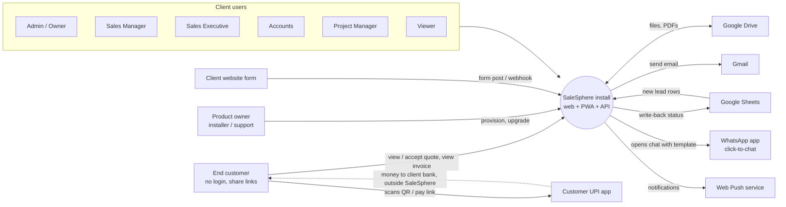
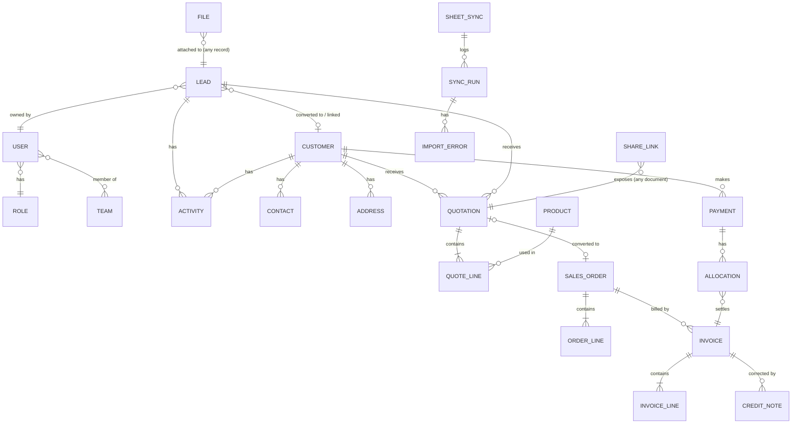

# Functional Requirements Document (FRD) — SaleSphere CRM

| Version | Date | Author | Change |
|---|---|---|---|
| 0.1 | 2026-11-13 | Claude (techno-functional consultant; NFRs from solution-architect view) | Initial draft from BRD v1.0 |
| 0.2 | 2026-11-13 | Claude (techno-functional consultant) | Q-021–Q-023 defaults; QA review fixes (reviews/FRD-review-v0.1.md): F-01–F-07, F-09, F-10, F-12–F-14, F-16–F-21, F-23–F-25, F-29, F-33 |
| 0.3 | 2026-11-13 | Claude (techno-functional consultant) | CR-001 – CR-004 approved by product owner: backup retention ≈ 35 d (RULE-054, NFR-006, §7.3), PDF cold-start target (NFR-003), forced logout ≤ 60 s (FR-010 AC3), sub-processors (NFR-010) |

## 1. Introduction

### 1.1 Purpose
This document turns the approved business requirements (BRD v1.0) into atomic, testable functional requirements (`FR-xxx`), use cases (`UC-xxx`), business rules (`RULE-xxx`), data definitions and non-functional requirements (`NFR-xxx`) for the **SaleSphere MVP**. It is the input for process flows (Phase 3), UX (Phase 4), design (Phases 5–7) and testing (Phase 8).

### 1.2 Scope
MVP scope as approved in BRD §5.1: per-client install and configuration; built-in authentication and RBAC; masters; leads (Google Sheet sync, manual, CSV, web form/webhook); one-tap Call / WhatsApp click-to-chat / Gmail email; follow-ups; quotations with online acceptance; sales orders; invoices (Tax Invoice, Bill of Supply, Proforma, Credit Note) with UPI QR; payments; Customer 360 and statement; Google Drive documents; installable PWA with offline capture and push; search, dashboard and basic reports; DPDP support; and extension points for later integrations.
Phase 2+ items (BRD §5.3) are out of scope and are not specified here, except as extension points (FR-091).

### 1.3 References
| Ref | Document | Version |
|---|---|---|
| BRD | `docs/01-brd/BRD.md` | 1.0 (G1 approved 2026-11-13) |
| Brief | `docs/00-project-brief.md` | 1.0 (G0 approved) |
| SD | `docs/00-source/SaleSphere-Solution-Design.md` | 1.0 (product owner source) |

### 1.4 Definitions
See the BRD §20 glossary. Additional terms:

| Term | Meaning |
|---|---|
| Install | One client's isolated SaleSphere deployment |
| Solo mode | Install configured for one person (freelancer): no teams, assignment rules or approvals; the single user is Admin |
| Team mode | Install with multiple users, roles, assignment and approvals |
| Record scope | Which records a role can see: **Own** (owner = me), **Team** (owner in my team), **All** |
| Document | Quotation, sales order, invoice, credit note or receipt |
| Issued | A document that has been given a number from its series and can no longer be edited |
| Balance due | Invoice grand total − allocated payments − credit notes (RULE-040) |
| Share link | Expiring, unguessable URL that lets an external person view one document |

UI references (`SCR-xxx`) are assigned in Phase 4 and API references (`API-xxx`) in Phase 7; both are tracked in the RTM rather than repeated per FR.

## 2. System overview

## 3. Actors, roles & permissions

### 3.1 Actors
| Actor | Description | Type |
|---|---|---|
| Admin | Client owner or delegate; full access, settings, users, masters. In Solo mode the only user. | Human |
| Sales Manager | Oversees a team's leads, approves discounts, sees team reports (Team mode) | Human |
| Sales Executive | Works own leads/customers, mostly on mobile; creates quotes, records payments (Q-020) | Human |
| Accounts | Invoices, payments, credit notes, ledgers, GST summary | Human |
| Project Manager | Manages sales orders and their delivery status | Human |
| Viewer / Auditor | Read-only access to all business records and the audit log | Human |
| End customer | Client's customer; no account; uses share links to view, accept or reject quotes and view/pay invoices | Human (external) |
| Product owner | Provisions and upgrades installs; no app login unless the client creates a support user (FR-089) | Human (external) |
| Google Sheets | Source of lead rows; target of write-back | System |
| Google Drive | Private storage for files and generated PDFs | System |
| Gmail | Sends email on behalf of the client's Google account | System |
| Web form / webhook caller | Client website or tool posting leads | System |
| Scheduler | Runs timed jobs (sync polling, reminders, SLA checks, purge, expiry) | System |
| Push service | Delivers web push notifications | System |

### 3.2 Permissions matrix
C = create, R = read, U = update, D = delete/deactivate, A = approve, X = execute action. Scope in brackets: (O) own, (T) team, (All). "—" = no access. In **Solo mode** the single user is Admin.

| Feature / action | Admin | Sales Manager | Sales Executive | Accounts | Project Manager | Viewer |
|---|---|---|---|---|---|---|
| Settings, branding, integrations | C R U D | — | — | — | — | R |
| Users, roles, sessions | C R U D | R (T) | — | — | — | R |
| Masters — catalogue | C R U D | R U | R | R U | R | R |
| Masters — T&C, message and document templates | C R U D | — | R | — | R | R |
| Masters — sales (sources, stages, reasons, outcomes, territories, tags, customer groups/types) | C R U D | R U | R | R | R | R |
| Masters — company, banks, UPI, tax, number series | C R U D | R | R | R U | R | R |
| Leads | C R U D (All) | C R U D (T) | C R U (O) | R (All) | R (All) | R (All) |
| Lead assign / bulk actions | X (All) | X (T) | — | — | — | — |
| Lead import (CSV) / Sheet sync config | C R U D | C (CSV) | — | — | — | R |
| Activities, notes, follow-ups | C R U D (All) | C R U (T) | C R U (O) | C R (All) | C R (All) | R |
| Customers & contacts | C R U D (All) | C R U (T) | C R U (O) | C R U (All) | R (All) | R |
| Quotations | C R U D (All) | C R U (T) | C R U (O) | R (All) | R (All) | R |
| Quotation discount approval | A | A (T) | — | — | — | — |
| Sales orders | C R U D (All) | C R U (T) | C R U (O) | R (All) | R U (All) | R |
| Invoices / credit notes (issue; drafts only editable) | C R U | R (T) | R (O) | C R U | R (All) | R |
| Payments — record | C R | C R (T) | C R (O)¹ | C R | — | R |
| Payments — reverse | X | — | — | X | — | — |
| Files (upload / view) | C R D (All) | C R (T) | C R (O) | C R (All) | C R (All) | R |
| Customer 360 — profile, orders, quotations, activities, documents | R (All) | R (T) | R (O) | R (All) | R (All) | R |
| Customer 360 — financial tiles, Invoices, Payments, Ledger tabs; statement | R (All) | R (T) | R (O) | R (All) | — | R |
| Reports & dashboard | R (All) | R (T) | R (O) | R (All, finance) | R (orders) | R |
| Audit log | R | — | — | — | — | R |
| Data principal export / erase | X | — | — | — | — | — |

¹ Default on per Q-020; Admin can switch it off per role (RULE-048).
Draft documents may be deleted by their creator; issued documents are never deleted (RULE-036).

## 4. Functional requirements

Each FR uses a compact block: the attribute table carries Module, Source BR, Priority, Actors and Business rules; UI/API references are tracked in the RTM (§1.4). **Defaults where not stated:** pre-condition = the actor is signed in and permitted per §3.2 (or, for system actors, the triggering event has occurred); post-condition = the change is saved and audited (FR-015). FR-specific pre/post-conditions are stated where they differ. `RULE-xxx` in §6 refine the high-level business rules of BRD §10. 91 FRs across 16 modules.

| Module | FRs | BRs |
|---|---|---|
| M1 Install & configuration | FR-001 – FR-006 | BR-001, BR-002, BR-003 |
| M2 Authentication, users & audit | FR-007 – FR-016 | BR-004, BR-005, BR-006 |
| M3 Master data | FR-017 – FR-024 | BR-007 |
| M4 Leads | FR-025 – FR-036 | BR-009 – BR-012, BR-015 |
| M5 Google connection & Sheet sync | FR-037 – FR-043 | BR-008, BR-024, BR-025 |
| M6 One-tap actions & follow-ups | FR-044 – FR-050 | BR-013, BR-014, BR-025 |
| M7 Quotations | FR-051 – FR-058 | BR-016, BR-017 |
| M8 Sales orders | FR-059 – FR-061 | BR-018 |
| M9 Invoices & UPI QR | FR-062 – FR-069 | BR-019, BR-020 |
| M10 Payments | FR-070 – FR-073 | BR-021 |
| M11 Customers & Customer 360 | FR-074 – FR-076 | BR-022, BR-023 |
| M12 Documents (Drive) | FR-077 – FR-079 | BR-024 |
| M13 App experience | FR-080 – FR-083 | BR-026, BR-027, BR-028 |
| M14 Dashboard & reports | FR-084 – FR-085 | BR-029 |
| M15 Privacy & retention | FR-086 – FR-090 | BR-030 |
| M16 Extensibility | FR-091 | BR-031 |

---

### M1 — Install & configuration

### FR-001 — Client configuration defines an install
| Module | Source BR | Priority | Actors | Business rules |
|---|---|---|---|---|
| M1 | BR-001, BR-002 | Must | Product owner | RULE-001 |

- **Description:** The system shall build and configure an install from a client configuration file (`clients/<client-id>/config.json` + assets) holding company name, domain, colours, logo, terminology, enabled modules, tax mode (GST / non-GST), locale, and Solo/Team mode, with no client-specific code.
- **Pre-conditions:** Client folder committed to the repository. **Post-conditions:** Build artefacts carry the client's branding and settings.
- **AC1** Given a config file that passes schema validation, When the build runs for that client ID, Then the app is produced with the client's name, colours, logo and PWA manifest.
- **AC2** Given a config file with a missing mandatory key or invalid value, When the build or provisioning runs, Then it stops with an error naming the key, and nothing is deployed.
- **AC3** Given two client folders, When both are built, Then no file, setting or secret of one appears in the other's output.

### FR-002 — Provision and seed a new install
| Module | Source BR | Priority | Actors | Business rules |
|---|---|---|---|---|
| M1 | BR-001, BR-007 | Must | Product owner | RULE-001, RULE-010 |

- **Description:** The system shall provide a provisioning command that, for a new client ID, deploys database rules, indexes, API functions, scheduled jobs and secrets into the client's own Firebase project, and seeds default roles, number series, a seed master template (e.g. "Web / IT services" with SAC-coded items: website design, development, hosting, domain, maintenance — Q-023) and the first Admin user with a one-time password.
- **Pre-conditions:** Client Firebase project (Blaze) and Cloudflare account exist; config valid. **Post-conditions:** Install reachable on its domain; first Admin can log in and must change password.
- **AC1** Given a valid client config and empty project, When provisioning runs, Then roles, number series, seed masters and one Admin user exist, and a run report lists every step as succeeded.
- **AC2** Given provisioning is re-run on an already provisioned project, When it runs, Then existing data is not duplicated or overwritten (idempotent) and the report says "already present" per step.
- **AC3** Given a step fails, When provisioning stops, Then the report names the failed step and re-running resumes from it.

### FR-003 — Branding and terminology in Settings
| Module | Source BR | Priority | Actors | Business rules |
|---|---|---|---|---|
| M1 | BR-002 | Must | Admin | — |

- **Description:** The system shall let the Admin change app name, logo (light/dark), colours, email sender name, and rename module labels (e.g. Lead → Enquiry, Customer → Client) in Settings, applied across the UI, documents and messages.
- **Pre-conditions:** Admin logged in. **Post-conditions:** New labels and branding shown to all users at next page load; change audited.
- **AC1** Given the Admin renames "Lead" to "Enquiry", When any user opens the app, Then menus, headings, buttons and empty states show "Enquiry".
- **AC2** Given a new logo is uploaded, When a new document is issued, Then it uses the new logo; documents already issued keep their original branding, even when their payment block is refreshed (FR-068).
- **AC3** Given a colour pair whose text contrast is below 4.5:1, When the Admin saves, Then the system warns and suggests an accessible alternative.

### FR-004 — Solo / Team mode and module switches
| Module | Source BR | Priority | Actors | Business rules |
|---|---|---|---|---|
| M1 | BR-002 | Must | Admin, Product owner | RULE-002 |

- **Description:** The system shall support Solo mode (one user; teams, assignment rules, discount approvals and team reports hidden) and Team mode, and shall let modules (e.g. Sales Orders) be switched on or off by configuration.
- **Pre-conditions:** —. **Post-conditions:** UI and API reflect the mode; data model unchanged.
- **AC1** Given Solo mode, When the user opens Settings or a lead, Then no team, assignment-rule or approval options are shown, and new leads are owned by the user.
- **AC2** Given Solo mode with one active user, When the Admin tries to create a second active user, Then the system explains that Team mode is needed and offers to switch.
- **AC3** Given Team mode with more than one active user, When the Admin tries to switch to Solo, Then it is blocked until only one active user remains.
- **AC4** Given a module is switched off, When a user navigates or calls its API, Then it is hidden and the API returns "module not enabled".

### FR-005 — Configurable document number series
| Module | Source BR | Priority | Actors | Business rules |
|---|---|---|---|---|
| M1 | BR-002 | Must | Admin, System | RULE-003, RULE-015 |

- **Description:** The system shall number quotations, sales orders, tax invoices, bills of supply, proforma invoices, credit notes and receipts from configurable series (prefix, financial-year token, padding, financial-year reset), allocating numbers atomically at issue so that numbers are unique and gap-free.
- **Pre-conditions:** Series defined per document type. **Post-conditions:** Issued document carries the next number.
- **AC1** Given series `INV/{FY}/{0000}` with next number 142 in FY 2025-26, When an invoice is issued, Then it is numbered `INV/25-26/0142` and next becomes 143.
- **AC2** Given two users issue invoices at the same moment, When both complete, Then they receive different consecutive numbers.
- **AC3** Given the date crosses 1 April, When the first invoice of the new FY is issued, Then numbering restarts at 1 with the new FY token.
- **AC4** Given a draft is deleted, When the next document is issued, Then no number is skipped (drafts hold no number).
- **AC5** Given prefix "QUOTATION-WEB" with FY token and 4-digit padding, When the series is saved, Then it is rejected because numbers would exceed 16 characters.
- **AC6** Given an invoice dated 28-03-2026 is issued on 02-04-2026, When numbered, Then it uses the FY 2025-26 series.

### FR-006 — Upgrade installs from a release
| Module | Source BR | Priority | Actors | Business rules |
|---|---|---|---|---|
| M1 | BR-003 | Must | Product owner | RULE-004 |

- **Description:** The system shall deploy a tagged release to all installs or a chosen list, running pending versioned data migrations once per install in order, and shall record the deployed version per install.
- **Pre-conditions:** Release tag exists; migrations tested. **Post-conditions:** Install runs the new version; migration log updated; version shown in Settings → About.
- **AC1** Given release v1.1.0 with two new migrations, When deployed to an install on v1.0.0, Then both migrations run once in order and the install reports v1.1.0.
- **AC2** Given a migration fails on one install, When the deploy continues, Then that install is left on its previous version, other installs proceed, and the failure is reported per install.
- **AC3** Given the same release is deployed again, When it runs, Then no migration runs twice.

---

### M2 — Authentication, users & audit

### FR-007 — Username and password login
| Module | Source BR | Priority | Actors | Business rules |
|---|---|---|---|---|
| M2 | BR-004 | Must | All users | RULE-005, RULE-008 |

- **Description:** The system shall authenticate users with a case-insensitive username and a password verified against a salted Argon2id hash, issuing a short-lived access token and a revocable refresh token in a secure http-only cookie.
- **Pre-conditions:** Active user account. **Post-conditions:** Session recorded; last-login updated; login audited.
- **AC1** Given a valid username in any letter case and correct password, When the user signs in, Then they reach their home dashboard and a session record exists.
- **AC2** Given a wrong password, When the user signs in, Then the message "Username or password is incorrect" is shown without revealing which, and the failed attempt is counted and audited.
- **AC3** Given a deactivated user, When they sign in with correct credentials, Then access is refused with "Your account is inactive — contact your admin".
- **AC4** Given any login request, When it is logged, Then the password never appears in logs, audit or error output.
- **AC5** Given a username that does not exist, When the user signs in, Then the same generic message is shown, the response time is comparable to a wrong-password attempt, and the attempt is audited as "unknown user".

### FR-008 — Lockout and rate limiting
| Module | Source BR | Priority | Actors | Business rules |
|---|---|---|---|---|
| M2 | BR-004 | Must | System | RULE-007 |

- **Description:** The system shall lock an account for 15 minutes after 5 consecutive failed logins and shall rate-limit login attempts per IP address.
- **Pre-conditions:** —. **Post-conditions:** Lock recorded with expiry; Admin can unlock.
- **AC1** Given 4 consecutive failures, When the 5th fails, Then the account is locked for 15 minutes and the user sees when they can retry.
- **AC2** Given a locked account, When the correct password is entered before expiry, Then access is still refused. The lock message is shown only after a correct password, so locking does not reveal whether a username exists.
- **AC5** Given a failed attempt followed by a successful login, When the user later fails again, Then the counter starts from 1.
- **AC3** Given a locked account, When an Admin selects Unlock, Then the user can sign in immediately and the action is audited.
- **AC4** Given more than 20 login attempts from one IP within 1 minute, When further attempts arrive, Then they are rejected with "Too many attempts, try again shortly".

### FR-009 — Password policy and forced change
| Module | Source BR | Priority | Actors | Business rules |
|---|---|---|---|---|
| M2 | BR-004 | Must | All users, Admin | RULE-006, RULE-009 |

- **Description:** The system shall enforce a configurable password policy and shall force a password change at first login and after an Admin reset, before any other function is available.
- **AC1** Given a user flagged must-change-password, When they sign in, Then only the change-password screen is available until they set a compliant password.
- **AC2** Given a new password shorter than the policy minimum or equal to the username, When submitted, Then it is rejected with the specific rule broken.
- **AC3** Given a successful change, When saved, Then all the user's other sessions are revoked.

### FR-010 — Session management
| Module | Source BR | Priority | Actors | Business rules |
|---|---|---|---|---|
| M2 | BR-004 | Must | All users, Admin | RULE-008 |

- **Description:** The system shall renew access silently using the refresh token, let users sign out, and let the Admin view active sessions per user and force sign-out.
- **AC1** Given an access token has expired and a valid refresh token exists, When the user acts, Then the session continues without re-login.
- **AC2** Given the user signs out, When the old refresh token is reused, Then it is rejected.
- **AC4** Given a refresh token that has already been rotated, When it is presented again, Then it is rejected and all sessions descending from it are revoked (token-reuse detection).
- **AC3** Given the Admin forces logout of a user, When that user next acts, Then they are returned to the sign-in screen within 60 seconds (CR-003: token-epoch check, cache ≤ 60 s).

### FR-011 — User administration
| Module | Source BR | Priority | Actors | Business rules |
|---|---|---|---|---|
| M2 | BR-004, BR-005 | Must | Admin | RULE-005, RULE-010 |

- **Description:** The system shall let the Admin create users (username, full name, phone, email, role, team, territory), edit them, reset passwords (one-time password + forced change), and deactivate/reactivate them; users are never hard-deleted.
- **AC1** Given a username already in use (case-insensitive), When the Admin creates a user, Then it is rejected with "Username already taken".
- **AC2** Given the Admin deactivates a user with open leads, When confirming, Then the system asks for a new owner for open leads and follow-ups and reassigns them, and all that user's sessions are revoked.
- **AC3** Given only one active Admin exists, When anyone tries to deactivate or demote them, Then the action is blocked.

### FR-012 — User self-service and optional 2FA
| Module | Source BR | Priority | Actors | Business rules |
|---|---|---|---|---|
| M2 | BR-004 | Should | All users | RULE-006 |

- **Description:** The system shall let users change their password, view their own login history (date, device, IP, result), and optionally enable authenticator-app (TOTP) two-factor authentication.
- **AC1** Given a user enables 2FA and confirms a valid code, When they next sign in, Then a 6-digit code is required after the password.
- **AC2** Given a user loses their authenticator, When the Admin resets 2FA for them, Then 2FA is removed, the user is notified, and the action is audited.
- **AC3** Given a user opens Login history, When it loads, Then the last 50 attempts are listed with result.
- **AC4** Given 5 consecutive wrong 2FA codes, When the 5th is entered, Then it counts as a failed login toward lockout (RULE-007).

### FR-013 — Role and record-scope enforcement
| Module | Source BR | Priority | Actors | Business rules |
|---|---|---|---|---|
| M2 | BR-005 | Must | System | RULE-011 |

- **Description:** The system shall check, on the server for every request, that the user's role permits the action on the module (§3.2) and that the record lies within the role's record scope (Own / Team / All); the browser never accesses the database or Drive directly.
- **AC1** Given a Sales Executive, When they request a lead owned by another executive, Then the API returns 404 (record outside scope is treated as not found) and the attempt is logged.
- **AC2** Given a Sales Manager, When they list leads, Then only leads owned by members of their team(s) are returned.
- **AC3** Given any request without a valid access token, When it reaches the API, Then it is rejected with 401 and no data.
- **AC4** Given a hidden UI button, When the equivalent API is called directly without permission, Then it is rejected with 403.

### FR-014 — Role configuration
| Module | Source BR | Priority | Actors | Business rules |
|---|---|---|---|---|
| M2 | BR-005 | Must | Admin | RULE-010, RULE-027, RULE-048 |

- **Description:** The system shall ship six default roles (Admin, Sales Manager, Sales Executive, Accounts, Project Manager, Viewer) and let the Admin adjust per role: record scope, maximum discount % without approval, and whether the role may record payments.
- **AC1** Given a fresh install, When the Admin opens Roles, Then the six default roles exist with the permissions in §3.2.
- **AC2** Given the Admin sets Sales Executive discount limit to 10 %, When an executive quotes 12 %, Then approval is required (FR-053).
- **AC3** Given the Admin switches off "Record payments" for Sales Executive, When an executive opens a customer, Then "Record payment" is not offered and the API refuses it.

### FR-015 — Audit log capture
| Module | Source BR | Priority | Actors | Business rules |
|---|---|---|---|---|
| M2 | BR-006 | Must | System | RULE-012 |

- **Description:** The system shall write an immutable audit entry for every login attempt, logout, permission denial, and every create, update, delete, issue, cancel, approve, share and export action, recording user, timestamp, record type and ID, action, and before/after values of changed fields.
- **AC1** Given a user changes a lead's phone, When saved, Then an audit entry shows old and new phone, user and time.
- **AC2** Given any user including Admin, When they try to edit or delete an audit entry via UI or API, Then it is refused.
- **AC3** Given a password change, When audited, Then the entry records "password changed" without any password value.

### FR-016 — Audit log viewer
| Module | Source BR | Priority | Actors | Business rules |
|---|---|---|---|---|
| M2 | BR-006 | Must | Admin, Viewer | — |

- **Description:** The system shall let Admin and Viewer search the audit log by date range, user, record type, record ID and action, and export results to Excel.
- **AC1** Given filters user = "ravi" and last 7 days, When applied, Then only Ravi's entries in that range are listed, newest first.
- **AC2** Given a record's detail page, When the Admin opens "History", Then that record's audit entries are shown.

---

### M3 — Master data

### FR-017 — Company profile and GST registration
| Module | Source BR | Priority | Actors | Business rules |
|---|---|---|---|---|
| M3 | BR-007, BR-019 | Must | Admin | RULE-016 |

- **Description:** The system shall maintain the company profile (legal name, trade name, address, state, phone, email, website, PAN, CIN) and GST status: registered (one GSTIN per install in the MVP; multiple branches/GSTINs are Phase 2) or not registered.
- **AC1** Given a GSTIN whose first two digits do not match the selected state's GST code, When saved, Then it is rejected with "GSTIN does not match state".
- **AC2** Given the company is marked "Not GST-registered", When invoices are created, Then only Bill of Supply and Proforma types are offered (FR-063).

### FR-018 — Bank accounts and UPI IDs
| Module | Source BR | Priority | Actors | Business rules |
|---|---|---|---|---|
| M3 | BR-007, BR-020 | Must | Admin, Accounts | RULE-014 |

- **Description:** The system shall maintain bank accounts (bank, account no., IFSC, branch, type, show on invoice) and UPI IDs (VPA, payee name, linked bank, default), with exactly one default of each when any exist.
- **AC1** Given a VPA without "@" or with spaces, When saved, Then it is rejected with an example of a valid UPI ID.
- **AC2** Given a second UPI ID is marked default, When saved, Then the previous default is unset.
- **AC3** Given an IFSC not matching `^[A-Z]{4}0[A-Z0-9]{6}$`, When saved, Then it is rejected.

### FR-019 — Product and service catalogue
| Module | Source BR | Priority | Actors | Business rules |
|---|---|---|---|---|
| M3 | BR-007, BR-016 | Must | Admin, Sales Manager, Accounts | RULE-013, RULE-017 |

- **Description:** The system shall maintain products/services with code, name, description, type (goods/service), HSN or SAC, unit, sale rate, cost (optional), tax rate, category and image.
- **AC1** Given a duplicate item code, When saved, Then it is rejected.
- **AC2** Given the company is GST-registered and HSN/SAC is blank, When the item is saved, Then the system warns that it cannot be used on a tax invoice until filled.
- **AC3** Given an item used on any document, When the user tries to delete it, Then only deactivation is offered.

### FR-020 — Finance masters
| Module | Source BR | Priority | Actors | Business rules |
|---|---|---|---|---|
| M3 | BR-007 | Must | Admin, Accounts | RULE-013, RULE-015 |

- **Description:** The system shall maintain tax rates (0/5/12/18/28 % GST and cess, inclusive/exclusive), payment terms (name, days, advance %), payment modes (name, reference required Y/N), financial years with a lock date, and units of measure.
- **AC1** Given a lock date of 31-03-2026, When any user creates, edits or issues a document dated on or before it, Then the action is refused with "Period locked".
- **AC2** Given payment mode "UPI" with reference required, When a payment in UPI mode is saved without UTR, Then it is rejected.

### FR-021 — Document and message templates
| Module | Source BR | Priority | Actors | Business rules |
|---|---|---|---|---|
| M3 | BR-007, BR-013 | Must | Admin | — |

- **Description:** The system shall maintain terms & conditions per document type and WhatsApp/Email message templates with variables (`{{name}}`, `{{company}}`, `{{amount}}`, `{{due_date}}`, `{{doc_no}}`, `{{link}}`, `{{pay_link}}`, `{{owner_name}}`), plus document layout options (accent colour, column visibility, QR on/off, footer text, declaration, signature/stamp image).
- **AC1** Given a template containing an unknown variable, When saved, Then it is rejected listing the valid variables.
- **AC2** Given a template is used, When a variable has no value for that record, Then it is replaced by an empty string and the user sees the preview before sending.

### FR-022 — Sales masters
| Module | Source BR | Priority | Actors | Business rules |
|---|---|---|---|---|
| M3 | BR-007, BR-011, BR-012 | Must | Admin, Sales Manager | RULE-013 |

- **Description:** The system shall maintain lead sources, one pipeline's stages (order, probability %, mandatory fields), lost and junk reasons, call outcomes (with optional automation, FR-045), territories (pincodes/cities → team/users), tags, customer groups and customer types, and the first-contact SLA (minutes and business hours).
- **AC1** Given a stage is in use by open leads, When the Admin tries to delete it, Then they must choose a stage to move those leads to, or deactivate instead.
- **AC2** Given stages are reordered, When saved, Then Kanban columns follow the new order.

### FR-023 — Excel/CSV import of masters and opening data
| Module | Source BR | Priority | Actors | Business rules |
|---|---|---|---|---|
| M3 | BR-007 | Must | Admin | RULE-016, RULE-018 |

- **Description:** The system shall import products, customers (with contacts and addresses) and open leads from Excel/CSV using a downloadable template, validating every row and producing a result report (created, updated, skipped, failed with reason) before committing.
- **AC1** Given a file with 100 rows of which 3 have invalid GSTINs, When imported, Then a preview shows 97 valid and 3 failed with reasons, and only on confirmation are the 97 created.
- **AC2** Given a row whose code matches an existing product, When "update existing" is chosen, Then that product is updated; otherwise it is skipped.
- **AC3** Given a file over 5,000 rows, When uploaded, Then it is rejected with "Split into files of up to 5,000 rows".

### FR-024 — Deactivate referenced masters
| Module | Source BR | Priority | Actors | Business rules |
|---|---|---|---|---|
| M3 | BR-007 | Must | Admin | RULE-013 |

- **Description:** The system shall prevent deletion of any master value referenced by a record and instead allow deactivation, which hides it from new selections while keeping existing records intact.
- **AC1** Given a deactivated tax rate, When a user creates a new quotation line, Then that rate is not offered, but existing documents still display it.

---

### M4 — Leads

### FR-025 — Create a lead manually
| Module | Source BR | Priority | Actors | Business rules |
|---|---|---|---|---|
| M4 | BR-009 | Must | Admin, Sales Manager, Sales Executive | RULE-018, RULE-019, RULE-020, RULE-055 |

- **Description:** The system shall let a user create a lead with name, phone and/or email, company, city/pincode, interest (product/service), expected value, source, notes and tags, defaulting the owner per assignment rules.
- **Post-conditions:** Lead in stage New; "created" activity; assignment applied; owner notified.
- **AC1** Given name and neither phone nor email, When saved, Then it is rejected with "Add a phone number or email".
- **AC2** Given the phone matches an existing lead, When saved, Then the user is shown the existing lead and can open it or add this as a re-enquiry (FR-029).
- **AC3** Given a Sales Executive creates a lead in Team mode, When saved, Then the executive is the owner unless they choose "assign automatically".

### FR-026 — Import leads from CSV
| Module | Source BR | Priority | Actors | Business rules |
|---|---|---|---|---|
| M4 | BR-009 | Must | Admin, Sales Manager | RULE-018 – RULE-022 |

- **Description:** The system shall import leads from a CSV/Excel file with column mapping, applying normalisation, deduplication and assignment per row, and reporting created, merged and failed rows.
- **AC1** Given a file with 2 rows duplicating existing leads by phone, When imported, Then those 2 are merged as re-enquiries and reported as "merged".
- **AC2** Given two rows within the same file share a phone, When imported, Then one lead is created and the second is merged into it.

### FR-027 — Capture leads from a web form or webhook
| Module | Source BR | Priority | Actors | Business rules |
|---|---|---|---|---|
| M4 | BR-009 | Must | Web form / webhook caller | RULE-018 – RULE-022, RULE-055, RULE-059 |

- **Description:** The system shall provide (a) a **public embeddable web form** with no secret in the page, protected by an allowed-origins list, a honeypot field, a minimum fill time and rate limiting, and (b) a **server-to-server webhook** authenticated by a per-source API key; both create leads with source and consent recorded and are idempotent.
- **AC1** Given a valid webhook call with API key and idempotency key, When the same call is repeated within 24 h, Then only one lead exists and the second call returns the first lead's ID.
- **AC2** Given an invalid or revoked API key on the webhook, When called, Then it is rejected with 401 and no lead is created.
- **AC5** Given a form submission from an origin not on the allowed list, or with the honeypot filled, When received, Then it is rejected silently (no lead) and counted in the source's spam log.
- **AC3** Given the embedded form, When submitted without ticking the consent checkbox (if configured as required), Then it is not accepted.
- **AC4** Given more than 60 submissions per minute from one source, When exceeded, Then extra requests are rejected with 429.

### FR-028 — Normalise contact details
| Module | Source BR | Priority | Actors | Business rules |
|---|---|---|---|---|
| M4 | BR-010 | Must | System | RULE-019 |

- **Description:** The system shall normalise phone numbers to E.164 (default country India, +91) and lowercase/trim email addresses on every lead, contact and customer save.
- **AC1** Given phone "098450 12345", When saved, Then it is stored as "+919845012345".
- **AC2** Given phone "12345", When saved, Then it is stored as entered, flagged "Check number", and excluded from phone dedupe.

### FR-029 — Automatic duplicate detection and merge
| Module | Source BR | Priority | Actors | Business rules |
|---|---|---|---|---|
| M4 | BR-010 | Must | System | RULE-020, RULE-021 |

- **Description:** The system shall, for every incoming lead from any source, detect an existing open lead with the same normalised phone or email and merge into it (keep the existing lead and owner, fill only empty fields, add a "Re-enquired" activity with the new details); if the match is an existing customer contact, it shall create a new lead linked to that customer and flagged "Existing customer".
- **AC1** Given an open lead with phone +919845012345, When a Sheet row arrives with the same phone, Then no new lead is created, a "Re-enquired via Google Sheet" activity is added, and the owner is notified.
- **AC2** Given the match is a lead in Lost stage, When a new enquiry arrives, Then the lead is reopened to New, keeps its owner if active, and gets a "Re-enquired" activity.
- **AC3** Given the match is a contact of customer "Acme", When the enquiry arrives, Then a new lead linked to Acme is created and labelled "Existing customer".

### FR-030 — Manual merge of duplicate leads
| Module | Source BR | Priority | Actors | Business rules |
|---|---|---|---|---|
| M4 | BR-010 | Should | Admin, Sales Manager | RULE-020 |

- **Description:** The system shall let Admin/Sales Manager merge two leads, choosing the surviving lead and field values; activities, files and quotations move to the survivor and the other is marked "Merged into …".
- **AC1** Given leads L1 and L2, When merged with L1 surviving, Then L2's activities appear on L1's timeline and opening L2 redirects to L1.

### FR-031 — Automatic lead assignment
| Module | Source BR | Priority | Actors | Business rules |
|---|---|---|---|---|
| M4 | BR-011 | Must | System | RULE-022 |

- **Description:** The system shall, in Team mode, assign each new unowned lead by the first matching configured rule — territory (pincode/city), source, product interest — and then by the chosen distribution (round-robin or fewest open leads) among active eligible users, falling back to a default owner.
- **Post-conditions:** Owner set; "Assigned to X" activity; push notification to owner (FR-082).
- **AC1** Given round-robin among A, B, C and the last lead went to B, When a new lead arrives, Then it is assigned to C.
- **AC2** Given a territory rule "560001–560099 → Team South" and a lead with pincode 560034, When it arrives, Then it is assigned within Team South.
- **AC3** Given all eligible users are inactive, When a lead arrives, Then it is assigned to the default owner and flagged "Unassigned rule fallback".
- **AC4** Given Solo mode, When any lead arrives, Then it is owned by the single user.

### FR-032 — Reassign and bulk actions
| Module | Source BR | Priority | Actors | Business rules |
|---|---|---|---|---|
| M4 | BR-011, BR-012 | Must | Admin, Sales Manager | RULE-011 |

- **Description:** The system shall let Admin/Sales Manager reassign one or many selected leads and change stage or add tags in bulk (up to 500 per action), reporting per-record success or failure.
- **AC1** Given 50 selected leads, When reassigned to user D, Then all 50 show owner D, each gets an activity, and D receives one summary notification.
- **AC2** Given 3 of the selected leads are outside the manager's team scope, When the bulk action runs, Then those 3 are skipped and reported.

### FR-033 — Lead stages and outcomes
| Module | Source BR | Priority | Actors | Business rules |
|---|---|---|---|---|
| M4 | BR-012 | Must | Lead owner, Sales Manager, Admin | RULE-023 |

- **Description:** The system shall move leads through configured stages, require a reason for Lost and Junk, set Won only through conversion or quotation acceptance, keep a stage history, and let Admin/Sales Manager reopen closed leads.
- **AC1** Given a lead, When the user selects Lost without a reason, Then the change is refused until a reason is chosen.
- **AC2** Given a lead, When the user tries to set Won directly, Then they are directed to "Convert to customer".
- **AC3** Given a stage change, When saved, Then a "Stage: Contacted → Interested" activity with user and time is added.

### FR-034 — Lead list and Kanban views
| Module | Source BR | Priority | Actors | Business rules |
|---|---|---|---|---|
| M4 | BR-012 | Must | All lead users | RULE-011 |

- **Description:** The system shall show leads in a list (sortable, filterable by stage, owner, source, tag, date, SLA status, follow-up due; saved filters per user) and a Kanban board by stage with drag-and-drop stage change and per-column count and value.
- **AC1** Given a saved filter "My hot leads", When the user reopens the app, Then the filter is available in one tap.
- **AC2** Given a card is dragged to "Lost", When dropped, Then the lost-reason prompt appears before the move is saved.
- **AC3** Given 2,000 leads in scope, When the list opens, Then the first page renders within NFR-001 targets using pagination.

### FR-035 — Activity timeline
| Module | Source BR | Priority | Actors | Business rules |
|---|---|---|---|---|
| M4 | BR-012, BR-013 | Must | All users with record access | — |

- **Description:** The system shall show, on each lead and customer, a newest-first timeline of calls (with outcome), WhatsApp messages opened, emails sent, notes, stage changes, assignments, files, quotations, invoices and payments, each with user and timestamp, filterable by type.
- **AC1** Given a lead converted to a customer, When the customer timeline opens, Then the lead's past activities are included.

### FR-036 — Convert a lead to a customer
| Module | Source BR | Priority | Actors | Business rules |
|---|---|---|---|---|
| M4 | BR-015 | Must | Lead owner, Sales Manager, Admin | RULE-023 |

- **Description:** The system shall convert a qualified lead into a customer (or link it to an existing customer matched by phone, email or GSTIN) plus a contact, copying details and history, and set the lead to Won.
- **AC1** Given a lead whose phone matches an existing customer's contact, When converting, Then the user is offered "Link to existing customer" or "Create new".
- **AC2** Given conversion succeeds, When complete, Then the customer opens in Customer 360, the lead shows "Converted to <customer>", and open follow-ups move to the customer.
- **AC3** Given a lead with an open quotation, When converted, Then the quotation is linked to the new customer.

---

### M5 — Google connection & Sheet sync

### FR-037 — Connect the client's Google account
| Module | Source BR | Priority | Actors | Business rules |
|---|---|---|---|---|
| M5 | BR-008, BR-024, BR-025 | Must | Admin | — |

- **Description:** The system shall let the Admin connect one Google account by OAuth consent, requesting only the scopes needed for Drive files created by the app, Gmail sending and Sheets access, storing the refresh token server-side as a secret, and showing connection status.
- **AC1** Given the Admin completes Google consent, When returning to Settings, Then status shows "Connected as <email>" with the granted features.
- **AC2** Given the Admin declines one scope (e.g. Gmail), When returning, Then dependent features show "Not available — reconnect to enable" and others work.
- **AC3** Given the Admin selects Disconnect, When confirmed, Then the token is revoked and deleted and dependent features stop with a clear message.

### FR-038 — Select sheet and map columns
| Module | Source BR | Priority | Actors | Business rules |
|---|---|---|---|---|
| M5 | BR-008 | Must | Admin | RULE-018 |

- **Description:** The system shall let the Admin pick a spreadsheet and tab, preview the first 5 rows, map sheet columns to lead fields, set defaults for unmapped fields (source, owner rule, stage), and save the mapping; multiple sheets may be connected.
- **AC1** Given a preview, When neither phone nor email is mapped, Then saving is blocked with "Map a Phone or Email column".
- **AC2** Given the sheet's header row changes after mapping, When the next sync runs, Then rows are not imported, the sync is marked "Mapping needs attention", and the Admin is notified.

### FR-039 — Sync triggers
| Module | Source BR | Priority | Actors | Business rules |
|---|---|---|---|---|
| M5 | BR-008 | Must | System, Admin | RULE-024 |

- **Description:** The system shall import new rows either near-real-time (an Apps Script on-change trigger calls a signed SaleSphere webhook, setup instructions provided) or by polling at a configured interval of 1–4 minutes, and shall allow a manual "Sync now".
- **AC1** Given webhook mode, When a row is added to the sheet, Then the lead exists in SaleSphere within 1 minute.
- **AC2** Given polling mode at 4 minutes, When a row is added, Then the lead exists within 5 minutes.
- **AC3** Given the webhook call fails, When the next poll safety-net runs (every 15 minutes in webhook mode), Then the row is still imported.

### FR-040 — Exactly-once import
| Module | Source BR | Priority | Actors | Business rules |
|---|---|---|---|---|
| M5 | BR-008 | Must | System | RULE-024 |

- **Description:** The system shall import each sheet row at most once, identified by a row marker (written-back lead ID) and a hash of the mapped values, so that overlapping or repeated sync runs and concurrent webhook + poll triggers never create duplicate leads.
- **AC1** Given webhook and poll process the same row at the same time, When both complete, Then exactly one lead exists.
- **AC2** Given a previously imported (stamped) row is edited in the sheet, When the next sync runs, Then no new lead is created and the sync log records "changed after import — ignored".
- **AC4** Given the sheet cannot be edited by the connected account, When the mapping is saved, Then saving is blocked with "SaleSphere needs edit access to mark imported rows".
- **AC5** Given two identical rows (same values) are added, When synced, Then each row is stamped separately; the second is handled by dedupe (FR-029) as a re-enquiry.
- **AC3** Given rows are deleted or re-sorted in the sheet, When the next sync runs, Then already-imported rows are not re-imported.

### FR-041 — Write-back to the sheet
| Module | Source BR | Priority | Actors | Business rules |
|---|---|---|---|---|
| M5 | BR-008 | Should | System | RULE-024 |

- **Description:** The system shall always write the CRM Lead ID marker into the imported row (Must, RULE-024) and, when enabled (Should), also write current status and owner name and update them on change.
- **AC1** Given write-back is on, When a row is imported, Then the "CRM Lead ID" cell is filled within one sync cycle.
- **AC2** Given a write-back fails (e.g. sheet protected), When it happens, Then the import itself is not undone and the failure appears in the sync log.

### FR-042 — Sync log and import error queue
| Module | Source BR | Priority | Actors | Business rules |
|---|---|---|---|---|
| M5 | BR-008 | Must | Admin | — |

- **Description:** The system shall record each sync run (start, end, rows read, created, merged, skipped, failed) and place failed rows in an import-error queue with the reason, where the Admin can fix-and-retry or dismiss them.
- **AC1** Given a row with an invalid phone and no email, When synced, Then it appears in the error queue with reason "No valid phone or email", and the run shows failed = 1.
- **AC2** Given the Admin corrects the value in the queue and selects Retry, When processed, Then the lead is created and the error is closed.

### FR-043 — Google connection health alert
| Module | Source BR | Priority | Actors | Business rules |
|---|---|---|---|---|
| M5 | BR-008, BR-024, BR-025 | Must | System, Admin | — |

- **Description:** The system shall detect a revoked/expired Google token or repeated API failures and alert the Admin in-app, by push and by a banner in Settings, with a one-click reconnect.
- **AC1** Given the Google token is revoked, When the next sync, upload or email attempt fails with an auth error, Then the Admin sees "Google connection lost — reconnect" within 15 minutes and sync status turns red.
- **AC2** Given reconnection succeeds, When the next sync runs, Then rows added during the outage are imported.

---

### M6 — One-tap actions & follow-ups

### FR-044 — Call with outcome capture
| Module | Source BR | Priority | Actors | Business rules |
|---|---|---|---|---|
| M6 | BR-013 | Must | Users with record access | RULE-025, RULE-026 |

- **Description:** The system shall show a Call action on every lead, contact and customer that opens the device dialer (`tel:`) and, when the user returns to the app, presents an outcome sheet (configured outcomes, e.g. Connected / No answer / Busy / Wrong number; note; next follow-up) that is saved as a call activity.
- **AC1** Given a lead with a valid phone, When the user taps Call and returns to the app, Then the outcome sheet opens pre-filled with the lead and call start time.
- **AC2** Given the user dismisses the sheet, When they return to the lead, Then a "Call — outcome not recorded" activity exists and a reminder chip asks for the outcome.
- **AC3** Given the first call activity on a new lead, When saved, Then the first-contact SLA timer stops (FR-050).
- **AC4** Given a desktop browser without a dialer, When the user taps Call, Then the number is shown with Copy and the outcome sheet is still offered.

### FR-045 — Call outcome automation
| Module | Source BR | Priority | Actors | Business rules |
|---|---|---|---|---|
| M6 | BR-013, BR-014 | Should | System | RULE-026 |

- **Description:** The system shall apply rules configured on call outcomes: move the lead to a stage, and/or create a follow-up after N days, including "after N consecutive No answer → flag Unreachable and follow up in X days".
- **AC1** Given rule "3 × No answer → Unreachable, follow-up in 2 days", When the 3rd consecutive No answer is logged, Then the lead is tagged Unreachable and a follow-up is created for 2 days later.
- **AC2** Given a Connected outcome between No answers, When counted, Then the consecutive counter resets.

### FR-046 — WhatsApp click-to-chat with templates
| Module | Source BR | Priority | Actors | Business rules |
|---|---|---|---|---|
| M6 | BR-013 | Must | Users with record access | — |

- **Description:** The system shall show a WhatsApp action that lets the user pick a message template (greeting, brochure, quote link, invoice/pay link, reminder), fills its variables, shows an editable preview, opens WhatsApp via `wa.me/<number>?text=<message>`, and logs a "WhatsApp opened" activity with the template used.
- **AC1** Given template "Hi {{name}}, here is your quote {{link}}", When used for Ravi with quote QT/25-26/0007, Then WhatsApp opens with Ravi's number and the text containing his name and the quote's share link.
- **AC2** Given a lead without a valid phone, When WhatsApp is tapped, Then the user is told "Add a valid mobile number first".
- **AC3** Given the message is opened, When the activity is logged, Then it states "opened" (delivery cannot be confirmed without the Business API).

### FR-047 — Email via the client's Gmail
| Module | Source BR | Priority | Actors | Business rules |
|---|---|---|---|---|
| M6 | BR-013, BR-025 | Must | Users with record access | RULE-057 |

- **Description:** The system shall provide an in-app email composer with templates, To/Cc, subject, body and attachments (generated PDFs or uploaded files up to 20 MB total), sending through the connected Gmail account with the configured sender name and logging an email activity.
- **AC1** Given a quotation PDF is attached, When the email is sent, Then the recipient receives it from the client's Gmail address and the timeline shows "Email sent" with subject.
- **AC2** Given the daily send limit is reached, When the user sends, Then the email is not sent and the user sees "Daily email limit reached — try tomorrow or use WhatsApp".
- **AC3** Given Gmail is not connected, When the user opens the composer, Then they see "Email not set up — ask your admin" and a mailto fallback.
- **AC4** Given Gmail returns a temporary error, When sending, Then the system retries up to 3 times over 5 minutes before marking the email "Failed" with Retry.

### FR-048 — Directions and notes
| Module | Source BR | Priority | Actors | Business rules |
|---|---|---|---|---|
| M6 | BR-013 | Must | Users with record access | RULE-051 |

- **Description:** The system shall provide a Directions action that opens Google Maps to the record's address, and a quick Note action that adds a text note to the timeline (available offline).
- **AC1** Given a customer with an address, When Directions is tapped, Then Maps opens with the address as destination.
- **AC2** Given the device is offline, When a note is saved, Then it shows "Will sync" and is synced when back online (FR-081).

### FR-049 — Follow-up scheduling and reminders
| Module | Source BR | Priority | Actors | Business rules |
|---|---|---|---|---|
| M6 | BR-014 | Must | Users with record access, Scheduler | — |

- **Description:** The system shall let users schedule follow-ups (date/time, type: call/WhatsApp/email/visit/other, note) on leads and customers, remind the owner by push at the due time, list today's and overdue follow-ups, and let users complete, reschedule or cancel them.
- **AC1** Given a follow-up due at 11:00, When 11:00 arrives, Then the owner receives a push notification that opens the record.
- **AC2** Given a follow-up passes its due time uncompleted, When the owner opens Home, Then it appears in "Overdue" in red.
- **AC3** Given a lead is reassigned, When saved, Then its open follow-ups move to the new owner.
- **AC4** Given a lead is set to Lost or Junk, When saved, Then its open follow-ups are cancelled automatically.

### FR-050 — First-contact SLA tracking
| Module | Source BR | Priority | Actors | Business rules |
|---|---|---|---|---|
| M6 | BR-014 | Must | System | RULE-025 |

- **Description:** The system shall start a first-contact timer when a lead is created (or from the sheet's enquiry timestamp), counting business hours only, stop it at the first logged call, WhatsApp or email by a user, show remaining/elapsed time on the lead, and flag a breach to the owner (and Sales Manager in Team mode).
- **AC1** Given SLA 15 minutes and a lead created at 10:00 on a working day, When no contact is logged by 10:15, Then the lead shows "SLA breached" and the owner is notified.
- **AC2** Given a lead created at 21:00 with business hours 09:00–19:00, When the next day starts, Then the timer begins at 09:00.
- **AC3** Given the SLA report, When run for a period, Then it shows % of leads contacted within SLA (OBJ-002).

---

### M7 — Quotations

### FR-051 — Create a quotation
| Module | Source BR | Priority | Actors | Business rules |
|---|---|---|---|---|
| M7 | BR-016 | Must | Admin, Sales Manager, Sales Executive | RULE-003, RULE-015, RULE-017, RULE-029 |

- **Description:** The system shall let users create a draft quotation for a lead or customer with line items from the catalogue (searchable by name/code) or free-text lines, section headings, quantity, unit, rate, discount (% or amount), tax rate, HSN/SAC, plus validity, payment terms, terms & conditions and notes defaulted from masters.
- **AC1** Given a catalogue item is added, When selected, Then description, unit, rate, tax rate and HSN/SAC are copied from the master and remain editable on the line.
- **AC2** Given a quotation for a lead without company/GSTIN, When saved as draft, Then it is allowed (B2C) and the place of supply defaults per RULE-034 (lead's state if known, else company state).
- **AC3** Given a draft, When saved, Then it has no number until sent (RULE-003) and shows "Draft".

### FR-052 — Line and tax calculation
| Module | Source BR | Priority | Actors | Business rules |
|---|---|---|---|---|
| M7, M9 | BR-016, BR-019 | Must | System | RULE-034, RULE-035 |

- **Description:** The system shall compute per line: gross = qty × rate; discount; taxable value; tax split (CGST+SGST or IGST) by place of supply; line total; and document totals: sub-total, total discount, tax totals by rate, round-off, grand total, and amount in words (Indian numbering), recalculating live as lines change.
- **AC1** Given 2 × ₹10,000 at 10 % discount and 18 % GST, intra-state, When calculated, Then taxable = ₹18,000.00, CGST = ₹1,620.00, SGST = ₹1,620.00, total = ₹21,240.00.
- **AC2** Given the same line inter-state, When calculated, Then IGST = ₹3,240.00 and no CGST/SGST.
- **AC3** Given a grand total of ₹48,379.60 and round-off on, When calculated, Then round-off = +₹0.40 and grand total = ₹48,380.00, in words "Rupees Forty-Eight Thousand Three Hundred Eighty Only".
- **AC4** Given a non-GST install, When calculated, Then no tax lines appear.

### FR-053 — Discount approval
| Module | Source BR | Priority | Actors | Business rules |
|---|---|---|---|---|
| M7 | BR-016 | Must | Sales Executive, Sales Manager, Admin | RULE-027 |

- **Description:** The system shall, in Team mode, require approval before sending when any line or overall discount exceeds the owner's role limit; route the request to the owner's team manager (or Admin), notify them, and record approve/reject with comment.
- **AC1** Given a 15 % discount and a 10 % role limit, When the executive selects Send, Then the quote moves to "Pending approval" and the manager is notified.
- **AC2** Given the manager approves, When saved, Then the executive is notified and can send; given they reject, Then the quote returns to Draft with the comment.
- **AC3** Given the approver is the quote owner, When they try to approve their own quote, Then it is refused (Admin may approve any).
- **AC4** Given the approved quote is edited to a higher discount, When re-sent, Then approval is required again.
- **AC5** Given Solo mode, When sending any discount, Then no approval is required.

### FR-054 — Quotation revisions
| Module | Source BR | Priority | Actors | Business rules |
|---|---|---|---|---|
| M7 | BR-016 | Must | Quote owner, Sales Manager, Admin | RULE-028 |

- **Description:** The system shall lock a sent quotation and allow changes only by creating a revision (R1, R2 …) that keeps the base number, marks the previous revision Superseded, and lets users view previous revisions and a side-by-side comparison of lines and totals.
- **AC1** Given QT/25-26/0007 R0 was sent, When the user selects Revise, Then a draft R1 is created with R0's contents, and R0 becomes Superseded when R1 is sent.
- **AC2** Given a customer opens R0's link after R1 was sent, When the page loads, Then it shows "This quotation has been updated" with a link to R1, and Accept is not available on R0.
- **AC3** Given Compare is opened, When R0 and R1 are shown, Then changed lines and totals are highlighted. *(Compare view: Should.)*

### FR-055 — Quotation PDF
| Module | Source BR | Priority | Actors | Business rules |
|---|---|---|---|---|
| M7 | BR-017 | Must | System | — |

- **Description:** The system shall render a branded A4 quotation PDF using the shared document layout (FR-067, without payment block) on send and on change, store it in the customer's (or lead's) Drive folder, and offer download, print and native share.
- **AC1** Given a quote is sent, When the PDF is generated, Then it contains logo, company details, quote number and revision, customer, lines, totals, validity, terms and signature block.
- **AC2** Given the number has been allocated on Send, When PDF generation fails, Then the quote is still Sent with its number (number and status commit together, RULE-003), the share link works as a web view, the PDF shows "PDF pending", and generation is retried in the background up to 3 times before alerting the user with "Regenerate PDF".

### FR-056 — Share and send a quotation
| Module | Source BR | Priority | Actors | Business rules |
|---|---|---|---|---|
| M7 | BR-017 | Must | Quote owner | RULE-049 |

- **Description:** The system shall, on Send, allocate the quote number, create a share link, set status Sent, and let the user send it via WhatsApp (FR-046), email (FR-047) or copy link.
- **AC1** Given an approved/allowed draft, When the user sends via WhatsApp, Then the number is allocated, the link is generated, WhatsApp opens with the quote template, and status is Sent.
- **AC2** Given the lead is in a stage before "Quotation Sent", When the quote is sent, Then the lead moves to "Quotation Sent".

### FR-057 — Customer response page
| Module | Source BR | Priority | Actors | Business rules |
|---|---|---|---|---|
| M7 | BR-017 | Must | End customer | RULE-029, RULE-030, RULE-049 |

- **Description:** The system shall show the end customer a mobile-friendly, branded quotation page via the share link with PDF download and three actions: Accept (customer types their name; optional comment), Request changes (comment required), Reject (reason optional); record the response with timestamp and IP; notify the owner; and update the quote and lead.
- **AC1** Given a valid, unexpired latest revision, When the customer accepts with name "Ravi Kumar", Then the quote becomes Accepted, further responses are disabled, the owner gets a push notification, and a lead (if any) is converted to a customer and set Won.
- **AC2** Given the customer requests changes, When submitted, Then the quote shows "Changes requested" with the comment and the owner is notified.
- **AC3** Given the quote has expired, When the link opens, Then the page shows "This quotation expired on <date> — contact <owner>" and no actions.
- **AC4** Given the customer double-taps Accept, When processed, Then only one acceptance is recorded.

### FR-058 — View tracking and expiry
| Module | Source BR | Priority | Actors | Business rules |
|---|---|---|---|---|
| M7 | BR-017 | Must | System | RULE-029 |

- **Description:** The system shall record each opening of a share link (time, device type), show "Viewed n times, last <time>" on the quote, notify the owner on first view, and set quotes to Expired after the validity date.
- **AC1** Given the customer opens the link three times, When the owner views the quote, Then it shows "Viewed 3 times, last 2 h ago".
- **AC2** Given validity ends 30-11-2026, When 01-12-2026 begins (IST), Then status is Expired.
- **AC3** Given an internal user opens the share link while logged in, When counted, Then the view is not counted as a customer view.

---

### M8 — Sales orders

### FR-059 — Create a sales order
| Module | Source BR | Priority | Actors | Business rules |
|---|---|---|---|---|
| M8 | BR-018 | Must | Admin, Sales Manager, Sales Executive | RULE-031 |

- **Description:** The system shall create a sales order from an accepted quotation in one action (copying customer, lines, prices, taxes, terms and linking both ways) or manually for a customer, with expected delivery date, customer PO reference and notes.
- **AC1** Given an accepted quote, When "Create order" is selected, Then an order with identical lines and totals is created, numbered, and linked to the quote.
- **AC2** Given an order already exists for that quote, When "Create order" is selected again, Then the existing order is opened instead.
- **AC3** Given a Sent (not accepted) quote, When the user creates an order, Then they must confirm "Mark as accepted on customer's behalf" with a note, which is audited.
- **AC4** Given the Sales Orders module is switched off (e.g. Solo freelancer), When the user selects "Create invoice" on an accepted quote, Then an order is created in the background (hidden from navigation) and the invoice is raised from it, so invoiced-vs-pending still reconciles (Q-021).

### FR-060 — Order status lifecycle
| Module | Source BR | Priority | Actors | Business rules |
|---|---|---|---|---|
| M8 | BR-018 | Must | Admin, Project Manager, order owner | RULE-032 |

- **Description:** The system shall track orders through Confirmed → In progress → Delivered/Completed → Closed, with On hold and Cancelled (reason required), keeping a status history.
- **AC1** Given an order with an issued, not fully credited invoice, When the user tries to cancel it, Then it is blocked with "Credit the invoices first".
- **AC2** Given all lines are fully invoiced and paid, When the order is Delivered, Then the user is prompted to Close it.

### FR-061 — Invoiced vs pending tracking
| Module | Source BR | Priority | Actors | Business rules |
|---|---|---|---|---|
| M8 | BR-018, BR-019 | Must | System | RULE-033 |

- **Description:** The system shall show per order line the ordered, invoiced and pending quantity and value, and at order level the invoiced %, received % and balance to invoice.
- **AC1** Given an order of 10 units with 4 invoiced, When viewed, Then pending shows 6 units and invoiced 40 %.
- **AC2** Given a credit note cancels 2 invoiced units, When viewed, Then invoiced becomes 2 and pending 8.

---

### M9 — Invoices & UPI QR

### FR-062 — Create an invoice from an order
| Module | Source BR | Priority | Actors | Business rules |
|---|---|---|---|---|
| M9 | BR-019 | Must | Admin, Accounts | RULE-033, RULE-039 |

- **Description:** The system shall create a draft invoice from an order for all pending lines or selected lines/quantities, defaulting invoice date (today), due date (from payment terms), place of supply, bill-to and ship-to addresses.
- **AC1** Given pending 6 units, When the user enters 7 on the invoice, Then it is refused with "Only 6 left to invoice".
- **AC2** Given payment terms "Net 15" and invoice date 01-12-2026, When created, Then the due date is 16-12-2026.

### FR-063 — Invoice types
| Module | Source BR | Priority | Actors | Business rules |
|---|---|---|---|---|
| M9 | BR-019 | Must | Admin, Accounts | RULE-037 |

- **Description:** The system shall support Tax Invoice (GST-registered installs), Bill of Supply (non-GST installs, title "BILL OF SUPPLY", no tax), and Proforma Invoice (own series, not counted in outstanding or tax reports, may be created directly from a quotation or order and later converted into a tax invoice/bill of supply).
- **AC1** Given a GST-registered company, When creating an invoice, Then Tax Invoice and Proforma are offered.
- **AC2** Given a proforma is converted, When the tax invoice is issued, Then the proforma shows "Converted to INV/…" and is excluded from outstanding.

### FR-064 — GST determination
| Module | Source BR | Priority | Actors | Business rules |
|---|---|---|---|---|
| M9 | BR-019 | Must | System | RULE-016, RULE-017, RULE-034 |

- **Description:** The system shall determine intra- vs inter-state tax from the company GSTIN's state and the place of supply, show GSTINs and HSN/SAC per line, and include a tax summary by rate on the document.
- **AC1** Given company in Karnataka (29) and place of supply Karnataka, When issued, Then CGST and SGST appear; given Maharashtra (27), Then IGST appears.
- **AC2** Given a tax invoice line without HSN/SAC, When the user issues the invoice, Then issuing is blocked naming the line.

### FR-065 — Draft and issue
| Module | Source BR | Priority | Actors | Business rules |
|---|---|---|---|---|
| M9 | BR-019 | Must | Admin, Accounts | RULE-003, RULE-015, RULE-036, RULE-058 |

- **Description:** The system shall keep invoices as editable drafts until Issue, when it allocates the number, freezes all values, generates the PDF, and adds the amount to the customer's outstanding. Only the payment block (balance due, QR, PAID stamp) of an issued invoice's PDF is refreshed when its balance changes; the refreshed file is saved as a new version with the same number.
- **AC1** Given an issued invoice, When any user tries to edit lines or amounts, Then editing is not available; only notes/attachments may be added.
- **AC2** Given two users edit the same draft, When the second saves an older version, Then it is refused with "Changed by <user> — reload".
- **AC3** Given Issue fails before the number and status are committed (e.g. validation or network error), When the user retries, Then no number has been consumed and the invoice is still a Draft.

### FR-066 — Credit notes and invoice cancellation
| Module | Source BR | Priority | Actors | Business rules |
|---|---|---|---|---|
| M9 | BR-019 | Must | Admin, Accounts | RULE-036, RULE-038 |

- **Description:** The system shall issue credit notes against an issued invoice (full or selected lines/amount, reason required), reducing its balance and the order's invoiced quantity; cancelling an invoice is done by a full credit note; issued invoices are never deleted.
- **AC1** Given a ₹10,000 invoice with no payments, When a full credit note is issued, Then balance = 0, the invoice shows "Cancelled by CN/25-26/0003", and the order's pending quantity is restored.
- **AC2** Given a ₹10,000 invoice with ₹6,000 paid, When a ₹6,000 credit note is issued, Then balance = 0 and ₹2,000 becomes the customer's on-account credit.

### FR-067 — Branded invoice PDF
| Module | Source BR | Priority | Actors | Business rules |
|---|---|---|---|---|
| M9 | BR-019, BR-020 | Must | System | RULE-040 |

- **Description:** The system shall render an A4 PDF per SD §7: header band (logo, legal name, address, GSTIN, contact), title row (type, Original/Duplicate, number, dates, order/PO ref, place of supply), Bill To/Ship To, items table, totals block, payment block (UPI QR, amount, UPI ID, bank details, paid/balance), terms, signatory, footer (declaration, jurisdiction, thank-you, page x of y), multi-page with repeated header.
- **AC1** Given an invoice with 40 lines, When rendered, Then it spans pages with repeated table header and "Page x of y" on each.
- **AC2** Given QR is switched off for the template, When rendered, Then the payment block shows bank details only.

### FR-068 — UPI QR and pay link for the balance due
| Module | Source BR | Priority | Actors | Business rules |
|---|---|---|---|---|
| M9 | BR-020 | Must | System | RULE-040, RULE-041 |

- **Description:** The system shall, whenever an invoice PDF or web view is rendered and a UPI ID applies, generate a UPI QR (error correction M) and a "Pay via UPI" link in NPCI deep-link format carrying the current balance due, show the amount under the QR, and replace the block with a PAID stamp when the balance is zero.
- **AC1** Given invoice INV/25-26/0142, balance ₹48,380.00, UPI `acme@okhdfcbank`, payee "Acme Interiors", When rendered, Then the QR decodes to `upi://pay?pa=acme@okhdfcbank&pn=Acme%20Interiors&am=48380.00&cu=INR&tn=INV%2F25-26%2F0142&tr=INV2526-0142`.
- **AC2** Given a part payment of ₹20,000 is recorded, When the invoice is re-shared, Then the QR amount is ₹28,380.00.
- **AC3** Given balance = 0, When rendered, Then no QR is shown and a PAID stamp appears.
- **AC4** Given no UPI ID is configured, When rendered, Then no QR is shown and bank details are shown if configured.
- **AC5** Given the web view is opened on a phone, When "Pay via UPI" is tapped, Then the device offers installed UPI apps.
- **AC6** Given a payee name of 60 characters, When the payload is built, Then `pn` carries the first 50 characters, URL-encoded.
- **AC7** Given `tr` is switched off for the UPI ID, When rendered, Then the payload omits `tr` and keeps `tn`.
- **AC8** Given a proforma invoice, When rendered, Then the QR amount is the proforma grand total, or the advance % of the payment term when one is set (RULE-037).

### FR-069 — Share an invoice
| Module | Source BR | Priority | Actors | Business rules |
|---|---|---|---|---|
| M9 | BR-019, BR-020 | Must | Admin, Accounts, record owner | RULE-049 |

- **Description:** The system shall share issued invoices via share link (web view with live balance, QR and PDF download), WhatsApp template with pay link, or email with PDF attachment, logging each share.
- **AC1** Given an invoice is shared on WhatsApp, When the customer opens the link a week later after a part payment, Then the page shows the updated balance and QR.

---

### M10 — Payments

### FR-070 — Record a payment
| Module | Source BR | Priority | Actors | Business rules |
|---|---|---|---|---|
| M10 | BR-021 | Must | Admin, Accounts, Sales Manager, Sales Executive (if permitted) | RULE-042, RULE-043, RULE-045, RULE-047, RULE-048, RULE-059 |

- **Description:** The system shall record a customer payment with date, amount, mode, reference/UTR (required per mode), bank account received in, TDS deducted (amount and section), optional proof attachment (e.g. UPI screenshot) and note; when opened from an invoice the amount defaults to its balance due.
- **AC1** Given an invoice with balance ₹28,380, When "Record payment" is opened from it, Then amount = ₹28,380 and the invoice is pre-selected for allocation.
- **AC2** Given a UTR already recorded on another payment, When saved, Then the user is warned "UTR already used on RCPT/…"; only Admin/Accounts can override with a reason.
- **AC3** Given a future payment date, When saved, Then it is rejected.
- **AC4** Given a network retry submits the same payment twice, When processed, Then only one payment exists (idempotency key).

### FR-071 — Allocate payments and manage advances
| Module | Source BR | Priority | Actors | Business rules |
|---|---|---|---|---|
| M10 | BR-021 | Must | Payment recorder, Accounts | RULE-044, RULE-045 |

- **Description:** The system shall allocate a payment (cash + TDS) to the customer's open invoices oldest due date first by default, or manually across selected invoices, keep any remainder as an on-account advance, and allow advances to be applied to later invoices; all balance updates for one payment occur atomically.
- **AC1** Given invoices A (₹10,000, due 1 Nov) and B (₹15,000, due 10 Nov) and a ₹20,000 payment, When auto-allocated, Then A = paid, B balance = ₹5,000.
- **AC2** Given a ₹30,000 payment against ₹25,000 outstanding, When saved, Then ₹5,000 is kept as advance and shown in Customer 360.
- **AC3** Given ₹9,000 received and ₹1,000 TDS on a ₹10,000 invoice, When allocated, Then the invoice is fully settled and TDS ₹1,000 is reported separately.
- **AC4** Given manual allocations exceeding the payment amount, When saved, Then it is rejected.

### FR-072 — Payment receipt
| Module | Source BR | Priority | Actors | Business rules |
|---|---|---|---|---|
| M10 | BR-021 | Must | System, payment recorder | RULE-003 |

- **Description:** The system shall create a numbered receipt for each payment (PDF using the document layout, listing allocations and TDS), store it in Drive and offer sharing via WhatsApp/email.
- **AC1** Given a payment is saved, When complete, Then a receipt RCPT/25-26/nnnn exists and "Share receipt" is offered.

### FR-073 — Reverse a payment
| Module | Source BR | Priority | Actors | Business rules |
|---|---|---|---|---|
| M10 | BR-021 | Must | Admin, Accounts | RULE-046 |

- **Description:** The system shall let Admin/Accounts reverse a payment (e.g. bounced cheque, wrong entry) with a mandatory reason, undoing its allocations, restoring invoice balances, marking the receipt Cancelled, and auditing the action.
- **AC1** Given a payment allocated to invoice A, When reversed, Then A's balance is restored, the QR on A shows the restored amount, and the receipt shows "Cancelled — <reason>".
- **AC2** Given a Sales Executive, When they open a payment, Then Reverse is not available.

---

### M11 — Customers & Customer 360

### FR-074 — Customers, contacts and addresses
| Module | Source BR | Priority | Actors | Business rules |
|---|---|---|---|---|
| M11 | BR-022 | Must | Admin, Sales Manager, Sales Executive, Accounts | RULE-016, RULE-019 |

- **Description:** The system shall maintain customers (code, display name, legal name, type, group, GSTIN, PAN, owner, tags, credit days) with multiple contacts (name, role: decision-maker / accounts / site / other, phone, email, primary flag), each with their own action buttons, and multiple addresses (billing/shipping, state for place of supply).
- **AC1** Given a GSTIN is entered, When saved, Then its state code must match the billing address state.
- **AC2** Given a customer already has the same GSTIN, When a new customer is saved, Then the user is warned of the possible duplicate.

### FR-075 — Customer 360 view
| Module | Source BR | Priority | Actors | Business rules |
|---|---|---|---|---|
| M11 | BR-022 | Must | Users with customer access | RULE-011, RULE-040 |

- **Description:** The system shall show for one customer: a header (name, company, tags, owner, customer since, Call / WhatsApp / Email / New quote); KPI tiles (lifetime value, total invoiced, total received, outstanding, overdue with ageing, active orders, open quotations, average days to pay); and tabs Overview (next follow-up, recent activity, upcoming due dates), Orders, Quotations, Invoices (with ageing bucket Not yet due / 1–30 / 31–60 / 61–90 / 90+ and resend with QR), Payments (incl. advances and TDS), Ledger/Statement, Activities, Contacts, Documents.
- **AC1** Given a payment is recorded, When Customer 360 is reopened, Then Total received, Outstanding and Overdue reflect it immediately.
- **AC2** Given an invoice 45 days past due, When the Invoices tab is viewed, Then it is in the 31–60 bucket.
- **AC3** Given a Project Manager, When opening Customer 360, Then profile, Orders, Quotations, Activities and Documents are shown, while financial KPI tiles and the Invoices, Payments and Ledger tabs are not shown (§3.2).

### FR-076 — Statement of account
| Module | Source BR | Priority | Actors | Business rules |
|---|---|---|---|---|
| M11 | BR-023 | Must | Admin, Sales Manager, Accounts, record owner (per §3.2) | — |

- **Description:** The system shall produce a customer statement for a chosen date range: opening balance (net of all entries dated before the start date), then chronological entries — invoices (debit), credit notes (credit), payments received (credit), TDS deducted (credit, shown on its own line), payment reversals (debit) — with running and closing balance; on-account advances appear as credits. Output as screen view, PDF and Excel, shareable via WhatsApp/email link.
- **AC1** Given opening balance ₹10,000, invoices ₹20,000, payments ₹15,000 in range, When produced, Then closing balance = ₹15,000.
- **AC2** Given proforma invoices exist, When the statement is produced, Then they are excluded.
- **AC3** Given a ₹10,000 invoice settled by ₹9,000 payment + ₹1,000 TDS, When the statement is produced, Then it shows the invoice debit, the payment credit and a separate TDS credit, and the closing balance is ₹0.

---

### M12 — Documents (Google Drive)

### FR-077 — Drive folder structure
| Module | Source BR | Priority | Actors | Business rules |
|---|---|---|---|---|
| M12 | BR-024 | Must | System | — |

- **Description:** The system shall, after Google is connected, create the folder tree `SaleSphere – <Client>/Customers/<code – name>/{Quotations, Orders, Invoices, Payments, Documents}`, `/Leads/<id – name>`, `/Company`, `/Exports`, creating customer folders on demand and renaming them when the customer name changes.
- **AC1** Given a new customer's first document, When generated, Then the customer folder and subfolders exist and the PDF is in the right subfolder.
- **AC2** Given a lead converts to a customer, When files exist in the lead folder, Then they are moved to the customer's Documents folder.

### FR-078 — Upload and view files
| Module | Source BR | Priority | Actors | Business rules |
|---|---|---|---|---|
| M12 | BR-024 | Must | Users with record access | RULE-050 |

- **Description:** The system shall let users attach files (camera or device) to leads, customers, quotations, orders, invoices and payments, uploading through the API to Drive (resumable), storing metadata only in the database, and showing them to permitted users via the API with thumbnails for images.
- **AC1** Given a 30 MB file, When uploaded, Then it is rejected with "Files must be 25 MB or smaller".
- **AC2** Given an `.exe` file, When uploaded, Then it is rejected.
- **AC3** Given a user without access to the record, When they request the file URL, Then access is refused.
- **AC4** Given the upload is interrupted, When the connection returns within the session, Then the upload resumes.

### FR-079 — Customer share links
| Module | Source BR | Priority | Actors | Business rules |
|---|---|---|---|---|
| M12 | BR-024, BR-017 | Must | System, record owner | RULE-049 |

- **Description:** The system shall issue share links for quotations, invoices, receipts and statements with an unguessable token and expiry (default: quotation validity + 7 days; invoices 90 days after full payment; statements 30 days), let users revoke or extend them, log each access, and never expose a public Drive link.
- **AC1** Given a revoked link, When opened, Then the page shows "This link is no longer active — contact <company>".
- **AC2** Given a share link, When opened, Then only that document is visible and no other record or navigation is reachable.

---

### M13 — App experience

### FR-080 — Installable app shell
| Module | Source BR | Priority | Actors | Business rules |
|---|---|---|---|---|
| M13 | BR-026 | Must | All users | — |

- **Description:** The system shall be installable as a PWA with the client's name, icon and splash; on phones show a bottom tab bar (Home · Leads · Customers · Sales · More) with a floating "+" quick-add (lead, quote, payment, note, follow-up) and swipe actions on list rows (right → Call, left → WhatsApp); on desktop show a left sidebar and list/detail split view; and support light and dark themes (system default, user override).
- **AC1** Given Android Chrome, When the user opens the app twice, Then an "Install app" prompt is offered and the installed app opens full-screen with the client icon.
- **AC2** Given iOS Safari, When the user opens the app, Then an install guide ("Share → Add to Home Screen") is shown once.
- **AC3** Given a lead row on a phone, When swiped right, Then the Call flow (FR-044) starts.
- **AC4** Given the device is in dark mode, When the app opens, Then the dark theme is applied with text contrast ≥ 4.5:1.

### FR-081 — Offline cache and queued actions
| Module | Source BR | Priority | Actors | Business rules |
|---|---|---|---|---|
| M13 | BR-026 | Must | All mobile users | RULE-051 |

- **Description:** The system shall cache the user's recently viewed records (last 200 leads/customers and today's follow-ups) for read-only offline viewing, queue notes, call outcomes and follow-ups created offline, sync them in order when online, and show pending/failed sync status; other actions require a connection.
- **AC1** Given the phone is offline, When the user opens a recently viewed lead, Then its details and timeline (as last synced) are shown with an "Offline" banner.
- **AC2** Given a call outcome saved offline, When connectivity returns, Then it syncs within 1 minute and the "pending" badge clears.
- **AC3** Given the user tries to create an invoice offline, When tapped, Then the app explains "Needs internet connection".
- **AC4** Given a queued note's lead was reassigned in the meantime, When it syncs, Then the note is still added to the lead's timeline under the author's name.

### FR-082 — Push notifications
| Module | Source BR | Priority | Actors | Business rules |
|---|---|---|---|---|
| M13 | BR-027 | Must | All users, System | — |

- **Description:** The system shall, with the user's permission, send web push notifications for the events in §8 (lead assigned, follow-up due, SLA breach, quote viewed/accepted/changes requested/rejected, approval requested/decided, payment recorded on my customer, Google connection lost), with per-user per-event opt-out, and an in-app notification centre showing the same items.
- **AC1** Given a lead is assigned to Priya with push enabled, When assignment completes, Then Priya's device shows "New lead: <name> from <source>" within 1 minute, opening the lead on tap.
- **AC2** Given push permission is denied, When an event occurs, Then it still appears in the in-app notification centre.
- **AC3** Given Priya opts out of "Quote viewed", When a quote is viewed, Then no push is sent but the in-app item is created.

### FR-083 — Global search
| Module | Source BR | Priority | Actors | Business rules |
|---|---|---|---|---|
| M13 | BR-028 | Must | All users | RULE-011 |

- **Description:** The system shall provide one search box (Ctrl/Cmd + K on desktop) finding leads, customers, contacts and documents by name, phone (any format), email, GSTIN or document number, returning only records in the user's scope, grouped by type.
- **AC1** Given a customer with phone +919845012345, When the user searches "98450 12345", Then the customer is found.
- **AC2** Given the user searches "0142", When results appear, Then invoice INV/25-26/0142 is listed.
- **AC3** Given a Sales Executive searches a name owned by another executive, When results appear, Then that record is not listed.

---

### M14 — Dashboard & reports

### FR-084 — Role-based home dashboard
| Module | Source BR | Priority | Actors | Business rules |
|---|---|---|---|---|
| M14 | BR-029 | Must | All users | RULE-011 |

- **Description:** The system shall show a home dashboard within the user's scope: today's and overdue follow-ups, new/unassigned leads, SLA breaches, hot leads (stage-based), quotations awaiting response, overdue invoices, collections this month, pipeline by stage (count and value), and target vs achieved where targets exist.
- **AC1** Given a Sales Executive, When Home opens, Then all tiles show only their own data.
- **AC2** Given a tile is tapped, When opened, Then the underlying filtered list is shown.

### FR-085 — Reports and Excel export
| Module | Source BR | Priority | Actors | Business rules |
|---|---|---|---|---|
| M14 | BR-029 | Must | Per §3.2 | RULE-011 |

- **Description:** The system shall provide the reports in §9 with filters and export to Excel, each limited to the user's scope.
- **AC1** Given the Collections & ageing report for "as of 30-11-2026", When run, Then each customer's outstanding is split into Not yet due, 1–30, 31–60, 61–90 and 90+ buckets whose sum equals their outstanding (excluding on-account advances, shown separately).
- **AC2** Given Export is selected, When the file downloads, Then it contains the same rows and columns as on screen and the export is audited.

---

### M15 — Privacy & retention

### FR-086 — Record source and consent basis
| Module | Source BR | Priority | Actors | Business rules |
|---|---|---|---|---|
| M15 | BR-030 | Must | System, users | RULE-055 |

- **Description:** The system shall store on every lead and contact the source, capture date, and consent basis (web-form consent, person-initiated enquiry, imported by business, existing customer), and show it on the record.
- **AC1** Given a lead from the web form with consent ticked, When saved, Then consent basis = "Web-form consent" with timestamp.
- **AC2** Given a CSV import, When rows are created, Then consent basis = "Imported by business" and the importing user is recorded.

### FR-087 — Export a person's data
| Module | Source BR | Priority | Actors | Business rules |
|---|---|---|---|---|
| M15 | BR-030 | Must | Admin | RULE-012 |

- **Description:** The system shall let the Admin find all records relating to a person (by phone/email) and export their personal data (leads, contacts, activities, documents list) as a downloadable file, recording the request in the audit log.
- **AC1** Given a phone number, When "Export personal data" runs, Then a file lists every lead, contact and activity for that phone and the action is audited.

### FR-088 — Erase or anonymise a person
| Module | Source BR | Priority | Actors | Business rules |
|---|---|---|---|---|
| M15 | BR-030 | Must | Admin | RULE-053, RULE-054 |

- **Description:** The system shall let the Admin erase a person: records with no financial documents are deleted (including Drive files); where invoices/payments exist, non-mandatory personal fields and activities are anonymised while legally required invoice fields are retained.
- **AC1** Given a lead with no quotes or invoices, When erased, Then the lead, its activities and files are deleted and only a non-personal tombstone (ID, date, "erased on request") remains in the audit log.
- **AC2** Given a contact on an issued invoice, When erased, Then the invoice keeps the billed name and address, while the contact's phone, email, notes and activities are removed.
- **AC3** Given a lead with a quotation but no invoice, When erased, Then the lead, quotation and files are deleted.
- **AC4** Given audit entries for the erased person, When viewed, Then they show only masked values (RULE-012).

### FR-089 — Support access with client consent
| Module | Source BR | Priority | Actors | Business rules |
|---|---|---|---|---|
| M15 | BR-030 | Must | Admin, Product owner | RULE-056 |

- **Description:** The system shall include a support user that is disabled by default and can be enabled only by the client Admin for a chosen period (maximum 7 days), after which it is disabled automatically; all its actions are audited and labelled "Support".
- **AC1** Given the Admin enables support access for 2 days, When 2 days pass, Then the support user is disabled and its sessions are revoked.
- **AC2** Given a Solo-mode install, When the Admin enables support access, Then it is allowed and the install stays in Solo mode.

### FR-090 — Automatic retention purge
| Module | Source BR | Priority | Actors | Business rules |
|---|---|---|---|---|
| M15 | BR-030 | Must | Scheduler | RULE-052, RULE-053 |

- **Description:** The system shall daily delete leads that have been in Junk for more than 3 calendar months (with their activities and files), keeping a non-personal tombstone, and shall never auto-delete financial documents, payments, customers with financial documents, or audit entries within their retention period.
- **AC1** Given a lead marked Junk on 01-08-2026, When the purge runs on 02-11-2026, Then the lead is deleted; a lead marked Junk on 15-08-2026 remains until the run on 16-11-2026.
- **AC2** Given a Junk lead is reopened before 3 months, When the purge runs, Then it is not deleted.

---

### M16 — Extensibility

### FR-091 — Integration extension points
| Module | Source BR | Priority | Actors | Business rules |
|---|---|---|---|---|
| M16 | BR-031 | Could | Product owner | RULE-001 |

- **Description:** The system shall define provider interfaces for messaging (WhatsApp Business API), payment collection (gateway links/webhooks) and lead sources, with the MVP's built-ins (click-to-chat, UPI QR, Sheet/form/CSV) as the default implementations, so that client-configured, client-paid providers can be enabled by configuration in Phase 2 without a code fork.
- **AC1** Given the MVP release, When reviewing the code, Then each of the three capabilities is called through its provider interface and the provider is selected from the install's configuration.

## 5. Use cases

### UC-001 — Sign in
- **Primary actor:** Any user **Trigger:** User opens the app without a session **Pre-conditions:** Account exists **Linked FRs:** FR-007 – FR-010, FR-012
- **Main flow:** 1. User enters username and password. 2. System verifies credentials and lock state. 3. If 2FA enabled, system asks for the code and verifies it. 4. System creates a session and opens Home.
- **Alternate flows:** A1 (step 2) must-change-password → system shows change-password; on success continue at 4. A2 Session still valid → system skips to Home.
- **Exception flows:** E1 Wrong credentials → generic error, failure counted; at 5th → locked 15 min. E2 Account inactive → refused. E3 Rate limit exceeded → "Too many attempts". E4 Wrong 2FA code 5 times → treated as failed login.
- **Post-conditions:** Session recorded; audit entry written.

### UC-002 — Provision a new client install
- **Primary actor:** Product owner **Trigger:** New client signed (₹20,000 fee) **Pre-conditions:** Client Firebase project (Blaze), Cloudflare account and domain ready **Linked FRs:** FR-001, FR-002, FR-006, FR-037
- **Main flow:** 1. Product owner adds client config and logo to the repository. 2. Runs provisioning for the client ID. 3. System validates config, deploys rules, indexes, functions, jobs and secrets, seeds roles, number series, seed masters and first Admin. 4. Product owner creates the Pages site, attaches domain, routes `/api/*`. 5. Product owner hands the one-time password to the client Admin. 6. Client Admin signs in, changes password, connects Google, sets UPI/bank/logo/footer, connects the lead sheet.
- **Alternate flows:** A1 Client wants Solo mode → config `mode: solo`; step 6 skips users and teams.
- **Exception flows:** E1 Config invalid → stop with key-level error (nothing deployed). E2 Step fails → report failed step; re-run resumes. E3 Google consent left in Testing → health alert (FR-043) and runbook correction.
- **Post-conditions:** Install live on client domain at the current release version.

### UC-003 — Import leads from a Google Sheet
- **Primary actor:** Scheduler / Sheet webhook **Trigger:** New row in a connected sheet, or poll interval **Pre-conditions:** Google connected, mapping saved **Linked FRs:** FR-038 – FR-043, FR-028, FR-029, FR-031
- **Main flow:** 1. Trigger fires. 2. System reads rows without a row marker. 3. For each row: map fields, normalise, check row hash, dedupe, create lead, assign, write back lead ID. 4. System notifies owners. 5. System records the run in the sync log.
- **Alternate flows:** A1 Duplicate phone/email → merge as re-enquiry (FR-029). A2 Status/owner write-back disabled → only the CRM Lead ID marker is written (always on, RULE-024).
- **Exception flows:** E1 Row invalid → import-error queue. E2 Google auth error → run aborted, health alert, rows imported after reconnect. E3 Header changed → run marked "Mapping needs attention", nothing imported. E4 Webhook and poll overlap → exactly-once guard (FR-040).
- **Post-conditions:** Every row is accounted for as created, merged, skipped or failed.

### UC-004 — Capture a lead manually or from the web form
- **Primary actor:** Sales Executive / web form **Trigger:** Phone enquiry, walk-in, or website submission **Linked FRs:** FR-025, FR-027 – FR-029, FR-031, FR-086
- **Main flow:** 1. Actor enters/submits lead details. 2. System validates mandatory fields and consent. 3. System normalises and checks duplicates. 4. System creates the lead, assigns, starts SLA timer, notifies owner.
- **Alternate flows:** A1 Duplicate found (manual entry) → user chooses open existing or add re-enquiry. A2 Existing customer → new lead linked to customer.
- **Exception flows:** E1 No phone or email → rejected. E2 Webhook bad key → 401. E3 Repeat submission → idempotent, same lead returned.
- **Post-conditions:** Lead in New with source and consent basis.

### UC-005 — Follow up a lead with a one-tap call
- **Primary actor:** Sales Executive **Trigger:** New lead notification or due follow-up **Pre-conditions:** Lead with valid phone **Linked FRs:** FR-044, FR-045, FR-049, FR-050, FR-033, FR-081
- **Main flow:** 1. Executive taps Call (or swipes right). 2. Dialer opens; call happens. 3. Executive returns; outcome sheet opens. 4. Executive selects outcome, adds note and next follow-up, optionally changes stage. 5. System logs the activity, stops SLA timer (first contact), applies outcome rules, schedules reminder.
- **Alternate flows:** A1 WhatsApp instead → template picker, WhatsApp opens, activity logged. A2 Offline → outcome queued and synced later.
- **Exception flows:** E1 Sheet dismissed → "outcome not recorded" activity + reminder chip. E2 Wrong number → lead flagged "Check number".
- **Post-conditions:** Timeline updated; next follow-up exists or lead closed.

### UC-006 — Convert a lead to a customer
- **Primary actor:** Lead owner **Trigger:** Lead qualified, or quote accepted **Linked FRs:** FR-036, FR-074, FR-077
- **Main flow:** 1. User selects Convert. 2. System checks for matching customers by phone/email/GSTIN. 3. User confirms new customer details (name, GSTIN, billing address/state). 4. System creates customer + contact, moves history, files and quotes, sets lead Won.
- **Alternate flows:** A1 Match found → link to existing customer. A2 Triggered by quote acceptance → automatic with lead data; missing address flagged "Complete details".
- **Exception flows:** E1 GSTIN invalid/state mismatch → user corrects before saving.
- **Post-conditions:** Customer 360 available; lead shows "Converted".

### UC-007 — Create and send a quotation
- **Primary actor:** Sales Executive **Trigger:** Lead/customer asks for a price **Linked FRs:** FR-051 – FR-056, FR-046, FR-047
- **Main flow:** 1. User creates a quote from the lead/customer. 2. Adds items, discounts, terms; totals compute live. 3. User previews and selects Send. 4. System allocates the number, renders the PDF, creates the share link. 5. User picks WhatsApp/email/copy link; system logs the share and moves the lead to "Quotation Sent".
- **Alternate flows:** A1 Discount above limit (Team mode) → Pending approval → manager approves → user sends. A2 Revision of a sent quote → R(n+1) draft → send → previous Superseded.
- **Exception flows:** E1 Manager rejects → back to Draft with comment. E2 PDF fails → quote is Sent and numbered; web link works; PDF regenerated in background (E-09). E3 HSN missing on GST install → warning (quote allowed), blocked later at invoice.
- **Post-conditions:** Quote Sent with link and PDF in Drive.

### UC-008 — Customer responds to a quotation
- **Primary actor:** End customer **Trigger:** Opens share link **Linked FRs:** FR-057, FR-058, FR-036, FR-082
- **Main flow:** 1. Customer opens link; view recorded; owner notified on first view. 2. Customer reviews and downloads PDF. 3. Customer selects Accept and types their name. 4. System records acceptance, locks the quote, converts the lead (if any), notifies owner.
- **Alternate flows:** A1 Request changes with comment → status "Changes requested", owner notified. A2 Reject → status Rejected; lead prompted for Lost reason by owner.
- **Exception flows:** E1 Expired → read-only page. E2 Superseded → link to latest revision. E3 Revoked link → inactive page. E4 Double submit → one response recorded.
- **Post-conditions:** Quote status reflects the response.

### UC-009 — Convert a quotation to a sales order
- **Primary actor:** Quote owner / Admin **Trigger:** Quote accepted **Linked FRs:** FR-059 – FR-061
- **Main flow:** 1. User selects Create order on the accepted quote. 2. System copies lines and links. 3. User adds delivery date and customer PO ref. 4. System saves order as Confirmed.
- **Alternate flows:** A1 Customer accepted by phone → user marks accepted on behalf (audited) then creates order. A2 Order module switched off → see Q-021.
- **Exception flows:** E1 Order already exists → open existing.
- **Post-conditions:** Order Confirmed with balance to invoice = order value.

### UC-010 — Raise an invoice with UPI QR
- **Primary actor:** Accounts / Admin **Trigger:** Order ready to bill (advance, partial or full) **Linked FRs:** FR-062 – FR-069
- **Main flow:** 1. User selects Create invoice on the order. 2. Chooses lines/quantities. 3. System defaults dates, place of supply, tax. 4. User reviews and selects Issue. 5. System allocates number, freezes values, renders PDF with UPI QR for the balance due, updates outstanding. 6. User shares via WhatsApp/email/link.
- **Alternate flows:** A1 Proforma first → issue proforma (PI series) with QR for advance; later convert. A2 Non-GST install → Bill of Supply.
- **Exception flows:** E1 Quantity above pending → blocked. E2 Missing HSN/SAC → blocked. E3 Period locked → blocked. E4 No UPI ID → no QR, bank details only.
- **Post-conditions:** Invoice issued; Customer 360 outstanding increased.

### UC-011 — Record and allocate a payment
- **Primary actor:** Sales Executive / Accounts **Trigger:** Customer says they paid (UPI screenshot, bank alert, cash) **Linked FRs:** FR-070 – FR-072, FR-075
- **Main flow:** 1. User opens Record payment from the invoice or customer. 2. Amount defaults to balance due; user selects mode and enters UTR, attaches screenshot. 3. System checks duplicate UTR and date. 4. System auto-allocates oldest first (user may adjust). 5. System saves atomically, updates balances, generates receipt. 6. User shares the receipt.
- **Alternate flows:** A1 Overpayment → remainder kept as advance. A2 TDS deducted → user enters TDS; invoice settled with cash + TDS. A3 Apply existing advance to a new invoice.
- **Exception flows:** E1 Duplicate UTR → warning; override only Admin/Accounts with reason. E2 Future date / locked period → rejected. E3 Network retry → idempotent.
- **Post-conditions:** Balances, QR amounts and Customer 360 updated.

### UC-012 — Correct or cancel an invoice
- **Primary actor:** Accounts / Admin **Trigger:** Wrong invoice, returned goods, discount after billing **Linked FRs:** FR-066, FR-061, FR-071
- **Main flow:** 1. User opens the issued invoice and selects Credit note. 2. Chooses full or partial (lines/amount) and reason. 3. System issues CN, reduces balance, restores order pending quantities.
- **Alternate flows:** A1 Invoice already paid → excess becomes customer on-account credit.
- **Exception flows:** E1 Credit amount above remaining creditable amount → rejected.
- **Post-conditions:** Invoice shows credit history; PDF/QR show new balance.

### UC-013 — Review a customer and share a statement
- **Primary actor:** Owner / Accounts **Trigger:** Collection call or customer query **Linked FRs:** FR-075, FR-076, FR-046
- **Main flow:** 1. User opens Customer 360. 2. Reviews KPI tiles and overdue invoices. 3. Selects Statement, picks date range. 4. System generates statement. 5. User shares via WhatsApp with pay link of the oldest overdue invoice.
- **Exception flows:** E1 No transactions in range → statement shows opening = closing balance with "No transactions".
- **Post-conditions:** Share logged on the timeline.

### UC-014 — Handle a personal-data request
- **Primary actor:** Admin **Trigger:** A person asks for their data or its deletion **Linked FRs:** FR-087, FR-088
- **Main flow:** 1. Admin searches by phone/email. 2. Reviews matched records. 3. Exports data or selects Erase. 4. System deletes or anonymises per RULE-054 and audits the request.
- **Exception flows:** E1 Person has financial documents → anonymise instead of delete, with explanation shown to Admin.
- **Post-conditions:** Request recorded with outcome and date.

### UC-015 — Release an upgrade to installs
- **Primary actor:** Product owner **Trigger:** New release tagged **Linked FRs:** FR-006
- **Main flow:** 1. Product owner tags a release. 2. Selects all or some installs. 3. Pipeline deploys per install and runs pending migrations. 4. Report shows result per install.
- **Exception flows:** E1 Migration fails on an install → that install stays on its previous version; others continue. E2 Post-deploy health check fails → that install's code is rolled back to the previous version (migrations are backward-compatible, NFR-019).
- **Post-conditions:** Version recorded per install.

## 6. Business rules

| ID | Rule | Applies to | Example |
|---|---|---|---|
| RULE-001 | An install is defined only by its config file and assets; config must pass schema validation before any build or deploy. No client-specific code. | FR-001, FR-002, FR-091 | Missing `companyName` → build stops |
| RULE-002 | Solo mode allows exactly one active user (Admin) (the support user of RULE-056 is not counted); assignment rules, teams, discount approvals and team reports are hidden. Solo → Team allowed any time; Team → Solo only with one active user. | FR-004, FR-031, FR-053 | Freelancer pilot runs in Solo |
| RULE-003 | Document numbers follow `{prefix}/{FY}/{padded sequence}`, are allocated atomically only when a document is issued/sent, are unique per series, never reused, and reset on 1 April when FY reset is on. Drafts have no number. The FY is taken from the document date. A formatted number must be ≤ 16 characters using only letters, digits, `/` and `-` (CGST Rule 46); a series that could exceed this is rejected when saved. | FR-005, FR-051, FR-065, FR-072 | `INV/25-26/0142` |
| RULE-004 | Data migrations are versioned and run exactly once per install, in order; a failed migration stops that install's upgrade. | FR-006 | v1.1.0 migration 003 fails → install stays on v1.0.0 |
| RULE-005 | Usernames are unique case-insensitively, 3–32 characters, `a–z 0–9 . _ -`, stored lower-case. | FR-007, FR-011 | "Ravi.K" stored "ravi.k" |
| RULE-006 | Default password policy: ≥ 10 characters, not equal to or containing the username, not on a common-password list; Admin may strengthen. | FR-009, FR-012 | "password123" rejected |
| RULE-007 | 5 consecutive failed logins lock the account for 15 minutes; a successful login resets the counter; login attempts limited to 20 per IP per minute. | FR-008 | 5th failure at 10:00 → unlock 10:15 |
| RULE-008 | Access token lifetime 15 min; refresh token rotates on use and expires after 30 days without use; password change/reset, deactivation or forced logout revoke all refresh tokens. | FR-007, FR-010 | — |
| RULE-009 | A user flagged must-change-password can use only the change-password function. | FR-009 | First Admin login |
| RULE-010 | At least one active Admin must exist at all times. | FR-011, FR-014 | Last Admin cannot be demoted |
| RULE-011 | Record scope: Own = owner is the user; Team = owner belongs to a team the user manages; All. Lists, search, reports, dashboards and APIs all apply scope. | FR-013, FR-034, FR-083 – FR-085 | Executive sees own leads only |
| RULE-012 | Audit entries are append-only and cannot be edited or deleted by any user; retained ≥ 8 years. Personal-data field values (name, phone, email, address, notes) are stored in audit entries **masked** (e.g. `+91******345`), so erasure does not require changing the audit log. | FR-015, FR-016 | — |
| RULE-013 | A master value referenced by any record cannot be deleted, only deactivated; inactive values are not offered for new records. | FR-019 – FR-024 | Old tax rate kept on past invoices |
| RULE-014 | If any UPI IDs (or bank accounts) exist, exactly one is the default; per-branch defaults allowed where branches exist. | FR-018, FR-068 | — |
| RULE-015 | Documents and payments dated on or before the FY lock date cannot be created, edited, issued or reversed. | FR-020, FR-065, FR-070 | Lock 31-03-2026 |
| RULE-016 | GSTIN must match `^[0-9]{2}[A-Z]{5}[0-9]{4}[A-Z][1-9A-Z]Z[0-9A-Z]$` and its first two digits must equal the state's GST code. | FR-017, FR-074 | `29ABCDE1234F1Z5` = Karnataka |
| RULE-017 | On a GST-registered install, every line on a Tax Invoice must have HSN (goods) or SAC (services). | FR-019, FR-064 | Web design service SAC 998314 |
| RULE-018 | A lead needs a name and at least one of a valid phone or a valid email. | FR-025 – FR-027, FR-038 | — |
| RULE-019 | Phones are normalised to E.164 with default country +91; unparseable numbers are kept as entered, flagged, and excluded from dedupe. Emails are trimmed and lower-cased. | FR-028 | "098450 12345" → "+919845012345" |
| RULE-020 | A new enquiry matching an existing non-purged lead by normalised phone or email is merged into it: existing lead and owner kept, only empty fields filled, "Re-enquired" activity added; a Lost lead is reopened to New; a Junk lead is reopened only by manual action (the enquiry is still logged on it). | FR-026, FR-029, FR-030 | — |
| RULE-021 | A new enquiry matching an existing customer contact creates a new lead linked to that customer, labelled "Existing customer", owned by the customer's owner. | FR-029 | Repeat business |
| RULE-022 | Assignment (Team mode): first matching rule (territory → source → interest) defines the eligible users; distribution is round-robin or fewest open leads among active eligible users; else default owner. Solo: the single user. | FR-031 | — |
| RULE-023 | Lost and Junk require a reason. Won is set only by conversion or quote acceptance. Only Admin/Sales Manager reopen Won/Lost/Junk leads (except automatic reopen of Lost in RULE-020). | FR-033, FR-036 | — |
| RULE-024 | Each imported sheet row is stamped with its CRM Lead ID in a marker column (always written; the Google account must be able to edit the sheet). A row with a marker is never re-imported. Rows without a marker are matched by hash of mapped values only to guard concurrent runs; edits to a stamped row are ignored and logged. | FR-039 – FR-041 | — |
| RULE-025 | First-contact SLA (default 15 min) counts business hours only (default Mon–Sat 09:00–19:00 IST, configurable) from the enquiry time; it stops at the first call, WhatsApp or email activity logged by a user. | FR-044, FR-050 | Lead at 21:00 → clock starts 09:00 |
| RULE-026 | Call outcome rules run after each call; "N consecutive No answer" counts only uninterrupted No answer/Busy outcomes. | FR-045 | 3 × No answer → Unreachable + follow-up in 2 days |
| RULE-027 | Team mode: a quote whose any line discount % or overall discount % exceeds the owner's role limit needs approval by the owner's team manager or an Admin before sending; nobody approves their own quote except Admin; increasing discount after approval needs re-approval. | FR-053 | Limit 10 %, quote 15 % → approval |
| RULE-028 | A sent quotation is immutable; changes create the next revision (R1, R2 …) with the same base number; sending a revision supersedes the previous one. | FR-054 | QT/25-26/0007-R1 |
| RULE-029 | Quote validity defaults from master (e.g. 15 days); after the validity date (end of day IST) the quote is Expired and cannot be accepted; extending validity requires a revision. | FR-051, FR-057, FR-058 | — |
| RULE-030 | Only the latest, unexpired, Sent/Viewed revision can be accepted; acceptance is final and records name typed, timestamp and IP. | FR-057 | — |
| RULE-031 | One accepted quotation produces at most one sales order; manual orders without a quote are allowed. | FR-059 | — |
| RULE-032 | An order can be cancelled only if it has no issued invoices that are not fully credited; cancellation needs a reason. | FR-060 | — |
| RULE-033 | Invoiced quantity per order line (net of credit notes) cannot exceed the ordered quantity. | FR-061, FR-062 | 10 ordered, 4 invoiced → max 6 |
| RULE-034 | Place of supply: **goods** = shipping state, else billing state; **services** (the pilot's case) = the recipient's billing-address state, else the company's state when the recipient's address is unknown; a document with both uses the goods rule for goods lines only if the CA review (A-022) confirms — otherwise one place of supply per document, editable by the user. Company GST state = place of supply → CGST + SGST (half each); different → IGST; non-GST install → Bill of Supply without tax. Export/SEZ/reverse-charge are out of MVP scope. | FR-052, FR-064 | KA→KA = CGST+SGST |
| RULE-035 | Amounts are held in paise (integers); line tax computed per line and rounded half-up to 2 decimals; grand total optionally rounded to the nearest rupee with a round-off line. | FR-052 | ₹48,379.60 → ₹48,380.00 (+0.40) |
| RULE-036 | Issued invoices, credit notes and receipts are never edited or deleted; corrections use credit notes (invoices), reversals (payments) or revisions (quotes). | FR-065, FR-066, FR-073 | — |
| RULE-037 | Proforma invoices use their own series, carry no tax liability, are excluded from outstanding, statements and GST reports, and may show a UPI QR for the requested advance amount. | FR-063 | PI/25-26/0003 |
| RULE-038 | Total credit notes on an invoice cannot exceed its grand total; any credit beyond the balance due becomes the customer's on-account credit. | FR-066 | — |
| RULE-039 | Due date = invoice date + payment-term days; an invoice is overdue when today (IST) > due date and balance due > 0. Ageing buckets: Not yet due, then by days past due 1–30, 31–60, 61–90, 90+. | FR-062, FR-075, FR-085 | — |
| RULE-040 | Balance due = grand total − allocated payments (cash + TDS) − credit notes; it is recomputed whenever a payment, reversal or credit note is saved, and the UPI QR always carries the current balance; at zero the QR is replaced by PAID. | FR-067, FR-068, FR-075 | — |
| RULE-041 | UPI payload: `upi://pay?pa=<VPA>&pn=<payee name>&am=<balance, 2 decimals>&cu=INR&tn=<document number, URL-encoded>&tr=<reference>`. **pn** = payee name from the UPI master, truncated to 50 characters then URL-encoded. **tr** = series prefix + FY digits without separator + `-` + sequence (e.g. `INV/25-26/0142` → `INV2526-0142`); `tr` can be switched off per UPI ID for personal VPAs where some apps reject it (A-023). | FR-068 | `tr=INV2526-0142` |
| RULE-042 | Payment modes marked "reference required" (UPI, NEFT/RTGS/IMPS, cheque, card) need a reference/UTR; cash does not. | FR-070 | — |
| RULE-043 | A UTR/reference may be used on only one active payment; Admin/Accounts may override with a reason (audited). | FR-070 | — |
| RULE-044 | Auto-allocation settles open invoices by oldest due date first; manual allocations must not exceed the payment amount nor any invoice's balance; unallocated remainder is an on-account advance; a payment's allocations and balance updates commit atomically. | FR-071 | — |
| RULE-045 | TDS deducted counts toward settling the invoice; TDS amount and section are stored separately for reporting. | FR-070, FR-071 | ₹9,000 + ₹1,000 TDS settles ₹10,000 |
| RULE-046 | Only Admin/Accounts can reverse a payment; a reason is required; reversal removes all its allocations and cancels its receipt. | FR-073 | Bounced cheque |
| RULE-047 | Payment date cannot be in the future or in a locked period. | FR-070 | — |
| RULE-048 | Sales Executives may record payments by default (Q-020); Admin can disable per role. | FR-014, FR-070 | — |
| RULE-049 | Share links use ≥ 128-bit random tokens, show only the linked document, are revocable and logged per access, and expire by default: quotation = validity + 7 days; invoice/receipt = 90 days after balance becomes zero; statement = 30 days. | FR-056, FR-057, FR-069, FR-079 | — |
| RULE-050 | Files ≤ 25 MB; allowed: PDF, JPG, PNG, WEBP, HEIC, DOC(X), XLS(X), CSV, TXT; executables and archives blocked. | FR-078 | — |
| RULE-051 | Offline, only notes, call outcomes and follow-ups can be created; they sync in creation order; field conflicts resolve server-wins, while notes/activities are always appended; items unsynced for 7 days are flagged to the user. | FR-048, FR-081 | — |
| RULE-052 | Leads in Junk for more than 3 calendar months are deleted with their activities and files, leaving a non-personal tombstone (Q-019). | FR-090 | — |
| RULE-053 | Quotations, orders, invoices, credit notes, payments, receipts, customers that have any of these, and audit entries are retained ≥ 8 years (A-010) and are never auto-deleted. | FR-088, FR-090 | — |
| RULE-054 | Erasure: "financial documents" = issued invoices, credit notes, payments and receipts. If the person has none, delete their leads, contacts, activities, quotations, orders and files. Otherwise anonymise contact details, notes, activities, quotations and orders, while keeping legally required invoice fields (billed name, address, GSTIN). Erased data remains in rolling backups (daily kept 7 days + weekly kept 5 weeks) for up to ≈ 35 days and is re-erased from the erasure ledger after any restore (CR-001). | FR-088 | — |
| RULE-055 | Every lead/contact stores source and consent basis; a web form configured with "consent required" rejects submissions without consent. | FR-025, FR-027, FR-086 | — |
| RULE-056 | The support user is disabled by default; only the client Admin can enable it, for at most 7 days; all its actions are audited as "Support". | FR-089 | — |
| RULE-057 | The system stops sending email via Gmail after 450 messages in a rolling 24 h (configurable, below Gmail's limit) and tells the user. | FR-047 | — |
| RULE-058 | Every editable record carries a version; a save based on an older version is rejected with the name of the user who changed it. | FR-065 and all edit FRs | — |
| RULE-059 | Create requests for leads (webhook/form) and payments accept an idempotency key; a repeat within 24 h returns the original result. | FR-027, FR-070 | — |
| RULE-060 | MVP currency is INR only; amounts display with Indian digit grouping (₹12,34,567.00). | All money FRs | — |
| RULE-061 | Timestamps are stored in UTC and displayed in IST as DD-MM-YYYY (HH:mm); financial year runs 1 April – 31 March. | All | — |

### 6.1 Edge cases and resolutions

| # | Area | Edge case | Resolution | Ref |
|---|---|---|---|---|
| E-01 | Duplicates | Same person enquires via Sheet and web form within seconds | Dedupe on normalised phone/email inside a transaction; second becomes re-enquiry | FR-029, FR-040 |
| E-02 | Duplicates | Same phone used by two different people (shared office line) | Merge happens; user can add the second person as a new contact on the customer; unmerge is not offered in MVP (A-020) | FR-029 |
| E-03 | Concurrency | Two users edit the same quote/invoice draft | Optimistic version check; second save refused with reload | RULE-058 |
| E-04 | Concurrency | Two invoices issued simultaneously | Atomic counter; distinct consecutive numbers | FR-005 |
| E-05 | Concurrency | Payment recorded while another user issues a credit note on the same invoice | Both run in transactions on the invoice balance; second recalculates; allocation fails if balance would go negative | RULE-044 |
| E-06 | Reversals | Cheque bounces after receipt sent | Reverse payment; invoice balance and QR restored; customer notified manually | FR-073 |
| E-07 | Reversals | Invoice issued to wrong customer | Full credit note; re-invoice correct customer from the order | FR-066 |
| E-08 | Cancellations | Customer cancels after advance paid | Credit remaining invoices; advance stays on account or refund recorded outside (refunds are Phase 2) | FR-066, A-021 |
| E-09 | Partial failures | PDF render fails after number allocated | Number stays with the issued document; PDF generation retried in background; "PDF pending" shown | FR-055, FR-065 |
| E-10 | Partial failures | Drive upload fails while issuing | Document still issued; PDF upload retried; file status "Pending upload" | FR-077 |
| E-11 | Partial failures | Sheet write-back fails | Import kept; failure logged | FR-041 |
| E-12 | Timeouts | Gmail/Drive API slow or down | Retries with backoff (3 × over 5 min), then "Failed — Retry" | FR-047 |
| E-13 | Timeouts | User double-taps Save on payment due to slow network | Idempotency key | RULE-059 |
| E-14 | Approvals | Approver on leave | Admin can approve any; manager can be changed on the team | RULE-027 |
| E-15 | Approvals | Quote edited after approval | Re-approval if discount increased; otherwise approval kept | FR-053 |
| E-16 | Audit | Admin changes their own role or permissions | Audited; last-Admin rule enforced | RULE-010 |
| E-17 | Retention | Junk lead later becomes a customer | Reopening removes it from purge | FR-090 |
| E-18 | Retention | Erasure request for a customer with invoices | Anonymise, keep legal fields | RULE-054 |
| E-19 | Bulk | Bulk reassign of 500 leads partly outside scope | Per-record result; out-of-scope skipped | FR-032 |
| E-20 | Bulk | CSV with 5,000+ rows | Rejected; split file | FR-023 |
| E-21 | Dates | Quote sent on 31 March, invoiced on 1 April | Invoice takes new FY series; quote keeps old | RULE-003 |
| E-22 | Dates | Device clock wrong on offline note | Server stores device time and receipt time; timeline sorted by device time, flagged if > 24 h skew | FR-081 |
| E-23 | i18n | Names in Devanagari/Tamil | Stored as UTF-8; PDFs embed fonts covering Indic scripts | NFR-017 |
| E-24 | i18n | Non-Indian phone numbers | Stored E.164 with their country code when entered with "+" | RULE-019 |
| E-25 | Tax | Customer changes state mid-order | Place of supply per invoice at issue; earlier invoices unchanged | RULE-034 |
| E-26 | Tax | Company registers for GST after go-live | Admin switches tax mode; new series for Tax Invoice; earlier Bills of Supply unchanged | FR-017 |
| E-27 | UPI | Customer pays a different amount than the QR | Record actual amount; balance shows remainder or advance | FR-071 |
| E-28 | UPI | Customer pays via QR of an old PDF (stale amount) | Record actual amount; overpayment → advance | FR-071 |
| E-29 | Users | Owner of leads deactivated | Mandatory reassignment at deactivation | FR-011 |
| E-30 | Sync | Sheet owner deletes the CRM Lead ID column | Row hash fallback prevents re-import; write-back flagged | RULE-024 |

## 7. Data requirements

### 7.1 Entities (conceptual)

All entities also carry `createdBy`, `createdAt`, `updatedAt`, `version` and a reserved `custom` map (Phase 2 custom fields).

### 7.2 Data dictionary

| Entity | Field | Type | Mandatory | Validation | Example | PII |
|---|---|---|---|---|---|---|
| User | username | string | Y | RULE-005, unique | `priya.s` | Y |
| User | fullName | string | Y | 2–80 chars | Priya Sharma | Y |
| User | phone | string | N | E.164 | +919812345678 | Y |
| User | email | string | N | email format | priya@acme.in | Y |
| User | role | ref Role | Y | existing role | Sales Executive | N |
| User | teamIds | ref Team[] | N | Team mode only | [south] | N |
| User | passwordHash | string | Y | Argon2id; never returned by API | — | Y (secret) |
| User | status / failedAttempts / lockedUntil / mustChangePassword / lastLoginAt | enum / int / datetime / bool / datetime | Y | — | active / 0 / null / true / — | N |
| User | totpSecret | string (encrypted) | N | — | — | Y (secret) |
| Lead | id | string | Y | system | L-000123 | N |
| Lead | name | string | Y | 1–120 chars | Ravi Kumar | Y |
| Lead | phone / phoneRaw | string | C¹ | RULE-019 | +919845012345 | Y |
| Lead | email | string | C¹ | email format, lower-case | ravi@x.com | Y |
| Lead | company | string | N | ≤ 120 | Ravi Designs | N |
| Lead | city / pincode / state | string | N | pincode 6 digits | Bengaluru / 560034 / KA | Y (location) |
| Lead | interestProductId | ref Product | N | active product | Website – Basic | N |
| Lead | expectedValue | integer (paise) | N | ≥ 0 | 2500000 | N |
| Lead | sourceId / utm | ref / map | Y / N | active source | Google Sheet – Meta ads | N |
| Lead | consentBasis / consentAt | enum / datetime | Y | RULE-055 | web_form_consent | N |
| Lead | stage / lostReasonId | ref | Y / C | RULE-023 | Interested | N |
| Lead | ownerId | ref User | Y | active user | priya.s | N |
| Lead | enquiryAt / firstContactAt / slaStatus | datetime / datetime / enum | Y / N / Y | — | — / — / within | N |
| Lead | nextFollowUpAt | datetime | N | future | 14-11-2026 11:00 | N |
| Lead | customerId / mergedIntoId / junkAt | ref / ref / datetime | N | — | — | N |
| Lead | sheetRowHash / sheetSyncId | string / ref | N | — | sha256… | N |
| Activity | type | enum | Y | call, whatsapp, email, note, stage, assign, file, quote, invoice, payment, system | call | N |
| Activity | outcome / note | ref / text | N | note ≤ 5,000 | No answer / "Call after 5" | Y (free text) |
| Activity | occurredAt / deviceAt | datetime | Y | — | — | N |
| FollowUp | dueAt / type / status / ownerId | datetime / enum / enum / ref | Y | — | — / call / open / — | N |
| Customer | code | string | Y | unique, system | C-0042 | N |
| Customer | displayName / legalName | string | Y / N | ≤ 120 | Acme Interiors | Y (if individual) |
| Customer | type / groupId | enum / ref | Y / N | individual, business, government | business | N |
| Customer | gstin | string | N | RULE-016 | 29ABCDE1234F1Z5 | N |
| Customer | pan | string | N | `^[A-Z]{5}[0-9]{4}[A-Z]$` | ABCDE1234F | Y |
| Customer | creditDays / ownerId / tags | int / ref / string[] | N / Y / N | ≥ 0 | 15 | N |
| Customer | totals (invoiced, received, outstanding, overdue, advance, activeOrders, openQuotes, avgDaysToPay) | integer (paise) / int | Y (system) | derived | — | N |
| Contact | name / role / phone / email / isPrimary | string / enum / string / string / bool | Y / N / C¹ / C¹ / Y | RULE-019 | Anita / accounts | Y |
| Address | type / line1 / line2 / city / state / pincode | enum / string… | Y (type, line1, city, state) | state from master | billing / Karnataka | Y |
| Product | code / name / type / hsnSac / unit / rate / cost / taxRateId / active | string / string / enum / string / ref / paise / paise / ref / bool | Y (code, name, type, unit, rate, taxRate) | HSN 4–8 digits, SAC 6 digits | WEB-BASIC / Website – Basic / service / 998314 | N |
| Quotation | number / revision / baseId | string / int / ref | Y on send | RULE-003, RULE-028 | QT/25-26/0007 / 1 | N |
| Quotation | partyType / partyId | enum / ref | Y | lead or customer | customer / C-0042 | N |
| Quotation | date / validUntil / placeOfSupply | date / date / state | Y | validUntil ≥ date | — | N |
| Quotation | status | enum | Y | draft, pending_approval, approved, sent, viewed, changes_requested, accepted, rejected, expired, superseded | sent | N |
| Quotation | lines[] (productId, description, qty, unit, rate, discountPct/Amt, taxRate, hsnSac, taxable, cgst, sgst, igst, total) | array | Y (≥ 1 priced line) | qty > 0; rate ≥ 0; discount ≤ gross | — | N |
| Quotation | subTotal / discountTotal / taxTotal / roundOff / grandTotal | paise | Y | RULE-035 | 4838000 | N |
| Quotation | termsText / paymentTermId / approval{by, at, comment} / response{type, name, comment, at, ip} / viewCount / lastViewedAt | mixed | N | — | — | Y (response name, IP) |
| SalesOrder | number / quotationId / customerId / status / expectedDelivery / customerPoRef / lines[] (ordered, invoicedQty) | mixed | Y (number, customer, status, lines) | RULE-031 – RULE-033 | SO/25-26/0004 | N |
| Invoice | number / type / orderId / customerId | string / enum / ref / ref | Y | type: tax_invoice, bill_of_supply, proforma | INV/25-26/0142 | N |
| Invoice | date / dueDate / placeOfSupply / billTo / shipTo (snapshots) | date / date / state / object | Y | RULE-034, RULE-039 | — | Y (snapshot) |
| Invoice | lines[] / totals / status / balanceDue / upiVpaUsed | array / paise / enum / paise / string | Y | status: draft, issued, partly_paid, paid, cancelled | 2838000 | N |
| CreditNote | number / invoiceId / lines or amount / reason / date | mixed | Y | RULE-038 | CN/25-26/0003 | N |
| Payment | receiptNo / customerId / date / amount / mode / reference(UTR) / bankAccountId / tdsAmount / tdsSection / proofFileId / status | mixed | Y (receiptNo, customer, date, amount, mode) | RULE-042 – RULE-047; amount > 0 | RCPT/25-26/0091 / UTR 432112345678 | N |
| Allocation | paymentId / invoiceId / amount | ref / ref / paise | Y | RULE-044 | 2000000 | N |
| File | driveFileId / name / mimeType / size / recordType / recordId / uploadedBy | mixed | Y | RULE-050 | quote.pdf | N (content may contain PII) |
| ShareLink | tokenHash / documentType / documentId / expiresAt / revokedAt / accessLog[] | mixed | Y | RULE-049 | — | Y (access IPs) |
| SheetSync | spreadsheetId / tab / mapping / mode / interval / writeBack / defaults | mixed | Y | FR-038 | — | N |
| SyncRun | startedAt / endedAt / read / created / merged / skipped / failed | datetime / ints | Y | — | — | N |
| ImportError | syncRunId / rowNumber / rowData / reason / status | mixed | Y | — | "No valid phone or email" | Y (row data) |
| AuditEntry | at / userId / action / recordType / recordId / before / after / ip / userAgent | mixed | Y | append-only | — | Y (values, IP) |
| Settings | company, branding, terminology, mode, modules, numberSeries, sla, emailLimit, google{connectedEmail, scopes, status} | object | Y | RULE-001 | — | Y (connected email) |

¹ C = conditional: at least one of phone or email (RULE-018).

### 7.3 Data retention & archival

| Data | Retention | Action at end |
|---|---|---|
| Quotations, orders, invoices, credit notes, payments, receipts, and customers having them | ≥ 8 years from end of FY (A-010) | Manual review; no auto-delete in MVP |
| Audit log | ≥ 8 years | No auto-delete in MVP |
| Junk leads (+ activities, files) | 3 calendar months after marked Junk (Q-019) | Auto-delete, tombstone kept (FR-090) |
| Lost leads, open leads | Until erased on request or converted | — |
| Share-link access logs | Life of the link + 1 year | Delete |
| Sync runs / resolved import errors | 180 days | Delete |
| Sessions | Until expiry/revocation + 30 days | Delete |
| Backups (daily export) | daily kept 7 days + weekly kept 5 weeks (CR-001) | Overwritten |
| Erased persons | Immediately on request | Delete / anonymise per RULE-054 |

## 8. Notifications

All push notifications also appear in the in-app notification centre (FR-082). Email/WhatsApp to customers are user-initiated in the MVP (no automated customer messaging).

| ID | Event | Channel | Recipient | Template summary |
|---|---|---|---|---|
| N-001 | Lead assigned (new, reassigned, bulk summary) | Push + in-app | New owner | "New lead: {name} from {source}" |
| N-002 | Re-enquiry on existing lead | Push + in-app | Lead owner | "{name} enquired again via {source}" |
| N-003 | Follow-up due | Push + in-app | Follow-up owner | "Follow up {name}: {type} at {time}" |
| N-004 | First-contact SLA breached | Push + in-app | Owner; Sales Manager (Team) | "{name} not contacted in {sla} min" |
| N-005 | Discount approval requested | Push + in-app | Team manager / Admin | "{owner} requests {disc}% on {quote_no}" |
| N-006 | Approval decided | Push + in-app | Quote owner | "{quote_no} approved / rejected: {comment}" |
| N-007 | Quote first viewed | Push + in-app | Quote owner | "{customer} opened {quote_no}" |
| N-008 | Quote accepted / changes requested / rejected | Push + in-app | Quote owner; Sales Manager (Team) | "{customer} accepted {quote_no}" |
| N-009 | Payment recorded on my customer | In-app | Customer owner | "₹{amount} received from {customer}" |
| N-010 | Google connection lost / mapping needs attention | Push + in-app + Settings banner | Admins | "Google connection lost — reconnect" |
| N-011 | Sync run had failures | In-app | Admins | "{n} sheet rows need attention" |
| N-012 | Support access enabled / expired | In-app | Admins | "Support access active until {date}" |
| N-013 | Account locked | In-app (on next login) + audit | User; Admins | "Your account was locked after 5 failed attempts" |
| N-014 | Customer share messages (quote, invoice, receipt, statement, reminder) | WhatsApp click-to-chat / Gmail (user-initiated) | End customer | From message templates (FR-021) |

## 9. Reports & dashboards

| ID | Report | Audience | Filters | Fields | Frequency |
|---|---|---|---|---|---|
| RPT-001 | Home dashboard | All (scoped) | — | See FR-084 tiles | Live |
| RPT-002 | Pipeline by stage | Admin, Sales Manager, Sales Exec | Owner, source, date created | Stage, count, value, weighted value (probability %) | On demand |
| RPT-003 | Sales | Admin, Sales Manager, Accounts | Period, owner, customer, product | Invoices issued count/value (net of CNs), by month/owner/product | On demand |
| RPT-004 | Collections & ageing | Admin, Accounts, Sales Manager | As-of date, owner, customer group | Customer, outstanding, 0–30, 31–60, 61–90, 90+, last payment date | On demand |
| RPT-005 | Lead source performance | Admin, Sales Manager | Period, source | Source, leads, contacted within SLA %, converted, won value | On demand |
| RPT-006 | First-contact SLA | Admin, Sales Manager | Period, owner | Leads, contacted within SLA, %, average time to first contact | On demand |
| RPT-007 | Payments received | Admin, Accounts | Period, mode, owner | Receipt no., date, customer, mode, UTR, amount, TDS | On demand |
| RPT-008 | GST summary (outward) | Admin, Accounts | Period | Taxable value and CGST/SGST/IGST by rate; B2B (with GSTIN) vs B2C | Monthly |
| RPT-009 | Outstanding by customer | Admin, Accounts, owners | As-of date | Customer, invoiced, received, CN, outstanding, overdue | On demand |
| RPT-010 | Sheet sync log | Admin | Period, sheet | Runs, read, created, merged, failed | On demand |

All reports export to Excel (FR-085) and respect record scope (RULE-011).

## 10. Integrations (functional view)

| ID | System | Purpose | Data exchanged | Direction | Frequency |
|---|---|---|---|---|---|
| INT-001 | Google OAuth | Connect client's Google account | Consent, tokens | Bi | Once (+ reconnect) |
| INT-002 | Google Sheets | Lead import and write-back | Sheet rows → leads; lead ID, status, owner → sheet | Bi | Webhook (near-real-time) or poll 1–4 min; 15-min safety poll |
| INT-003 | Apps Script webhook (in client's sheet) | Notify SaleSphere of new rows | Signed ping with sheet/tab ID | In | On change |
| INT-004 | Google Drive | Store files and generated PDFs | Files, folder IDs, thumbnails | Bi | On upload / document generation |
| INT-005 | Gmail | Send email as client | Message, attachments | Out | On user action |
| INT-006 | WhatsApp (click-to-chat) | Open chat with pre-filled message | Phone, text via `wa.me` URL | Out (device) | On user action |
| INT-007 | UPI apps (customer) | Pay invoice | NPCI UPI deep link / QR | Out (to customer) | On render |
| INT-008 | Web Push (browser vendors) | Notifications | Notification payload (no sensitive data) | Out | On event |
| INT-009 | Website form / webhook | Lead capture | Lead fields, consent, idempotency key | In | On submission |
| INT-010 | Google Maps (URL) | Directions | Address in URL | Out (device) | On user action |
| INT-011 | Phone dialer (`tel:`) | Calls | Phone number | Out (device) | On user action |

## 11. Non-functional requirements

Targets proposed from the solution-architect perspective for the scale in A-002; validated in Phase 5/6.

| ID | Category | Requirement (measurable) | Priority |
|---|---|---|---|
| NFR-001 | Performance (UI) | p75 Largest Contentful Paint ≤ 2.5 s and Interaction to Next Paint ≤ 200 ms for Home, lists and record pages on a mid-range Android phone over 4G; in-app navigation between cached screens ≤ 1 s | Must |
| NFR-002 | Performance (API) | p95 API latency ≤ 800 ms for reads and ≤ 1.5 s for writes, excluding cold starts and external Google calls; p95 cold-start ≤ 3 s | Must |
| NFR-003 | Performance (documents) | p95 PDF generation ≤ 5 s warm and ≤ 12 s including a cold start (asynchronous, CR-002) for documents up to 3 pages; QR rendering ≤ 300 ms | Must |
| NFR-004 | Timeliness (sync) | Webhook-mode Sheet rows become leads ≤ 1 min (p95); poll mode ≤ interval + 1 min; 100 % of rows accounted for in the sync log | Must |
| NFR-005 | Availability | 99.5 % monthly availability of app and API per install (excluding announced maintenance and Google/Cloudflare provider outages) | Must |
| NFR-006 | Backup & recovery | RPO ≤ 24 h (daily automated export kept 7 days + weekly kept 5 weeks in the client's project, CR-001); RTO ≤ 8 h; restore procedure tested before go-live | Must |
| NFR-007 | Security (application) | Authentication, session and access-control requirements meet OWASP ASVS 4.0 Level 2; zero High/Critical findings from the pre-release OWASP Top 10 scan | Must |
| NFR-008 | Security (data) | TLS 1.2+ with HSTS on all traffic; Argon2id password hashes (≥ OWASP minimum parameters); secrets only in Secret Manager; no secrets in the repository (secret scanning in CI); database denies all direct client access | Must |
| NFR-009 | Security (web) | Content-Security-Policy without `unsafe-inline` scripts; cookies `Secure; HttpOnly; SameSite=Strict`; framing denied; dependency vulnerability scan with no unresolved High/Critical at release | Must |
| NFR-010 | Privacy / compliance | All personal data stored at rest in `asia-south1` (Mumbai); named sub-processors (Google, Cloudflare, browser push services) may process data in transit outside India (CR-004); no PII in application logs; DPDP export/erase completed in ≤ 5 min of Admin action; GST document fields per CGST rules for tax invoices, bills of supply and credit notes | Must |
| NFR-011 | Scalability | Per install, meet NFR-001/002 with 25 concurrent users, 50,000 leads, 200,000 activities, 10,000 invoices/year and 2,000 Sheet rows/day | Must |
| NFR-012 | Cost | At A-002 volumes, per-install cloud cost stays within free tiers plus ≤ ₹500/month Firebase usage (target, validated in Phase 5); budget alert configured at install | Should |
| NFR-013 | Accessibility | WCAG 2.2 AA; automated axe checks report zero serious/critical issues on all screens; full keyboard operation on desktop; customer share pages included | Must |
| NFR-014 | Usability | Touch targets ≥ 44 × 44 px; log a call outcome in ≤ 3 taps after returning from the dialer; create and send a 3-line quote in ≤ 5 min and issue an invoice from an order in ≤ 1 min by a trained user (OBJ-003/004) | Must |
| NFR-015 | Observability | Structured JSON logs with request ID and user ID (no PII values); error alerting to the product owner per install; health endpoint; metrics for sync runs, job failures and PDF failures; version visible in Settings | Must |
| NFR-016 | Browser / device support | Chrome, Edge, Firefox (latest 2 versions) on desktop; Chrome on Android 10+; Safari on iOS/iPadOS 16.4+; layouts at 360, 768, 1024, 1280, 1536 px without horizontal scroll | Must |
| NFR-017 | Localisation | en-IN UI; IST; DD-MM-YYYY; Indian digit grouping and amount in words; UTF-8 throughout; PDFs render Devanagari and other major Indic scripts in names/addresses; all UI strings externalised for Phase 2 Hindi | Must |
| NFR-018 | Maintainability | TypeScript strict; ≥ 80 % unit-test coverage on domain logic (tax, totals, numbering, allocation, dedupe, SLA, UPI payload); lint/typecheck clean in CI; single codebase for all installs | Must |
| NFR-019 | Deployability | New install provisioned and configured in ≤ 1 working day (OBJ-007); release to all installs automated; data migrations are backward-compatible (expand/contract) so that code can be rolled back per install to the previous version in ≤ 30 min without reversing data | Must |
| NFR-020 | Data integrity | Zero duplicate document numbers; payment allocations and balance updates atomic; money stored as integer paise; optimistic concurrency on all editable records | Must |
| NFR-021 | Offline resilience | Queued offline actions survive app restarts for ≥ 7 days; sync completes ≤ 1 min after reconnect | Must |
| NFR-022 | Auditability | Audit entries for 100 % of state-changing actions; audit search over a 30-day range returns in ≤ 3 s | Must |

## 12. Assumptions, constraints, dependencies

**Constraints and dependencies:** as BRD §13 (CON-001 – CON-007) and §14 (DEP-001 – DEP-007).

**Assumptions (BRD A-001 – A-013 apply), plus:**

| ID | Assumption | Impact if wrong |
|---|---|---|
| A-014 | SLA business hours default to Mon–Sat 09:00–19:00 IST, configurable | SLA report values change |
| A-015 | Customer acceptance by typed name + timestamp + IP is sufficient (no OTP/e-signature in MVP) | Add OTP verification |
| A-016 | Share-link expiry defaults per RULE-049 are acceptable | Config change only |
| A-017 | 25 MB per file and 450 emails/day cap are acceptable | Config change only |
| A-018 | MVP is INR-only; export/SEZ/reverse-charge invoices not needed by pilot | Tax engine extension |
| A-019 | Offline cache of the last 200 records covers field needs | Increase cache size |
| A-020 | Unmerge of wrongly merged leads is not needed in MVP | Add unmerge |
| A-021 | Refunds are recorded outside SaleSphere in MVP (advance stays on account) | Add refund voucher (Phase 2) |
| A-022 | Place-of-supply and invoice-format rules (RULE-034, FR-067) will be confirmed by a Chartered Accountant before go-live | Tax engine changes |
| A-023 | `tr` in the UPI link is accepted by major UPI apps for business VPAs; it can be switched off for personal VPAs | QR payments fail for some payers |
| A-024 | Sheets are chosen through Google Picker so the app gets per-file access; Google OAuth verification for Gmail/Sheets scopes is a dependency to plan (R-001) | Unverified-app warning or scope change |

**Deferred QA findings (FRD review v0.1), to be closed in Phase 5–8:** F-08 tax-inclusive/cess/decimal-qty worked examples (LLD tax engine + test cases); F-15 Google Picker & verification (ADR, Phase 6); F-22 search match semantics on Firestore (ADR, Phase 6); F-26 – F-28, F-30 – F-32 (wording, tolerances, revocation check, targets FR, measurement method) — Phase 7/8.

## 13. Open questions

| ID | Question | Owner | Answer |
|---|---|---|---|
| Q-021 | The pilot (freelance web developer) may want **Quotation → Invoice** without a separate sales-order step. Proposed default: when the Sales Orders module is switched off, "Create invoice" on an accepted quote creates the order silently in the background, so invoiced-vs-pending still works. OK? | Product owner | Default accepted 2026-11-13: with Sales Orders switched off, "Create invoice" on an accepted quote creates the order silently (FR-059 AC4) |
| Q-022 | Web developers often bill **monthly retainers / hosting / AMC**. Recurring invoices are Phase 2 in the BRD. Keep them in Phase 2 (default), or bring a simple "repeat this invoice monthly" into the MVP? | Product owner | Default accepted 2026-11-13: recurring invoices stay in Phase 2 |
| Q-023 | Should the pilot's seed template include typical web-service items (website design, development, hosting, domain, maintenance with SAC codes) — default yes? | Product owner | Default accepted 2026-11-13: seed template "Web / IT services" with SAC-coded items (FR-002) |

## 14. Sign-off

| Name | Role | Decision | Date |
|---|---|---|---|
| Product owner | Accountable for SaleSphere | Approved | 2026-11-13 |
