# Process Flows — SaleSphere CRM

| Version | Date | Author | Change |
|---|---|---|---|
| 0.1 | 2026-11-13 | Claude (techno-functional consultant) | Initial draft from BRD v1.0 and FRD v0.2 (G2 approved) |

**Conventions:** Swimlanes are `subgraph` blocks per actor or system. Red nodes (`pain`) mark AS-IS pain points; amber nodes (`exc`) mark exceptions; blue nodes (`sys`) mark automatic system steps. "SS" = SaleSphere. FR/UC/RULE IDs refer to `02-frd/FRD.md`.

## 1. Process inventory

| ID | Process | Owner | Trigger | Frequency | Linked UC / FR |
|---|---|---|---|---|---|
| PF-001 | Lead capture & assignment | Admin / Sales Manager | New enquiry in Sheet, web form, CSV or phone | Continuous (≤ 2,000/month) | UC-003, UC-004 · FR-023, FR-025 – FR-031, FR-037 – FR-043, FR-086 |
| PF-002 | Lead follow-up & qualification | Sales Executive | Lead assigned; follow-up due | Daily | UC-005, UC-006 · FR-032 – FR-036, FR-044 – FR-050, FR-081, FR-082, FR-078, FR-080, FR-083 |
| PF-003 | Quotation to customer decision | Sales Executive | Customer asks for a price | Several per week | UC-007, UC-008 · FR-051 – FR-058, FR-079 |
| PF-004 | Order to invoice | Accounts / Admin | Quote accepted; billing milestone | Per deal | UC-009, UC-010 · FR-059 – FR-069 |
| PF-005 | Payment collection & allocation | Sales Executive / Accounts | Customer pays; overdue invoice | Daily | UC-011 · FR-070 – FR-073, FR-078 |
| PF-006 | Invoice correction (credit note) | Accounts | Billing error, cancellation | Occasional | UC-012 · FR-066, FR-061 |
| PF-007 | Customer review & collections follow-up | Owner / Accounts | Collection call, customer query, month-end | Weekly | UC-013 · FR-074 – FR-076, FR-084, FR-085 |
| PF-008 | Client install & go-live | Product owner, client Admin | New client signs (₹20,000) | Per client | UC-002 · FR-001 – FR-005, FR-011, FR-014, FR-017 – FR-022, FR-024, FR-037, FR-077 |
| PF-009 | Release upgrade | Product owner | New release tagged | Per release | UC-015 · FR-006 |
| PF-010 | Personal-data request & retention | Admin; Scheduler | Data principal request; daily purge | Occasional; daily | UC-014 · FR-087 – FR-090 |
| PF-011 | User access management | Admin; all users | New staff, sign-in, leaver | Daily (sign-in); occasional | UC-001 · FR-007 – FR-016, FR-089 |

FR-091 (integration extension points) is an architectural requirement with no business process of its own; it is traced through the HLD (Phase 6).

## 2. Level-0 value chain

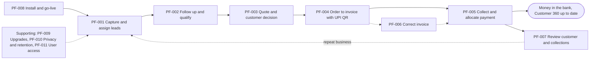

## 3. Process details

### PF-001 — Lead capture & assignment

**AS-IS**
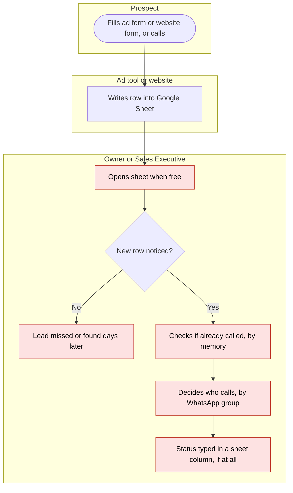

**Pain points → improvements**
| # | Pain point | Impact | TO-BE improvement | FR |
|---|---|---|---|---|
| 1 | Sheet checked manually and irregularly | Leads missed or contacted late | Rows imported automatically within 5 min (webhook ≤ 1 min) | FR-039, FR-040 |
| 2 | Duplicates spotted by memory | Same person called twice; messy data | Phone/email normalised and deduplicated automatically; re-enquiry logged | FR-028, FR-029 |
| 3 | Assignment by chat message | Nobody owns the lead | Rule-based auto-assignment with push to owner | FR-031, FR-082 |
| 4 | No status tracking | No visibility of pipeline | Lead stages, timeline, sheet write-back | FR-033, FR-035, FR-041 |
| 5 | Walk-in/phone enquiries not recorded | Lost leads | Manual entry and quick-add on mobile; CSV import | FR-025, FR-026, FR-080 |
| 6 | No record of consent/source | DPDP exposure; no source ROI | Source and consent basis captured on every lead | FR-086, RPT-005 |

**TO-BE**
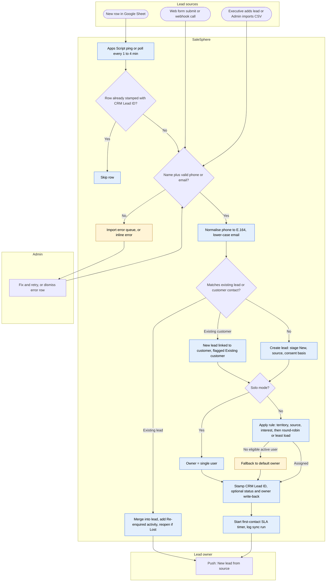

**Exceptions & SLAs**
| Step | Exception | Handling | SLA |
|---|---|---|---|
| t1 | Webhook ping lost | 15-minute safety poll picks the row up (FR-039 AC3) | Lead ≤ 5 min (poll), ≤ 1 min (webhook) — NFR-004 |
| t1 | Google token revoked | Run aborted; Admin alerted; rows imported after reconnect (FR-043) | Alert ≤ 15 min |
| t1 | Sheet header changed | Run marked "Mapping needs attention"; nothing imported (FR-038 AC2) | Alert next run |
| t2 | Sheet not editable by connected account | Mapping save blocked (FR-040 AC4) | — |
| v1 | Invalid row | Import error queue with reason (FR-042) | Visible next run |
| s2 | Spam or wrong origin on web form | Rejected silently, counted (FR-027 AC5) | — |
| s2 | Duplicate submission | Idempotency key returns original lead (RULE-059) | — |
| r2 | All eligible users inactive | Default owner + "rule fallback" flag (FR-031 AC3) | — |
| w1 | Write-back fails | Import kept; failure logged (FR-041 AC2) | — |

---

### PF-002 — Lead follow-up & qualification

**AS-IS**
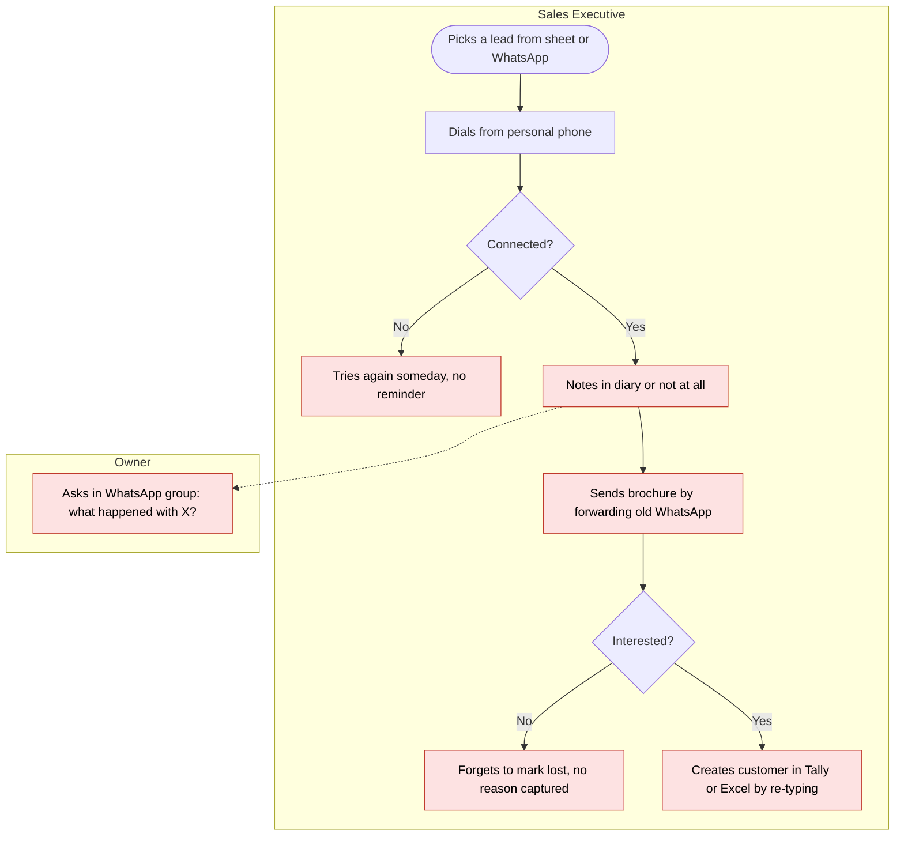

**Pain points → improvements**
| # | Pain point | Impact | TO-BE improvement | FR |
|---|---|---|---|---|
| 1 | No reminder to retry or follow up | Leads go cold | Follow-up scheduler with push; overdue list; call-outcome automation | FR-045, FR-049 |
| 2 | Calls and messages not logged | No history; owner has to ask | One-tap Call/WhatsApp/Email auto-logged with outcome | FR-044, FR-046, FR-047 |
| 3 | Slow first contact | Lower conversion | First-contact SLA timer, breach alerts, SLA report | FR-050, RPT-006 |
| 4 | Brochures/messages ad hoc | Inconsistent communication | Message templates with variables | FR-021, FR-046 |
| 5 | Lost leads without reason | No learning | Mandatory lost/junk reasons | FR-033 |
| 6 | Re-typing into accounts tool | Errors, wasted time | One-click convert to customer with history | FR-036 |
| 7 | Owner chases updates in chat | Management overhead | Dashboard, Kanban, timeline | FR-034, FR-035, FR-084 |
| 8 | No signal while offline in the field | Notes lost | Offline note and call-outcome queue | FR-081 |

**TO-BE**
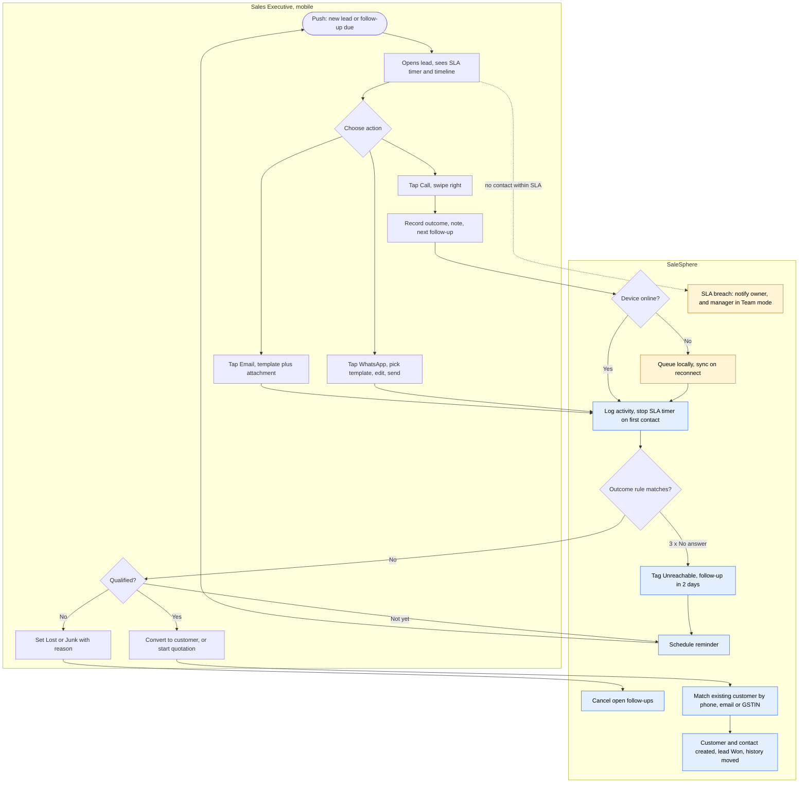

**Exceptions & SLAs**
| Step | Exception | Handling | SLA |
|---|---|---|---|
| e2 | No contact within SLA | Breach flag and push (FR-050) | 15 min business hours (RULE-025) |
| e4 | Outcome sheet dismissed | "Outcome not recorded" activity + reminder chip (FR-044 AC2) | — |
| e4 | Desktop without dialer | Show number with Copy; still offer outcome (FR-044 AC4) | — |
| e5 | No valid mobile number | Prompt to fix number (FR-046 AC2) | — |
| e6 | Gmail not connected or daily cap hit | Clear message; mailto or WhatsApp fallback (FR-047) | — |
| s5 | Offline | Queue; sync ≤ 1 min after reconnect (NFR-021) | ≤ 1 min |
| s8 | Possible duplicate customer | Offer link-to-existing (FR-036 AC1) | — |

---

### PF-003 — Quotation to customer decision

**AS-IS**
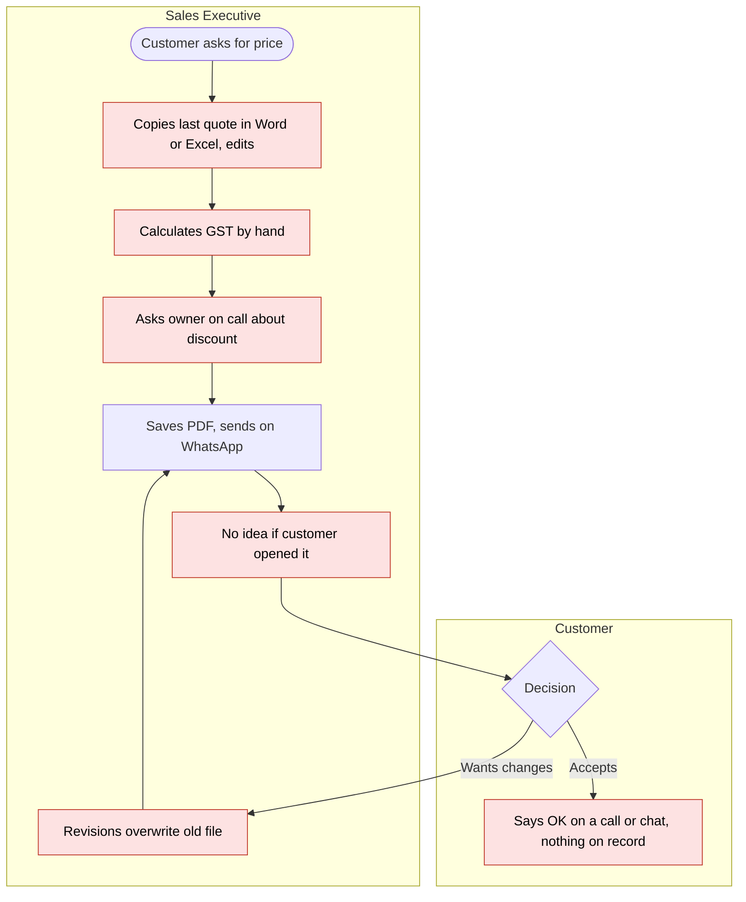

**Pain points → improvements**
| # | Pain point | Impact | TO-BE improvement | FR |
|---|---|---|---|---|
| 1 | Quotes built by copying old files | Slow (> 5 min), errors | Catalogue-based builder with defaults | FR-051 |
| 2 | Manual GST maths | Tax errors | Automatic line, tax, round-off and words | FR-052 |
| 3 | Discount approval by phone | No control or record | Rule-based approval in Team mode | FR-053 |
| 4 | Overwritten revisions | No audit of what was offered | Versioned revisions with compare | FR-054 |
| 5 | No open tracking | Follow-up timing guessed | View tracking + first-view push | FR-058 |
| 6 | Acceptance not recorded | Disputes | Online Accept / Request changes / Reject with name, time, IP | FR-057 |
| 7 | Document storage scattered | Can't find old quotes | PDF stored in customer's Drive folder | FR-055, FR-077 |

**TO-BE**
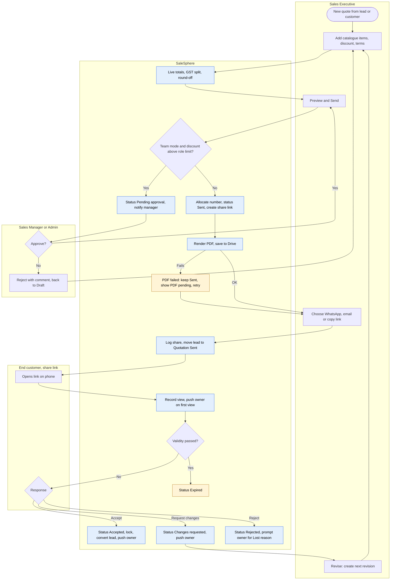

**Exceptions & SLAs**
| Step | Exception | Handling | SLA |
|---|---|---|---|
| s3 | Approver unavailable | Admin may approve any quote (RULE-027, E-14) | — |
| s3 | Discount increased after approval | Re-approval required (FR-053 AC4) | — |
| s5 | PDF render fails | Sent stays; web view works; background retry ×3 (FR-055 AC2) | PDF ≤ 5 s p95 (NFR-003) |
| c1 | Link revoked | "No longer active" page (FR-079 AC1) | — |
| c1 | Older revision opened | "Updated" page linking latest (FR-054 AC2) | — |
| c2 | Double-tap Accept | Single acceptance recorded (FR-057 AC4) | — |
| s8 | Expired | Read-only page; extend via revision (RULE-029) | End of validity day IST |
| s10 | Accepted by phone, not online | Owner marks "accepted on customer's behalf", audited (FR-059 AC3) | — |

---

### PF-004 — Order to invoice

**AS-IS**
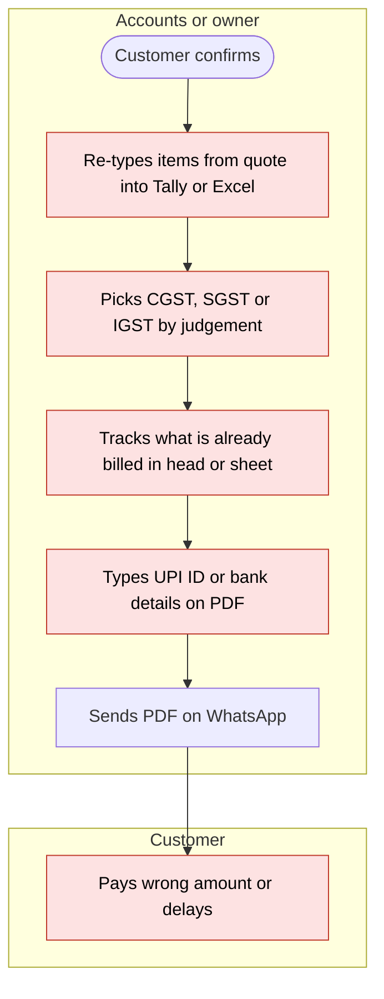

**Pain points → improvements**
| # | Pain point | Impact | TO-BE improvement | FR |
|---|---|---|---|---|
| 1 | Re-typing quote into invoice | Errors, slow | Quote → order → invoice in one click; Solo: quote → invoice | FR-059, FR-062 |
| 2 | Tax type chosen by judgement | GST errors | Place of supply rule decides CGST+SGST vs IGST | FR-064, RULE-034 |
| 3 | Billed vs pending unknown | Over/under-billing | Invoiced vs pending per line; cap at ordered qty | FR-061, RULE-033 |
| 4 | Hand-typed payment details | Wrong-amount payments | UPI QR with exact balance due, pay link | FR-068 |
| 5 | Non-standard invoice formats | Compliance risk | Branded GST-compliant layout; Bill of Supply for non-GST | FR-063, FR-067 |
| 6 | Number series kept manually | Duplicates/gaps | Atomic numbering per FY | FR-005 |

**TO-BE**
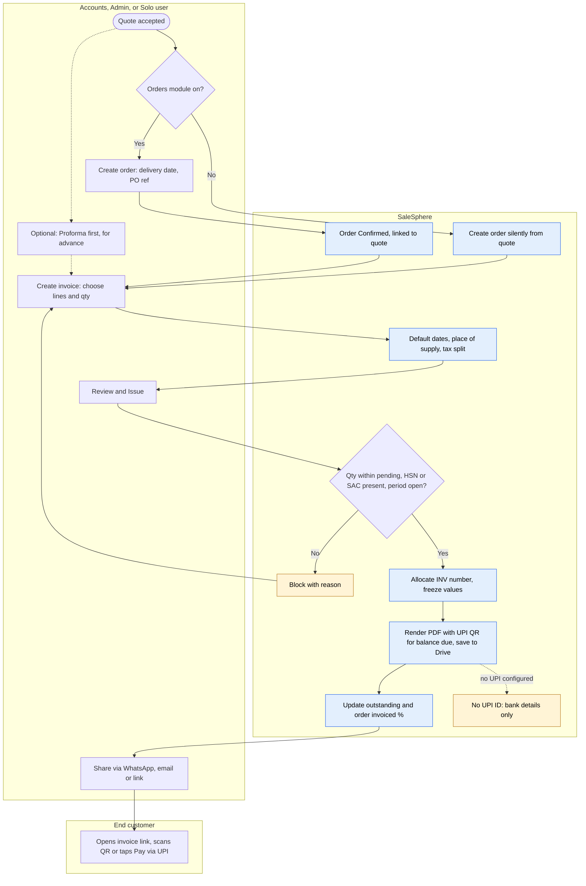

**Exceptions & SLAs**
| Step | Exception | Handling | SLA |
|---|---|---|---|
| s4 | Qty above pending | Blocked "Only n left to invoice" (FR-062 AC1) | — |
| s4 | Missing HSN/SAC on tax invoice | Blocked naming the line (FR-064 AC2) | — |
| s4 | Locked period | "Period locked" (RULE-015) | — |
| s6 | Issue fails before commit | Still Draft, no number consumed (FR-065 AC3) | — |
| s7 | PDF/Drive failure after issue | Issued; PDF pending; background retry (E-09, E-10) | — |
| s9 | No UPI ID | Bank details only (FR-068 AC4) | — |
| — | Invoice from order | Total cycle "Create invoice → issued with QR" | < 1 min (OBJ-004, NFR-014) |

---

### PF-005 — Payment collection & allocation

**AS-IS**
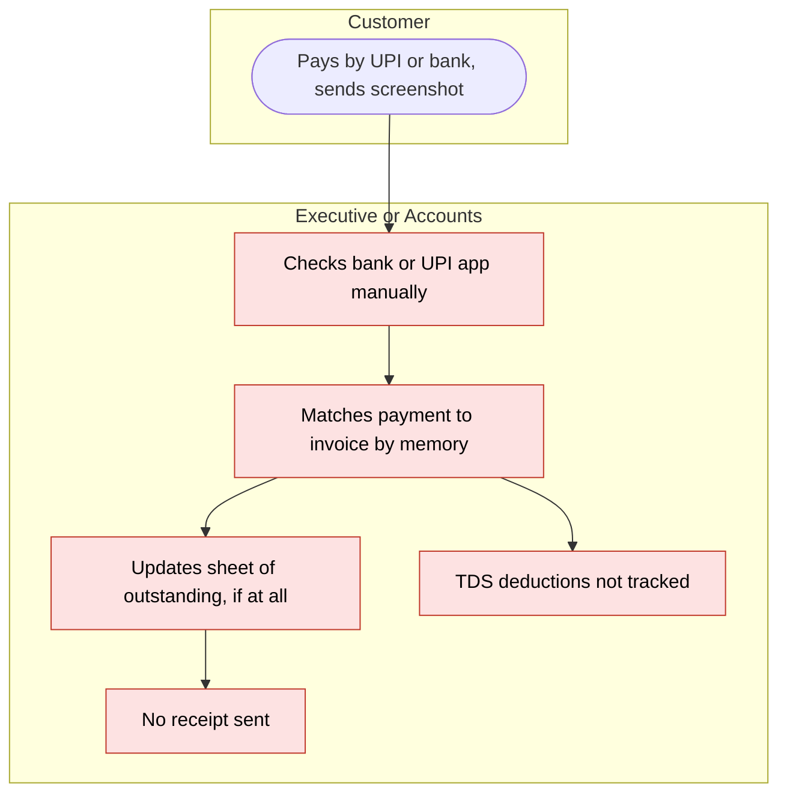

**Pain points → improvements**
| # | Pain point | Impact | TO-BE improvement | FR |
|---|---|---|---|---|
| 1 | Manual matching to invoices | Wrong balances | Amount pre-filled from invoice; auto oldest-first allocation | FR-070, FR-071 |
| 2 | Duplicate entries of same payment | Overstated receipts | UTR uniqueness check; idempotent save | RULE-043, RULE-059 |
| 3 | Outstanding not updated | Wrong follow-ups | Atomic balance update; Customer 360 and QR refresh | FR-071, FR-075 |
| 4 | No receipts | Customer trust | Numbered receipt PDF and share | FR-072 |
| 5 | TDS not tracked | Reconciliation gaps | TDS recorded and reported separately | FR-070, RULE-045 |
| 6 | Bounced cheques untracked | Phantom collections | Payment reversal restores balances | FR-073 |

**TO-BE**
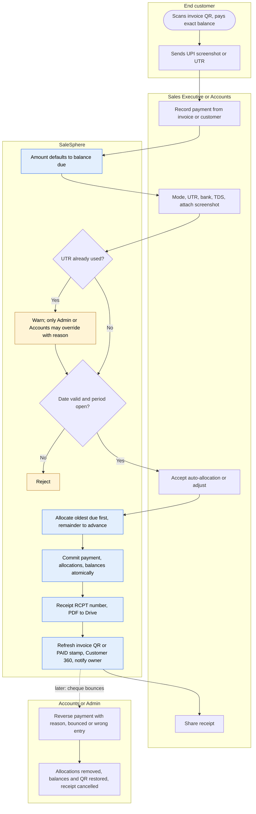

**Exceptions & SLAs**
| Step | Exception | Handling | SLA |
|---|---|---|---|
| s2 | Duplicate UTR | Warning; override by Admin/Accounts with reason (RULE-043) | — |
| s4 | Future date or locked period | Rejected (RULE-047) | — |
| s6 | Customer paid different amount (E-27/E-28) | Actual amount recorded; remainder outstanding or advance | — |
| s7 | Concurrent credit note on same invoice | Transactional recalculation (E-05) | — |
| u2 | Network retry | Idempotency key → single payment (FR-070 AC4) | — |
| r1 | Sales Executive tries to reverse | Not available (FR-073 AC2) | — |

---

### PF-006 — Invoice correction (credit note)

**AS-IS**
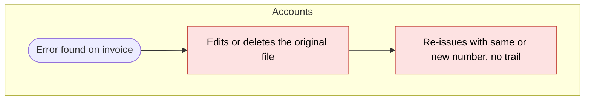

**Pain points → improvements**
| # | Pain point | Impact | TO-BE improvement | FR |
|---|---|---|---|---|
| 1 | Issued invoices edited or deleted | GST non-compliance, no audit trail | Issued documents immutable; credit notes only | FR-065, FR-066, RULE-036 |
| 2 | Order billing not restored | Over/under-billing | Credit note restores order pending quantity | FR-061 |
| 3 | Overpaid invoice after correction | Lost track of customer credit | Excess becomes on-account credit | RULE-038 |

**TO-BE**
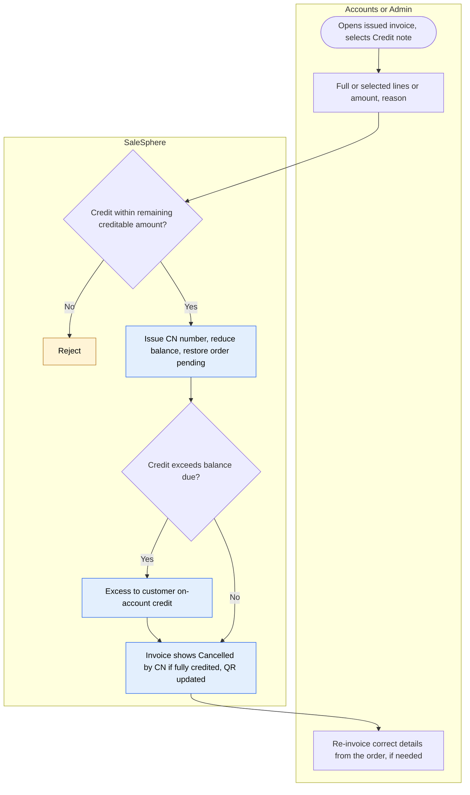

**Exceptions & SLAs**
| Step | Exception | Handling | SLA |
|---|---|---|---|
| s1 | Credit above invoice total − previous credits | Rejected (RULE-038) | — |
| a1 | Invoice in locked period | Credit note dated in open period; original untouched (RULE-015) | — |
| a3 | Refund to customer requested | Recorded outside SaleSphere in MVP (A-021) | — |

---

### PF-007 — Customer review & collections follow-up

**AS-IS**
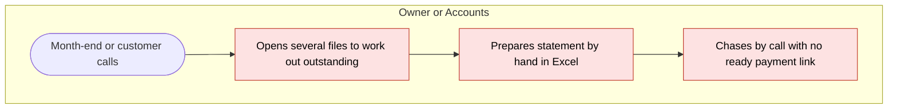

**Pain points → improvements**
| # | Pain point | Impact | TO-BE improvement | FR |
|---|---|---|---|---|
| 1 | Customer position spread across files | Slow, error-prone | Customer 360 with KPI tiles and tabs | FR-075 |
| 2 | Statements built by hand | Time, errors | One-click statement for any date range | FR-076 |
| 3 | No ageing view | Wrong priorities | Ageing buckets, collections report, dashboard tile | FR-085, RPT-004 |
| 4 | Chasing without a pay link | Delayed payment | Share statement or invoice with live QR via WhatsApp | FR-046, FR-069 |

**TO-BE**
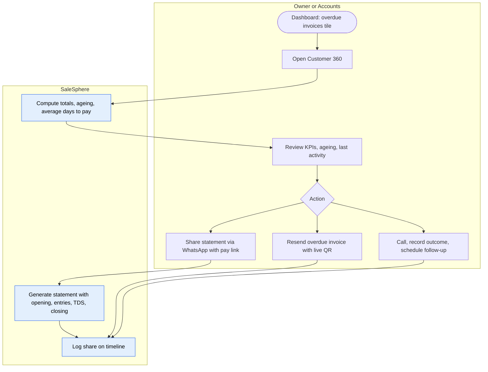

**Exceptions & SLAs**
| Step | Exception | Handling | SLA |
|---|---|---|---|
| s2 | No transactions in range | Opening = closing, "No transactions" (UC-013 E1) | — |
| u2 | Project Manager opens customer | Financial tiles hidden (FR-075 AC3) | — |
| s1 | Large customer history | Running totals kept on customer record | Customer 360 within NFR-001 |

---

### PF-008 — Client install & go-live

**AS-IS:** N/A — new process (SaleSphere is a new product; no prior install process exists).

**Pain points → improvements:** N/A — no AS-IS. Design goals instead:

| # | Goal | TO-BE mechanism | FR |
|---|---|---|---|
| 1 | Install in ≤ 1 working day | Config-only install + provisioning script | FR-001, FR-002, NFR-019 |
| 2 | No code fork per client | Config, feature flags, Solo/Team mode | FR-001, FR-004 |
| 3 | Client self-configures | Settings: branding, masters, Google, UPI | FR-003, FR-017 – FR-022, FR-037 |
| 4 | Avoid broken Google connection | "In production" consent + health alert | FR-043, R-001 |

**TO-BE**
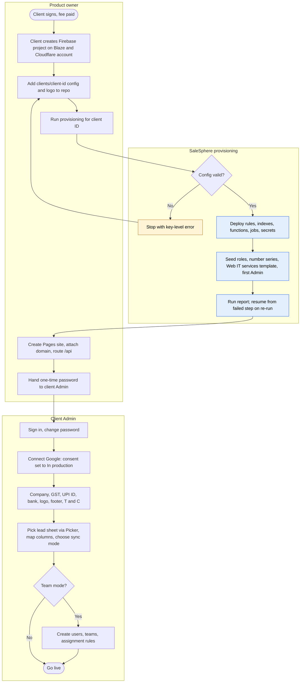

**Exceptions & SLAs**
| Step | Exception | Handling | SLA |
|---|---|---|---|
| s1 | Invalid config | Nothing deployed; key-level error (FR-001 AC2) | — |
| s3/s4 | Step fails | Report; re-run resumes idempotently (FR-002 AC2–AC3) | — |
| c2 | Consent left in Testing | Token expiry → health alert; runbook fix (R-001) | Alert ≤ 15 min |
| c4 | Sheet not editable | Mapping blocked until edit access granted (FR-040 AC4) | — |
| — | Whole install | Provision + configure | ≤ 1 working day (OBJ-007) |

---

### PF-009 — Release upgrade

**AS-IS:** N/A — new process.

**TO-BE**
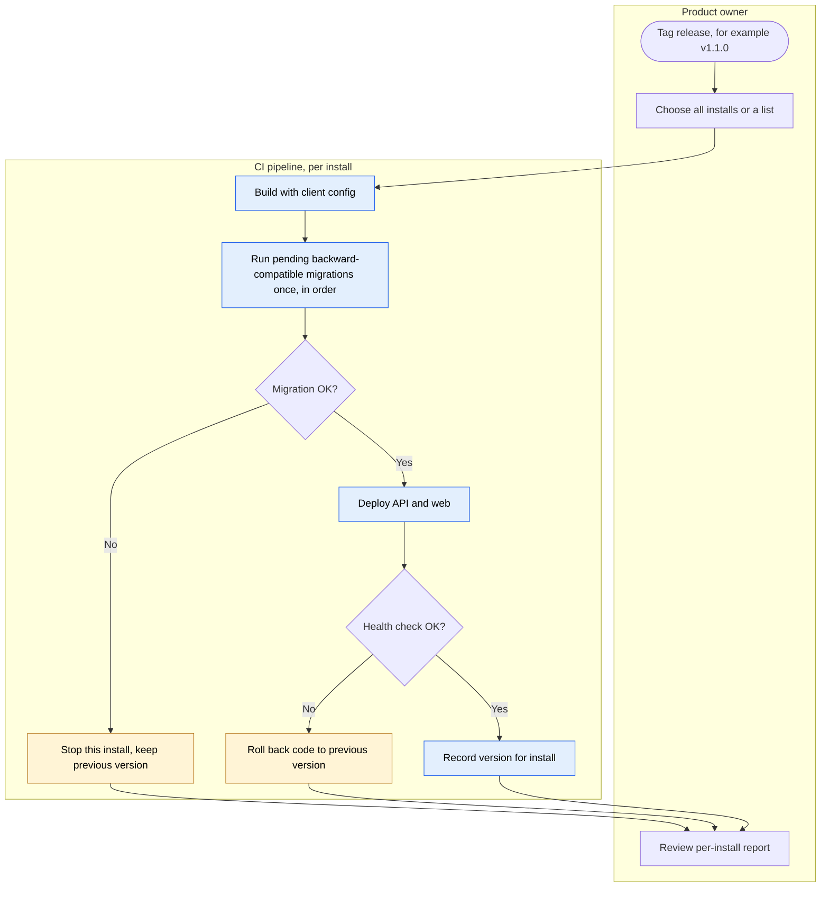

**Exceptions & SLAs**
| Step | Exception | Handling | SLA |
|---|---|---|---|
| c3 | Migration fails on one install | That install stays on previous version; others continue (FR-006 AC2) | — |
| c6 | Post-deploy health fails | Code rollback (NFR-019) | ≤ 30 min |
| c2 | Release re-run | No migration runs twice (FR-006 AC3) | — |

---

### PF-010 — Personal-data request & retention

**AS-IS:** N/A — no current process for data-principal requests or retention exists at target clients.

**TO-BE**
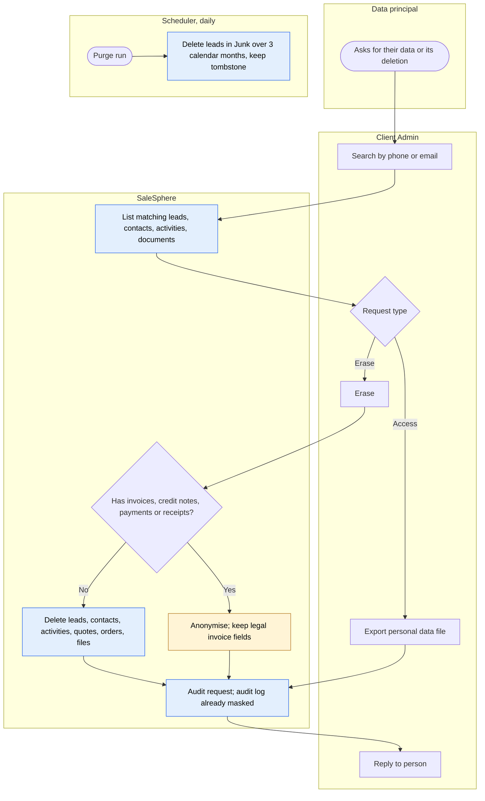

**Exceptions & SLAs**
| Step | Exception | Handling | SLA |
|---|---|---|---|
| s2 | Person has financial documents | Anonymise instead of delete (RULE-054) | — |
| s3 | Data in backups | Rolls off within 30 days; not restored (RULE-054) | ≤ 30 days |
| j2 | Junk lead reopened before 3 months | Not purged (FR-090 AC2) | Daily |
| a3/a4 | Tooling time | Export/erase completes | ≤ 5 min (NFR-010) |

---

### PF-011 — User access management

**AS-IS:** N/A — no current system access to manage (WhatsApp groups and shared sheets today).

**TO-BE**
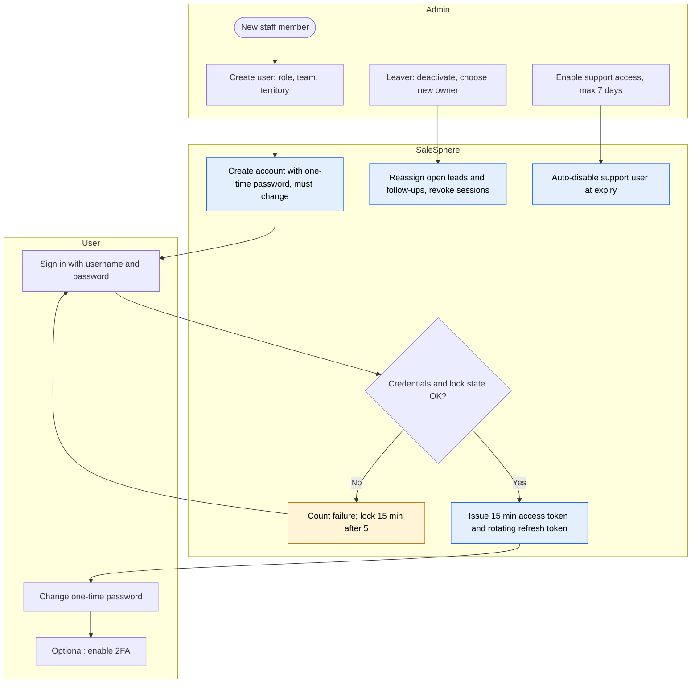

**Exceptions & SLAs**
| Step | Exception | Handling | SLA |
|---|---|---|---|
| s2 | Unknown username | Same generic error and timing (FR-007 AC5) | — |
| s3 | Rate limit by IP | > 20/min rejected (FR-008 AC4) | — |
| a3 | Last active Admin | Deactivation blocked (RULE-010) | — |
| s4 | Refresh token reuse | Session family revoked (FR-010 AC4) | — |
| s5 | Forced logout | Effective at next access-token expiry | ≤ 15 min |

## 4. Entity lifecycles

### 4.1 Lead
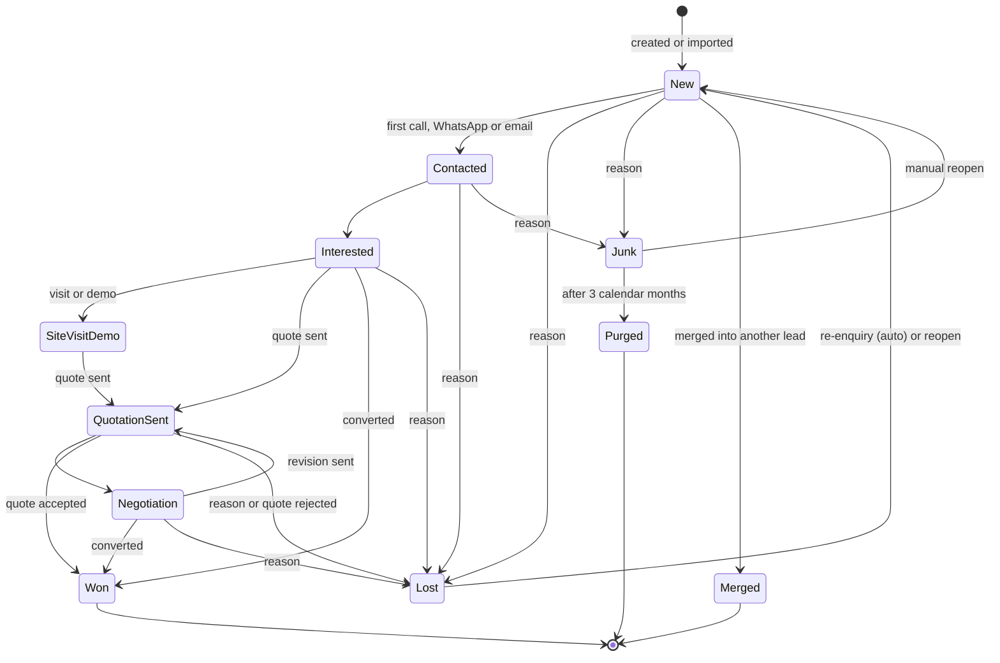
Stage names are configurable (FR-022); the states above are the seeded defaults. Won/Lost/Junk/Merged/Purged are system-controlled per RULE-020, RULE-023, RULE-052.

### 4.2 Follow-up
```mermaid
stateDiagram-v2
  [*] --> Open: scheduled
  Open --> Due: due time reached, push sent
  Due --> Overdue: not completed
  Open --> Done: completed
  Due --> Done: completed
  Overdue --> Done: completed
  Open --> Open: rescheduled
  Overdue --> Open: rescheduled
  Open --> Cancelled: lead Lost or Junk, or user cancels
  Overdue --> Cancelled: lead Lost or Junk
  Done --> [*]
  Cancelled --> [*]
```

### 4.3 Quotation (per revision)
```mermaid
stateDiagram-v2
  [*] --> Draft
  Draft --> PendingApproval: send with discount above limit (Team)
  PendingApproval --> Approved: manager approves
  PendingApproval --> Draft: manager rejects
  Approved --> Draft: edited with higher discount
  Draft --> Sent: send (number allocated)
  Approved --> Sent: send
  Sent --> Viewed: customer opens link
  Viewed --> Accepted: customer accepts
  Sent --> Accepted: accepted on behalf (audited)
  Viewed --> ChangesRequested: customer comments
  Viewed --> Rejected: customer rejects
  Sent --> Expired: validity passed
  Viewed --> Expired: validity passed
  ChangesRequested --> Superseded: next revision sent
  Sent --> Superseded: next revision sent
  Viewed --> Superseded: next revision sent
  Expired --> Superseded: revision with new validity sent
  Draft --> [*]: deleted (no number)
  Accepted --> [*]
  Rejected --> [*]
  Superseded --> [*]
```

### 4.4 Sales order
```mermaid
stateDiagram-v2
  [*] --> Confirmed: from accepted quote or manual
  Confirmed --> InProgress
  InProgress --> Delivered: delivered or completed
  Confirmed --> OnHold: reason
  InProgress --> OnHold: reason
  OnHold --> InProgress: resume
  Delivered --> Closed: fully invoiced and paid
  Confirmed --> Cancelled: reason, no uncredited invoices
  OnHold --> Cancelled: reason, no uncredited invoices
  Closed --> [*]
  Cancelled --> [*]
```

### 4.5 Invoice (tax invoice / bill of supply)
```mermaid
stateDiagram-v2
  [*] --> Draft
  Draft --> [*]: deleted (no number)
  Draft --> Issued: issue (number, PDF, QR)
  Issued --> PartlyPaid: payment allocated
  PartlyPaid --> Paid: balance zero
  Issued --> Paid: full payment or advance applied
  Issued --> Overdue: due date passed with balance
  PartlyPaid --> Overdue: due date passed with balance
  Overdue --> PartlyPaid: part payment
  Overdue --> Paid: balance zero
  Paid --> PartlyPaid: payment reversed
  Paid --> Issued: payment reversed fully
  Issued --> Cancelled: full credit note
  PartlyPaid --> Paid: credit note clears balance
  Paid --> [*]
  Cancelled --> [*]
```
Proforma invoices follow Draft → Issued → Converted (to tax invoice) or Expired, and are excluded from outstanding (RULE-037).

### 4.6 Payment
```mermaid
stateDiagram-v2
  [*] --> Recorded: saved with allocations
  Recorded --> PartlyAllocated: remainder kept as advance
  PartlyAllocated --> Allocated: advance applied to invoice
  Recorded --> Allocated: fully allocated
  Allocated --> Reversed: Admin or Accounts, reason
  PartlyAllocated --> Reversed: Admin or Accounts, reason
  Recorded --> Reversed: Admin or Accounts, reason
  Reversed --> [*]
  Allocated --> [*]
```

### 4.7 Share link
```mermaid
stateDiagram-v2
  [*] --> Active: document sent or shared
  Active --> Active: viewed (logged)
  Active --> Expired: expiry reached (RULE-049)
  Active --> Revoked: user revokes
  Expired --> Active: user extends
  Revoked --> [*]
  Expired --> [*]
```

### 4.8 User account
```mermaid
stateDiagram-v2
  [*] --> MustChangePassword: created or password reset
  MustChangePassword --> Active: compliant password set
  Active --> Locked: 5 failed sign-ins
  Locked --> Active: 15 min passed or Admin unlocks
  Active --> MustChangePassword: Admin resets password
  Active --> Inactive: deactivated (leads reassigned)
  Locked --> Inactive: deactivated
  Inactive --> MustChangePassword: reactivated
  Inactive --> [*]
```

### 4.9 Google connection
```mermaid
stateDiagram-v2
  [*] --> NotConnected
  NotConnected --> Connected: Admin completes consent
  Connected --> Partial: some scopes declined
  Partial --> Connected: reconnect with all scopes
  Connected --> Broken: token revoked or expired
  Partial --> Broken: token revoked or expired
  Broken --> Connected: reconnect
  Connected --> NotConnected: Admin disconnects
  Broken --> NotConnected: Admin disconnects
```

### 4.10 Sheet import row
```mermaid
stateDiagram-v2
  [*] --> Pending: new row seen without marker
  Pending --> Imported: lead created, marker stamped
  Pending --> Merged: duplicate, re-enquiry logged, marker stamped
  Pending --> Failed: invalid, sent to error queue
  Failed --> Imported: Admin fixes and retries
  Failed --> Dismissed: Admin dismisses
  Imported --> [*]
  Merged --> [*]
  Dismissed --> [*]
```

## 5. Cross-system sequences

### SEQ-01 — Google Sheet row to assigned lead (PF-001)
```mermaid
sequenceDiagram
  autonumber
  participant GS as Google Sheet
  participant AS as Apps Script trigger
  participant API as SaleSphere API
  participant DB as Firestore
  participant PS as Web Push
  actor O as Lead owner
  GS->>AS: row added (onChange)
  AS->>API: POST sheet webhook, signed ping
  API->>GS: read rows without CRM Lead ID marker
  GS-->>API: new rows
  loop each row
    API->>API: map, validate, normalise phone and email
    API->>DB: transaction - dedupe check, create or merge lead, assign owner
    DB-->>API: lead ID
    API->>GS: write CRM Lead ID marker (and status, owner if enabled)
  end
  API->>DB: save sync run counts and import errors
  API->>PS: notify owner - new lead
  PS-->>O: push notification
  Note over API,GS: Safety poll every 15 min (or 1 to 4 min in poll mode) repeats the same steps
```

### SEQ-02 — Send quotation and customer acceptance (PF-003)
```mermaid
sequenceDiagram
  autonumber
  actor E as Sales Executive
  participant APP as SaleSphere PWA
  participant API as SaleSphere API
  participant DB as Firestore
  participant DR as Google Drive
  participant WA as WhatsApp app
  actor C as End customer
  participant PS as Web Push
  E->>APP: Send quote via WhatsApp
  APP->>API: POST send quote
  API->>DB: transaction - allocate QT number, status Sent, create share link
  API->>API: render PDF
  API->>DR: upload PDF to customer folder
  API-->>APP: number, share link
  APP->>WA: open wa.me with template and link
  E->>WA: tap send
  C->>API: open share link
  API->>DB: log view, status Viewed
  API->>PS: first view - notify owner
  C->>API: Accept with typed name
  API->>DB: transaction - status Accepted, record name, time, IP, convert lead
  API->>PS: notify owner - accepted
  API-->>C: thank-you page
```

### SEQ-03 — Issue invoice with UPI QR and customer payment (PF-004, PF-005)
```mermaid
sequenceDiagram
  autonumber
  actor A as Accounts
  participant API as SaleSphere API
  participant DB as Firestore
  participant DR as Google Drive
  actor C as End customer
  participant UPI as Customer UPI app
  participant BK as Client bank account
  A->>API: Issue invoice from order
  API->>DB: transaction - validate pending qty, allocate INV number, freeze, update outstanding
  API->>API: balance due = total - payments - credit notes
  API->>API: build upi pay link (pa, pn, am, cu, tn, tr) and QR level M
  API->>API: render PDF with payment block
  API->>DR: save PDF in Invoices folder
  API-->>A: issued, share link
  A->>C: share link via WhatsApp or email
  C->>API: open invoice web view
  API-->>C: live balance, QR, Pay via UPI button
  C->>UPI: scan QR or tap Pay via UPI
  UPI->>BK: transfer exact amount (outside SaleSphere)
  UPI-->>C: success with UTR
  C->>A: sends screenshot or UTR
  Note over A,API: Payment recorded in SEQ-04
```

### SEQ-04 — Record payment, allocate, receipt (PF-005)
```mermaid
sequenceDiagram
  autonumber
  actor U as Executive or Accounts
  participant APP as SaleSphere PWA
  participant API as SaleSphere API
  participant DB as Firestore
  participant DR as Google Drive
  participant PS as Web Push
  U->>APP: Record payment from invoice
  APP->>API: GET balance due
  API-->>APP: amount pre-fill
  U->>APP: mode UPI, UTR, TDS, screenshot
  APP->>API: POST payment with idempotency key
  API->>DB: check UTR uniqueness and period lock
  alt UTR already used
    API-->>APP: warning, override needs Admin or Accounts
  else OK
    API->>DB: transaction - payment, allocations oldest first, invoice balances, customer totals
    API->>DR: upload screenshot and receipt PDF
    API->>PS: notify customer owner - payment received
    API-->>APP: receipt number, share options
  end
```

### SEQ-05 — Sign-in and token refresh (PF-011)
```mermaid
sequenceDiagram
  autonumber
  actor U as User
  participant APP as SaleSphere PWA
  participant CF as Cloudflare
  participant API as SaleSphere API
  participant DB as Firestore
  U->>APP: username and password
  APP->>CF: POST /api/auth/login
  CF->>CF: per-IP rate limit
  CF->>API: forward
  API->>DB: load user, check lock
  API->>API: verify Argon2id hash
  alt failure
    API->>DB: increment failures, lock at 5, audit
    API-->>APP: generic error
  else success
    API->>DB: create session with hashed refresh token, audit
    API-->>APP: access token 15 min plus refresh cookie (HttpOnly, Secure, SameSite Strict)
  end
  Note over APP,API: Later, access token expired
  APP->>API: POST /api/auth/refresh with cookie
  API->>DB: verify and rotate refresh token, detect reuse
  API-->>APP: new access token
```

### SEQ-06 — Email via the client's Gmail (PF-002, PF-003)
```mermaid
sequenceDiagram
  autonumber
  actor U as User
  participant API as SaleSphere API
  participant SM as Secret Manager
  participant GM as Gmail API
  participant DB as Firestore
  U->>API: send email with template and attachment
  API->>DB: check daily sent count below cap (450)
  API->>SM: get Google refresh token
  API->>GM: send message as client account
  alt temporary error
    API->>GM: retry with backoff, up to 3 times
  end
  GM-->>API: message ID
  API->>DB: log email activity, increment count
  API-->>U: sent
```

### SEQ-07 — Offline queue sync (PF-002)
```mermaid
sequenceDiagram
  autonumber
  actor E as Sales Executive
  participant APP as PWA with local store
  participant SW as Service worker
  participant API as SaleSphere API
  participant DB as Firestore
  E->>APP: save call outcome while offline
  APP->>APP: store in local queue with device time and idempotency key
  APP-->>E: shows Will sync
  SW->>SW: connectivity restored
  loop queued items in order
    SW->>API: POST activity with idempotency key
    API->>DB: append activity, apply outcome rules
    API-->>SW: OK
  end
  SW-->>APP: clear pending badge
```

### SEQ-08 — Connect Google account (PF-008)
```mermaid
sequenceDiagram
  autonumber
  actor A as Client Admin
  participant APP as SaleSphere PWA
  participant API as SaleSphere API
  participant GO as Google OAuth
  participant SM as Secret Manager
  participant DR as Google Drive
  A->>APP: Settings, Connect Google
  APP->>API: start OAuth
  API-->>APP: redirect to Google consent (drive.file, gmail.send, sheets)
  A->>GO: sign in and consent
  GO-->>API: authorisation code
  API->>GO: exchange code for tokens
  GO-->>API: refresh and access tokens, granted scopes
  API->>SM: store refresh token
  API->>DR: create SaleSphere folder tree
  API-->>APP: Connected as client email, features by scope
```

## 6. Open questions

None new. All process-level decisions trace to answered questions (Q-001 – Q-023) and accepted assumptions (A-001 – A-024).

## 7. Sign-off

| Name | Role | Decision | Date |
|---|---|---|---|
| Product owner | Accountable for SaleSphere | Approved | 2026-11-13 |
