# UX Specification — SaleSphere CRM

| Version | Date | Author | Change |
|---|---|---|---|
| 0.1 | 2026-11-13 | Claude (UX designer) | Initial UX spec from FRD v0.2 and process flows v0.1 |

**Related:** [`design-system.md`](design-system.md) (tokens, `CMP-xxx`) · [`wireframes/`](wireframes/) (one file per `SCR-xxx`) · [`prototype/index.html`](prototype/index.html) (clickable prototype) · [`../reviews/UX-self-review-v0.1.md`](../reviews/UX-self-review-v0.1.md).

## 1. Design goals & principles

| # | Principle | Applied as |
|---|---|---|
| 1 | **One thumb, one tap to act** | Call, WhatsApp and Email are on every person card. Swipe actions on rows. Primary action sits in the bottom third on mobile. |
| 2 | **Never lose a lead, never lose the thread** | New leads push instantly. SLA chips sit on every new lead. Every action lands on one timeline. Offline capture is queued, never dropped. |
| 3 | **Money is always one glance away** | Balance due, ageing and the QR appear together. Customer 360 opens on its money tiles. Tabular, Indian-grouped figures. |
| 4 | **Speed over ceremony for daily users** | Defaults from masters. Live totals. Quote → invoice in two taps for Solo users. Forms avoid optional fields unless expanded. |
| 5 | **Safe by default** | Issued documents are locked, with the reason shown. Irreversible actions confirm with consequences. Permission-hidden actions explain who can do them. |

## 2. Personas

### P-01 — Arjun Mehta, freelance web developer (pilot client, Solo mode)
- **Context of use:** Android phone all day (client meetings, travel) and a laptop in the evenings for quotes and invoices. Uses SaleSphere 5–10 times a day.
- **Goals:** respond to every website enquiry from his Meta ads sheet within minutes; send a clean quote the same day; get paid without chasing.
- **Frustrations:** enquiries buried in a Google Sheet; building quotes from old Word files; clients paying late or the wrong amount; no idea of the total owed to him.
- **Tech comfort:** high (developer), but impatient with admin work.
- **Jobs-to-be-done:** *When* a new enquiry lands, *I want to* call or WhatsApp in one tap and log what happened, *so I can* close it before a competitor does. *When* a client says yes, *I want to* invoice with a UPI QR in under a minute, *so I can* get paid the same day.

### P-02 — Priya Sharma, sales executive (Team mode)
- **Context of use:** mid-range Android on 4G, in the field 70 % of the day, sometimes no signal. Logs 20–40 calls a day.
- **Goals:** know who to call next; log outcomes fast; send quotes from the phone; hit her monthly target.
- **Frustrations:** forgetting follow-ups; re-typing notes; waiting for the manager to approve a discount by phone.
- **Tech comfort:** medium; lives in WhatsApp.
- **Jobs-to-be-done:** *When* I finish a call, *I want to* record the outcome and next follow-up in under 3 taps, *so I can* move to the next lead.

### P-03 — Meena Iyer, accounts executive
- **Context of use:** desktop at the office, with dual screen and Tally open alongside.
- **Goals:** raise correct GST invoices from orders; match payments with UTRs; know who is overdue.
- **Frustrations:** re-typing quotes; guessing CGST/SGST vs IGST; screenshots arriving on WhatsApp without context.
- **Tech comfort:** medium-high with spreadsheets.
- **Jobs-to-be-done:** *When* a customer sends a payment screenshot, *I want to* record it against the right invoices in one form, *so I can* keep outstanding correct and send a receipt.

### P-04 — Rajesh Nair, owner / admin of a 12-person interiors firm (Team mode)
- **Context of use:** phone for quick checks, desktop weekly for settings and reports.
- **Goals:** see the pipeline and money position at any time; make sure no lead is ignored; control discounts.
- **Frustrations:** chasing the team on WhatsApp for status; month-end surprises on receivables.
- **Tech comfort:** low-medium; wants things obvious.
- **Jobs-to-be-done:** *When* I open the app in the morning, *I want to* see overdue follow-ups, SLA breaches and overdue invoices, *so I can* nudge the right person.

### P-05 — Kavya Rao, end customer (no login)
- **Context of use:** opens links from WhatsApp on her phone.
- **Goals:** understand the quote, accept it easily, pay the exact amount with her UPI app.
- **Frustrations:** blurry PDFs, typing UPI IDs, not knowing what she still owes.
- **Jobs-to-be-done:** *When* I get a quote link, *I want to* read it on my phone and accept in one tap, *so I can* get the work started.

## 3. Journey maps

### J-01 — Sheet enquiry to first contact (Priya / Arjun)
| Stage | Actions | Thoughts | Emotion | Pain points | Opportunities |
|---|---|---|---|---|---|
| Notified | Push "New lead: Kavya Rao from Meta ads" | "Fresh lead, call now" | 🙂 eager | Push denied on iPhone if not installed | Install prompt at onboarding; in-app bell fallback (FR-080, FR-082) |
| Review | Opens lead; sees source, interest, SLA chip "12 min left" | "What did she ask for?" | 😐 | Sheet message buried | Message shown as first activity (FR-035) |
| Contact | Taps Call (or swipes) | — | 🙂 | Returns to app and forgets to log | Outcome sheet opens automatically on return (FR-044) |
| Log | Selects "Connected", notes "Wants 5-page site", sets follow-up tomorrow 11:00 | "Done in 3 taps" | 😀 | Typing long notes on phone | Note templates and voice-to-text (OS keyboard) |
| Next | Lead moves to Contacted; SLA chip "Contacted in 6 min" | "Next lead" | 😀 | — | Next lead suggestion on Home (FR-084) |

### J-02 — Quote to cash, Solo freelancer (Arjun)
| Stage | Actions | Thoughts | Emotion | Pain points | Opportunities |
|---|---|---|---|---|---|
| Quote | From lead → New quote; adds "Website – 5 pages", "Hosting 1 yr"; 10 % discount | "Totals and GST done for me" | 🙂 | Picking SAC codes | Seeded web-services catalogue (Q-023) |
| Send | Send via WhatsApp → template with link | "Will she open it?" | 😐 | Uncertainty | "Viewed 2 times" + first-view push (FR-058) |
| Accept | Kavya taps Accept on her phone | "Yes!" | 😀 | Customer unsure where to sign | Clear Accept with typed name (FR-057) |
| Invoice | Push "Accepted" → Create invoice (order silent) → Issue | "Under a minute" | 😀 | Extra order step | Solo path skips orders (Q-021) |
| Collect | Shares invoice on WhatsApp; Kavya scans QR with exact amount | "No wrong amounts" | 😀 | Partial payments | QR updates to the balance (FR-068) |
| Record | Kavya sends screenshot → Record payment pre-filled → receipt sent | "Books are right" | 😀 | Remembering to record | Payment button on the invoice and in the "+" menu |

### J-03 — Weekly collections (Meena / Rajesh)
| Stage | Actions | Thoughts | Emotion | Pain points | Opportunities |
|---|---|---|---|---|---|
| Spot | Home tile "Overdue ₹2.4 L (7)" | "Who is late?" | 😟 | — | Ageing report sorted by risk (RPT-004) |
| Review | Opens Customer 360 of the biggest debtor | "What's the history?" | 😐 | Data spread out | Money tiles + Invoices tab with ageing (FR-075) |
| Chase | Shares statement + pay link on WhatsApp; logs call | "Easy to send" | 🙂 | Writing polite text | Reminder template (FR-021) |
| Receive | Records UTR, auto-allocated oldest first | "Done" | 😀 | Duplicate UTR | Duplicate warning (RULE-043) |

## 4. Information architecture

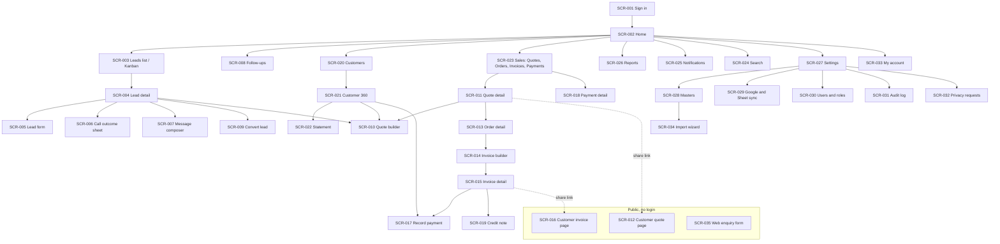

**Navigation model**
- **Mobile (< 1024 px):** bottom tab bar (CMP-024) with Home · Leads · Customers · Sales · More, plus a FAB "+" (quick add). "More" holds Follow-ups, Reports, Notifications, Settings, My account and Sign out. Detail screens push onto a stack with a back button. Sheets are used for quick tasks (call outcome, filters, share, record payment on small screens).
- **Desktop (≥ 1024 px):** left sidebar (CMP-023), a top bar with search (Ctrl/Cmd + K), the bell and the user menu. List/detail split view on Leads, Customers and Sales.
- **App shell (SCR-036)** wraps everything: navigation, offline banner, global Google-connection banner, install prompt and toasts.

**Role-based visibility** (from FRD §3.2; ✓ = visible, — = hidden, (O)/(T) = scope)

| Navigation item | Admin | Sales Mgr | Sales Exec | Accounts | Project Mgr | Viewer |
|---|---|---|---|---|---|---|
| Home | ✓ | ✓ (T) | ✓ (O) | ✓ | ✓ | ✓ |
| Leads | ✓ | ✓ (T) | ✓ (O) | ✓ read | ✓ read | ✓ read |
| Customers | ✓ | ✓ (T) | ✓ (O) | ✓ | ✓ (no money tabs) | ✓ |
| Sales › Quotes / Orders | ✓ | ✓ (T) | ✓ (O) | ✓ read | ✓ | ✓ |
| Sales › Invoices / Payments | ✓ | ✓ (T) read | ✓ (O) read; payments create | ✓ | — | ✓ |
| Follow-ups | ✓ | ✓ (T) | ✓ (O) | ✓ own | ✓ own | — |
| Reports | ✓ | ✓ (T) | ✓ (O) | ✓ finance | ✓ orders | ✓ |
| Settings › Company, Branding, Integrations, Privacy | ✓ | — | — | — | — | read |
| Settings › Masters | ✓ | catalogue, sales | — | catalogue, finance | — | read |
| Settings › Users & roles | ✓ | team (read) | — | — | — | read |
| Settings › Audit log | ✓ | — | — | — | — | ✓ |
| Quick add (+) | all | lead, quote, note, follow-up, payment | lead, quote, note, follow-up, payment¹ | payment, note | note, follow-up | — |

¹ When "Record payments" is enabled for the role (default on, RULE-048). In **Solo mode** the single user is Admin. Team, assignment and approval UI is hidden.

## 5. User flows

One flow per use case, including error and empty paths. Screen IDs are shown in brackets.

### UC-001 — Sign in
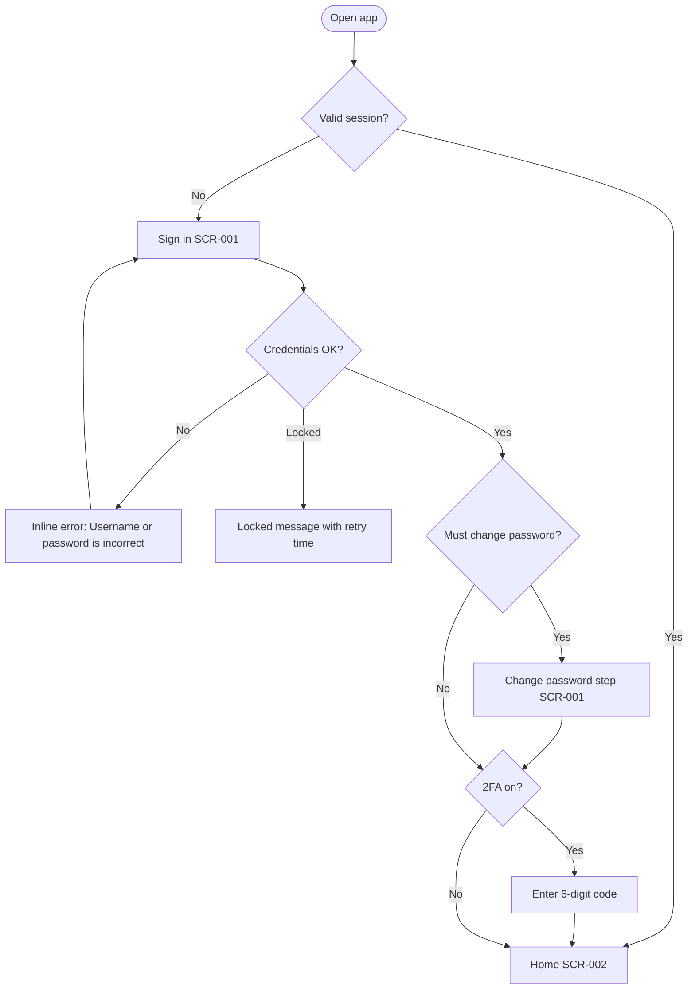

### UC-002 — Provision and first-run setup (client Admin part)
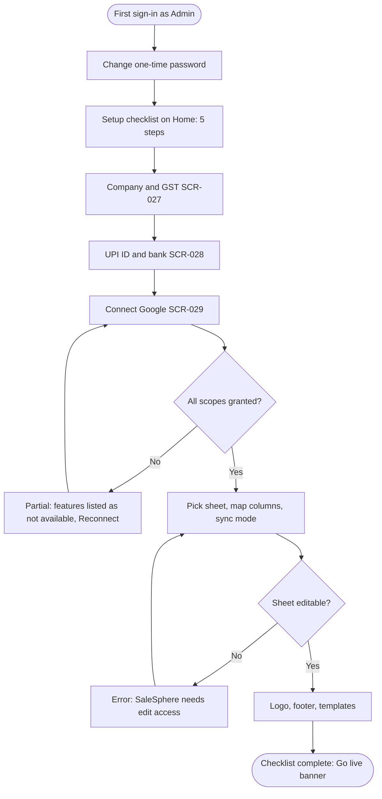

### UC-003 — Sheet import (Admin monitoring view)
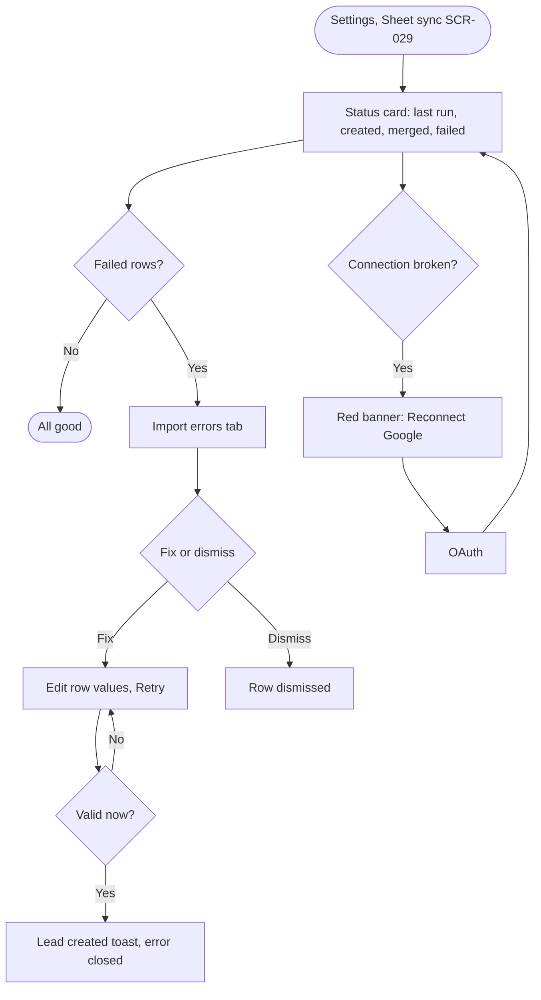

### UC-004 — Capture a lead
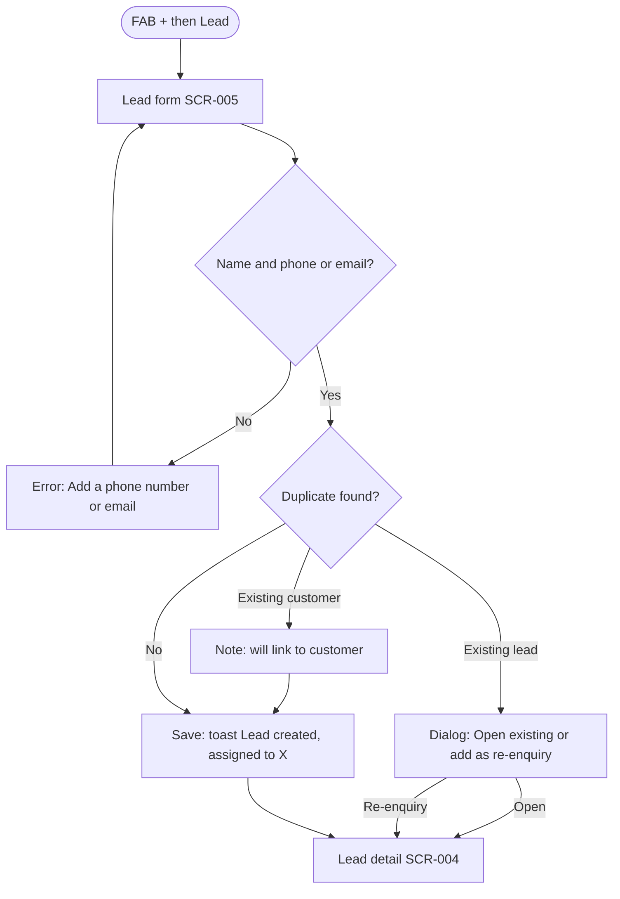

### UC-005 — Follow up a lead by call
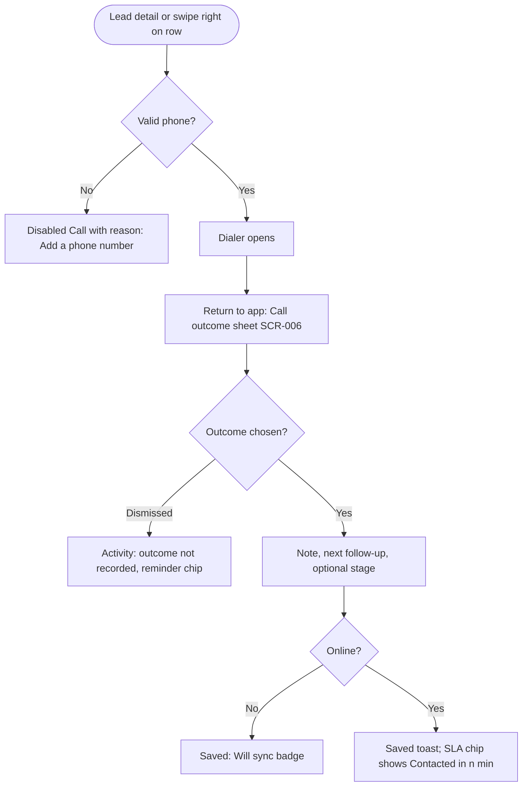

### UC-006 — Convert lead to customer
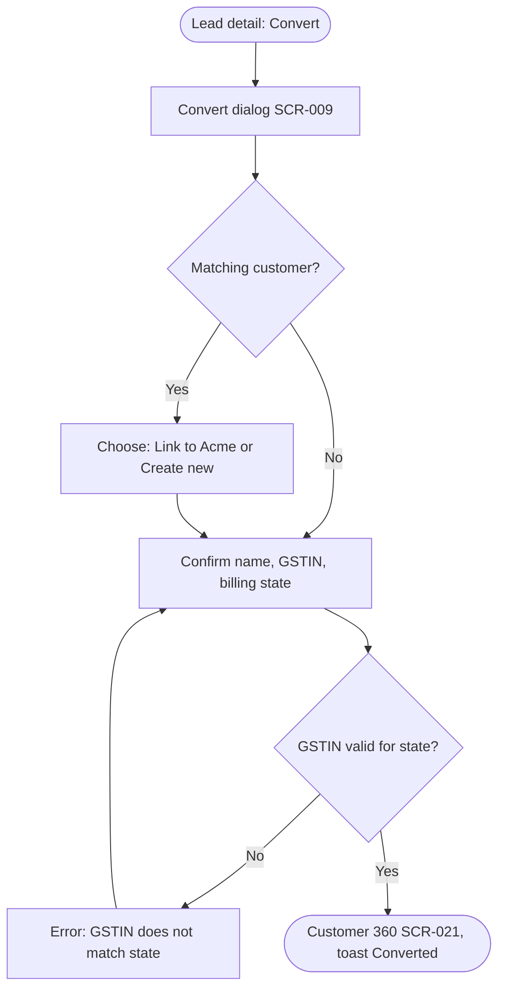

### UC-007 — Create and send a quote
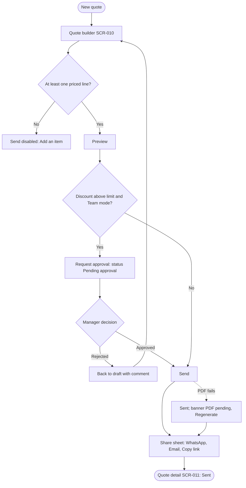

### UC-008 — Customer responds
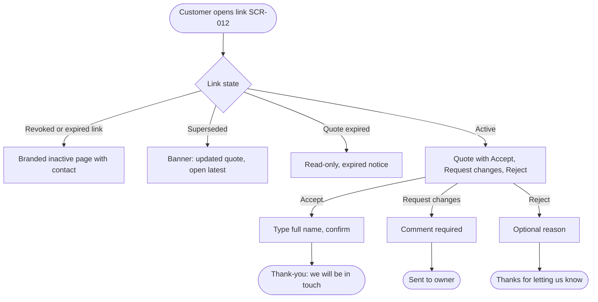

### UC-009 — Quote to order
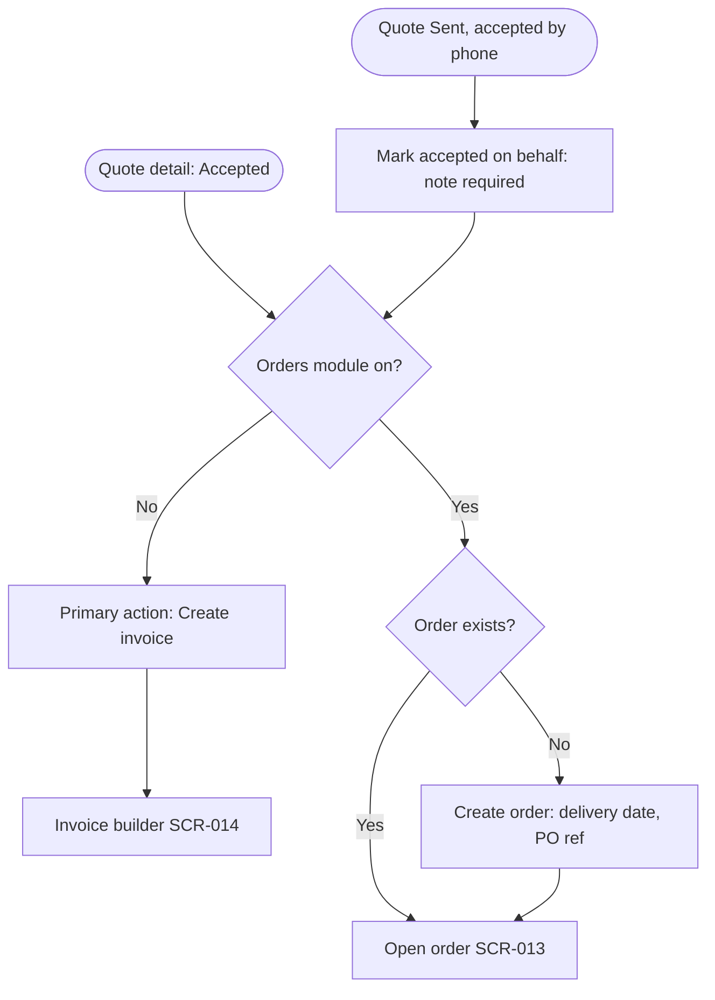

### UC-010 — Raise invoice
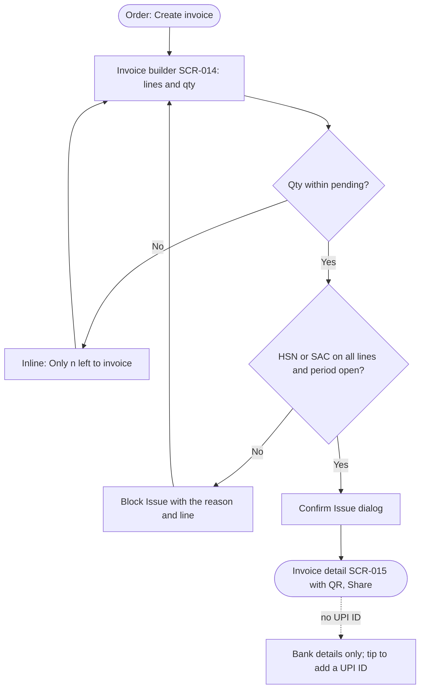

### UC-011 — Record payment
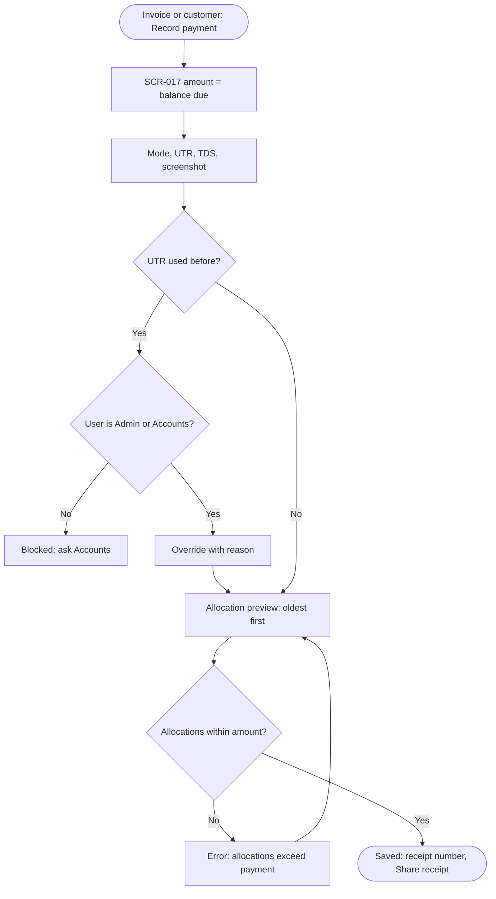

### UC-012 — Credit note
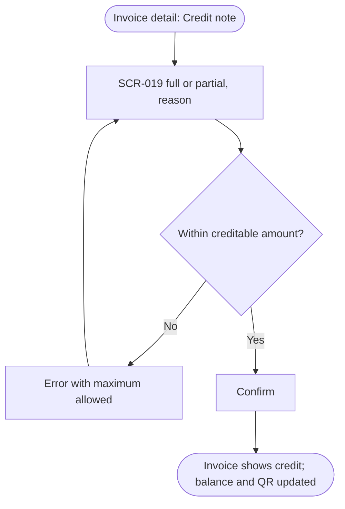

### UC-013 — Customer review and statement
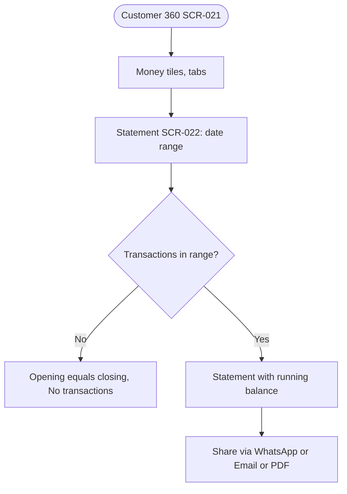

### UC-014 — Personal-data request
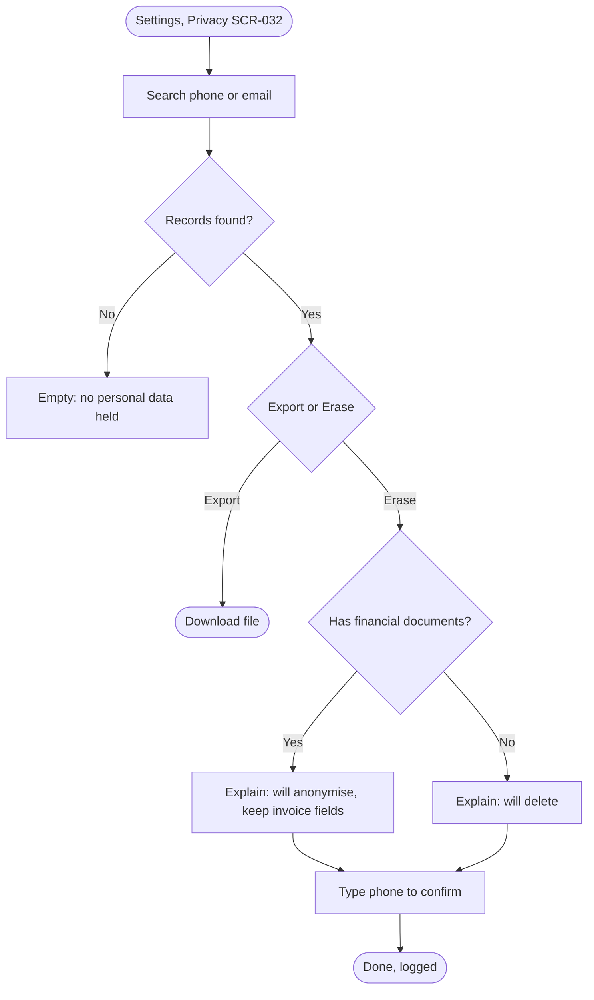

### UC-015 — Release upgrade
N/A for UX: a CI/CD process run by the product owner. The only UI touchpoint is **Settings › About** (SCR-027), which shows the current version and the migration log.

## 6. Screen inventory

| SCR ID | Screen | Purpose | Roles | Linked FR / UC | Priority |
|---|---|---|---|---|---|
| SCR-001 | Sign in (incl. change password, 2FA) | Authenticate | All | FR-007 – FR-009, FR-012 · UC-001 | Must |
| SCR-002 | Home dashboard | Today's work and money at a glance; setup checklist | All | FR-084, FR-049, FR-050 · UC-002 | Must |
| SCR-003 | Leads list / Kanban | Find, filter, bulk-act on leads | Lead roles | FR-034, FR-032, FR-033 · UC-005 | Must |
| SCR-004 | Lead detail | One lead: actions, timeline, follow-ups; overflow Assign and Merge | Lead roles | FR-030, FR-031, FR-033, FR-035, FR-044 – FR-050, FR-078 · UC-005 | Must |
| SCR-005 | Lead form | Create/edit lead | Admin, Mgr, Exec | FR-025, FR-028, FR-029, FR-086 · UC-004 | Must |
| SCR-006 | Call outcome sheet | Log call outcome and next step | Users with record access | FR-044, FR-045, FR-081 · UC-005 | Must |
| SCR-007 | Message composer (WhatsApp / Email) | Template pick, preview, send | Users with record access | FR-046, FR-047, FR-021 | Must |
| SCR-008 | Follow-ups | Today / overdue / upcoming list | All with follow-ups | FR-049 | Must |
| SCR-009 | Convert lead dialog | Lead → customer | Owner, Mgr, Admin | FR-036 · UC-006 | Must |
| SCR-010 | Quote builder | Create/edit/revise quote | Admin, Mgr, Exec | FR-051 – FR-054 · UC-007 | Must |
| SCR-011 | Quote detail | Status, revisions, approval, share, convert | Quote roles | FR-053 – FR-059 · UC-007, UC-009 | Must |
| SCR-012 | Customer quote page (public) | View, accept, request changes, reject | End customer | FR-057, FR-058, FR-079 · UC-008 | Must |
| SCR-013 | Order detail | Status, invoiced vs pending, create invoice | Admin, PM, owner | FR-059 – FR-061 · UC-009 | Must |
| SCR-014 | Invoice builder | Draft invoice from order/quote | Admin, Accounts | FR-062 – FR-065 · UC-010 | Must |
| SCR-015 | Invoice detail | Preview with QR, share, payments, credit | Finance roles | FR-065 – FR-069 · UC-010 | Must |
| SCR-016 | Customer invoice page (public) | Live balance, QR, Pay via UPI, PDF | End customer | FR-068, FR-069, FR-079 | Must |
| SCR-017 | Record payment | Payment + allocation + receipt | Admin, Accounts, Mgr, Exec¹ | FR-070 – FR-072 · UC-011 | Must |
| SCR-018 | Payment detail / receipt | View, share receipt, reverse | Finance roles | FR-072, FR-073 | Must |
| SCR-019 | Credit note dialog | Full/partial credit | Admin, Accounts | FR-066 · UC-012 | Must |
| SCR-020 | Customers list | Find customers; outstanding column | Customer roles | FR-074, FR-083 | Must |
| SCR-021 | Customer 360 | Everything about one customer | Customer roles | FR-074, FR-075 · UC-013 | Must |
| SCR-022 | Statement of account | Date-range statement, share | Admin, Mgr, Accounts, owner | FR-076 · UC-013 | Must |
| SCR-023 | Sales hub | Tabs: Quotes, Orders, Invoices, Payments | Per role | FR-051, FR-059, FR-062, FR-070 | Must |
| SCR-024 | Global search (command palette) | Find anything | All | FR-083 | Must |
| SCR-025 | Notification centre | In-app notifications, preferences link | All | FR-082 | Must |
| SCR-026 | Reports | Report list and report view, export | Per role | FR-085, FR-050 | Must |
| SCR-027 | Settings home | Company, GST, branding, terminology, mode, modules, SLA, About | Admin | FR-003 – FR-006, FR-017 · UC-002, UC-015 | Must |
| SCR-028 | Masters | Generic list/edit for each master | Admin (+ per §3.2) | FR-018 – FR-022, FR-024 | Must |
| SCR-029 | Google & Sheet sync | Connect Google, sheets, mapping, sync log, errors | Admin | FR-037 – FR-043, FR-027 · UC-003 | Must |
| SCR-030 | Users & roles | Users, roles, teams and assignment rules, sessions, support access | Admin | FR-010, FR-011, FR-014, FR-031, FR-089 | Must |
| SCR-031 | Audit log | Search audit entries | Admin, Viewer | FR-015, FR-016 | Must |
| SCR-032 | Privacy requests | Export/erase a person | Admin | FR-087, FR-088 · UC-014 | Must |
| SCR-033 | My account | Profile, password, 2FA, login history, notification prefs | All | FR-009, FR-012, FR-082 | Must |
| SCR-034 | Import wizard | Excel/CSV import with preview | Admin, Mgr (leads) | FR-023, FR-026 | Must |
| SCR-035 | Web enquiry form (public, embeddable) | Lead capture from website | Website visitor | FR-027, FR-086 · UC-004 | Must |
| SCR-036 | App shell | Navigation (role-filtered), offline banner, install prompt, global banners, toasts, 403/404 pages | All | FR-013, FR-043, FR-080, FR-081, FR-091² | Must |

¹ When enabled for the role. FR-001, FR-002 (provisioning), FR-077 (Drive folder tree) and FR-090 (retention purge) are system-only with no screen; their results surface in SCR-027 About, SCR-029 and the audit log. ² FR-091 has no visible UI. Its integration extension points surface only as an "Integrations" list in SCR-029 (MVP providers shown as built-in).

## 7. Screen specifications

**Common state conventions:**
- Loading uses CMP-022 skeletons after 300 ms.
- Empty uses CMP-021.
- Error uses CMP-018 with Retry.
- Success uses a CMP-017 toast, plus a redirect where noted.
- No permission shows a 403 page, or the action is hidden and an explanation tooltip appears where the user might expect it.

Each screen's state row lists only what is specific to it.

### SCR-001 — Sign in
- **Purpose / FRs:** FR-007 – FR-009, FR-012.
- **Layout:** centred card (max 400 px) on `bg`, with the client logo and app name, a form, and a footer "Trouble signing in? Ask your admin." Steps in the same card: credentials → change password → 2FA code.
- **Components:** CMP-003 (username, password with show/hide), CMP-001, CMP-018.
- **Data:** none before login. Afterwards, last-login info appears in My account.
- **Actions:** primary "Sign in"; on step 2 "Set new password"; on step 3 "Verify".
- **Validation & messages:**
  - "Username or password is incorrect."
  - "Too many attempts — try again at 10:15."
  - "Your account is inactive — contact your admin."
  - "Password must be at least 10 characters and not contain your username."
- **States:**

  | Default | Loading | Empty | Error | Partial data | Success | No permission |
  |---|---|---|---|---|---|---|
  | Empty fields, Sign in enabled | Button spinner, fields read-only | n/a | Inline banner above form; focus to banner | n/a | Redirect to Home (or the page originally requested) | Inactive account message |

- **Responsive:** same card at all sizes, full-width with 16 px gutters below 400 px.
- **Accessibility:**
  - `<main>` with `<h1>` "Sign in to {App name}"
  - `autocomplete="username"` / `current-password` / `new-password` / `one-time-code`
  - the error banner is `role="alert"`
  - the Enter key submits
- **Microcopy:** title "Sign in to SaleSphere"; button "Sign in"; change step "Set a new password to continue".

### SCR-002 — Home dashboard
- **Purpose / FRs:** FR-084, FR-049, FR-050; first-run setup checklist (UC-002).
- **Layout:** greeting + date → (Admin first-run) setup checklist card → tiles grid → "Today" list (follow-ups due and overdue) → "New leads" list with SLA chips → pipeline chart → quotes awaiting response.
- **Grid:** 2 columns on mobile tiles, 4 columns ≥ 1024.
- **Components:** CMP-013 tiles (Follow-ups today, Overdue follow-ups, New leads, SLA breached, Quotes awaiting, Overdue invoices, Collections this month), CMP-010, CMP-039, CMP-038, CMP-033 (checklist).
- **Data:** counts and sums in the user's scope (RULE-011).
- **Actions:** tile → filtered list; row → record; quick actions on rows (Call/WhatsApp).
- **States:**

  | Default | Loading | Empty | Error | Partial data | Success | No permission |
  |---|---|---|---|---|---|---|
  | Tiles with values | Tile skeletons | "All caught up 🎉 — no follow-ups today" per section; first-run checklist for Admin | Per-tile "—" with retry; page stays usable | Some tiles failed → those tiles show retry | n/a | Tiles hidden per role (e.g. no money tiles for PM) |

- **Responsive:** 360 = stacked; 768 = tiles in 2×4; 1280 = tiles in a row plus two-column lists.
- **Accessibility:** `<h1>` "Good morning, Priya"; tiles are links with full accessible names; the chart has a table alternative.
- **Microcopy:** section titles "Today", "New leads", "Waiting on customers"; empty "Nothing overdue. Nice work."

### SCR-003 — Leads list / Kanban
- **Purpose / FRs:** FR-034, FR-032, FR-033.
- **Layout:** page header (title, view toggle List/Board, "New lead") → FilterBar (CMP-034, quick chips: My leads · New · Due today · SLA breached · Unreachable) → list (mobile rows / desktop table) or Kanban. Desktop split view: the list on the left opens a lead in the right pane.
- **Components:** CMP-034, CMP-010, CMP-009, CMP-011, CMP-019 (source/stage chips), CMP-039, CMP-037.
- **Data:** name, company, phone (masked last 4 on list), source chip, stage, value, owner avatar (Team), SLA chip, next follow-up.
- **Actions:**
  - row: open, swipe Call/WhatsApp
  - bulk (Admin/Mgr): Assign, Change stage, Add tag
  - Kanban drag between stages; dropping on Lost or Junk prompts for the reason
- **Validation & messages:**
  - bulk result toast "48 reassigned · 2 skipped (outside your team) — View"
  - drag to Won → "Convert the lead to mark it as Won"
- **States:**

  | Default | Loading | Empty | Error | Partial data | Success | No permission |
  |---|---|---|---|---|---|---|
  | Paged list | Skeleton rows | First-use: "No leads yet — add one or connect your Google Sheet" (Admin CTA); filters: "No leads match — Clear filters" | Banner + Retry; cached list if offline | Bulk partial results highlighted | Toast on stage change with Undo | Exec sees own only; bulk bar hidden |

- **Responsive:** 360 rows + FAB; 768 table without the owner column; ≥ 1024 split view.
- **Accessibility:**
  - Kanban has a keyboard move and a "Move to…" menu
  - the view toggle is a radio group
  - result counts are announced
- **Microcopy:** "New lead", "Board", "List", "Save filter", "Assign to…".

### SCR-004 — Lead detail
- **Purpose / FRs:** FR-033, FR-035, FR-044 – FR-050, FR-078, FR-086.
- **Layout:**
  - header: name, company, stage chip (tappable to change), SLA chip, owner
  - ActionBar (Call · WhatsApp · Email · Directions)
  - "Next follow-up" card
  - details card (phone, email, location, interest, value, source and consent)
  - quotes card
  - files
  - timeline with filter chips
  - overflow menu: Edit, Convert, Assign, Merge (Mgr/Admin), Mark Lost/Junk
- **Components:** CMP-025, CMP-027, CMP-019, CMP-039, CMP-012, CMP-028, CMP-032, CMP-016.
- **Actions:** primary "Convert to customer" (once qualified) or "New quote"; the stage change sheet requires a reason for Lost/Junk; Add note; Add follow-up.
- **Validation & messages:**
  - "Choose a reason to mark this lead as Lost."
  - re-enquiry banner "Re-enquired via Google Sheet today 10:42".
- **States:**

  | Default | Loading | Empty | Error | Partial data | Success | No permission |
  |---|---|---|---|---|---|---|
  | Full record | Header + timeline skeleton | Timeline: "No activity yet — make the first contact" | 404 "This lead doesn't exist or isn't assigned to you" | Offline: cached data + "Offline — showing last synced"; queued items with "Will sync" | Toasts for note saved, stage changed (Undo) | Read-only roles: ActionBar Call/WA still allowed; edit hidden |

- **Responsive:** mobile stacked with a sticky ActionBar above the tab bar; desktop: detail pane with the ActionBar in the header and the timeline in the right column (≥ 1280).
- **Accessibility:**
  - the ActionBar buttons are named with the lead name
  - the stage chip is a button with `aria-haspopup="dialog"`
  - timeline day headings are `<h3>`
- **Microcopy:** "Next follow-up", "No follow-up set — Add one", "Converted to Acme Interiors" (banner when Won).

### SCR-005 — Lead form
- **Purpose / FRs:** FR-025, FR-028, FR-029, FR-086.
- **Layout:**
  - mobile: full-screen dialog
  - desktop: side drawer
  - fields: name*, phone (CMP-036), email, company, city, pincode, interest (combobox), expected value (CMP-035), source*, consent basis (auto, editable by Admin), notes, tags, owner (Team: "Assign automatically" default)
- **Actions:** "Save lead" (primary), "Save and call" (mobile secondary), Cancel.
- **Validation & messages:**
  - "Add a phone number or email."
  - "This number looks incomplete — check it." (a warning, not a block)
  - duplicate dialog "Ravi Kumar already exists (Interested, owner Priya). Open lead / Add as re-enquiry".
- **States:**

  | Default | Loading | Empty | Error | Partial data | Success | No permission |
  |---|---|---|---|---|---|---|
  | Empty form with defaults | Save spinner | n/a | Field errors + summary; network error keeps input | n/a | Toast "Lead created · assigned to Priya" → Lead detail | Hidden for read-only roles |

- **Responsive:** single column below 768, two columns ≥ 768.
- **Accessibility:** required fields are marked in text; error summary; `autocomplete` on name/phone/email.

### SCR-006 — Call outcome sheet
- **Purpose / FRs:** FR-044, FR-045, FR-081.
- **Layout:** bottom sheet (desktop: popover dialog) titled "How did the call with Ravi go?" containing:
  - outcome chips (Connected, No answer, Busy, Wrong number, plus configured outcomes)
  - note (Textarea, optional)
  - "Next follow-up" with presets (Tomorrow 11:00, In 2 days, Next week, Custom)
  - "Change stage" (optional, collapsed)
  - Save
- **Behaviour:**
  - opens automatically on return from the dialer (visibility change within 30 min of tapping Call)
  - otherwise reachable from the "Outcome not recorded" chip
  - 3 taps: outcome → preset → Save
- **Validation & messages:**
  - Wrong number → "Mark number to check?" toggle on by default
  - rule fired → toast "3rd no answer — tagged Unreachable, follow-up in 2 days".
- **States:**

  | Default | Loading | Empty | Error | Partial data | Success | No permission |
  |---|---|---|---|---|---|---|
  | No outcome selected; Save disabled with hint "Choose an outcome" | Save spinner | n/a | Save failed online → kept, "Couldn't save — Retry" | Offline → "Saved on this phone — will sync" | Sheet closes, toast, SLA chip updates | n/a |

- **Accessibility:**
  - outcome chips form a radio group
  - focus starts on the group
  - on dismiss with an outcome chosen: "Discard outcome?"

### SCR-007 — Message composer (WhatsApp / Email)
- **Purpose / FRs:** FR-046, FR-047, FR-021.
- **Layout:**
  - template picker (list with preview) → editable message with variables filled
  - for Email: To/Cc/Subject/Body/Attachments (generated PDFs offered as chips)
  - primary "Open WhatsApp" or "Send email"
- **Validation & messages:**
  - "Add a valid mobile number first."
  - "Email isn't set up — ask your admin" with a "Use my email app" fallback
  - "Daily email limit reached — try tomorrow or use WhatsApp."
  - unfilled variables are highlighted: "Amount is empty for this lead."
- **States:**

  | Default | Loading | Empty | Error | Partial data | Success | No permission |
  |---|---|---|---|---|---|---|
  | Template list | Sending spinner (email) | No templates: "Create a template in Settings" (Admin link) | Send failed: "Couldn't send — Retry" (3 auto-retries noted) | Some variables empty (highlighted) | WhatsApp opens; activity logged toast "WhatsApp opened"; email "Email sent" | Gmail scope missing → explanation |

- **Accessibility:** the template list is a listbox; the preview is a live region; attachments are removable with labelled buttons.

### SCR-008 — Follow-ups
- **Purpose / FRs:** FR-049.
- **Layout:** segmented tabs Overdue · Today · Upcoming · Done; rows with person, type icon, time, note, and actions (Call, Done, Reschedule).
- **States:**

  | Default | Loading | Empty | Error | Partial data | Success | No permission |
  |---|---|---|---|---|---|---|
  | Grouped by time | Skeleton rows | "No follow-ups today" + "Plan tomorrow" link | Retry banner | Offline cached | Done → row slides out + Undo | Viewer: hidden |

- **Accessibility:** Done is a button with an accessible name ("Mark follow-up with Ravi done").

### SCR-009 — Convert lead dialog
- **Purpose / FRs:** FR-036.
- **Layout:**
  - match section (if any): radio "Link to existing: Acme Interiors (C-0042)" / "Create new customer"
  - customer fields: display name, legal name, type, GSTIN (optional; validated), billing address with state*, contact name/phone/email prefilled
- **Validation & messages:** "GSTIN doesn't match the state Karnataka (29)."
- **States:**

  | Default | Loading | Empty | Error | Partial data | Success | No permission |
  |---|---|---|---|---|---|---|
  | Prefilled from lead | Match check spinner, then form | n/a | Field errors; network error keeps input | Missing address → saved with "Complete details" flag | Redirect to Customer 360 + toast "Converted" | Hidden for read-only roles |

### SCR-010 — Quote builder
- **Purpose / FRs:** FR-051 – FR-054, FR-052.
- **Layout:**
  - header: party (lead/customer), quote no. or "Draft", revision, date, valid until, place of supply
  - LineItemEditor (CMP-029)
  - TotalsBlock (CMP-030), sticky on desktop at the right, collapsible summary bar on mobile ("Total ₹21,240 ▲")
  - terms, payment terms, notes
  - footer: "Preview", primary "Send" (or "Request approval")
- **Validation & messages:**
  - "Add at least one item."
  - discount over limit: "15 % is above your 10 % limit — this quote needs approval."
  - HSN warning "Add a SAC code — needed before invoicing."
- **States:**

  | Default | Loading | Empty | Error | Partial data | Success | No permission |
  |---|---|---|---|---|---|---|
  | Draft with one empty line | Saving indicator "Saved" / "Saving…" (autosave every 5 s) | Catalogue empty: "Add products in Settings" + free-text line option | Conflict: "Changed by Rahul — reload" | Revision mode banner "Editing R1 of QT/25-26/0007" | Send → share sheet → Quote detail | Read-only quote: lock banner with reason |

- **Responsive:** mobile: lines as cards with an edit sheet; desktop: editable table.
- **Accessibility:**
  - totals update live, politely announced after 1 s idle
  - line inputs are labelled by line number
  - keyboard: Enter adds a line, Ctrl+Enter opens Preview

### SCR-011 — Quote detail
- **Purpose / FRs:** FR-053 – FR-059.
- **Layout:**
  - header: number + revision, status chip, customer, total
  - status timeline (Sent → Viewed 3× → Accepted)
  - DocumentPreview (CMP-042)
  - actions by status: Share, Revise, Approve/Reject (manager), Create order / Create invoice (accepted), "Mark accepted on behalf", Revoke link
  - revisions list with Compare
- **Validation & messages:**
  - approval banner for the manager: "Priya requests 15 % discount — Approve / Reject (comment)"
  - "You can't approve your own quote."
- **States:**

  | Default | Loading | Empty | Error | Partial data | Success | No permission |
  |---|---|---|---|---|---|---|
  | Preview + status | Preview skeleton page | n/a | Load error Retry | "PDF pending — Regenerate PDF" | Toasts: Approved, Order created | Approve hidden for non-approvers |

### SCR-012 — Customer quote page (public)
- **Purpose / FRs:** FR-057, FR-058, FR-079.
- **Layout:**
  - the client's branding header
  - "Quotation QT/25-26/0007 for Kavya Rao", valid-until chip
  - mobile-friendly HTML quote (lines, totals, terms) and "Download PDF"
  - sticky bottom: "Accept quote" (primary), "Request changes", "Decline"
  - Accept sheet: "Type your full name to accept" + optional comment
- **Validation & messages:** expired/superseded/revoked variants (UC-008 flow). After accepting: "Thank you, Kavya — Arjun will be in touch shortly."
- **States:**

  | Default | Loading | Empty | Error | Partial data | Success | No permission |
  |---|---|---|---|---|---|---|
  | Active quote | Page skeleton | n/a | "We couldn't load this quote — try again" | PDF not ready → HTML view only | Confirmation screen; actions disabled | Revoked/expired link page |

- **Accessibility:** works without login; no tracking cookies; full keyboard; `lang="en-IN"`.

### SCR-013 — Order detail
- **Purpose / FRs:** FR-059 – FR-061.
- **Layout:**
  - header: SO number, status chip (changeable), customer, value
  - progress: invoiced % and received % bars with text values
  - lines table (ordered / invoiced / pending)
  - invoices list
  - actions: "Create invoice", "Put on hold", "Cancel order" (reason)
- **Validation & messages:** "Credit the invoices first to cancel this order."
- **States:**

  | Default | Loading | Empty | Error | Partial data | Success | No permission |
  |---|---|---|---|---|---|---|
  | Order + lines | Skeleton | No invoices yet: "Create the first invoice" | Retry | n/a | Toast "Invoice draft created" | Read-only roles |

### SCR-014 — Invoice builder
- **Purpose / FRs:** FR-062 – FR-065.
- **Layout:**
  - type selector (Tax invoice / Proforma; Bill of Supply on non-GST installs)
  - date, due date (from terms), place of supply, bill-to/ship-to
  - lines with pending qty hints ("6 left")
  - TotalsBlock
  - primary "Issue invoice" (confirm), secondary "Save draft"
- **Validation & messages:**
  - "Only 6 left to invoice."
  - "Line 2 needs a SAC code."
  - "This date is in a locked period (before 01-04-2026)."
- **Microcopy:** invoice type helper text — Tax invoice: "For GST-registered businesses"; Bill of Supply: "For businesses not registered for GST — no tax is charged"; Proforma: "A request for advance payment — not a tax invoice".
- **States:**

  | Default | Loading | Empty | Error | Partial data | Success | No permission |
  |---|---|---|---|---|---|---|
  | Prefilled from order | Spinner on Issue | Nothing pending: "Everything on this order is invoiced" | Issue failed: still Draft, no number used | n/a | Redirect to Invoice detail with QR + toast "INV/25-26/0142 issued" | Hidden for non-finance roles |

### SCR-015 — Invoice detail
- **Purpose / FRs:** FR-065 – FR-069.
- **Layout:**
  - header: number, status chip, customer, due date, balance due
  - DocumentPreview (A4) with the UPIPaymentBlock (CMP-031)
  - side panel/mobile cards: payments list, credit notes, share history
  - actions: Share (WhatsApp/Email/Copy link), Record payment, Credit note, Download PDF, Duplicate copy
- **States:**

  | Default | Loading | Empty | Error | Partial data | Success | No permission |
  |---|---|---|---|---|---|---|
  | Preview with live QR | Page skeleton | No payments: "No payments yet" | Retry | PDF pending banner; no UPI ID → tip "Add a UPI ID to show a QR" | PAID stamp when balance 0 | PM: no access (403) |

- **Accessibility:** the QR alt text includes the amount and VPA; the balance is given as text; the lock icon reads "Issued — can't be edited".

### SCR-016 — Customer invoice page (public)
- **Purpose / FRs:** FR-068, FR-069, FR-079.
- **Layout:**
  - branding
  - "Invoice INV/25-26/0142", due date, **Balance due ₹28,380.00** (large)
  - QR (desktop) / "Pay via UPI" button (mobile, primary) + UPI ID copy + bank details
  - invoice summary and "Download PDF"
  - footer note "After paying, send your UTR to {owner phone}"
- **States:**

  | Default | Loading | Empty | Error | Partial data | Success | No permission |
  |---|---|---|---|---|---|---|
  | Payable | Skeleton | n/a | Retry | Partly paid: "Paid ₹20,000 · Balance ₹28,380" | PAID: "Fully paid — thank you" | Revoked/expired link page |

### SCR-017 — Record payment
- **Purpose / FRs:** FR-070 – FR-072.
- **Layout:**
  - mobile: full-screen sheet; desktop: dialog
  - fields: customer (prefilled), date (today), amount (prefilled balance, "Fill balance" chip), mode (chips: UPI, Bank transfer, Cash, Cheque, Card), UTR/reference (required per mode), received in (bank), TDS toggle → amount + section, proof (camera/upload), note
  - allocation preview table (oldest first, editable amounts, "Keep remainder as advance")
  - primary "Save payment"
- **Validation & messages:**
  - "UTR 432112345678 is already used on RCPT/25-26/0088."
  - "Payment date can't be in the future."
  - "Allocations (₹31,000) are more than the payment (₹30,000)."
- **States:**

  | Default | Loading | Empty | Error | Partial data | Success | No permission |
  |---|---|---|---|---|---|---|
  | Prefilled | Save spinner | No open invoices: "Whole amount will be kept as advance" | Field + summary errors; network retry safe (idempotent) | Remainder shown as advance | Toast "₹28,380 saved · RCPT/25-26/0091 — Share receipt" | Role without permission: entry points hidden; direct URL → 403 with "Ask your admin to enable payment recording" |

### SCR-018 — Payment detail / receipt
- **Purpose / FRs:** FR-072, FR-073.
- **Layout:** receipt preview, allocations, proof thumbnail, actions Share receipt, Reverse payment (Admin/Accounts, ConfirmDialog with reason).
- **States:**

  | Default | Loading | Empty | Error | Partial data | Success | No permission |
  |---|---|---|---|---|---|---|
  | Receipt | Skeleton | n/a | Retry | Receipt PDF pending | Reversed: banner "Cancelled — cheque bounced" | Reverse hidden for others |

### SCR-019 — Credit note dialog
- **Purpose / FRs:** FR-066.
- **Layout:** radio Full / Selected lines / Amount, reason (required), date, a preview of the new balance; primary "Issue credit note".
- **Validation & messages:** "You can credit up to ₹10,000 on this invoice."
- **States:**

  | Default | Loading | Empty | Error | Partial data | Success | No permission |
  |---|---|---|---|---|---|---|
  | Full selected | Spinner | n/a | Field errors | Excess-to-advance note | Toast "CN/25-26/0003 issued" | Finance roles only |

### SCR-020 — Customers list
- **Purpose / FRs:** FR-074, FR-083.
- **Layout:** search + chips (My customers · Overdue · Has advance), rows with name, company, outstanding (danger if overdue), last activity; desktop table with outstanding/overdue columns.
- **States:**

  | Default | Loading | Empty | Error | Partial data | Success | No permission |
  |---|---|---|---|---|---|---|
  | List | Skeleton | "No customers yet — convert a lead or import from Excel" | Retry | Offline cached | n/a | Scope-filtered |

### SCR-021 — Customer 360
- **Purpose / FRs:** FR-074, FR-075.
- **Layout:**
  - header strip: name, company, tags, owner, customer since
  - ActionBar + "New quote"
  - KPI tiles (8, horizontally scrollable on mobile)
  - tabs: Overview · Orders · Quotations · Invoices · Payments · Ledger · Activities · Contacts · Documents
- **States:**

  | Default | Loading | Empty | Error | Partial data | Success | No permission |
  |---|---|---|---|---|---|---|
  | Overview tab | Tiles + tab skeleton | Per tab, e.g. "No invoices yet" | Per-tab retry | Advance chip "₹5,000 advance on account" | n/a | PM: money tiles and Invoices/Payments/Ledger tabs hidden (FR-075 AC3) |

- **Accessibility:** tabs are reflected in the URL; tiles are links with names that include the amounts.

### SCR-022 — Statement of account
- **Purpose / FRs:** FR-076.
- **Layout:** date range (presets: This FY, Last FY, Last 3 months, Custom) → table (Date, Type, Number, Debit, Credit, Balance) with opening/closing rows → Share (WhatsApp / Email / PDF / Excel).
- **States:**

  | Default | Loading | Empty | Error | Partial data | Success | No permission |
  |---|---|---|---|---|---|---|
  | This FY | Skeleton | "No transactions in this period" with opening = closing | Retry | n/a | Toast "Statement link copied" | PM hidden |

### SCR-023 — Sales hub
- **Purpose / FRs:** FR-051, FR-059, FR-062, FR-070.
- **Layout:** tabs Quotes · Orders · Invoices · Payments (per role), each a filterable list with status chips and amount; "New …" action per tab.
- **States:** as SCR-020 per tab. Tabs the role can't use are hidden.

### SCR-024 — Global search
- **Purpose / FRs:** FR-083.
- **Layout:** command palette overlay (desktop) or full-screen search (mobile): input, recent searches, grouped results, quick actions.
- **States:**

  | Default | Loading | Empty | Error | Partial data | Success | No permission |
  |---|---|---|---|---|---|---|
  | Recent + quick actions | "Searching…" inline | "No results for '0143' — check the number" | "Search unavailable — Retry" | Offline: "Showing results from this phone only" | Opens record | Scope-filtered silently |

### SCR-025 — Notification centre
- **Purpose / FRs:** FR-082.
- **Layout:** list grouped Today/Earlier; "Mark all read"; "Notification settings" link (SCR-033).
- **States:** empty "You're all caught up"; push denied banner "Turn on notifications to hear about new leads instantly — How".

### SCR-026 — Reports
- **Purpose / FRs:** FR-085, FR-050.
- **Layout:** report list (RPT-002 – RPT-010 per role) → report view: filters, chart (CMP-038) with table toggle, data table, "Export to Excel".
- **States:**

  | Default | Loading | Empty | Error | Partial data | Success | No permission |
  |---|---|---|---|---|---|---|
  | Report with default filters | Chart + table skeleton | "No data for these filters" | Retry | n/a | Toast "Export ready" + download | Reports filtered by role |

### SCR-027 — Settings home
- **Purpose / FRs:** FR-003 – FR-006, FR-017, FR-022 (SLA).
- **Layout:**
  - left list (desktop) / grouped list (mobile): Company & GST, Branding, Terminology, Mode & modules, Number series, SLA & business hours, Templates, Masters, Google & Sheets, Users & roles, Audit log, Privacy, About
  - each section is a form with "Save changes"
- **Validation & messages:**
  - colour contrast warning "This colour is hard to read on white (3.2:1). Try #1D4ED8."
  - "Solo mode allows one active user. Deactivate other users first."
- **States:** standard form states. About shows the version and migration log (UC-015).

### SCR-028 — Masters
- **Purpose / FRs:** FR-018 – FR-022, FR-024.
- **Layout:** master type list → table of values (active/inactive filter) → edit drawer; "Import from Excel" (SCR-034); referenced values show "Deactivate" instead of "Delete".
- **States:**
  - empty: "No UPI IDs yet — add one to show a QR on invoices"
  - error: field errors (VPA, IFSC, GSTIN formats)

### SCR-029 — Google & Sheet sync
- **Purpose / FRs:** FR-037 – FR-043, FR-027 (form/webhook keys).
- **Layout:**
  - connection card (status chip, connected email, features by scope, Connect/Reconnect/Disconnect)
  - Sheets: list of connected sheets with status and last run
  - "Connect a sheet" wizard (CMP-033): Pick sheet (Google Picker) → Preview 5 rows → Map columns → Defaults & sync mode (webhook with Apps Script copy-paste instructions, or poll 1–4 min) → Write-back options → Done
  - per sheet: Runs tab and Import errors tab
  - Web form & webhook: embed snippet, allowed origins, API keys (create/revoke)
- **Validation & messages:**
  - "Map a Phone or Email column."
  - "SaleSphere needs edit access to mark imported rows."
  - banner "Google connection lost — Reconnect".
- **States:**

  | Default | Loading | Empty | Error | Partial data | Success | No permission |
  |---|---|---|---|---|---|---|
  | Connected + sheets | Skeleton | Not connected: explainer + "Connect Google" | Auth broken banner | Partial scopes: features disabled list | Toast "Sheet connected — first sync running" | Admin only |

### SCR-030 — Users & roles
- **Purpose / FRs:** FR-010, FR-011, FR-014, FR-031, FR-089.
- **Layout:** tabs Users · Roles · Teams (Team mode) · Sessions · Support access.
- **Users:** table plus a drawer for create/edit (one-time password shown once with Copy).
- **Roles:** discount limit, record scope, "Can record payments".
- **Teams & assignment rules (Team mode):** teams with a manager, and ordered rules (territory → source → interest, then round-robin or fewest open leads, then default owner).
- **Support access:** a switch with a duration of up to 7 days and the expiry shown.
- **Validation & messages:**
  - "Username already taken."
  - deactivate → "Reassign Priya's 34 open leads and 12 follow-ups to…"
  - "There must be at least one active admin."
- **States:** standard. Solo mode hides Teams and shows a "Switch to Team mode" CTA in Users.

### SCR-031 — Audit log
- **Purpose / FRs:** FR-015, FR-016.
- **Layout:** filters (date range, user, record type, record ID, action) → table (time, user, action, record, changes summary) → row drawer with masked before/after; Export.
- **States:** empty "No activity matches these filters".

### SCR-032 — Privacy requests
- **Purpose / FRs:** FR-087, FR-088.
- **Layout:** search by phone/email → matched records summary → actions "Export data" / "Erase" (ConfirmDialog with typed confirmation and a consequence explanation) → request log.
- **States:**
  - empty "We hold no personal data for this number"
  - success "Erased · logged on 13-11-2026"

### SCR-033 — My account
- **Purpose / FRs:** FR-009, FR-012, FR-082.
- **Layout:** profile (read-only name/role), Change password, Two-factor authentication (set up with QR + backup), Login history (last 50), Notification preferences (per event switch), Theme (System/Light/Dark), Install app.
- **States:** standard. The 2FA setup error is "That code didn't match — check your authenticator's time."

### SCR-034 — Import wizard
- **Purpose / FRs:** FR-023, FR-026.
- **Layout:** Stepper: Choose type & download template → Upload file → Map columns → Preview (valid / failed with reasons, "update existing" toggle) → Import → Result report (download failed rows).
- **Validation & messages:** "Split into files of up to 5,000 rows."
- **States:** partial: "97 imported · 3 failed — Download failed rows".

### SCR-035 — Web enquiry form (public, embeddable)
- **Purpose / FRs:** FR-027, FR-086.
- **Layout:** branded compact form: name*, phone*, email, requirement, consent checkbox (when configured: "I agree to be contacted about my enquiry"), submit "Send enquiry"; hidden honeypot.
- **States:**

  | Default | Loading | Empty | Error | Partial data | Success | No permission |
  |---|---|---|---|---|---|---|
  | Form | Button spinner | n/a | Field errors; "Something went wrong — please try again or call us" | n/a | "Thanks! We'll contact you shortly." | Disallowed origin: form not rendered |

### SCR-036 — App shell
- **Purpose / FRs:** FR-080, FR-081, FR-043.
- **Layout:**
  - sidebar or bottom bar + FAB
  - top bar (search, bell, sync indicator, avatar)
  - global banners stack: offline (CMP-040), Google connection lost (Admin), support access active (Admin)
  - install prompt (Android) / install guide (iOS, once)
  - toast region
- **States:**
  - offline banner
  - syncing badge
  - sync failed "2 items failed — Retry"
  - update available "A new version is ready — Refresh"

## 8. Interaction patterns

| Pattern | Rule |
|---|---|
| Forms | Labels above, inline validation on blur, error summary on submit, sticky primary on mobile, autosave for quote drafts only, "Discard changes?" on leave |
| Tables & lists | Desktop tables with sticky header and sort; mobile rows with swipe; bulk bar on selection; infinite scroll with "Load more" fallback |
| Search & filters | Global palette (Ctrl/Cmd + K or `/`); per-list search; quick chips + filter sheet; filters in URL; saved filters |
| Modals vs pages | Pages for records and builders; sheets for quick capture (call outcome, record payment on mobile, filters, share); dialogs for confirmations and short forms (convert, credit note) |
| Notifications | Push + in-app centre; toasts only for the user's own actions; banners for system state |
| Confirmations | ConfirmDialog for irreversible (Issue invoice, Reverse payment, Erase, Deactivate, Revoke link); Undo toast for reversible (stage change, follow-up done, delete draft line) |
| Undo | 5 s window; restores the exact previous state; announced |
| File upload | Camera first on mobile; progress; resumable; type/size errors per file |
| Date & time | DD-MM-YYYY, IST; presets; typing allowed; relative time with absolute on hover/focus |
| Pagination | Server-side; 25 per page desktop default; "Showing 1–25 of 2,000" |
| Share | One share sheet: WhatsApp (template), Email, Copy link, Download PDF, native share (mobile) |
| Swipe | Right = Call, left = WhatsApp; never the only path; disabled when phone invalid |
| Offline | Read cached; queue notes, call outcomes, follow-ups; everything else disabled with "Needs internet" tooltip |

## 9. Content & tone of voice

- **Plain, friendly, brief:** "Call Ravi", "Send quote", "Record payment", not "Submit" or "OK".
- **Indian English and formats:** ₹, lakh grouping, DD-MM-YYYY, "mobile number", "UPI ID", "UTR".
- **Errors** say what happened and what to do: "Only 6 left to invoice — reduce the quantity or amend the order."
- **Permission messages** name who can help: "Ask your admin to turn on payment recording for your role."
- **Customer-facing pages** use the client's name and voice, never "SaleSphere".
- **Terminology** follows the client's renamed labels (Lead → Enquiry), applied everywhere, including empty states.

**Microcopy glossary:**

| Context | Text |
|---|---|
| Quick add | "Quick add" → Lead · Quote · Payment · Note · Follow-up |
| SLA chip | "12 min left" · "Due in 3 min" · "Breached 25 min" · "Contacted in 6 min" · "Starts 9:00" |
| Quote statuses | Draft · Waiting approval · Sent · Viewed 3× · Changes requested · Accepted · Declined · Expired · Replaced |
| Invoice statuses | Draft · Issued · Partly paid · Paid · Overdue · Cancelled |
| Offline banner | "You're offline. Notes and call outcomes will sync when you're back." |
| Google banner | "Google connection lost — leads from your sheet are paused. Reconnect" |
| Empty leads | "No leads yet. Add one, or connect your Google Sheet to bring them in automatically." |
| Accept page | "Accept quote" · "Type your full name to accept" · "Thank you — {owner} will be in touch shortly." |

## 10. Accessibility checklist (WCAG 2.2 AA)

- [x] Contrast ≥ 4.5:1 for text and ≥ 3:1 for UI: all token pairs computed (design-system §2.1); client brand colours validated on save.
- [x] Visible focus: 2 px focus ring with 2 px offset on every interactive element (2.4.7, 2.4.11 not obscured by sticky bars, which have scroll padding).
- [x] Keyboard-only end to end: every swipe and drag action has a button or menu equivalent; Kanban keyboard move; command palette.
- [x] Labels and error association: visible labels, `aria-describedby`, error summary, focus to first error (3.3.1, 3.3.3).
- [x] Targets ≥ 44 px (exceeds 2.5.8's 24 px minimum); dragging alternatives (2.5.7).
- [x] Reduced motion respected (§2.5 design system).
- [x] Headings and landmarks: one `<h1>` per page; `<nav>`, `<main>`, `<aside>`; skip link "Skip to content".
- [x] Alt text: QR alt includes amount and VPA; decorative icons `aria-hidden`.
- [x] No info by colour alone: status chips always have text; overdue amounts carry the "Overdue" label.
- [x] Consistent help (3.2.6): "Help" location fixed in the More/user menu.
- [x] Redundant entry (3.3.7): lead → customer → quote → invoice carry data forward; addresses never re-typed.
- [x] Accessible authentication (3.3.8): paste allowed in password and OTP fields; no cognitive tests (honeypot instead of CAPTCHA puzzles).
- [x] Reflow at 320 CSS px and 400 % zoom without horizontal scroll (except data tables, which scroll within their own region).
- [x] Language: `lang="en-IN"`; Indic names render with Noto fallbacks.

## 11. Usability test plan

| Item | Plan |
|---|---|
| Participants | 5 people: pilot freelancer (P-01), 2 sales executives, 1 accounts person, 1 SMB owner; plus 3 "end customers" for public pages |
| Method | Moderated remote sessions on the participant's own phone (prototype URL), 30 min each, think-aloud |
| Tasks | T1 Log a call outcome with a follow-up tomorrow (≤ 3 taps after return; success = saved correctly). T2 Create and send a 2-item quote via WhatsApp (≤ 5 min). T3 As a customer, accept a quote on the phone (≤ 1 min, no help). T4 Raise an invoice from an accepted quote and share it (≤ 1 min). T5 Record a UPI payment with a UTR from a screenshot (≤ 1 min). T6 Find who owes the most and share their statement (≤ 2 min). |
| Success criteria | ≥ 80 % task completion without help; SUS ≥ 75; no critical errors (wrong amount/customer) |
| When | After G4 using the prototype; again with the pilot build in Phase 10 |

## 12. Open questions

| ID | Question | Owner | Default if no answer |
|---|---|---|---|
| Q-024 | SaleSphere's own product logo/wordmark for the default theme and sign-in pages — do you have one? | Product owner | Text wordmark "SaleSphere" in Inter 600 with a simple sphere glyph; replaced by each client's logo |
| Q-025 | Should the customer-facing pages (quote/invoice) show "Powered by SaleSphere" in the footer? | Product owner | Yes, small and muted; can be switched off per client |
