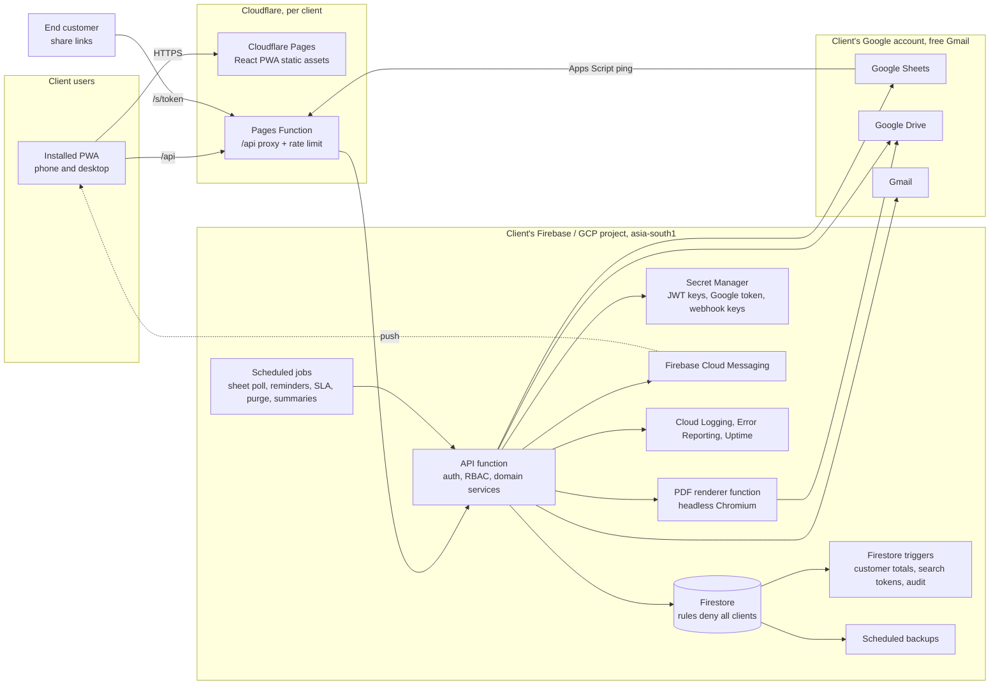
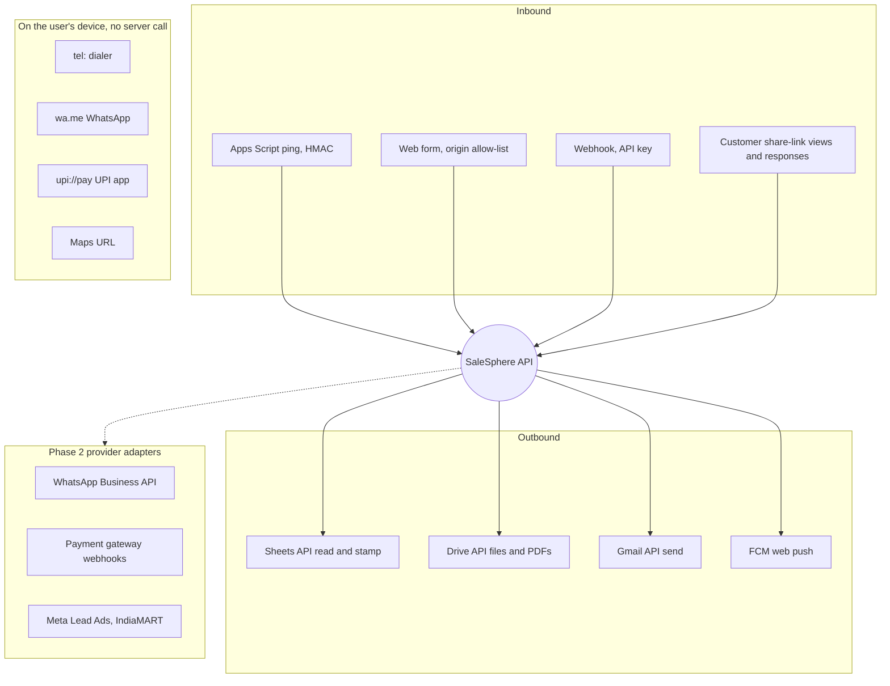

# Solution Design Document — SaleSphere CRM

| Version | Date | Author | Change |
|---|---|---|---|
| 0.1 | 2026-11-13 | Claude (solution architect; business fit by techno-functional consultant) | Initial draft from BRD v1.0, FRD v0.2, process flows v0.1, UX v0.1 |

**Inputs:** [`BRD`](../01-brd/BRD.md) · [`FRD`](../02-frd/FRD.md) · [`PROCESS-FLOWS`](../03-process/PROCESS-FLOWS.md) · [`UX-SPEC`](../04-ux/UX-SPEC.md) · product owner's [source design](../00-source/SaleSphere-Solution-Design.md) (SD).

## 1. Executive summary

SaleSphere is a resellable lead-to-cash CRM. Each Indian SMB or freelancer client gets an isolated install. This document compares four ways to deliver it and recommends **Option A: a per-client install on Firebase + Cloudflare**, which is the product owner's design (SD §2, CON-001).

| Option | What it is | Weighted score (out of 5) |
|---|---|---|
| **A** (recommended) | One isolated Google Cloud/Firebase project per client: Cloudflare Pages React PWA, Cloud Functions API, Firestore in Mumbai, built-in authentication, Google Drive for files | **4.00** |
| B | Per-client Docker VM: Next.js + NestJS + PostgreSQL | 3.90 |
| C | Multi-tenant SaaS | 3.70 |
| D | Configure an off-the-shelf CRM and invoicing SaaS | 3.25 |

Option A wins on four counts:
- **Cost:** per-client running cost is close to zero (free tiers plus pay-as-you-go, billed to the client's own Google Cloud account).
- **No servers:** nothing to patch per client.
- **Fit:** it is Google-native (Sheets, Drive, Gmail).
- **Isolation:** every client is fully isolated, which keeps compliance simple.

Option A's weaknesses are owning authentication ourselves, Firestore's limited querying (search and reports), lock-in to Firebase, and rendering Indic scripts in PDFs. Each has a concrete mitigation (§4.4, §12), and each becomes an ADR in Phase 6.

**Delivery plan:**
- **MVP** in about 10 weeks, piloted with a freelance web developer in Solo mode.
- **v1:** Team mode, WhatsApp Business API, payment gateway, project orders.
- **v2:** intelligent features, e-invoice, Tally export.
- **v3:** one-command install and store apps.

**Indicative cost:**
- per-client running cost: **≈ ₹0–500/month** at pilot scale
- one-time setup effort: about 1 working day per client, for a ₹20,000 fee

## 2. Business problem & requirements summary

| Area | Summary | Refs |
|---|---|---|
| Problem | SMBs and freelancers lose Sheet/WhatsApp leads, re-type quotes and invoices, get paid late or the wrong amount, and have no single customer view | BRD §2.2 |
| Objectives | 100 % Sheet leads in ≤ 5 min; ≥ 80 % first contact within SLA; quote < 5 min; invoice with QR < 1 min; −20 % DSO; 5 installs in 6 months; install ≤ 1 day | OBJ-001 – OBJ-007 |
| Top FR groups | Install & config (M1), auth/RBAC/audit (M2), leads + Sheet sync (M4, M5), one-tap actions (M6), quote → order → invoice → payment with UPI QR (M7 – M10), Customer 360 (M11), Drive documents (M12), PWA/offline/push/search (M13) | FR-001 – FR-091 |
| Critical NFRs | LCP ≤ 2.5 s on 4G (NFR-001); API p95 ≤ 800 ms, cold start ≤ 3 s (NFR-002); PDF ≤ 5 s (NFR-003); Sheet ≤ 1/5 min (NFR-004); 99.5 % (NFR-005); RPO 24 h / RTO 8 h (NFR-006); OWASP ASVS L2 (NFR-007); data in India (NFR-010); ≤ ₹500/month cost (NFR-012); WCAG 2.2 AA (NFR-013); Indic PDF rendering (NFR-017) | FRD §11 |
| Fixed constraints | Product owner's stack (CON-001); free Gmail (CON-002); isolated install per client (CON-003); 10-week build by product owner + Claude Code (CON-004); English UI, India locale (CON-006) | BRD §13 |

## 3. Capability map

| Capability | Description | Linked FRs | Build / Buy / Reuse |
|---|---|---|---|
| Install provisioning & config | Client config schema, provisioning script, seed templates, fan-out deploys, migrations | FR-001 – FR-006 | **Build** on Firebase CLI, gcloud, Wrangler and GitHub Actions |
| Identity & access | Username/password, Argon2id, JWT + rotating refresh, lockout, TOTP 2FA, RBAC + record scope | FR-007 – FR-014, FR-089 | **Build**, reusing proven libraries (`argon2`, `jose`, `otplib`); Firebase Auth deliberately not used (SD §2.3) |
| Audit log | Append-only, masked PII | FR-015, FR-016 | **Build** |
| Master data & import | CRUD masters, Excel/CSV import with validation | FR-017 – FR-024 | **Build** + reuse `exceljs` / `papaparse` |
| Lead capture & dedupe | Manual, CSV, web form, webhook; E.164 normalisation; merge | FR-025 – FR-031 | **Build** + reuse `libphonenumber-js` |
| Pipeline & activities | Stages, Kanban, timeline, follow-ups, SLA | FR-032 – FR-036, FR-049, FR-050 | **Build** |
| Google Sheet sync | OAuth, Picker, mapping, webhook/poll, exactly-once, write-back, error queue | FR-037 – FR-043 | **Build** on Google Sheets API + provided Apps Script snippet |
| Contact actions | Call, WhatsApp click-to-chat, Directions | FR-044 – FR-046, FR-048 | **Reuse** device handlers (`tel:`, `wa.me`, Maps URL) |
| Email | Send as client via Gmail | FR-047 | **Reuse** Gmail API |
| Quotation, order, invoice, tax engine | Lines, GST split, round-off, numbering, revisions, approvals, credit notes | FR-051 – FR-067 | **Build** (core IP; heavily unit-tested) |
| Document rendering (PDF) | One HTML template set used for web preview and PDF | FR-055, FR-067, FR-072, FR-076 | **Reuse** headless Chromium (Puppeteer) in a dedicated function; templates built in-house |
| UPI QR | NPCI deep link + QR | FR-068 | **Reuse** NPCI spec + `qrcode` library |
| Payments & allocation | Record, allocate, advances, TDS, reversal, receipts | FR-070 – FR-073 | **Build** |
| Customer 360 & statement | Running totals, ageing, statement | FR-074 – FR-076 | **Build** |
| File storage | Private files, folder tree, thumbnails | FR-077 – FR-079 | **Reuse** Google Drive API (client's account) |
| Share links | Expiring public document views | FR-056, FR-057, FR-069, FR-079 | **Build** |
| PWA shell & offline | Install, service worker, cache, outbox queue | FR-080, FR-081 | **Reuse** Vite PWA plugin (Workbox) + IndexedDB (`idb`) |
| Push notifications | Web push to browsers | FR-082 | **Reuse** Firebase Cloud Messaging (works without Firebase Auth) |
| Search | Name/phone/GSTIN/number search across entities | FR-083 | **Build** a token index on Firestore (ADR in Phase 6) |
| Dashboard & reports | Counts/sums, ageing, exports | FR-084, FR-085 | **Build** using Firestore aggregation queries + daily summary documents; `exceljs` |
| Privacy & retention | Export, erase/anonymise, purge, support access | FR-086 – FR-090 | **Build** |
| Extension points | Messaging, payment and lead-source provider interfaces | FR-091 | **Build** (interfaces only in MVP) |
| Backups | Daily database backup | NFR-006 | **Reuse** Firestore scheduled backups |
| Observability | Logs, errors, uptime | NFR-015 | **Reuse** Cloud Logging, Error Reporting, Cloud Monitoring uptime checks |
| CI/CD | Lint, test, build, per-client deploy | NFR-018, NFR-019 | **Reuse** GitHub Actions |
| **Bought instead (rejected)** | Whole-product SaaS (Option D) | — | Rejected: see §4 |

## 4. Solution options

### 4.1 Option A — Per-client install on Firebase + Cloudflare (product owner's design)
- **Frontend:** React + TypeScript + Vite PWA (Tailwind, shadcn/ui) on **Cloudflare Pages**. A small Pages Function proxies `/api/*` to the client's API, so the app and API share one origin.
- **API:** **Cloud Functions for Firebase (2nd gen, Node.js)**. A single HTTP API function (Express-style router), plus background functions for scheduled jobs, Firestore triggers and PDF rendering.
- **Data:** **Firestore** in `asia-south1`. The browser has no direct access (rules deny all); everything goes through the API.
- **Auth:** built in, using Argon2id, JWT and refresh tokens in an httpOnly cookie.
- **Files:** the client's **Google Drive**, via OAuth.
- **Isolation:** one Firebase project and one Cloudflare Pages project per client, deployed by CI from one repository.
- **Pros:**
  - The client's own Google Cloud billing covers near-zero running cost.
  - There are no servers or OS patching.
  - Autoscaling.
  - Google-native integrations.
  - Strong isolation.
  - It matches the approved design.
- **Cons:**
  - Firestore query limits (no full-text search or ad-hoc joins).
  - Cold starts.
  - Firebase/GCP lock-in.
  - We own the security of authentication.
  - Each client is a separate cloud project to manage.

### 4.2 Option B — Per-client container on a small VM (kit default stack)
- **Stack:** Next.js + NestJS + PostgreSQL (Prisma) in Docker Compose on a ₹500–1,000/month VPS per client (for example in a Mumbai region), with Auth.js, Drive for files, and Caddy for TLS.
- **Pros:**
  - SQL makes reports and search easy.
  - A mature authentication ecosystem.
  - Portable, with no lock-in.
  - Predictable latency, with no cold starts.
- **Cons:**
  - A server per client to patch, monitor and back up, so operations effort grows linearly with clients (R-008).
  - A fixed monthly cost per client even when the client is idle.
  - Uptime depends on one VM unless redundancy is paid for.

### 4.3 Option C — Multi-tenant SaaS (single deployment)
- **Stack:** one PostgreSQL database with a tenant ID on every row, one app, subdomain per client, per-tenant branding.
- **Pros:**
  - The cheapest at scale.
  - One deployment to upgrade.
  - Easiest analytics across clients.
- **Cons:**
  - Contradicts the approved model of a separate install per client, with the client's own data, Drive and billing (CON-003, BRD §5.2 out of scope).
  - The product owner carries every client's data and the DPDP processor liability.
  - A tenant-isolation bug exposes all clients.
  - The product owner pays all running costs.

### 4.4 Option D — Buy and configure existing SaaS (e.g. Zoho Bigin + Zoho Invoice, or similar)
- **Pros:**
  - Fastest to start.
  - Mature features.
  - The vendor handles security.
- **Cons:**
  - Not a product the owner can resell under the client's brand.
  - Per-user subscriptions paid by each client.
  - Limited control over the UPI QR for the exact balance, Sheet exactly-once import, Solo-mode simplicity and the WhatsApp-first flow.
  - The ₹20,000 fee would be for configuration only.
  - Highest lock-in.

### 4.5 Comparison

Scores range from 1 (poor) to 5 (best); weighted score = Σ(weight × score). Business fit was assessed with the techno-functional consultant against the BRD objectives.

| Criterion | Weight | A — Firebase per-client | B — VM per-client | C — Multi-tenant | D — Buy SaaS |
|---|---|---|---|---|---|
| Business fit (resellable, isolated, Google/UPI/WhatsApp-first) | 20 % | 5 | 5 | 3 | 2 |
| Time to market (10-week MVP) | 15 % | 4 | 3 | 3 | 5 |
| Total cost (3-year, per client incl. ops) | 15 % | 5 | 3 | 5 | 2 |
| Scalability / performance | 5 % | 4 | 4 | 5 | 4 |
| Security & compliance (DPDP, auth, isolation) | 15 % | 3 | 4 | 3 | 4 |
| Maintainability (ops per client, upgrades) | 10 % | 4 | 3 | 5 | 4 |
| Vendor lock-in (higher = less lock-in) | 10 % | 2 | 5 | 4 | 1 |
| Team skills (product owner + Claude Code, TypeScript) | 10 % | 4 | 4 | 3 | 5 |
| **Weighted score** | 100 % | **4.00** | **3.90** | **3.70** | **3.25** |

Option A at 4.00 = 0.20×5 + 0.15×4 + 0.15×5 + 0.05×4 + 0.15×3 + 0.10×4 + 0.10×2 + 0.10×4. The other columns are computed the same way.

### 4.6 Recommendation & rationale

**Recommend Option A.** The margin over B is small (0.10). The deciding factors for a ₹20,000-per-client resale model are **per-client running cost and operations effort**:
- **Cost:** Option A costs close to nothing when a client is idle, and the client's own Google Cloud billing pays for it. Option B needs a paid, patched server per client for as long as the client stays.
- **Operations:** with A there is nothing per client to patch; with B the operations load grows with every client.

Option A's lower security and lock-in scores are addressed by design:

| Weakness | Mitigation | Decision record |
|---|---|---|
| Building our own authentication (R-004) | Proven libraries only; OWASP ASVS L2 checklist; refresh-token rotation and reuse detection; lockout; mandatory security review before go-live; option to add an external IdP later behind the same auth interface | ADR (Phase 6) |
| Firestore query limits | Search via a normalised token index (array-contains); dashboards via aggregation queries; heavier reports from daily summary documents; optional BigQuery export for v2 analytics | ADR |
| Lock-in | Hexagonal "ports and adapters": domain logic (tax, allocation, numbering, dedupe) in a pure TypeScript package with no Firebase imports; repositories behind interfaces, so a move to PostgreSQL (Option B) stays possible later | ADR |
| Indic PDF rendering (NFR-017) | Render PDFs from HTML with headless Chromium, which does full text shaping for Devanagari and other scripts; JavaScript PDF libraries without shaping are rejected | ADR |
| Cold starts (NFR-002) | Keep the API as one function (warm path shared); bundle minimally; offer an optional `minInstances: 1` per client (≈ ₹600–900/month) for clients that want guaranteed latency | ADR |

The stack is otherwise **as specified in CON-001**. The CLAUDE.md §3 default stack is overridden; the ADRs record this in Phase 6.

## 5. Solution overview

**Logical layers (all TypeScript, in one monorepo):**

| Package | Responsibility |
|---|---|
| `apps/web` | React PWA (routes = SCR-xxx, components = CMP-xxx, tokens from the design system) |
| `apps/api` | HTTP API (validation with Zod, authn/authz middleware, RFC 7807 errors), jobs, triggers, PDF function |
| `packages/domain` | Pure business rules: tax, totals, numbering format, allocation, dedupe keys, SLA clock, UPI payload, RULE-xxx. No I/O. ≥ 80 % coverage (NFR-018) |
| `packages/adapters` | Firestore repositories, Google APIs, FCM, Secret Manager, provider interfaces (FR-091) |
| `packages/ui` | Design-system components and tokens |
| `packages/config` | Client config schema (Zod) shared by build, provisioning and runtime |
| `clients/<id>/` | Per-client config, logo, icons (no code) |
| `infra/` | Provisioning scripts, Firestore rules and indexes, CI workflows, Cloudflare config |

## 6. Integration landscape

| System | Purpose | Pattern | Owner |
|---|---|---|---|
| Google OAuth 2.0 | Connect the client's Google account (Drive `drive.file`, Gmail `gmail.send`, Sheets) | OAuth authorisation-code flow; refresh token kept in Secret Manager | Client Admin (consent); product owner (OAuth client per project) |
| Google Picker | Let the Admin choose the lead sheet, giving per-file access under `drive.file` | Browser widget → file ID to API | SaleSphere |
| Google Sheets API | Read new rows; stamp CRM Lead ID; write back status/owner | REST; webhook-triggered pull + poll every 1–4 min + 15-min safety poll | SaleSphere |
| Apps Script (in client's sheet) | Near-real-time "rows changed" signal | Installable onChange trigger → HTTPS POST with HMAC signature | Client Admin installs the snippet from SCR-029 |
| Google Drive API | Folder tree, uploads (resumable), PDFs, thumbnails | REST | SaleSphere |
| Gmail API | Send email as the client | REST `users.messages.send`; send cap 450/day (RULE-057) | SaleSphere |
| Firebase Cloud Messaging | Web push | FCM HTTP v1 from the API; VAPID web push in the PWA | SaleSphere |
| Website form / webhook | Lead capture | Public form endpoint (origin allow-list, honeypot, rate limit) and server-to-server webhook (per-source API key, idempotency key) | Client (website) |
| UPI apps | Customer payment | NPCI `upi://pay` deep link and QR (no server integration) | Customer |
| Device apps | Dialer, WhatsApp, Maps | `tel:`, `wa.me`, Maps URL | Device |
| **Phase 2 adapters** | WhatsApp Business API (Meta Cloud API), payment gateways (Razorpay/Cashfree/PhonePe), lead sources (Meta Lead Ads, IndiaMART) | Provider interfaces (FR-091); webhooks with signature verification | Client-configured, client-paid |

## 7. Data strategy

| Topic | Approach |
|---|---|
| **Sources of truth** | Firestore holds all business records (one database per client). Google Drive holds file contents, while Firestore keeps only metadata. Google Sheets is an input, never a source of truth after import. |
| **Ownership** | The client owns its data, Drive and Firebase project. The product owner holds deploy access only. App access requires client consent (FR-089). |
| **Model** | Collections per SD §9.1 / FRD §7. Money is stored as integer paise. Each customer document keeps running totals, maintained by triggers, so Customer 360 loads in one read. Document numbers are allocated from `counters` in transactions. Every record carries `version` for optimistic locking. |
| **Search** | A `searchTokens` array per lead, customer, contact and document holds lower-case name prefixes, the last 4–10 phone digits, GSTIN and document-number fragments. It is maintained by a trigger and queried with `array-contains` (ADR in Phase 6). |
| **Reporting** | Dashboards use Firestore `count()` and `sum()` aggregation queries. Ageing, sales and GST reports read daily summary documents written by a scheduled job, plus live deltas. Exports are generated server-side to Excel. Optional BigQuery export comes in v2. |
| **Data quality** | Validation at the API boundary (Zod), E.164 phones, GSTIN/IFSC/VPA format checks, dedupe on every inbound lead, import preview before commit. |
| **Migration / data load** | The pilot has no history (Q-018). The optional opening load uses the Excel import wizard (customers, contacts, products, open leads; SCR-034). **Sheet backfill:** on first connection the Admin chooses "Only new rows" or "Also import rows from the last N days" (default 30 days, Q-026), and the sync stamps every imported row. Opening balances for customers with unpaid invoices are entered as "opening invoices" in a dedicated series `OB/`, excluded from GST reports (A-025). |
| **Retention** | Per FRD §7.3: financial documents and audit log ≥ 8 years; Junk leads purged after 3 months; backups 30 days rolling. |
| **Backup & restore** | Firestore scheduled daily backups (30-day retention) in the client project; restore is tested before go-live (NFR-006). Drive files are covered by the client's Google account (trash recovery 30 days). |
| **Analytics across clients** | None: by design no client data leaves the client's project. Product telemetry is limited to anonymous technical metrics (version, error counts) sent to the product owner's monitoring (A-026). |

## 8. Security & compliance approach

| Area | Control |
|---|---|
| **Identity** | Argon2id hashes (≥ OWASP parameters); 15-min access JWT signed with a per-client key in Secret Manager; rotating refresh token (stored hashed, reuse detection); lockout 5/15 min; per-IP rate limit at the Cloudflare Pages Function; optional TOTP 2FA; forced change of the one-time password. |
| **Authorisation** | Central middleware enforces the role × action matrix (FRD §3.2) and record scope on every route; IDs outside scope return 404 (FR-013); field-level masking of finance data for the Project Manager role. |
| **Data access** | Firestore security rules deny all client access; only the API service account can read/write. Least-privilege service accounts per function. |
| **Transport & web** | TLS 1.2+ with HSTS (Cloudflare). CSP without inline scripts; `SameSite=Strict` cookies; same-origin API (Pages proxy), so no CORS is needed for the app. CSRF protection via SameSite plus a custom header check. |
| **Public surfaces** | Share links use ≥ 128-bit tokens (stored hashed), expiry and revocation, rate limits, and no indexing (`noindex`). The web form has an origin allow-list, a honeypot and a rate limit. Webhooks use an API key or HMAC and idempotency. |
| **Secrets** | Secret Manager only; no secrets in Git (secret scanning in CI); the Google refresh token is encrypted at rest by Secret Manager. |
| **Personal data (DPDP Act 2023)** | Data in Mumbai; consent basis per lead; export/erase tooling; masked PII in audit and logs; breach response in the runbook; support access only with client consent and time-limited. The client is the Data Fiduciary and the product owner a processor for support only. A processing agreement template should go in the client contract (A-027). |
| **Supply chain** | Lockfile, Dependabot/Renovate, `npm audit` in CI (no unresolved High/Critical at release), pinned GitHub Actions. |
| **Assurance** | OWASP ASVS L2 checklist and an OWASP ZAP baseline scan in CI before each release; manual security review of auth and share links before the pilot go-live (R-004). |
| **GST compliance** | Tax engine unit-tested against worked examples; invoice layout reviewed by a CA before go-live (A-022). |

## 9. Deployment & hosting model

| Element | Model |
|---|---|
| **Per client** | One Firebase project (Blaze, client's billing account, region `asia-south1`) + one Cloudflare Pages project (client's domain, e.g. `crm.clientname.com`) + the client's Google account (Drive/Gmail/Sheets). |
| **Product-owner environments** | `staging` install (product owner's own Firebase + Pages) for every release before fan-out; `demo` install with sample data (the prototype data set) for sales demos. |
| **Repository** | One GitHub repository (`connecthopepitome-ship-it/CRM---Leads-`), trunk-based, with release tags `vX.Y.Z`. |
| **CI** | On pull request: lint → typecheck → unit and API tests → build → Playwright + axe on the staging preview. |
| **CD** | On tag: deploy to `staging` → smoke tests → manual approval → fan-out to selected clients (GitHub Environments per client holding that client's deploy credentials) → migrations (expand/contract) → health check → automatic code rollback on failure (NFR-019). |
| **Client credentials** | Each client project grants the product owner's CI service account deploy-only roles (Firebase deploy, Secret Manager admin for its own secrets); no data-read role (A-028). Cloudflare API token scoped to that Pages project. |
| **Scheduled work** | A 1-minute ticker job (sheet polling, follow-up reminders, SLA checks) and a daily job (summaries, purge, link expiry), via Cloud Scheduler → Pub/Sub → functions. |
| **Monitoring** | Uptime check on `/api/health` per client; Error Reporting alerts to the product owner; budget alert on each client project (NFR-012). |

## 10. Migration & rollout

| Phase | Scope | Users | Date (indicative, from G5 approval) | Exit criteria |
|---|---|---|---|---|
| **MVP (pilot)** | FRD MVP scope (FR-001 – FR-091) in Solo mode; Google Sheet + web form leads; quote → invoice with UPI QR; payments; Customer 360; PWA | Pilot: freelance web developer (1 user) | Build weeks 3–9; pilot go-live ≈ week 10 | All Must FRs pass test cases; security review passed; CA review of invoice format; restore test passed; pilot uses it daily for 2 weeks with no Sev-1 defects; KPI baselines captured (Q-018) |
| **v1.0 (general availability)** | Team-mode hardening, multi-user installs, usability fixes from the pilot, install time ≤ 1 day | First 2–5 paying clients (SMBs) | Pilot + 4–6 weeks | 5 installs live (OBJ-006); install ≤ 1 day (OBJ-007); 99.5 % availability over 30 days |
| **v1.x (roadmap Phase 2)** | Project orders and milestones, multiple pipelines, custom fields, recurring invoices, WhatsApp Business API adapter, payment-gateway adapters, bank-statement match, reminders, customer portal, more lead sources, Hindi UI | Existing + new clients | +6 weeks | Feature acceptance; adapters configurable per client without code fork |
| **v2 (roadmap Phase 3)** | Lead scoring, forecasts, collections assistant, AI drafts, Ask-your-CRM, e-invoice/e-way bill, Tally/Zoho Books export | Clients opting in | +6 weeks | Opt-in per client; data stays in client project |
| **v3 (roadmap Phase 4)** | One-command install, release dashboard, industry templates, Play Store / App Store apps | All | Later | Install < 1 hour |

**Pilot data load:** no history to migrate. Seed the "Web / IT services" template (Q-023), connect the pilot's Meta-ads Sheet with a 30-day backfill (Q-026), and optionally import existing customers from Excel.

## 11. Cost estimate (rough order of magnitude)

These are estimates at A-002 volumes (≤ 25 users, 2,000 leads and 500 invoices per month), using 2026 list prices converted at about ₹84/USD. They are **to be validated by a cost spike during Phase 9** (NFR-012).

**Build (one-time, product owner):**

| Item | One-time | Monthly |
|---|---|---|
| MVP build effort (product owner + Claude Code) | ~10 weeks of product owner time (A-005) | — |
| Claude Code / AI tooling | — | Product owner's existing subscription |
| GitHub repository and Actions | ₹0 (free tier; private repo minutes likely sufficient) | ₹0 – ₹350 if minutes are exceeded |
| Staging + demo installs | — | ₹0 – ₹500 (same profile as a client) |
| CA review of invoice formats; security review | Professional fees, TBD (Q-027) | — |

**Run (per client, billed to the client's own accounts):**

| Item | One-time | Monthly |
|---|---|---|
| Domain (client) | ~₹800 – ₹1,200 / year | — |
| Cloudflare Pages + Pages Functions (free plan: 100k function requests/day) | ₹0 | ₹0 |
| Firestore (free: 50k reads, 20k writes/day, 1 GiB) | ₹0 | ₹0 – ₹250 |
| Cloud Functions incl. PDF renderer (free: 2M invocations, 400k GB-s; ~1,500 PDFs × 5 s × 1 GiB ≈ 7,500 GB-s) | ₹0 | ₹0 – ₹100 |
| Cloud Scheduler, Pub/Sub, Secret Manager, Artifact Registry | ₹0 | ₹10 – ₹100 |
| Firestore backups (30 days) | ₹0 | ₹10 – ₹50 |
| **Subtotal at pilot scale** | | **≈ ₹0 – ₹500** |
| Optional: API `minInstances: 1` for no cold starts | — | ≈ ₹600 – ₹900 |
| Optional: Google One 100 GB if Drive fills (R-002) | — | ≈ ₹130 |
| Phase 2 optional, client-paid: WhatsApp Business API, payment gateway fees | — | Per provider pricing |

**Product owner unit economics (indicative):** ₹20,000 one-time fee against about 1 day to install and configure, plus ongoing support and upgrades that the fee does not fund. See R-015 and Q-028.

## 12. Risks & mitigations

| ID | Risk | Likelihood | Impact | Mitigation |
|---|---|---|---|---|
| R-001 | Free-Gmail OAuth in Testing mode → tokens expire after 7 days | High | High | Consent screen "In production" in the install runbook; health alert (FR-043); Google verification planned for sensitive scopes (A-024) |
| R-004 | Building our own auth has security flaws | Medium | High | Libraries only, ASVS L2 checklist, ZAP scan, manual review before go-live, auth behind an interface (IdP swap possible) |
| R-008 | Per-client operations grow with clients | Medium | Medium | Serverless (no patching), CI fan-out, per-client GitHub Environments, release dashboard in v3 |
| R-010 | Firebase cost spike (runaway loop) | Low | Medium | Budget alerts, idempotent jobs, rate limits, max-instances caps on functions |
| R-011 *(new)* | Indic scripts render wrongly in PDFs | Medium | Medium | Headless Chromium rendering with embedded Noto fonts; test cases with Devanagari, Tamil and Bengali names |
| R-012 *(new)* | Firestore limits make search and reports slow or costly | Medium | Medium | Token index, aggregation queries, daily summaries; load test at NFR-011 volumes in Phase 9; BigQuery path for v2 |
| R-013 *(new)* | Cold starts exceed 3 s on API or PDF functions | Medium | Low | Single API function, lean bundle, optional `minInstances`, background PDF generation (E-09) |
| R-014 *(new)* | Managing many client cloud projects and credentials | Medium | High | Deploy-only service accounts, per-client GitHub Environments, credentials inventory, documented off-boarding |
| R-015 *(new)* | One-time ₹20,000 fee doesn't fund multi-year upgrades and support | Medium | High | Consider an optional annual support/upgrade plan (Q-028); keep installs on the latest release to reduce support cost |
| R-016 *(new)* | Google API quotas (Sheets ~300 reads/min/project, Gmail daily send) | Low | Medium | Batched reads, backoff, 450/day email cap, per-project quotas (one per client) |
| R-017 *(new)* | Chromium bundle size and memory in Cloud Functions | Medium | Low | Dedicated PDF function (1–2 GiB), `@sparticuz/chromium`-style slim build, fallback queue retry |

Risks R-002, R-003, R-005 – R-007 and R-009 are unchanged from the BRD.

## 13. Assumptions & open questions

**Assumptions:**

| ID | Assumption | Impact if wrong |
|---|---|---|
| A-025 | Unpaid invoices from before go-live are loaded as "opening invoices" (own series `OB/`, excluded from GST reports) | Opening-balance design changes |
| A-026 | Only anonymous technical telemetry (version, error counts, no personal data) is sent to the product owner's monitoring | Monitoring design changes |
| A-027 | The client contract includes a data processing clause for the product owner's support access | Legal review needed |
| A-028 | Clients grant the product owner's CI service account deploy-only roles on their Firebase project | Deployment model changes |
| A-029 | Each client creates its own Firebase project and billing account (with the product owner's help during install) | Provisioning steps change |

**Open questions** (defaults are shown; none of them blocks G5):

| ID | Question | Owner | Default |
|---|---|---|---|
| Q-026 | Sheet first-connect backfill: import only new rows, or also the last N days? | Product owner | Offer both; default "last 30 days" |
| Q-027 | Do you have a Chartered Accountant and a security reviewer in mind for the pre-go-live reviews, or should these be budgeted? | Product owner | Budget both before pilot go-live |
| Q-028 | Will you offer an optional annual support/upgrade plan alongside the ₹20,000 fee? | Product owner | Not part of the product; flagged as a business risk (R-015) |
| Q-029 | Should the pilot get `minInstances: 1` (≈ ₹600–900/month) for faster first loads, or accept occasional cold starts? | Product owner | Accept cold starts for the pilot; measure |

## 14. Sign-off

| Name | Role | Decision | Date |
|---|---|---|---|
| Product owner | Accountable for SaleSphere | Approved | 2026-11-13 |
