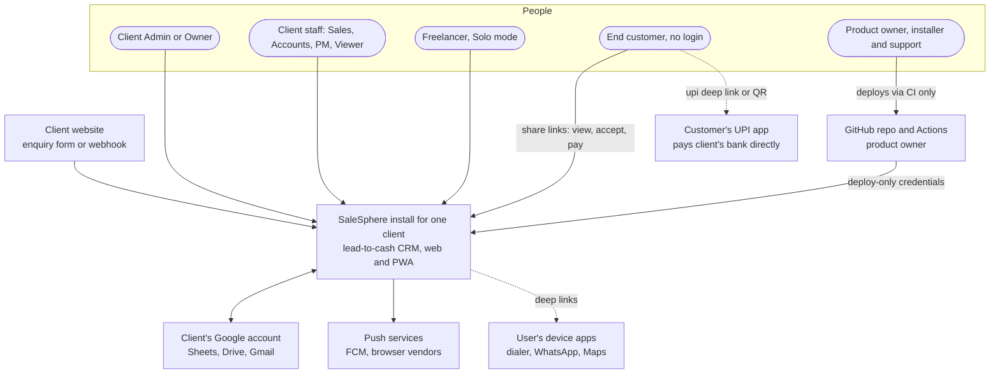
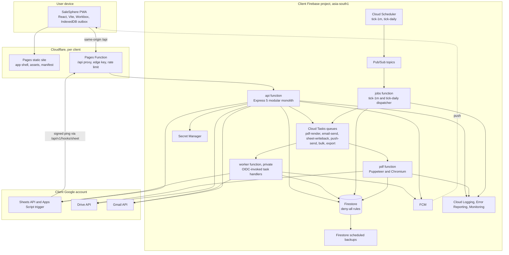
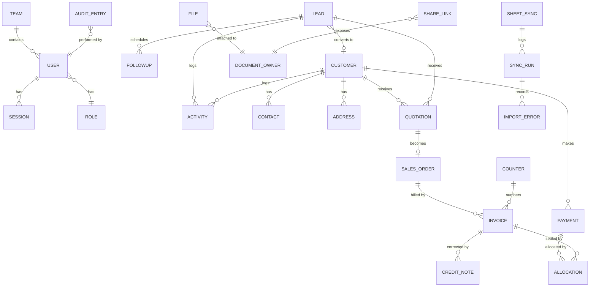
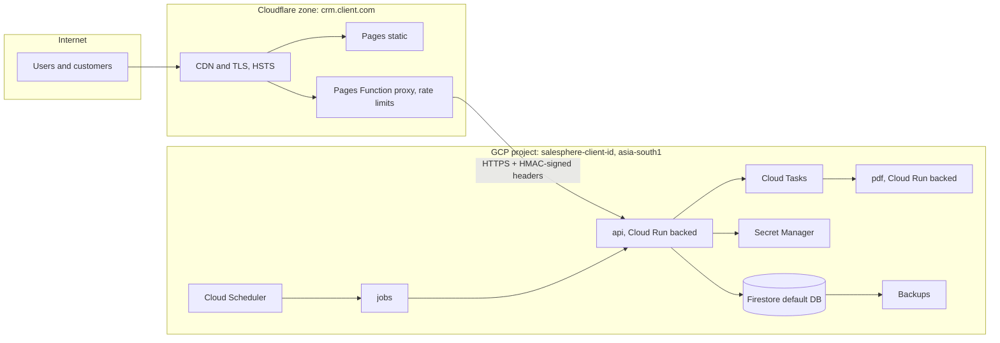

# High-Level Design (HLD) — SaleSphere CRM

| Version | Date | Author | Change |
|---|---|---|---|
| 0.1 | 2026-11-13 | Claude (solution architect) | Initial HLD from Solution Design v0.1 (G5 approved) |
| 0.2 | 2026-11-13 | Claude (solution architect) | QA review fixes (reviews/HLD-review-v0.1.md): all 8 High (H-01 – H-08) and Medium M-01 – M-10, M-13, M-14, M-16; CR-001 – CR-004 raised for requirement changes |

## 1. Introduction

**Purpose.** This document defines the architecture of one SaleSphere install. That covers its containers, modules, technology, integrations, data, security, NFR realisation, deployment, CI/CD, observability and resilience. It is the basis for the per-module LLDs (Phase 7) and the test strategy (Phase 8).

**Scope.** The MVP (FRD FR-001 – FR-091), plus extension points for Phase 2 adapters. The per-client install model applies throughout: every diagram describes **one client's install** unless it says otherwise.

**References.**

| Doc | Version |
|---|---|
| [BRD](../01-brd/BRD.md) | 1.0 |
| [FRD](../02-frd/FRD.md) | 0.2 (G2) |
| [Process flows](../03-process/PROCESS-FLOWS.md) | 0.1 (G3) |
| [UX spec](../04-ux/UX-SPEC.md) / [design system](../04-ux/design-system.md) | 0.1 (G4) |
| [Solution design](../05-solution/SOLUTION-DESIGN.md) | 0.1 (G5) |
| [ADRs](adr/README.md) | ADR-001 – ADR-014 |

## 2. Architecture goals & constraints

| Goal | Driving NFRs / constraints | Architectural response |
|---|---|---|
| Near-zero cost per client | NFR-012, CON-005 | Serverless (scale to zero), free tiers, no always-on cache or DB servers (ADR-001, ADR-004, ADR-007) |
| Strong client isolation and data in India | NFR-010, CON-003 | One Firebase project per client in `asia-south1`; nothing shared between clients (ADR-001) |
| Fast on 4G phones | NFR-001, NFR-002 | Static PWA on a CDN, a single warm API function, aggregation queries, lean bundles (ADR-002, ADR-003, ADR-011) |
| Correct money and numbers | NFR-020, RULE-003, RULE-035, RULE-044 | Firestore transactions, integer paise, a pure domain package with ≥ 80 % tests (ADR-001, ADR-004) |
| Secure own authentication | NFR-007 – NFR-009, R-004 | ASVS L2 design, rotating refresh tokens, edge rate limits, deny-all DB rules (ADR-005, ADR-006) |
| Install ≤ 1 day, safe upgrades | NFR-019, OBJ-007 | Config-only installs, provisioning scripts, CI fan-out, expand/contract migrations (ADR-006, ADR-014) |
| Works offline in the field | NFR-021 | App-shell cache + IndexedDB outbox (ADR-013) |
| Indian documents | NFR-017, GST rules | HTML → Chromium PDFs with Indic fonts (ADR-009) |

**Constraints:** CON-001 – CON-007 (BRD §13). The **CLAUDE.md §3 default stack is overridden** by ADR-002 (React/Vite instead of Next.js), ADR-003 (Express on Cloud Functions instead of NestJS), ADR-004 (Firestore instead of PostgreSQL/Prisma) and ADR-005 (built-in authentication instead of Auth.js/OIDC).

## 3. System context (C4 level 1)

## 4. Containers (C4 level 2)

| Container | Technology | Responsibility | Scales by |
|---|---|---|---|
| PWA | React 18, TypeScript, Vite, React Router, TanStack Query, RHF + Zod, Tailwind + shadcn/ui, Workbox, idb, Firebase Messaging SDK (ADR-002, ADR-013) | All UI (SCR-001 – SCR-036), offline cache and outbox, push registration | User devices |
| Pages static site | Cloudflare Pages (ADR-006) | Serve the hashed static bundle, manifest and icons per client; HTTP security headers (`_headers`) | CDN |
| Pages Function proxy | Cloudflare Pages Functions | Proxy `/api/*`; sign each request with a timestamped HMAC (`X-Edge-Signature`, `X-Edge-Ts`, `X-Edge-Kid`); forward `CF-Connecting-IP`; block `/api/internal/*`; set security headers on API responses; CORS only for the public form endpoint | Cloudflare edge |
| `api` | Cloud Functions 2nd gen, Node 22, Express 5, Zod, pino (ADR-003) | REST API `/api/v1`; authn/authz; all modules; transactions; enqueue tasks | Instances 0–10, concurrency 40 |
| `pdf` | Cloud Functions 2nd gen, Node 22, 2 GiB, puppeteer-core + Chromium (ADR-009) | Render quote/invoice/receipt/statement PDFs; upload to Drive; update file metadata | Instances 0–3, concurrency 1 |
| `worker` | Cloud Functions 2nd gen, Node 22, 512 MiB, **private** (no `allUsers` invoker; only the Cloud Tasks service account may invoke, verified by Google OIDC) | Execute Cloud Tasks: email send, sheet write-back, push send, bulk actions in chunks of 100, exports/imports, DPDP erase | Instances 0–5 |
| `jobs` | Cloud Functions 2nd gen (Pub/Sub trigger, private by construction) | Dispatch tick work: sheet polls, reminders, SLA, purge, summaries, link expiry, backups check | 1 per tick |
| Cloud Tasks | Managed queues (ADR-007) | Retries with backoff, rate limits for side effects | Managed |
| Firestore | Native mode, `asia-south1` (ADR-004) | System of record | Managed |
| Secret Manager | Managed | JWT signing keys, edge key, Google refresh token, webhook/HMAC keys, TOTP encryption key | — |
| FCM | Firebase Cloud Messaging (ADR-012) | Web push delivery | Managed |

## 5. Logical architecture / modules

Bounded contexts live inside the `api` function, with shared rules in `packages/domain` (pure) and I/O in `packages/adapters` (ADR-001). Allowed dependencies: module → domain, module → adapters (ports). No module reads another module's collections directly; it calls that module's service interface instead.

**Derived data (M-08):** customer running totals, `searchTokens` and audit entries are written **in the same transaction or batch** as the change that causes them. There are no Firestore triggers in the MVP. This supersedes the "Firestore triggers" box in Solution Design §5.

| Module | Responsibilities | Owns data (collections) | Linked FRs |
|---|---|---|---|
| `platform` | Config loading, feature flags, Solo/Team mode, number series, migrations, health, job dispatch | `settings`, `counters`, `migrations`, `jobs` | FR-001 – FR-006, FR-091 |
| `identity` | Login, sessions, password policy, lockout, 2FA, users, roles, teams, permissions, support access | `users`, `users/*/devices`, `roles`, `teams`, `sessions` | FR-007 – FR-014, FR-089 |
| `audit` | Append-only audit, masking, audit search/export | `auditLog` | FR-015, FR-016 |
| `masters` | All master data, Excel import | `masters/{type}/items`, `imports` | FR-017 – FR-024 |
| `leads` | Capture (manual, CSV, form, webhook), normalisation, dedupe/merge, assignment, stages, conversion | `leads`, `leads/*/activities` | FR-025 – FR-036, FR-086 |
| `engagement` | Activities, call outcomes and automation, WhatsApp/email logging, follow-ups, SLA | `followUps`, activity subcollections, `emailLog` | FR-044 – FR-050 |
| `google` | OAuth connection, Picker, Sheets sync (webhook/poll, marker, write-back), Drive folder tree, Gmail send, connection health | `googleConnection`, `sheetSync`, `syncRuns`, `importErrors` | FR-037 – FR-043, FR-047, FR-077 |
| `sales` | Quotations (revisions, approvals, responses), sales orders, invoices (types, issue, credit notes), tax and totals | `quotations`, `orders`, `invoices`, `creditNotes` | FR-051 – FR-069 |
| `payments` | Payments, allocations, advances, receipts, reversals | `payments` | FR-070 – FR-073 |
| `customers` | Customers, contacts, addresses, running totals, Customer 360 read model, statements | `customers` (+ `contacts`, `addresses`, `activities`) | FR-074 – FR-076 |
| `documents` | Files metadata, share links and public views, PDF orchestration | `files`, `shareLinks` | FR-055, FR-078, FR-079 |
| `notify` | In-app notifications, push via FCM, preferences | `notifications`, `users/*/devices` | FR-082 |
| `insights` | Search tokens and queries, dashboard aggregates, report summaries, exports | `reportSummaries` | FR-083 – FR-085 |
| `privacy` | Data principal export/erase, retention purge | `privacyRequests` | FR-087, FR-088, FR-090 |

**`packages/domain`** holds the pure business rules. **`packages/contracts`** holds the Zod request/response schemas shared with the PWA, plus the OpenAPI document.

| Domain rule | Rule IDs |
|---|---|
| tax and totals | RULE-034, RULE-035 |
| numbering format | RULE-003 |
| allocation | RULE-044, RULE-045 |
| balance | RULE-040 |
| UPI payload | RULE-041 |
| dedupe keys | RULE-019, RULE-020 |
| assignment | RULE-022 |
| SLA business clock | RULE-025 |
| call-outcome automation | RULE-026 |
| discount approval | RULE-027 |
| ageing | RULE-039 |
| search tokeniser | ADR-010 |
| masking | RULE-012 |
| retention | RULE-052 – RULE-054 |

## 6. Technology stack

| Layer | Choice | Why | ADR |
|---|---|---|---|
| Architecture style | Isolated install per client; modular monolith; hexagonal domain | Cost, isolation, testability, lock-in mitigation | ADR-001 |
| Frontend | React 18 + TS strict + Vite PWA, React Router, TanStack Query, RHF + Zod, Tailwind + shadcn/ui (Radix), Lucide | Static hosting, offline, design-system tokens | ADR-002 |
| Offline | vite-plugin-pwa (Workbox), idb outbox | Bounded offline capture | ADR-013 |
| Backend | Cloud Functions 2nd gen (Node 22), Express 5, Zod, zod-to-openapi, pino | Small cold start, shared contracts | ADR-003 |
| Database | Firestore Native, `asia-south1` | Serverless, transactions, India region | ADR-004 |
| Auth | Built-in: argon2, jose (EdDSA), otplib; rotating refresh tokens | Required UX; contained risk | ADR-005 |
| Hosting/edge | Cloudflare Pages + Pages Functions | Free, same-origin API, edge rate limit | ADR-006 |
| Async | Cloud Scheduler → Pub/Sub → `jobs`; Cloud Tasks queues | Cheap, reliable retries | ADR-007 |
| Files | Google Drive (`drive.file`) + Picker | Client-owned files, least privilege | ADR-008 |
| PDF | puppeteer-core + @sparticuz/chromium; Noto Indic fonts | Correct Indic shaping, one template set | ADR-009 |
| Search | Token arrays in Firestore | Zero extra vendor | ADR-010 |
| Reporting | Aggregation queries + daily summaries; exceljs | Cost-predictable | ADR-011 |
| Push | FCM web push | Free, in-project | ADR-012 |
| Libraries (domain) | libphonenumber-js, qrcode, date-fns-tz, decimal handling via integer paise | Correctness | — |
| Monorepo & quality | pnpm + Turborepo; ESLint (boundaries, jsx-a11y), Prettier, Husky; Vitest, Supertest, Playwright + axe; Firebase Emulator Suite | Fast CI, local dev | ADR-014 |
| CI/CD | GitHub Actions; GitHub Environments per client; Workload Identity Federation | Fan-out deploys without long-lived keys | ADR-006 |

## 7. Integration design

**API conventions:**
- REST at `/api/v1`, JSON, with an OpenAPI 3.1 document generated from Zod.
- Errors use RFC 7807 `application/problem+json` with a `code`, for example `QUANTITY_EXCEEDS_PENDING`.
- Cursor pagination (`?cursor=&limit=`).
- Optimistic concurrency uses `ETag` = record `version` with `If-Match` on PUT/PATCH; a stale version returns 412 (RULE-058).
- `Idempotency-Key` header on create-lead (hooks) and create-payment; replays within 24 h return the same response (RULE-059).
- Time values are ISO 8601 in UTC; money is integer paise in the API and formatted in the UI.

| ID | System | Protocol | Direction | Auth | Frequency | Error handling / retries | Idempotency |
|---|---|---|---|---|---|---|---|
| INT-001 | Google OAuth | OAuth 2.0 auth-code + PKCE (server-side) | Out/In | Client ID/secret per install (Secret Manager) | Connect/reconnect | Token refresh on 401; revoked → status Broken + N-010 | State param + nonce |
| INT-002 | Google Sheets API v4 | HTTPS REST (batchGet, batchUpdate) | Bi | OAuth access token | Webhook-triggered + poll every 1–4 min + 15-min safety poll | Exponential backoff on 429/5xx (Cloud Tasks for write-back, 5 tries); header change → "Mapping needs attention" | Row marker (CRM Lead ID) + row hash + Firestore transaction per row (RULE-024) |
| INT-003 | Apps Script onChange trigger | HTTPS POST `/api/v1/hooks/sheet/{syncId}` | In | HMAC-SHA256 of body + timestamp with per-sheet secret; ±5 min replay window | On change | 2xx fast-ack; work enqueued; failures fall back to poll | Ping is a hint only; import is idempotent |
| INT-004 | Google Drive API v3 | HTTPS REST, resumable upload | Bi | OAuth (`drive.file`) | On upload / PDF / folder ops | Cloud Tasks retry ×5; file status "Pending upload" (E-10) | Deterministic file names + `appProperties.ssId` check before create |
| INT-005 | Gmail API | `users.messages.send` | Out | OAuth (`gmail.send`) | On user action | Retry ×3 over 5 min (FR-047 AC4); quota → user message | `emailLog` ID as task name (no duplicate sends) |
| INT-006 | FCM HTTP v1 | HTTPS | Out | Service account (in-project) | On event | Retry ×3; invalid token → delete device | Notification ID |
| INT-007 | Web form | HTTPS POST `/api/v1/public/forms/{formId}` | In | None (public): origin allow-list, honeypot, min fill time, edge rate limit | On submit | 400 with field errors; 429 on rate limit | Client-generated idempotency key in hidden field |
| INT-008 | Lead webhook | HTTPS POST `/api/v1/hooks/leads` | In | `X-Api-Key` per source (hashed at rest) | On call | 401/400/429 problem+json | `Idempotency-Key` header (24 h) |
| INT-009 | UPI (customer app) | NPCI `upi://pay` URI in QR / link | Out (device) | — | On render | n/a | n/a |
| INT-010 | Device handlers | `tel:`, `https://wa.me/`, Maps URL | Out (device) | — | On tap | Missing phone → UI disables action | n/a |
| INT-011 | Phase 2 providers (FR-091) | Provider interfaces: `MessagingProvider`, `PaymentProvider`, `LeadSourceProvider` | — | Per provider | — | Implemented in v1.x | Webhook signature + event ID |

## 8. Data architecture

### 8.1 Conceptual model

`DOCUMENT_OWNER` is polymorphic (`recordType` + `recordId`): lead, customer, quotation, order, invoice or payment.

**Scope fields (H-05).** Every scoped collection carries a denormalised `ownerId`:

| Collection | Source of `ownerId` |
|---|---|
| leads, customers | Their own owner |
| quotations | The party's owner at creation |
| orders, invoices | The customer's owner |
| payments | The customer's owner |
| files | The parent record's owner |

When a customer or lead is reassigned, a chunked `bulk` task (100 documents per batch) updates `ownerId` on its quotations, orders, invoices, payments, files and open follow-ups, and audits the reassignment once. **Team scope** queries use `ownerId in [team members]` (Firestore `in` allows up to 30 values, which is enough at ≤ 25 users). **All** scope omits the filter. The same filters apply to lists, `count()`/`sum()` aggregations, search and exports. The per-screen query and index catalogue is part of each LLD (Phase 7).

### 8.2 Physical mapping (Firestore)

| Collection | Key fields | Notable indexes |
|---|---|---|
| `leads/{id}` (+ `activities`) | `ownerId, stage, phone, email, searchTokens[], nextFollowUpAt, slaStatus, createdAt, version` | `(ownerId, stage, createdAt desc)`, `(phone)`, `(email)`, `(searchTokens array, ownerId)`, `(stage, junkAt)` |
| `followUps/{id}` | `ownerId, dueAt, status, recordRef` | `(ownerId, status, dueAt)`, `(status, dueAt)` |
| `customers/{id}` (+ `contacts`, `addresses`, `activities`) | `ownerId, totals{…}, gstin, searchTokens[]` (contacts' names and phones are included in the parent customer's tokens) | `(ownerId, totals.overdue desc)`, `(searchTokens array, ownerId)`, `(searchTokens array)` |
| `quotations/{id}` | `number, baseId, revision, partyRef, ownerId, status, validUntil, lines[], totals, searchTokens[]` | `(ownerId, status, createdAt desc)`, `(partyRef, createdAt desc)`, `(status, validUntil)`, `(searchTokens array)` |
| `orders/{id}` | `number, quotationId, customerId, ownerId, status, lines[{orderedQty, invoicedQty}], searchTokens[]` | `(ownerId, status, createdAt desc)`, `(customerId, status)`, `(searchTokens array)` |
| `invoices/{id}` | `number, type, orderId, customerId, ownerId, date, dueDate, balanceDue, status, searchTokens[]` | `(ownerId, status, dueDate)`, `(customerId, dueDate)`, `(status, dueDate)`, `(searchTokens array)` |
| `payments/{id}` | `receiptNo, customerId, ownerId, amount, utr, allocations[], status, searchTokens[]` | `(utr)`, `(ownerId, date desc)`, `(customerId, date desc)` |
| `counters/{series-FY}` | `next` | — |
| `shareLinks/{tokenHash}` | `docRef, expiresAt, revokedAt, views` | `(expiresAt)` |
| `files/{id}` | `driveFileId, recordRef, ownerId, status` | `(recordRef)`, `(ownerId, createdAt desc)` |
| `auditLog/{id}` | `at, userId, action, recordRef, diff (masked)` | `(at desc)`, `(userId, at)`, `(recordRef, at)` |
| `sessions/{id}` | `userId, familyId, tokenHash, expiresAt, revokedAt` | `(userId)` |
| `reportSummaries/{date}` | Per-day aggregates by owner/source/stage/tax rate | — |

### 8.3 Data classification & handling

| Class | Examples | Handling |
|---|---|---|
| Secret | Password hashes, refresh-token hashes, TOTP secrets, OAuth tokens, signing keys | Secret Manager or hashed/encrypted fields; never returned by the API; never logged |
| Personal (PII) | Lead/contact name, phone, email, address, notes, IP addresses | API access only, by scope; masked in audit (RULE-012) and logs; export/erase (FR-087/088) |
| Business confidential | Prices, discounts, invoices, payments | Role-based (FRD §3.2); finance hidden from the PM role |
| Public by link | Shared quote/invoice views | Token-gated, expiring, `noindex` |

**Retention, backup and ownership:** see FRD §7.3, Solution Design §7, and §14 below.

## 9. Security architecture

**Authentication & sessions (ADR-005)**
- Login: username + password → Argon2id verify (with constant-time dummy verify for unknown users) → access JWT (EdDSA, 15 min, claims `sub, role, scope, epoch, kid`) returned in the body and held in memory.
- Refresh token in a `__Secure-rt` cookie (HttpOnly, Secure, SameSite=Strict, `Path=/api/v1/auth`). The `__Host-` prefix is not used because it requires `Path=/` (H-01).
- The refresh token is rotated on use. **Single-flight refresh (H-02):** the SPA serialises refresh across tabs with the Web Locks API (`navigator.locks`) and shares the new access token over `BroadcastChannel`. The server allows a **30 s grace window**: presenting the immediately previous token of a family within 30 s returns the current successor instead of being treated as reuse. Reuse outside the window revokes the family. The service worker never holds tokens; offline replay is done by the page (see ADR-013).
- Session lifetimes (M-04): 30 days idle, 90 days absolute, then re-login. `tokenEpoch` is bumped on password change, reset, deactivation, forced logout, **role change or team change**.
- 2FA (M-04): after a correct password, a single-use, 5-minute `mfa_pending` token is issued (no session yet); the last used TOTP time-step is stored to prevent replay; the lock state is revealed only after a correct password (FR-008 AC2).
- Lockout 5/15 min per username. A Cloudflare rate-limiting rule allows 60 login attempts per IP per minute (offices share NAT, M-01), and the API backstop counter allows the same (H-03).
- TOTP 2FA, where 5 failures count as a failed login.
- A per-user `tokenEpoch` is checked on every request (60 s cache), so forced logout and deactivation take effect within 60 s.

**Authorisation (RBAC + scope)**
- Permissions use the form `module:action[:scope]` (for example `leads:update:own`, `payments:reverse`, `invoices:issue`). They are seeded per role from FRD §3.2 and editable for limits (discount %, record payments).
- A central `authorize(permission, record)` middleware and repository-level scope filters (`ownerId in teamMembers`) mean list, search, report and aggregate queries **all** apply scope (RULE-011). An out-of-scope record returns **404**; a forbidden action returns **403**.
- Field-level: finance fields are stripped from responses for roles without `finance:read`.

**Data protection**
- In transit: TLS 1.2+ with HSTS (Cloudflare) and Google-managed TLS edge to functions.
- At rest: Google-managed encryption for Firestore, Drive and Secret Manager. TOTP secrets are additionally encrypted with an AES-GCM key from Secret Manager.
- PII is masked in audit and logs; pino redaction paths cover `password`, `token`, `phone`, `email`, `authorization` and `cookie`.

**Secrets management**
- Per-install secrets live in Secret Manager: JWT keys (rotated yearly or on incident), edge key, Google OAuth client and refresh token, HMAC keys, API-key pepper and TOTP encryption key.
- CI uses Workload Identity Federation, so there are no long-lived keys.
- **IAM (M-05):** each function runs as its own service account (`sa-api`, `sa-pdf`, `sa-worker`, `sa-jobs`) with only the roles it needs (Datastore user, Secret Accessor on named secrets, Cloud Tasks enqueuer, FCM sender). The default compute service account's Editor role is removed during provisioning. The CI deploy identity gets Firebase/Cloud Functions deploy roles, `roles/iam.serviceAccountUser` on the four function service accounts, and `roles/secretmanager.secretVersionAdder` (it can **add** secret versions but cannot **read** them). It has no data roles.
- Secret scanning (gitleaks) runs in CI.

**OWASP Top 10 (2021) control mapping**

| Risk | Controls |
|---|---|
| A01 Broken access control | Central RBAC + scope middleware; 404 for out-of-scope; deny-all Firestore rules; share links scoped to one document; IDOR tests per endpoint |
| A02 Cryptographic failures | TLS/HSTS; Argon2id; EdDSA JWT; hashed refresh tokens and API keys; ≥ 128-bit share tokens |
| A03 Injection | No query string building (Firestore SDK); Zod validation; output encoding in React; PDF templates escape all data; CSV/Excel formula-injection guard on export (prefix `=+-@` cells) |
| A04 Insecure design | Threat model per LLD; business-rule tests (allocation, numbering, approvals) |
| A05 Security misconfiguration | Headers via `_headers` (CSP, HSTS, X-Content-Type-Options, Referrer-Policy, Permissions-Policy, frame-ancestors none); least-privilege service accounts; config schema validation |
| A06 Vulnerable components | Renovate; `pnpm audit` gate; pinned actions; Chromium build updates |
| A07 Identification & auth failures | Lockout, rate limits, rotation + reuse detection, 2FA, generic errors, timing equalisation |
| A08 Software & data integrity | Signed webhooks (HMAC), idempotency, CI provenance, lockfile integrity, migrations versioned |
| A09 Logging & monitoring failures | Audit of all state changes and auth events; Error Reporting alerts; uptime checks |
| A10 SSRF | No user-supplied URLs fetched server-side; Google API hosts allow-listed; PDF renderer blocks network requests except data/inline assets |

**Web hardening (M-02, M-03)**
- **CSP**, set by `_headers` for static assets **and** by the proxy for `/api` and share responses:
  - `default-src 'self'`
  - `script-src 'self' https://apis.google.com https://www.gstatic.com` (Google Picker and FCM SDK)
  - `style-src 'self' 'unsafe-inline'` (required by Radix/shadcn runtime styles; scripts stay strict)
  - `img-src 'self' data: blob: https://*.googleusercontent.com` (QR codes and Drive thumbnails)
  - `connect-src 'self' https://fcmregistrations.googleapis.com https://firebaseinstallations.googleapis.com`
  - `frame-src https://docs.google.com https://drive.google.com` (Picker)
  - `frame-ancestors 'none'`, `base-uri 'self'`, `form-action 'self'`
- **CSRF:** cookies are `SameSite=Strict`, and every state-changing request must carry `X-Requested-With: SaleSphere` (requests without it get 403). The refresh endpoint also checks `Origin` against the install's domain.
- **CORS:** none for the app (same origin). The public form endpoint (`/api/v1/public/forms/*`) returns CORS headers only for the Admin-configured allowed origins.

**Google access (M-06)**
- Scopes: `drive.file` and `gmail.send` only. `drive.file` covers Sheets API access to the sheet picked in Google Picker, so the `spreadsheets` scope is dropped (ADR-008 updated).
- The Picker needs a short-lived (≤ 60 min) access token in the browser. The API issues it from a dedicated endpoint, only to Admins and only while the Picker is open. This is the single, documented exception to "the browser never touches Drive" (FR-013). The token can only open the Picker and files the Admin selects.
- Google OAuth verification is needed per client OAuth client (sensitive scope `gmail.send`). Until it is done, the Admin sees the "unverified app" screen once (A-024, R-001).

**PDF renderer hardening (M-07)**
- JavaScript disabled in the page (`page.setJavaScriptEnabled(false)`).
- Request interception aborts **every** network request; logos, signatures, fonts and the QR code are inlined as `data:` URIs before rendering.
- Templates use auto-escaping. Admin-edited text (terms, footer, declarations) is rendered as plain text with line breaks only, never as HTML.

**Endpoint security matrix (M-10, CLAUDE.md §7)**

| Endpoint group | Authn | Authz | Rate limit | Validation | Audit |
|---|---|---|---|---|---|
| `POST /api/v1/auth/*` (login, refresh, logout, 2FA) | None / refresh cookie / `mfa_pending` token | — | Edge 60 per IP per min + API backstop + per-username lockout | Zod | Every attempt |
| `/api/v1/{leads,customers,sales,payments,…}` | Access JWT + epoch check | RBAC permission + record scope (404 out of scope) | Edge 600 per IP per min | Zod + If-Match | All state changes (same transaction) |
| `POST /api/v1/search`, `/reports/*`, `/exports/*` | Access JWT | Permission + scope filters in query | Edge 600 per IP per min; exports 10 per user per hour | Zod | Exports audited |
| `/api/v1/admin/*` (settings, users, roles, masters, privacy) | Access JWT | Admin (or per §3.2) | Edge 600 per IP per min | Zod | All |
| `POST /api/v1/public/share/resolve`, `/public/share/{respond}` | Share token in body (hashed lookup) | One document only | Edge 60 per IP per min | Zod | View and response logged in `shareLinks/{id}/access` (link life + 1 year) |
| `POST /api/v1/public/forms/{formId}` | None | Allowed origin + honeypot + min fill time | Edge 60 per IP per min; per form 60 per min | Zod | Lead created audited as "web form" |
| `POST /api/v1/hooks/leads` | `X-Api-Key` (hashed) | Source-bound | Per key 60 per min | Zod + Idempotency-Key | Audited |
| `POST /api/v1/hooks/sheet/{syncId}` | HMAC + timestamp | Bound to that sync | Per sync 30 per min | Signature | Sync run log |
| `worker` / `pdf` / `jobs` | Google OIDC (service accounts) | Invoker IAM | Queue rate limits | Task payload schema | Per task outcome |

**Audit logging:** an append-only `auditLog` written inside the same transaction as the state change (FR-015, RULE-012). Logins, denials, exports, shares and support-user actions are included.

**Compliance mapping**

| Regulation | Mechanism |
|---|---|
| DPDP Act 2023 | Consent basis on leads, export/erase, masked audit, India region, processor-only support access (FR-086 – FR-089) |
| GST (CGST Rules 46, 49, 53) | Invoice, bill-of-supply and credit-note fields; ≤ 16-character serials; place-of-supply engine; CA review (A-022) |
| NPCI UPI | Deep-link format (RULE-041) |
| Google API Services User Data Policy | Minimal scopes, no transfer of client data, verification plan (A-024) |
| WCAG 2.2 AA | Design system + axe tests (NFR-013) |

## 10. NFR realisation

| NFR ID | Requirement | Design mechanism | Verification |
|---|---|---|---|
| NFR-001 | p75 LCP ≤ 2.5 s, INP ≤ 200 ms on mid-range Android over 4G | Static PWA on Cloudflare CDN; route-level code splitting; precached shell; skeletons; aggregation queries; image thumbnails via API | Lighthouse CI (Moto G Power profile, 4G throttling) on key routes in Phase 8; budgets in CI |
| NFR-002 | API p95 ≤ 800 ms read / 1.5 s write; cold start ≤ 3 s | Single warm `api` function (`cpu: 1`, 1 GiB, concurrency 40); lean bundle (esbuild, no heavy frameworks); in-memory config cache; denormalised totals; optional `minInstances` | k6 load test against staging; **cold-start test** that forces scale-to-zero (idle 20 min) and measures first-request latency 20 times (M-16); Cloud Monitoring latency SLO dashboard |
| NFR-003 | PDF p95 ≤ 5 s (≤ 3 pages) | Dedicated `pdf` function (2 GiB, `cpu: 2`); async via Cloud Tasks after commit, so the user is never blocked (the web view and share link work immediately); warm browser reuse per instance; slim Chromium | Timed render tests **including cold starts** (H-07). Measured at pilot volume, the cold-start p95 is expected at 6–10 s. **CR-002** proposes NFR-003 = warm p95 ≤ 5 s and cold p95 ≤ 12 s, because PDF generation is asynchronous. The alternative is `minInstances: 1` on `pdf` (≈ ₹2,000+/month, rejected for cost) |
| NFR-004 | Sheet → lead ≤ 1 min webhook, ≤ interval + 1 min poll; 100 % accounted | Apps Script HMAC ping → immediate pull; `tick-1m` polls; 15-min safety poll; marker + transactions; sync run log | Integration test with emulator + real test sheet; `sync_lag_seconds` metric |
| NFR-005 | 99.5 % monthly availability | Managed serverless; no single VM; Cloudflare CDN; health endpoint; graceful degradation (cached reads, outbox) | Cloud Monitoring uptime check every 5 min on `/api/v1/health`; monthly SLO report |
| NFR-006 | RPO ≤ 24 h, RTO ≤ 8 h | Firestore scheduled backups: **daily, kept 7 days**, plus **weekly, kept 5 weeks** (the platform maximum for daily is 7 days, H-06); Drive trash; IaC to recreate functions; restore runbook with erasure re-apply (M-13) | Restore drill into a scratch database before go-live and quarterly |
| NFR-007 | OWASP ASVS L2; no High/Critical in scan | §9 controls; ASVS checklist per LLD; endpoint security matrix | ZAP baseline scan in CI **plus an authenticated ZAP full scan on staging per release** (M-11); ASVS L2 checklist sign-off with evidence links; manual review of auth, share links and webhooks before go-live; auth and IDOR negative TCs |
| NFR-008 | TLS, Argon2id, Secret Manager, deny-all DB | ADR-004, ADR-005, ADR-006; gitleaks | Rules unit tests (emulator); header scan; secret-scan gate |
| NFR-009 | CSP without unsafe-inline, secure cookies, no framing, dependency scan | `_headers` CSP with nonce-less hashed bundles; cookie flags; Renovate + audit gate | Header assertions in E2E; CI audit gate |
| NFR-010 | Data in `asia-south1`; no PII in logs; DPDP tooling ≤ 5 min | Region pinned in provisioning; pino redaction; privacy module | Provisioning check; log-redaction unit tests; TC for export/erase timing |
| NFR-011 | 25 users, 50k leads, 200k activities, 10k invoices/yr, 2k rows/day | Indexed queries per screen; pagination; token search; summaries | Synthetic data seeding + k6 at target volumes in Phase 9/10 |
| NFR-012 | ≤ ₹500/month Firebase at A-002 volume | Scale-to-zero; 2 scheduler jobs; minimal reads (denormalised totals); budget alert | Cost spike in Phase 9 (billing export over 2 weeks synthetic load); budget alert configured |
| NFR-013 | WCAG 2.2 AA | Design system tokens and components; Radix primitives; jsx-a11y lint | Playwright + axe on all routes; manual screen-reader checks |
| NFR-014 | ≤ 3 taps outcome; quote ≤ 5 min; invoice ≤ 1 min | UX flows (SCR-006, SCR-010, SCR-014); defaults from masters; Solo quote → invoice | Usability test T1–T6 (UX §11); E2E step counts |
| NFR-015 | Structured logs, alerts, health, metrics, version | pino JSON with request/user ID; Error Reporting; log-based metrics; `/health` with version | Alert test in staging; dashboard review |
| NFR-016 | Browsers/devices; 360–1536 px | Browserslist targets; responsive design system | Playwright projects: Chromium, Firefox, WebKit; mobile viewports |
| NFR-017 | en-IN, IST, Indian grouping, Indic scripts in PDFs, externalised strings | `Intl` with `en-IN`; date-fns-tz IST; i18n message catalogue (ICU) from day 1; Noto fonts in PDF | Unit tests for formatting; PDF snapshot tests with Indic names |
| NFR-018 | TS strict, ≥ 80 % domain coverage, lint clean | `packages/domain` isolation; Vitest coverage threshold in CI | CI coverage gate |
| NFR-019 | Install ≤ 1 day; automated fan-out; rollback ≤ 30 min | Provisioning script; config-only installs; expand/contract migrations; previous function revision kept | Timed install rehearsal on staging; rollback drill |
| NFR-020 | No duplicate numbers; atomic allocations; paise; optimistic concurrency | Firestore transactions for counters and payments; `version` + If-Match | Concurrency tests (parallel issue/pay) on emulator |
| NFR-021 | Offline queue survives 7 days; sync ≤ 1 min | IndexedDB outbox replayed by the page on `online`/focus (Background Sync only as a wake-up hint where supported) | E2E with offline emulation and restart. iOS Safari may evict storage after 7 days of non-use for non-installed sites, so this NFR is guaranteed only for the installed PWA (M-15) |
| NFR-022 | 100 % state changes audited; 30-day search ≤ 3 s | Audit in the same transaction; indexed `(at)`, `(userId, at)` | Audit-coverage test per endpoint; timed query |

## 11. Deployment architecture

**Environments**

| Env | Purpose | Data | Where |
|---|---|---|---|
| `local` | Development | Seeded fake data | Vite dev server + Firebase Emulator Suite (Firestore, Functions, Pub/Sub); Google APIs stubbed or against a test account |
| `preview` | Per pull request | Ephemeral | Cloudflare Pages preview + emulator-backed API in CI (no cloud data) |
| `staging` | Release candidate validation | Synthetic | Product owner's Firebase project + Pages project |
| `demo` | Sales demos | Prototype dataset | Product owner's Firebase project + Pages project |
| `client-<id>` | Production per client | Client data | Client-owned Firebase (Blaze) + Cloudflare Pages + Google account |

**Topology (one client)**

**Network & domains**
- The client's domain (`crm.<client>.com`) is a CNAME to Cloudflare Pages. Pages serves the PWA, and the same origin serves `/api/*` through the proxy.
- Share links have the form `https://crm.<client>.com/s/<token>`, an SPA route. The SPA sends the token in the **body** of `POST /api/v1/public/share/resolve`, so it never appears in an API URL. Search uses `POST /api/v1/search`, so phone numbers and names never appear in URLs or platform request logs (H-08).
- **Edge → API trust (H-03):** the `api` function URL is reachable from the internet, so every request must carry an HMAC-SHA256 signature from the proxy over `ts + method + path + sha256(body)`. The secret is in Cloudflare secrets and Secret Manager. Two key IDs (`kid`) are active during rotation (quarterly, and on any suspicion). The API rejects missing or invalid signatures and timestamps outside ±60 s with 401, **before** reading `CF-Connecting-IP`. Rate limiting is enforced at the edge (Cloudflare rate-limiting rule) **and** in the API as a backstop: per-username lockout plus a per-IP counter in Firestore with a 1-minute window.
- `worker` and `pdf` have no public invoker. Cloud Tasks and Pub/Sub invoke them with OIDC tokens of dedicated service accounts. `/api/internal/*` does not exist on `api` and is blocked at the edge (H-04).
- No VPC is needed; there is no database server.

## 12. CI/CD

```mermaid
flowchart LR
  PR["Pull request"] --> L["Lint, typecheck, boundaries"]
  L --> U["Unit tests, domain coverage 80 percent"]
  U --> A["API tests on emulators"]
  A --> B["Build web and functions"]
  B --> S["Security: audit, gitleaks, licence check"]
  S --> P["Pages preview, Playwright and axe E2E"]
  P --> M["Merge to main"]
  M --> T["Tag vX.Y.Z"]
  T --> ST["Deploy staging"]
  ST --> SM["Smoke, ZAP baseline, Lighthouse"]
  SM --> AP{"Approve release"}
  AP --> FO["Fan-out per client environment"]
  FO --> MG["Run pending migrations, expand only"]
  MG --> HC{"Health check OK?"}
  HC -- No --> RB["Roll back code to previous revision, alert"]
  HC -- Yes --> REC["Record version per client"]
```

- **Per-client job steps:**
  1. Build the web app with `CLIENT_ID`.
  2. `wrangler pages deploy`.
  3. `firebase deploy --only functions,firestore:rules,firestore:indexes`.
  4. Migrations.
  5. Health check.
  6. Record the version.
- **Fan-out:** GitHub Environments (one per client) carry WIF provider settings, the project ID and the Cloudflare token, with required reviewers on production environments.
- **Commits:** Conventional Commits; release notes generated from commits (Phase 13).

## 13. Observability

| Signal | Implementation |
|---|---|
| Logs | pino JSON → Cloud Logging. Fields: `requestId`, `userId`, **`routeTemplate`** (for example `/api/v1/leads/:id`, never the raw path or query), `status`, `latencyMs`, `module`, `version`, `clientId`. PII redaction uses wildcard paths (`*.password`, `*.token`, `*.phone`, `*.email`, `*.authorization`, `*.cookie`, `*.utr`). **Platform request logs (H-08):** a log exclusion filter drops `run.googleapis.com/requests` entries for `api`, because the app writes its own route-template log. Logs go to a `_Default` bucket re-created in `asia-south1` (M-12). Retention: 30 days for application logs; auth and security events are kept 8 years in the `auditLog` collection. |
| Errors | Cloud Error Reporting (all functions) with email alert to the product owner (one notification channel shared across client projects via the product owner's email, A-026). |
| Metrics | Log-based metrics: `api_latency_ms` (by route), `api_5xx_count`, `pdf_render_ms`, `pdf_fail_count`, `sync_lag_seconds`, `sync_failed_rows`, `email_fail_count`, `job_fail_count`, `auth_lockouts`. |
| Traces | OpenTelemetry-ready (Cloud Trace auto for Cloud Run requests). Manual spans around Google API calls and transactions. |
| Health | `GET /api/v1/health` returns version, Firestore reachability, Google connection status and last tick time (no PII). |
| Uptime | Cloud Monitoring uptime check every 5 min via the public domain. |
| Dashboards | Per client: availability, latency, errors, sync lag, PDF success, job health. |
| Alerts | 5xx rate > 2 % for 10 min; uptime failing 2 checks in a row; sync lag > 10 min; tick missing > 5 min; PDF failures > 5 in 1 h; Google connection Broken; budget at 50/90/100 %. |
| SLOs | Availability 99.5 %/month; API p95 per NFR-002; Sheet import ≤ 5 min for 99 % of rows; PDF success ≥ 99 %. |

## 14. Resilience & DR

| Failure mode | Effect | Mitigation | Recovery |
|---|---|---|---|
| Function cold start / instance crash | Slow or failed request | Retries in the client (idempotent GETs); stateless instances | Automatic |
| Firestore transaction contention (counters, payments) | Retry | SDK automatic retries (5); counter per series per FY limits hot spots (≤ 1 write/s is sufficient) | Automatic |
| Google API outage or 429 | Sync, email or PDF upload delayed | Cloud Tasks backoff; safety poll; "Pending upload" status; user-visible retry | Automatic catch-up |
| Google token revoked | Sync, email and Drive stop | Health detection → N-010 alert; queued work retried after reconnect | Admin reconnects (FR-043) |
| PDF renderer failure | No PDF | Document stays issued; web view works; retries; "Regenerate PDF" | Automatic or user |
| Cloudflare outage | App unreachable | Rare and global; status page; (optional) direct Firebase Hosting fallback documented in the runbook | Wait or switch DNS |
| Bad release | Errors after deploy | Staging first; health-check gate; code rollback; backward-compatible migrations | ≤ 30 min (NFR-019) |
| Data corruption or accidental mass delete | Lost records | Audit trail; soft-delete for drafts; daily backups (7 days) + weekly backups (5 weeks) | Restore to a new database, then reconcile; RTO ≤ 8 h |
| Region outage (`asia-south1`) | Install down | Accepted for MVP (cost); backups are multi-zone within region | Restore into `asia-south2` (Delhi) from backup if prolonged |
| Offline device | No server access | Outbox, cached reads | Sync on reconnect |

**Timeouts:**

| Call | Timeout |
|---|---|
| Edge proxy → api | 60 s (exports, imports and erasure run as async tasks and are polled, M-09) |
| api request | 60 s |
| Google API calls | 15 s |
| pdf task | 120 s |
| jobs | 540 s |

**Retries:** exponential backoff with jitter, a maximum of 3–5 attempts, then a dead-letter log entry and an alert.

**Job safety (M-14):** each tick takes a Firestore lease document (`jobs/lease-{tick}`, compare-and-set with a 90 s TTL), so duplicate Pub/Sub deliveries or overlapping runs do nothing. Each reminder or notification uses a deterministic ID (`{followUpId}-{dueAt}`), so it is sent at most once. Bulk actions (FR-032, up to 500 records) run as chunked `bulk` tasks of 100.

**Backup / restore:**
- Firestore scheduled backups run **daily (kept 7 days)** and **weekly (kept 5 weeks)**. Erased personal data can therefore persist in backups for up to about 35 days. CR-001 aligns RULE-054 and FRD §7.3, which currently say 30 days.
- **Erasure ledger (M-13):** `privacyRequests` keeps a hashed identifier (SHA-256 of the normalised phone/email plus a pepper) for every erasure. After any restore, the restore runbook re-applies all erasures recorded after the backup time, before the restored database is switched in.
- Restore is a managed restore to a new database ID, followed by a config switch.
- The restore is drilled before go-live and quarterly (NFR-006).

## 15. Architecture decisions

| ADR | Decision |
|---|---|
| [ADR-001](adr/ADR-001-architecture-style.md) | Per-client isolated serverless install; modular monolith; hexagonal domain |
| [ADR-002](adr/ADR-002-frontend-framework.md) | React + TS + Vite PWA (overrides Next.js default) |
| [ADR-003](adr/ADR-003-backend-framework.md) | Cloud Functions 2nd gen + Express 5 + Zod/OpenAPI (overrides NestJS default) |
| [ADR-004](adr/ADR-004-database.md) | Firestore `asia-south1`, API-only access (overrides PostgreSQL/Prisma default) |
| [ADR-005](adr/ADR-005-authentication.md) | Built-in auth: Argon2id, EdDSA JWT, rotating refresh, TOTP (overrides OIDC default) |
| [ADR-006](adr/ADR-006-hosting-and-deployment.md) | Cloudflare Pages + proxy; GitHub Actions fan-out with WIF |
| [ADR-007](adr/ADR-007-async-jobs-and-caching.md) | Scheduler ticks + Pub/Sub + Cloud Tasks; no external cache |
| [ADR-008](adr/ADR-008-file-storage-google-drive.md) | Google Drive with `drive.file` + Picker |
| [ADR-009](adr/ADR-009-pdf-rendering.md) | HTML → PDF with headless Chromium and Indic fonts |
| [ADR-010](adr/ADR-010-search.md) | Token-array search in Firestore |
| [ADR-011](adr/ADR-011-reporting.md) | Aggregation queries + daily summaries |
| [ADR-012](adr/ADR-012-push-notifications.md) | FCM web push |
| [ADR-013](adr/ADR-013-offline-strategy.md) | Workbox + IndexedDB outbox |
| [ADR-014](adr/ADR-014-monorepo-and-tooling.md) | pnpm + Turborepo; Vitest, Supertest, Playwright + axe; emulators |

## 16. Risks, assumptions, open questions

- **Risks:** Solution Design §12 (R-001 – R-017) applies. Architecture-specific notes:
  - R-012 (Firestore limits) is mitigated by ADR-010 and ADR-011, and must be validated by the Phase 9 load test.
  - R-013 and R-017 (cold starts, Chromium) are mitigated by separating the `pdf` function.
- **New assumption A-030:** Cloudflare Pages Functions' free tier (100k requests/day) covers API proxy traffic at A-002 volumes, which is roughly 5–15k requests/day per install. If not, Workers Paid costs about $5/month.
- **New assumption A-031:** Firestore scheduled backups and Cloud Tasks are available in `asia-south1`.
- **Data processed outside India (M-12):** Cloudflare (edge and CDN), FCM push, Gmail and Drive (the client's own Google account) may process data outside India. Firestore data, backups and logs stay in `asia-south1`. This is disclosed in the client privacy notice template (A-027). The DPDP Rules 2025 log-retention and breach-notice obligations are to be confirmed with counsel (Q-030).
- **Change requests raised by this review:**

| CR | Change |
|---|---|
| CR-001 | RULE-054 / FRD §7.3: backup window "up to 30 days" becomes "up to ≈ 35 days" (daily 7 days + weekly 5 weeks) |
| CR-002 | NFR-003: PDF p95 ≤ 5 s warm, ≤ 12 s including cold start (async generation) |
| CR-003 | FR-010 AC3: forced logout effective within 60 s, not 15 min |
| CR-004 | NFR-010: "all personal data stored and processed in asia-south1" becomes "stored in asia-south1; named sub-processors (Cloudflare, Google FCM, Gmail/Drive) may process data outside India" |

These go through `/sdlc:change-request` after G6.
- **Open questions:** none new. Q-001 – Q-029 are closed or defaulted.

## 17. Sign-off

| Name | Role | Decision | Date |
|---|---|---|---|
| Product owner | Accountable for SaleSphere | Approved | 2026-11-13 |
