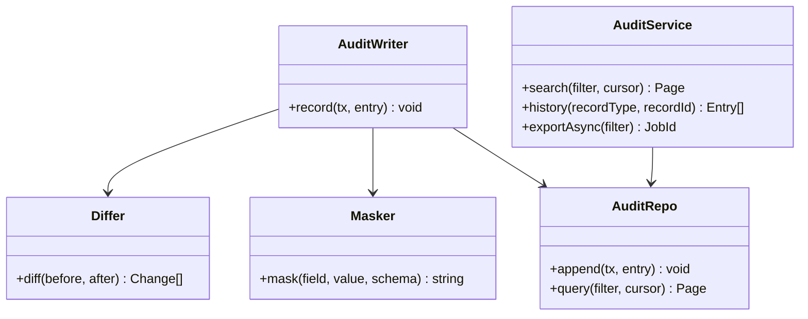
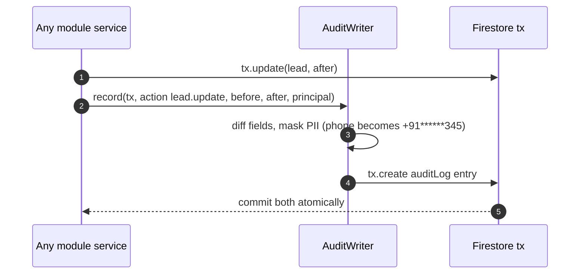
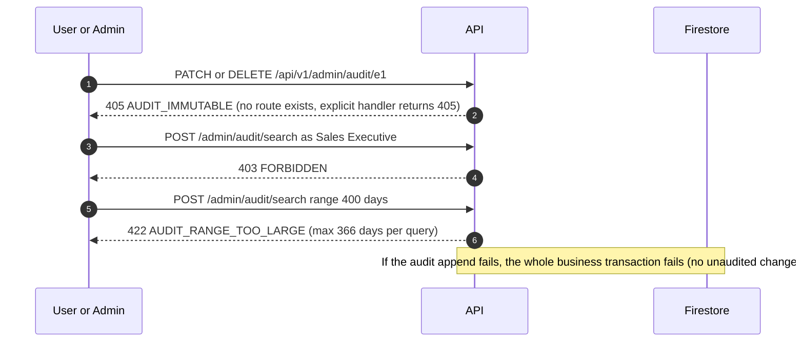
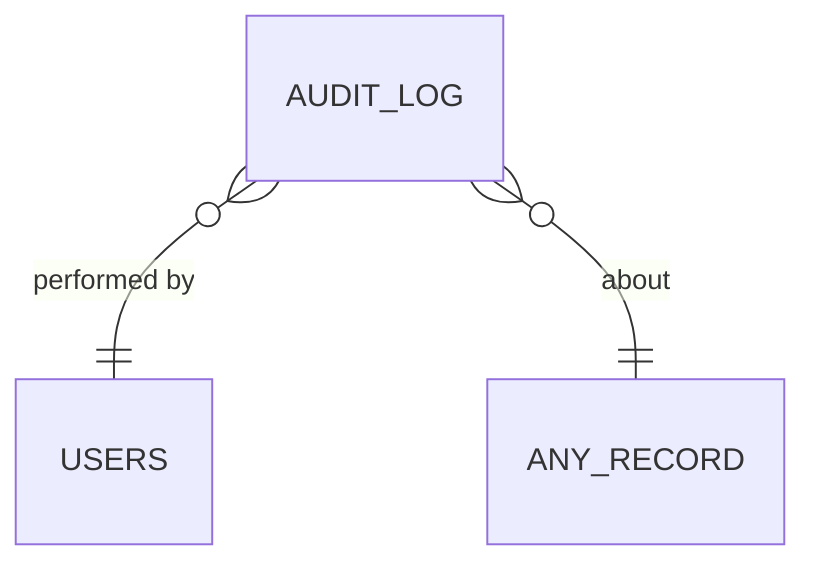

# Low-Level Design (LLD) — Module: audit

| Version | Date | Author | Change |
|---|---|---|---|
| 0.1 | 2026-11-13 | Claude (tech lead; self-checked against HLD v0.2 and ADRs — no separate architect review run) | Initial draft (batch 1) |

Conventions: [LLD-common](LLD-common.md). Ranges: API-040 – 044, TBL-020 – 024.

## 1. Module overview
The module keeps an append-only, PII-masked audit trail of logins and every state change, and lets Admins and Viewers search and export it.

| Linked | IDs |
|---|---|
| FRs | FR-015, FR-016 (also used by FR-087, FR-088, FR-089) |
| SCRs | SCR-031 (Audit log), "History" panel on record pages (SCR-004, SCR-011, SCR-015, SCR-021) |
| Rules | RULE-012 |
| NFR | NFR-022 |

## 2. Code structure
```
packages/domain/src/audit/
  diff.ts       # field-level diff of before/after
  mask.ts       # PII masking by schema metadata (.meta({ pii: true }))
apps/api/src/shared/audit-writer.ts     # AuditWriter.record(tx, entry) — used by every module
apps/api/src/modules/audit/
  audit.routes.ts  audit.service.ts  audit.repo.ts  audit.export.task.ts  audit.spec.ts
apps/web/src/app/settings/audit/        # SCR-031
apps/web/src/features/audit/HistoryPanel.tsx
```

## 3. Class / component diagram


## 4. Sequence diagrams

### 4.1 Record a change — happy path


### 4.2 Error paths


## 5. API contracts

### API-040 — Search audit log
| Item | Value |
|---|---|
| Method / path | POST /api/v1/admin/audit/search |
| Auth / roles | Bearer; `audit:read` (Admin, Viewer) |
| Linked FR | FR-016 |
| Idempotency | n/a (read) |
| Rate limit | Edge 600/min |

Request:
```json
{ "from": "2026-11-06", "to": "2026-11-13", "userId": "u3", "recordType": "lead", "recordId": null, "action": null, "limit": 50, "cursor": null }
```
`200`:
```json
{ "items": [ { "id": "a_91", "at": "2026-11-13T05:12:44Z", "user": { "id": "u3", "name": "Priya Sharma" }, "action": "lead.update", "recordType": "lead", "recordId": "L1",
  "changes": [ { "field": "phone", "before": "+91******345", "after": "+91******346" }, { "field": "stage", "before": "New", "after": "Contacted" } ], "ipMasked": "49.37.12.x" } ], "nextCursor": "c_…" }
```
Errors: `422 AUDIT_RANGE_TOO_LARGE`, `400 VALIDATION_FAILED`.

### API-041 — Export audit log (async)
| Item | Value |
|---|---|
| Method / path | POST /api/v1/admin/audit/export |
| Auth / roles | Bearer; `audit:export` (Admin, Viewer) |
| Linked FR | FR-016 |
| Idempotency | Idempotency-Key |
| Rate limit | 10/user/hour |

Same body as API-040 without paging. Returns `202 { "jobId": "job_x" }`; the result is an Excel file via API-008, kept 1 hour. The export itself is audited (`audit.export`).

### API-042 — Record history
| Item | Value |
|---|---|
| Method / path | GET /api/v1/history/{recordType}/{recordId}?cursor= |
| Auth / roles | Bearer; `audit:read`, **or** the user may read the record itself (scope check via the owning module) |
| Linked FR | FR-016 AC2 |

`200 { items: [...] }`, newest first. `404` if the record is out of scope.

## 6. Database design


### TBL-020 — auditLog
| Column | Type | Null | Default | Constraint / index | Notes |
|---|---|---|---|---|---|
| id | string | N | auto | | |
| at | ts | N | server time | index `(at desc)` | |
| userId | ref users | N | — | index `(userId, at desc)` | `system` / `support` / `public` (share link) / `hook:{keyId}` |
| action | string | N | — | index `(action, at desc)` | `<entity>.<verb>` catalogue in `@ss/contracts/audit-actions.ts` |
| recordType / recordId | string | Y | — | index `(recordType, recordId, at desc)` | null for auth events without a record |
| changes | array | Y | — | `{ field, before, after }`, masked | max 50 fields; long text truncated to 200 chars |
| meta | map | Y | — | e.g. `{ reason, count, jobId }` | no PII |
| ipMasked | string | Y | — | last octet masked | |
| requestId | string | Y | — | | log correlation |

No `version` and no updates (append-only). Retention ≥ 8 years (RULE-053); no TTL.

## 7. State machines
N/A — entries are immutable (created only).

## 8. Validation & business rules
| Rule ID | Where enforced | Implementation | Error code |
|---|---|---|---|
| RULE-012 (immutable) | No update/delete routes; repository exposes `append` only; Firestore rules deny all | — | `AUDIT_IMMUTABLE` (405) |
| RULE-012 (masking) | `domain/audit/mask.ts` | Fields flagged `pii` → phone `+91******345`, email `r***@x.com`, name `R*** K***`, address/notes `[redacted]` | — |
| FR-015 completeness | `AuditWriter.record` called by repository base `save()` for audited entities; ESLint rule forbids direct `tx.set` on audited collections outside repositories | Audit-coverage test per endpoint (NFR-022) | — |
| NFR-022 performance | Indexes above; `limit ≤ 100`; range ≤ 366 days | — | `AUDIT_RANGE_TOO_LARGE` |

## 9. Error code catalogue
| Code | HTTP | Message (user-facing) | Cause |
|---|---|---|---|
| AUDIT_IMMUTABLE | 405 | Audit entries can't be changed. | PUT/PATCH/DELETE attempt |
| AUDIT_RANGE_TOO_LARGE | 422 | Choose a range of one year or less. | > 366 days |

## 10. Events, jobs & schedules
| Job | Trigger | Action |
|---|---|---|
| `audit.export` | `export` Cloud Task | Streams query pages → exceljs workbook → `files` (expires in 1 hour) |

## 11. Caching
None (audit reads are rare and must be current).

## 12. Configuration / env vars
| Var | Required | Default | Description |
|---|---|---|---|
| AUDIT_MAX_RANGE_DAYS | N | 366 | Query guard |
| AUDIT_MAX_CHANGES | N | 50 | Per-entry field cap |

## 13. Logging & audit events
This module is the audit sink. Meta-events: `audit.export`, `audit.search` (only for Viewer/Support users, to trace auditor access).

## 14. Front-end design
| SCR | Route | Components (CMP) | Data fetching | State | Forms / validation |
|---|---|---|---|---|---|
| SCR-031 Audit log | `/settings/audit` | CMP-034 (filters), CMP-007 (range), CMP-004 (user, record type, action), CMP-009, CMP-016 (entry drawer), CMP-001 (Export) | `useInfiniteQuery(['audit', filters])` API-040; export API-041 → poll API-008 | Filters in URL | Range ≤ 1 year enforced client-side too |
| History panel | Drawer on SCR-004/011/015/021 | CMP-016, CMP-028 (timeline style) | API-042 | — | — |

## 15. Unit-test plan
| Unit | Scenarios |
|---|---|
| diff | added/removed/changed fields; nested maps (`totals.outstanding`); arrays (lines changed → summary "3 lines changed"); unchanged → no entry |
| mask | phone, email, name, address, notes; non-PII untouched; null values |
| AuditWriter (emulator) | entry written in the same tx; tx failure → no entry; business write fails if audit append fails |
| Routes | Viewer can search; Sales Exec 403; PATCH → 405; range > 366 → 422; history returns 404 out of scope |
| Coverage test | For every mutating route in the OpenAPI registry, calling it produces ≥ 1 audit entry (NFR-022) |

## 16. Open questions
None.
