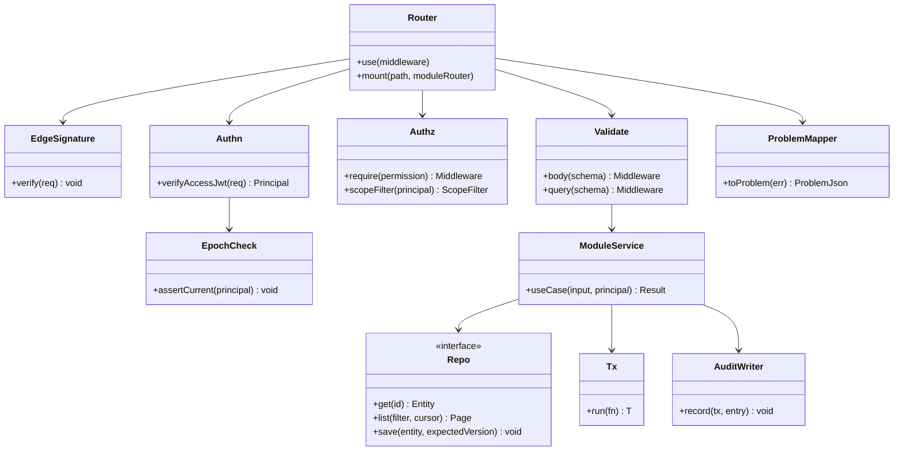
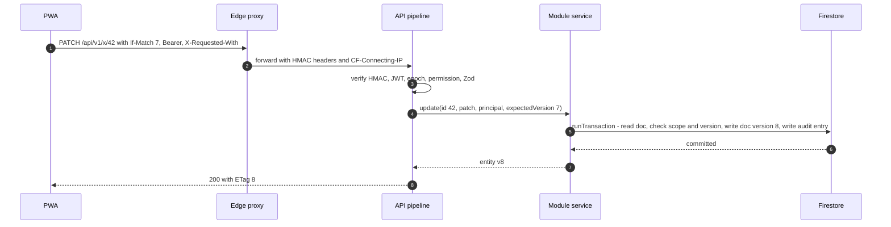
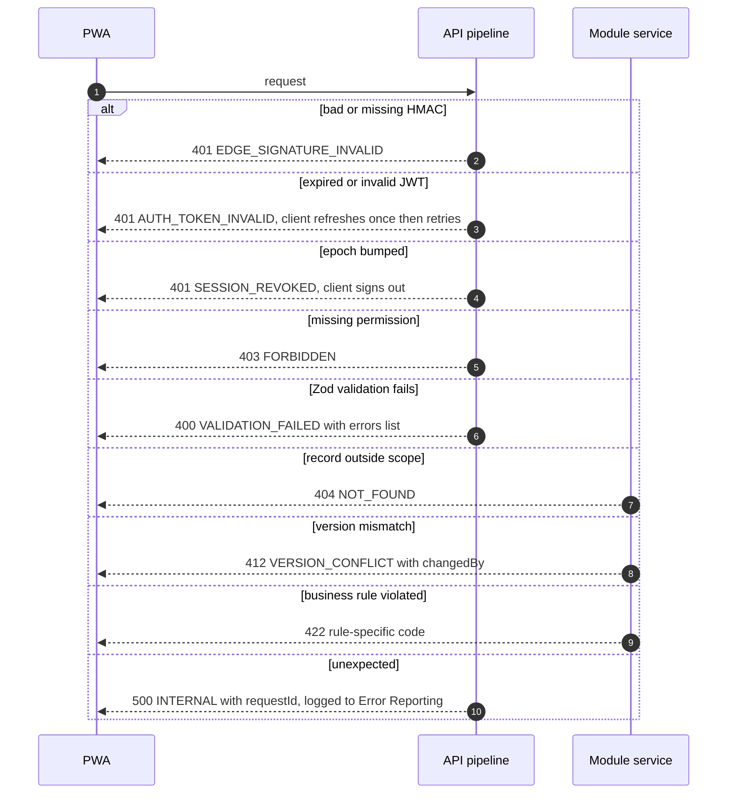
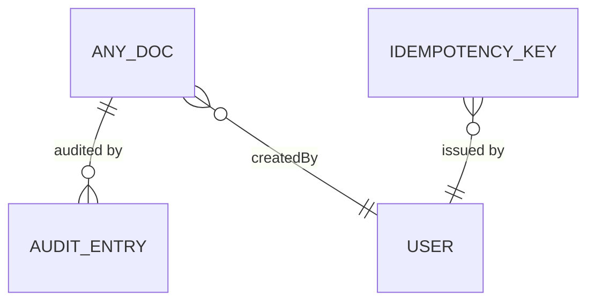

# Low-Level Design (LLD) — Common conventions (all modules)

| Version | Date | Author | Change |
|---|---|---|---|
| 0.1 | 2026-11-13 | Claude (tech lead; self-checked against HLD v0.2) | Cross-cutting conventions referenced by every module LLD |

Every `LLD-<module>.md` follows these conventions and lists only what is specific to it. Source: [HLD v0.2](../06-hld/HLD.md), ADR-001 – ADR-014.

## 1. Module overview
N/A as a business module. This document defines the shared code structure, request pipeline, API conventions, data conventions, errors, testing and front-end architecture.

**ID ranges** (global, so IDs never clash):

| Module | API range | TBL range | LLD | Batch |
|---|---|---|---|---|
| platform | API-001 – 009 | TBL-001 – 009 | [LLD-platform](LLD-platform.md) | 1 |
| identity | API-010 – 039 | TBL-010 – 019 | [LLD-identity](LLD-identity.md) | 1 |
| audit | API-040 – 044 | TBL-020 – 024 | [LLD-audit](LLD-audit.md) | 1 |
| masters | API-045 – 069 | TBL-030 – 039 | [LLD-masters](LLD-masters.md) | 1 |
| leads | API-070 – 099 | TBL-040 – 049 | LLD-leads | 2 |
| engagement | API-100 – 119 | TBL-050 – 059 | LLD-engagement | 2 |
| google | API-120 – 139 | TBL-060 – 069 | LLD-google | 2 |
| sales | API-140 – 179 | TBL-070 – 079 | LLD-sales | 3 |
| payments | API-180 – 189 | TBL-080 – 084 | LLD-payments | 3 |
| customers | API-190 – 199 | TBL-085 – 089 | LLD-customers | 3 |
| documents | API-200 – 214 | TBL-090 – 094 | LLD-documents | 3 |
| notify | API-215 – 224 | TBL-095 – 099 | LLD-notify | 4 |
| insights | API-225 – 239 | TBL-100 – 104 | LLD-insights | 4 |
| privacy | API-240 – 249 | TBL-105 – 109 | LLD-privacy | 4 |

## 2. Code structure

```
apps/
  api/src/
    main.ts                 # Express app factory (used by functions and Supertest)
    functions.ts            # exports: api, pdf, worker, jobs (firebase-functions v2)
    http/
      pipeline/             # requestId, edgeSignature, rateLimit, authn, epoch, authz, csrf, validate, audit, problem
      router.ts             # mounts module routers under /api/v1
    modules/<module>/
      <module>.routes.ts    # Express router; Zod schemas from @ss/contracts
      <module>.service.ts   # use-cases (orchestrates domain + repos, owns transactions)
      <module>.repo.ts      # Firestore repository (implements port from @ss/adapters)
      <module>.tasks.ts     # Cloud Tasks / job handlers (if any)
      <module>.spec.ts      # API tests (Supertest + emulator)
    shared/                 # tx helper, audit writer, ids, clock, errors, config cache
  web/src/
    app/                    # routes (React Router data routers), one folder per SCR
    features/<module>/      # hooks (TanStack Query), components, forms
    shell/                  # SCR-036: layout, nav, banners, toasts
    lib/                    # api client, auth store, i18n, formatters, outbox
packages/
  domain/       # pure rules (no I/O), 100 % type-safe, ≥ 80 % coverage
  contracts/    # Zod request/response schemas + OpenAPI registry + error codes
  adapters/     # ports + Firestore/Google/FCM/SecretManager/Tasks adapters
  ui/           # CMP-xxx components + tokens.css + tailwind preset
  config/       # client config Zod schema (ClientConfig)
  doc-templates/# HTML templates for PDFs and web preview (ADR-009)
clients/<id>/   # config.json, logo-light.svg, logo-dark.svg, icon-512.png
infra/          # firestore.rules, firestore.indexes.json, provision/, cloudflare/, workflows
```

## 3. Class / component diagram (request pipeline)



**Pipeline order:**
1. `requestId`
2. `edgeSignature` (HMAC, ±60 s)
3. `clientIp`
4. `rateLimitBackstop`
5. `csrf` (state-changing methods need `X-Requested-With: SaleSphere`)
6. `authn` (EdDSA JWT)
7. `epochCheck` (60 s cache)
8. `authz.require(permission)`
9. `validate`
10. handler
11. `problem` mapper

## 4. Sequence diagrams

### 4.1 Authenticated write — happy path


### 4.2 Error paths


## 5. API contracts — common conventions

| Item | Convention |
|---|---|
| Base path | `/api/v1` |
| Auth | `Authorization: Bearer <access JWT>` except public/hooks/auth endpoints |
| CSRF | `X-Requested-With: SaleSphere` on POST/PUT/PATCH/DELETE |
| Content type | `application/json; charset=utf-8`; errors `application/problem+json` |
| IDs | Firestore auto-IDs (20 chars) for records; human numbers (`INV/25-26/0142`) are separate fields |
| Money | Integer paise (`48380_00` → `4838000`), field names end in `Paise` |
| Dates | `date` = `YYYY-MM-DD` (IST business date); `datetime` = ISO 8601 UTC |
| Pagination | `?limit=25&cursor=<opaque>` → `{ items, nextCursor }`; max limit 100 |
| Sorting | `?sort=createdAt:desc` (whitelisted per endpoint) |
| Concurrency | Response `ETag: "<version>"`; updates require `If-Match`; mismatch → 412 |
| Idempotency | `Idempotency-Key` (UUID) on designated POSTs; stored 24 h in `idempotency/{key}` with response hash |
| Long work | `202 Accepted` + `{ jobId }` → `GET /api/v1/jobs/{jobId}` (exports, imports, erase, bulk) |

**Problem JSON** (every error):
```json
{
  "type": "https://salesphere.app/problems/QUANTITY_EXCEEDS_PENDING",
  "title": "Only 6 left to invoice",
  "status": 422,
  "code": "QUANTITY_EXCEEDS_PENDING",
  "detail": "Line 1 asks for 7 but 6 are pending on SO/25-26/0004.",
  "requestId": "req_8f2c1a",
  "errors": [{ "path": "lines.0.qty", "code": "too_big", "message": "Only 6 left to invoice" }]
}
```

## 6. Database design — common conventions

Firestore "tables" (TBL-xxx) are collections. Type mapping:

| Type | Firestore |
|---|---|
| string | string |
| int | integer |
| paise | integer |
| ts | Timestamp |
| date | string `YYYY-MM-DD` |
| map | map |
| array | array |
| ref | string ID |
| bool | boolean |

Every document carries these base fields (written by the repository base class, never by handlers):

| Column | Type | Null | Default | Constraint / index | Notes |
|---|---|---|---|---|---|
| id | string | N | auto | document ID | |
| createdAt / updatedAt | ts | N | server time | | audit |
| createdBy / updatedBy | ref users | N | principal | | `system` for jobs |
| version | int | N | 1 | incremented on every write | optimistic concurrency (RULE-058) |
| custom | map | N | `{}` | | reserved for Phase 2 custom fields |
| deletedAt | ts | Y | null | | soft delete (drafts, masters only) |

Indexes live in `infra/firestore.indexes.json`. Every list query in the LLDs names its index. Rules: `firestore.rules` = deny all.



### TBL-000 — idempotency (shared)
| Column | Type | Null | Default | Constraint / index | Notes |
|---|---|---|---|---|---|
| id | string | N | — | = Idempotency-Key | |
| route | string | N | — | | method + route template |
| principal | string | N | — | | user ID or API key ID |
| requestHash | string | N | — | | SHA-256 of body; a different body → 422 IDEMPOTENCY_KEY_REUSED |
| status / responseBody | int / map | N | — | | replayed verbatim |
| expiresAt | ts | N | now + 24 h | TTL policy | Firestore TTL deletes |

### TBL-00J — jobs (shared async status)
| Column | Type | Null | Default | Notes |
|---|---|---|---|---|
| id, kind, status (queued/running/succeeded/failed), progress (0–100), resultRef, error, requestedBy, expiresAt (TTL 7 d) | mixed | N | — | Polled via `GET /api/v1/jobs/{id}` (owner or Admin only) |

## 7. State machines
Module-specific (see each LLD). Shared async job state: `queued → running → succeeded | failed`.

## 8. Validation & business rules (common)
| Rule ID | Where enforced | Implementation | Error code |
|---|---|---|---|
| RULE-058 | Repository `save(entity, expectedVersion)` inside tx | Compare `version` and throw `VersionConflict(changedBy)` | `VERSION_CONFLICT` (412) |
| RULE-059 | `idempotency` middleware | Lookup/insert `idempotency/{key}` in the same tx as the create | `IDEMPOTENCY_KEY_REUSED` (422) |
| RULE-011 | `authz.scopeFilter` + repository list/get | Adds `ownerId == me` / `ownerId in team` / none; get() out of scope → NotFound | `NOT_FOUND` (404) |
| RULE-060/061 | `packages/domain/money.ts`, `time.ts` | Integer paise; `Intl.NumberFormat('en-IN')`; IST via date-fns-tz | — |
| RULE-015 | `domain/period.ts` → used by sales and payments | `assertOpenPeriod(date, lockDate)` | `PERIOD_LOCKED` (422) |

## 9. Error code catalogue (common)
| Code | HTTP | Message (user-facing) | Cause |
|---|---|---|---|
| EDGE_SIGNATURE_INVALID | 401 | Something went wrong — please refresh. | Missing or invalid proxy HMAC |
| AUTH_TOKEN_INVALID | 401 | Please sign in again. | Bad or expired access JWT |
| SESSION_REVOKED | 401 | You were signed out. Please sign in again. | Epoch changed |
| CSRF_HEADER_MISSING | 403 | Something went wrong — please refresh. | No `X-Requested-With` |
| FORBIDDEN | 403 | You don't have access to this. Ask your admin. | Missing permission |
| NOT_FOUND | 404 | We can't find that. | Missing or out of scope |
| VALIDATION_FAILED | 400 | Check the highlighted fields. | Zod errors (in `errors[]`) |
| VERSION_CONFLICT | 412 | Changed by {name} — reload to see the latest. | Stale If-Match |
| PRECONDITION_REQUIRED | 428 | Please reload and try again. | Missing If-Match on update |
| IDEMPOTENCY_KEY_REUSED | 422 | This request was already sent with different details. | Same key, different body |
| PERIOD_LOCKED | 422 | This date is in a locked period. | RULE-015 |
| MODULE_DISABLED | 404 | This feature isn't turned on. | FR-004 AC4 |
| RATE_LIMITED | 429 | Too many attempts — try again shortly. | Edge or backstop |
| INTERNAL | 500 | Something went wrong on our side — we've been notified. | Unhandled |

## 10. Events, jobs & schedules (common)
- **Ticks:** `tick-1m` and `tick-daily` → `jobs` function → lease `jobs/lease-{tick}` (CAS, TTL 90 s) → dispatch to module handlers registered in `platform/jobs.registry.ts`.
- **Cloud Tasks queues:**

  | Queue | Executed by | Max attempts | Backoff | Rate limit |
  |---|---|---|---|---|
  | `pdf-render` | `pdf` | 5 | 10 s → 5 min | 5/s |
  | `email-send` | `worker` | 3 | over 5 min | — |
  | `sheet-writeback` | `worker` | 5 | — | — |
  | `push-send` | `worker` | 3 | — | — |
  | `bulk` | `worker` | 3 | — | — |
  | `export` | `worker` | 2 | — | — |

- **Task naming:** task names are deterministic (`{kind}-{entityId}-{version}`) for dedupe.

## 11. Caching
| Cache | Where | TTL | Invalidation |
|---|---|---|---|
| Client config, settings, masters (lookups), role permissions | API in-memory LRU per instance | 60 s | TTL only (writes are rare; the admin UI shows "changes apply within a minute") |
| User epoch | API in-memory | 60 s | TTL (forced logout ≤ 60 s, CR-003) |
| JWT public keys | API in-memory | 10 min | `kid` miss → reload |
| Server state | PWA TanStack Query | `staleTime` 30 s lists, 5 min masters | Mutations invalidate query keys |
| Offline | PWA persisted query cache (last 200 records) + IndexedDB outbox | — | Cleared on sign-out |

## 12. Configuration / env vars (common)
| Var | Required | Default | Description |
|---|---|---|---|
| CLIENT_ID | Y | — | Install identifier (build and runtime) |
| GCP_PROJECT | Y | (runtime) | Firebase project ID |
| REGION | Y | asia-south1 | Function and queue region |
| APP_VERSION | Y | (CI) | Release tag |
| PUBLIC_ORIGIN | Y | — | `https://crm.client.com` (CSRF origin check, links) |
| EDGE_HMAC_SECRET_REF | Y | — | Secret Manager name (two versions for rotation) |
| LOG_LEVEL | N | info | pino level |
| TASKS_SA_EMAIL | Y | — | Service account used in OIDC for Cloud Tasks |
| Web: VITE_CLIENT_ID, VITE_FCM_VAPID_KEY, VITE_FIREBASE_APP_CONFIG | Y | — | Build-time; no secrets |

Every variable is documented in `.env.example` (CLAUDE.md §7).

## 13. Logging & audit events (common)
- Log line: `{ level, time, requestId, userId, routeTemplate, status, latencyMs, module, version, clientId, msg }`, with wildcard redaction (HLD §13).
- `AuditWriter.record(tx, { action, recordType, recordId, before, after })` computes a field diff and masks PII fields declared in each entity schema (`.meta({ pii: true })`).

## 14. Front-end design (common)
| Concern | Design |
|---|---|
| Routing | React Router v6 data routers; route = SCR; lazy-loaded per route; the URL holds tabs and filters |
| API client | `lib/api.ts` (fetch wrapper): adds Bearer token, CSRF header, If-Match from cached ETag; on 401 AUTH_TOKEN_INVALID → single-flight refresh (Web Locks) → retry once; maps problem+json to `ApiError` |
| Server state | TanStack Query; query keys `[module, entity, params]`; optimistic updates only for notes and call outcomes |
| Auth state | In-memory access token + `BroadcastChannel('ss-auth')`; no token in storage |
| Forms | React Hook Form + zodResolver using `@ss/contracts` schemas; server `errors[]` mapped to fields |
| i18n | `lib/i18n` with ICU messages (`en-IN`); terminology overrides injected from app-config (FR-003) |
| Formatting | `formatMoney(paise)`, `formatDate(date)`, `formatPhone(e164)` from `@ss/domain` |
| Errors | `ApiError` → toast or inline; 403 → permission explainer; 404 → not-found page |
| A11y | `@ss/ui` components (CMP-xxx); focus `<h1>` on route change; axe in E2E |

## 15. Unit-test plan (common)
| Unit | Scenarios |
|---|---|
| edgeSignature | valid; wrong secret; old ts (> 60 s); second kid accepted during rotation; body tampered |
| csrf | missing header on POST → 403; GET without header OK |
| authz.scopeFilter | own/team/all produce correct filters; team > 30 members throws (guard) |
| Repository.save | version match → v+1; mismatch → VersionConflict with changedBy |
| idempotency | first call stores; replay returns same body; different body → 422; TTL set |
| problem mapper | Zod error → 400 with paths; domain error → 422 code; unknown → 500 without stack |
| money/time | paise rounding half-up; Indian grouping; IST date boundaries at 18:30 UTC |

## 16. Open questions
None.
