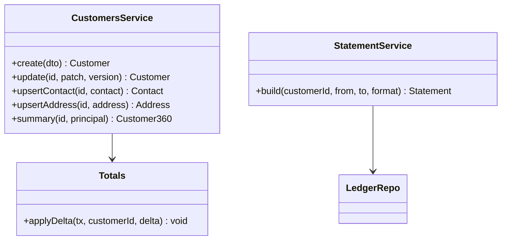
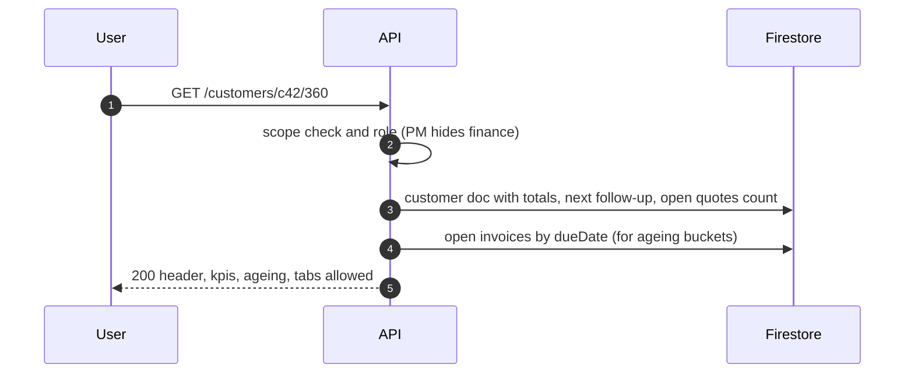
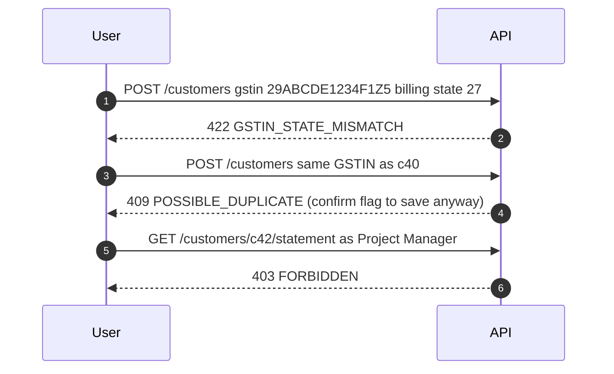
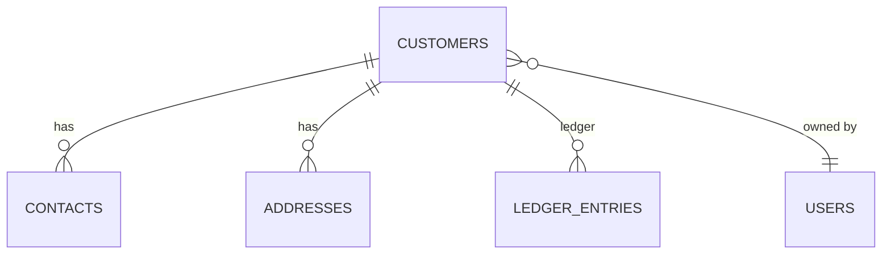

# Low-Level Design (LLD) — Module: customers

| Version | Date | Author | Change |
|---|---|---|---|
| 0.1 | 2026-11-13 | Claude (tech lead; self-checked against HLD v0.2 and ADRs — no separate architect review run) | Initial draft (batch 3) |

Conventions: [LLD-common](LLD-common.md). Ranges: API-190 – 199, TBL-085 – 089.

## 1. Module overview
Customers with contacts and addresses, the Customer 360 summary (denormalised totals kept current in the same transaction as every financial event), and the statement of account.

| Linked | IDs |
|---|---|
| FRs | FR-036 (target of conversion), FR-074 – FR-076 |
| UCs | UC-006, UC-013 |
| SCRs | SCR-020, SCR-021, SCR-022 |
| Rules | RULE-011, RULE-016, RULE-019, RULE-039, RULE-040 |

## 2. Code structure
```
packages/domain/src/customers/
  gstin.ts        # validateGstin(gstin, stateCode)   (RULE-016)
  statement.ts    # buildStatement(entries, from, to) -> {opening, rows[running], closing}
  ageing.ts       # bucket(dueDate, asOf) -> not_due | d1_30 | d31_60 | d61_90 | d90_plus
apps/api/src/modules/customers/
  customers.routes.ts  customers.service.ts  customers.repo.ts  totals.ts (applyDelta in tx)  statement.service.ts  customers.spec.ts
apps/web/src/app/customers/   # SCR-020, SCR-021 (tabs), SCR-022
```

## 3. Class / component diagram


## 4. Sequence diagrams

### 4.1 Customer 360 load


### 4.2 Error paths


## 5. API contracts
| ID | Method / path | Roles / permission | FR | Notes |
|---|---|---|---|---|
| API-190 | GET /customers?q=&ownerId=&groupId=&tag=&hasOverdue=&cursor= | `customer:read` | FR-074 | Outstanding column only with `finance:read` |
| API-191 | POST /customers | `customer:create` | FR-074 | `{…, confirmDuplicate?}` |
| API-192 | GET /customers/{id} · PATCH /customers/{id} | `customer:read` / `customer:update` + If-Match | FR-074 | |
| API-193 | GET /customers/{id}/360 | `customer:read` | FR-075 | Finance fields omitted for PM (AC3) |
| API-194 | POST /customers/{id}/contacts · PATCH/DELETE …/contacts/{cid} | `customer:update` | FR-074 | Contact keys written to TBL-041 |
| API-195 | POST /customers/{id}/addresses · PATCH/DELETE …/addresses/{aid} | `customer:update` | FR-074 | |
| API-196 | GET /customers/{id}/statement?from=&to=&format=json\|pdf\|xlsx | `finance:read` + scope | FR-076 | pdf/xlsx → 202 job |
| API-197 | GET /customers/{id}/invoices?bucket= · /payments · /orders · /quotes | per tab permission | FR-075 | Tab lists |

### API-193 — Customer 360
`200`:
```json
{ "customer": { "id": "c42", "code": "C-0042", "displayName": "Acme Interiors", "tags": ["retainer"], "ownerId": "u3", "since": "2026-04-02" },
  "kpis": { "lifetimeValue": 54000000, "invoiced": 54000000, "received": 49162000, "outstanding": 4838000, "overdue": 0, "advance": 0, "activeOrders": 1, "openQuotes": 2, "avgDaysToPay": 11 },
  "ageing": { "not_due": 4838000, "d1_30": 0, "d31_60": 0, "d61_90": 0, "d90_plus": 0 },
  "nextFollowUp": { "id": "f9", "dueAt": "2026-11-15T05:30:00Z" }, "tabs": ["overview","orders","quotes","invoices","payments","ledger","activities","contacts","documents"] }
```

## 6. Database design


### TBL-085 — customers/{id}
| Column | Type | Null | Notes |
|---|---|---|---|
| code | string | N | `C-` + 4-digit counter |
| displayName / legalName / type / groupId | string / string / enum / ref | N/Y/N/Y | index `(ownerId, displayName)` |
| gstin / pan | string | Y | `gstinIndex/{gstin}` for duplicate warning |
| ownerId / tags / creditDays | ref / string[] / int | | |
| totals | map | N | `{invoiced, received, credited, outstanding, advance, activeOrders, openQuotes, paidDaysSum, paidCount}`; overdue computed at read from open invoices |
| driveFolderId | string | Y | documents module |
| searchTokens | string[] | N | name prefixes, phones, GSTIN, code |
| leadIds | string[] | N | converted leads (timeline) |

### TBL-086 — customers/{id}/contacts/{cid}
`{ name, role: decision_maker|accounts|site|other, phone, phoneValid, email, isPrimary, consentBasis, consentAt }`.

### TBL-087 — customers/{id}/addresses/{aid}
`{ type: billing|shipping, line1, line2, city, stateCode, pincode, isDefault }`.

### TBL-088 — gstinIndex/{gstin}
`{ customerId }` (warning only; duplicates allowed after confirmation, so the doc keeps the first).

## 7. State machines
N/A — customers have no lifecycle beyond active / archived (`archived` flag hides from pickers; financial customers are never deleted, RULE-053).

## 8. Validation & business rules
| Rule ID | Where enforced | Implementation | Error code |
|---|---|---|---|
| RULE-016 | `gstin.ts` | regex + first 2 digits = billing address state code | `GSTIN_INVALID`, `GSTIN_STATE_MISMATCH` 422 |
| FR-074 AC2 | `gstinIndex` | existing and `!confirmDuplicate` | `POSSIBLE_DUPLICATE` 409 |
| RULE-019 | contacts | normalise phone/email; write contactKeys | — |
| RULE-040 | `totals.applyDelta` | called in every invoice/credit/payment/reversal tx | — |
| RULE-039 | `ageing.ts` | IST date diff | — |
| FR-075 AC3 | `summary()` | omit finance for roles without `finance:read` | — |
| FR-076 AC2 | statement | proforma never posts ledger entries | — |

## 9. Error code catalogue
| Code | HTTP | Message (user-facing) | Cause |
|---|---|---|---|
| GSTIN_INVALID | 422 | Enter a valid 15-character GSTIN. | RULE-016 |
| GSTIN_STATE_MISMATCH | 422 | GSTIN state doesn't match the billing address state. | FR-074 AC1 |
| POSSIBLE_DUPLICATE | 409 | A customer with this GSTIN already exists. | FR-074 AC2 |
| CUSTOMER_HAS_DOCUMENTS | 409 | Customers with documents can't be deleted. | RULE-053 |

## 10. Events, jobs & schedules
| Job | Trigger | Action |
|---|---|---|
| `statement.export` | `export` queue | PDF via documents renderer or xlsx via exceljs → `files` (1 h) |
| Rename listener | `customer.update` displayName | documents renames Drive folder |

## 11. Caching
None server-side. Client caches 360 for 30 s and invalidates on payment/invoice mutations.

## 12. Configuration / env vars
N/A — no module-specific variables.

## 13. Logging & audit events
Audit: `customer.create/update/archive`, `contact.create/update/delete`, `address.*`, `statement.export`.

## 14. Front-end design
| SCR | Route | Components (CMP) | Data fetching | State | Forms / validation |
|---|---|---|---|---|---|
| SCR-020 Customers | `/customers` | CMP-034, CMP-009 / CMP-010, CMP-035 | API-190 | filters in URL | — |
| SCR-021 Customer 360 | `/customers/:id?tab=` | CMP-025, CMP-027, CMP-013 KPI tiles, CMP-014 tabs, CMP-028, CMP-032 | API-193, API-197, API-100 | tab in URL | contact/address dialogs (RHF + Zod) |
| SCR-022 Statement | `/customers/:id/statement?from=&to=` | CMP-007 range, CMP-009, CMP-001 PDF/Excel/Share | API-196 | — | from ≤ to |

## 15. Unit-test plan
| Unit | Scenarios |
|---|---|
| gstin | valid KA; wrong checksum pattern; state mismatch |
| statement | FR-076 AC1 closing 15,000; AC2 proforma excluded; AC3 TDS line and closing 0; reversal debit |
| ageing | 45 days → 31–60 (FR-075 AC2); due today → not due |
| Routes | PM 360 hides finance; exec scope 404; duplicate GSTIN 409 then confirm 201 |

## 16. Open questions
None.
