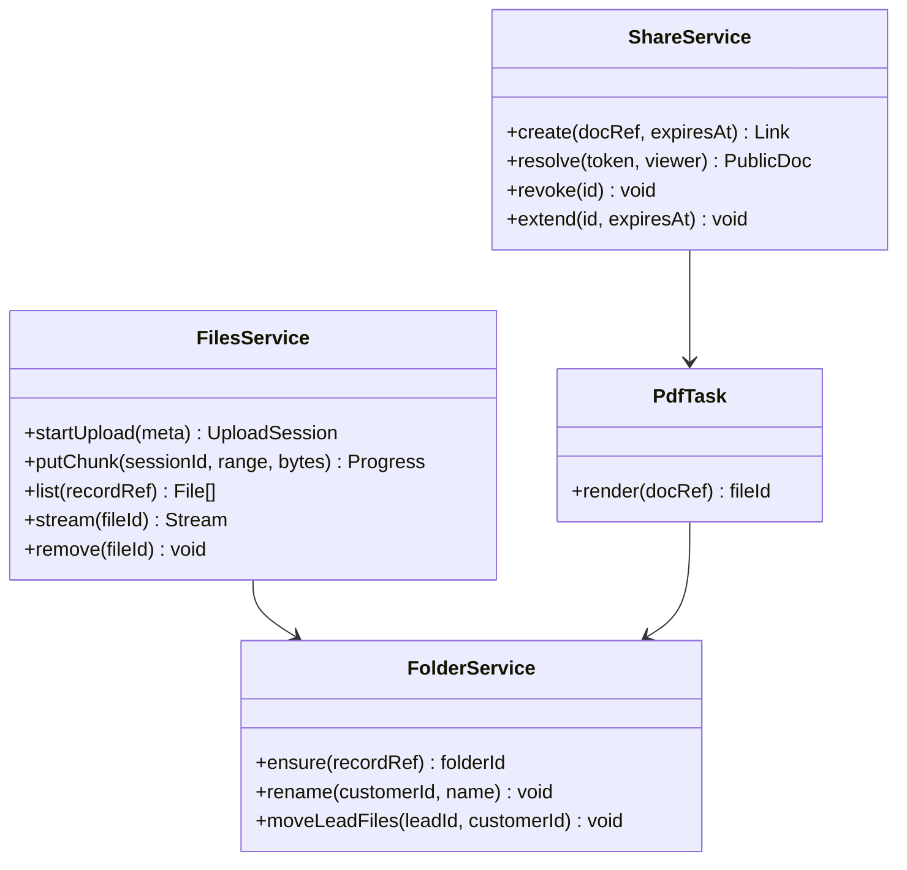
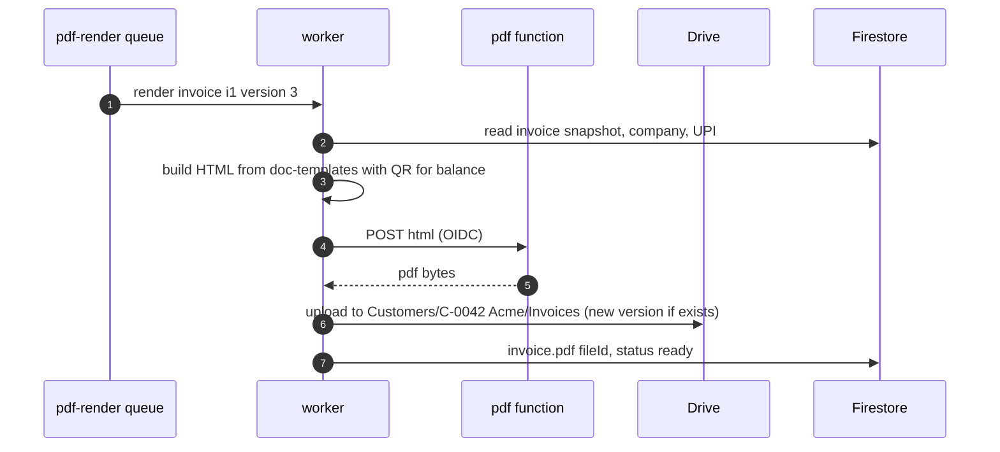
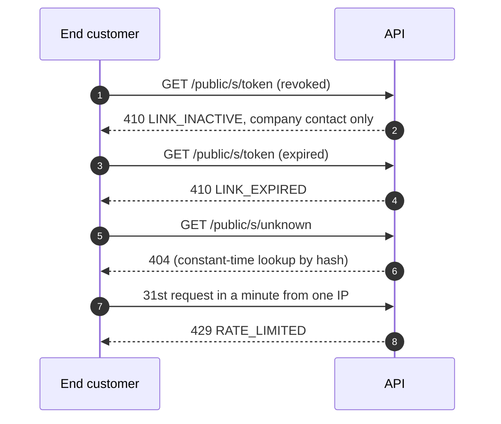
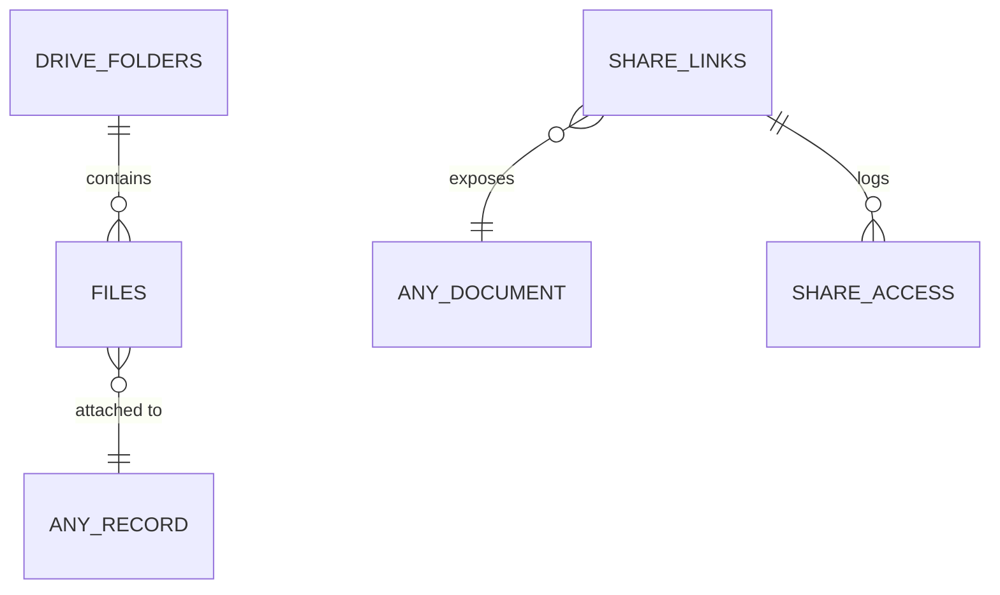
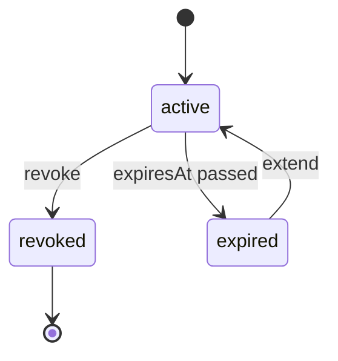

# Low-Level Design (LLD) — Module: documents

| Version | Date | Author | Change |
|---|---|---|---|
| 0.1 | 2026-11-13 | Claude (tech lead; self-checked against HLD v0.2 and ADRs — no separate architect review run) | Initial draft (batch 3) |

Conventions: [LLD-common](LLD-common.md). Ranges: API-200 – 214, TBL-090 – 094.

## 1. Module overview
Google Drive folder structure, file upload and download through the API (Drive files are never shared publicly), PDF rendering of quotations, invoices, credit notes, receipts and statements from shared HTML templates (ADR-009), and customer share links with the public document pages.

| Linked | IDs |
|---|---|
| FRs | FR-055, FR-067, FR-072 (rendering), FR-077 – FR-079 |
| SCRs | SCR-012 (view), SCR-016, document previews (CMP-042) in SCR-011, SCR-015, SCR-018 |
| Rules | RULE-049, RULE-050 |

## 2. Code structure
```
packages/doc-templates/src/
  layout.ts  quote.ts  invoice.ts  creditNote.ts  receipt.ts  statement.ts  styles.css  fonts/ (Noto Sans + Devanagari, Tamil…)
apps/api/src/modules/documents/
  files.routes.ts  files.service.ts  drive.folders.ts  share.routes.ts  share.service.ts  public.routes.ts  pdf.task.ts  documents.spec.ts
apps/api/src/pdf.ts            # `pdf` function: puppeteer-core + @sparticuz/chromium, renders HTML → PDF buffer
apps/web/src/app/public/       # /s/:token → SCR-012 / SCR-016 (no app shell, no auth)
```

## 3. Class / component diagram


## 4. Sequence diagrams

### 4.1 Render and store a PDF


### 4.2 Public share link — error paths


## 5. API contracts
| ID | Method / path | Roles / permission | FR | Notes |
|---|---|---|---|---|
| API-200 | POST /files/uploads | `file:create` + record scope | FR-078 | `{recordType, recordId, name, mimeType, size}` → `{sessionId, chunkSize}`; type/size checked (RULE-050) |
| API-201 | PUT /files/uploads/{sessionId} | uploader | FR-078 AC4 | `Content-Range` chunks (8 MB) proxied to Drive resumable session; `308` until complete, then `201 {file}` |
| API-202 | GET /files?recordType=&recordId= | record scope | FR-078 | |
| API-203 | GET /files/{id}/content?thumb=1 | record scope | FR-078 AC3 | Streams from Drive; `Content-Disposition` |
| API-204 | DELETE /files/{id} | `file:delete` (Admin) or uploader within 24 h | FR-078 | Generated PDFs not deletable |
| API-205 | GET /public/s/{token} | public | FR-057, FR-069, FR-079 | Document view JSON (logs access, counts quote views) |
| API-206 | GET /public/s/{token}/pdf | public | FR-079 | Streams latest PDF version |
| API-207 | POST /share-links | record scope | FR-056, FR-069, FR-079 | `{documentType, documentId}` → `{id, url, expiresAt}` (one active link per document; returns existing) |
| API-208 | PATCH /share-links/{id} | record scope | FR-079 | `{action: revoke\|extend, expiresAt?}` |
| API-209 | GET /share-links?documentType=&documentId= | record scope | FR-079 | With access log summary |
| API-210 | GET /documents/{type}/{id}/preview | record scope | FR-055, FR-067 | HTML preview (same template as PDF) |

### API-205 — Public document view
`200` (invoice):
```json
{ "type": "invoice", "company": { "name": "Acme Interiors", "logoUrl": "/public/s/tok/logo", "phone": "+91…" },
  "document": { "number": "INV/25-26/0142", "date": "2026-12-01", "dueDate": "2026-12-16", "lines": [ … ], "totals": { … }, "balanceDue": 2838000 },
  "upi": { "uri": "upi://pay?pa=acme@okhdfcbank&pn=Acme%20Interiors&am=28380.00&cu=INR&tn=INV%2F25-26%2F0142&tr=INV2526-0142", "qrSvg": "<svg…>" },
  "paid": false, "poweredBy": true, "actions": [] }
```
Quote view includes `actions: ["accept","changes","reject"]` only when RULE-030 holds, otherwise `state: superseded|expired|accepted` with `latestUrl` for superseded.

## 6. Database design


### TBL-090 — files/{id}
`{ driveFileId, name, mimeType, size, recordType, recordId, customerId?, ownerId, kind: upload|generated, docType?, docVersion?, thumbnailLink?, status: uploading|ready|pending_upload|failed, uploadedBy, createdAt }`; index `(recordType, recordId, createdAt desc)`.

### TBL-091 — driveFolders/{key}
`key = root | company | exports | leads | customer-{id} | customer-{id}-{sub} | lead-{id}`; `{ folderId, name }`.

### TBL-092 — shareLinks/{tokenHash}
| Column | Type | Notes |
|---|---|---|
| (doc id) | sha256(token) | token = 32 random bytes base64url (256-bit; RULE-049 ≥ 128) |
| documentType / documentId | enum / ref | quote, invoice, receipt, statement; index `(documentType, documentId)` |
| statementRange | map | statements only |
| createdBy / createdAt / expiresAt / revokedAt | | invoice expiry recomputed when balance hits 0 (+90 d) |
| accessCount / lastAccessAt | int / ts | |

### TBL-093 — shareAccess/{id}
`{ linkId, at, ipMasked, deviceType, internal (bool) }`; TTL = link expiry + 1 year (FRD §7.3).

### TBL-094 — uploadSessions/{id}
`{ driveSessionUri (encrypted), recordRef, name, mimeType, size, received, uploadedBy, expiresAt (24 h) }`.

## 7. State machines

File: `uploading → ready`; generated `pending_upload → ready | failed` (E-10).

## 8. Validation & business rules
| Rule ID | Where enforced | Implementation | Error code |
|---|---|---|---|
| RULE-049 | ShareService | random 256-bit, hash lookup, expiry defaults per type, access logged; internal viewers (valid session cookie) flagged and not counted (FR-058 AC3) | `LINK_INACTIVE`, `LINK_EXPIRED` 410 |
| RULE-050 | API-200 + magic-byte sniff on first chunk | ≤ 25 MB; allow-list MIME; block exe/archives | `FILE_TOO_LARGE`, `FILE_TYPE_BLOCKED` 422 |
| FR-078 AC3 | record scope check per request | no Drive links exposed | 404 |
| FR-077 | FolderService | idempotent `ensure` with folder doc; rename on customer rename; move lead files on convert | — |

## 9. Error code catalogue
| Code | HTTP | Message (user-facing) | Cause |
|---|---|---|---|
| FILE_TOO_LARGE | 422 | Files must be 25 MB or smaller. | RULE-050 |
| FILE_TYPE_BLOCKED | 422 | This file type isn't allowed. | RULE-050 |
| LINK_INACTIVE | 410 | This link is no longer active — contact {company}. | Revoked |
| LINK_EXPIRED | 410 | This link has expired — contact {company}. | Expired |
| DRIVE_UNAVAILABLE | 503 | Google Drive isn't reachable — try again shortly. | Drive error |

## 10. Events, jobs & schedules
| Job | Trigger | Action |
|---|---|---|
| `pdf.render` | `pdf-render` queue (ADR-009) | §4.1; 3 attempts, then `failed` + in-app alert "Regenerate PDF" |
| `drive.retry` | every 15 min | files `pending_upload` re-uploaded |
| `share.expiry` | daily | marks expired (read path also checks) |

## 11. Caching
Public page responses `Cache-Control: no-store` (live balance). Logo and fonts cached at the edge 1 day.

## 12. Configuration / env vars
| Var | Required | Default | Description |
|---|---|---|---|
| PDF_FUNCTION_URL | Y | — | Private `pdf` function (OIDC audience) |
| FILE_MAX_MB | N | 25 | RULE-050 |
| SHARE_STATEMENT_DAYS | N | 30 | RULE-049 |
| PUBLIC_RATE_PER_MIN | N | 30 | Per IP on `/public/*` |

## 13. Logging & audit events
Audit: `file.upload`, `file.delete`, `share_link.create/revoke/extend`, `pdf.regenerate`. Access to public links goes to TBL-093 (not audit). Metrics: `pdf.ms`, `pdf.failed`, `drive.failed`.

## 14. Front-end design
| SCR | Route | Components (CMP) | Data fetching | State | Forms / validation |
|---|---|---|---|---|---|
| SCR-012 Customer quote page | `/s/:token` (type quote) | CMP-042, CMP-030, CMP-001 Accept / Request changes / Reject, CMP-015 | API-205, API-151 | — | Accept requires typed name; changes requires comment |
| SCR-016 Customer invoice page | `/s/:token` (type invoice) | CMP-042, CMP-031 UPI block (Pay via UPI deep link), CMP-001 Download PDF | API-205, API-206 | — | — |
| Attachments | on SCR-004/011/013/015/018/021 | CMP-032 (camera capture, progress, resume) | API-200–204 | upload queue in memory | client size/type pre-check |

## 15. Unit-test plan
| Unit | Scenarios |
|---|---|
| templates | 40-line invoice → repeated header + Page x of y (snapshot of HTML structure); QR off → bank only; PAID stamp at 0; bill of supply title; Devanagari name renders with font |
| ShareService | token entropy/length; revoked 410; expired 410; internal view not counted; invoice expiry 90 d after paid |
| Files | 30 MB rejected; .exe rejected (extension and magic bytes); out-of-scope 404; resume continues from `received` |
| Folders | ensure idempotent; lead files moved on convert |

## 16. Open questions
None.
