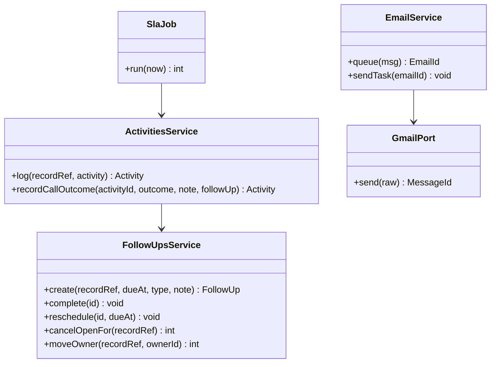
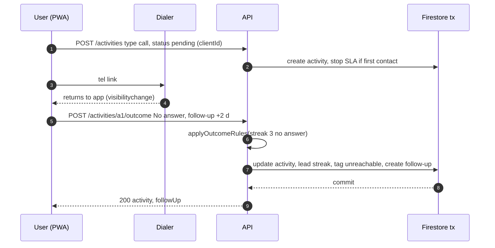
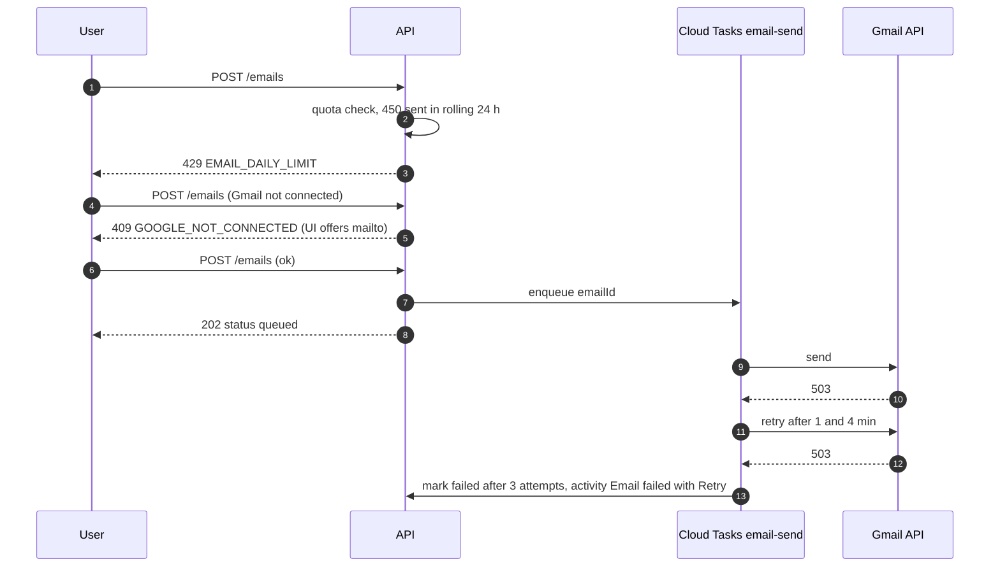
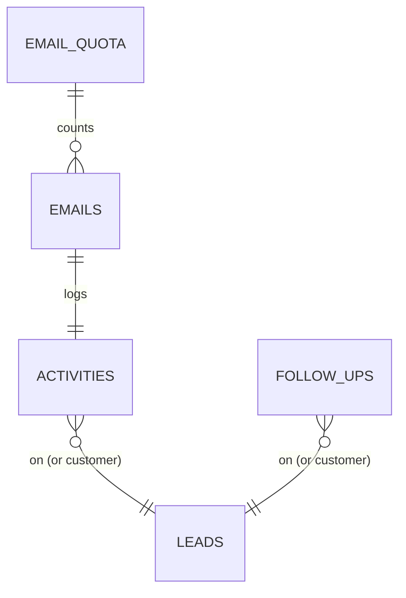
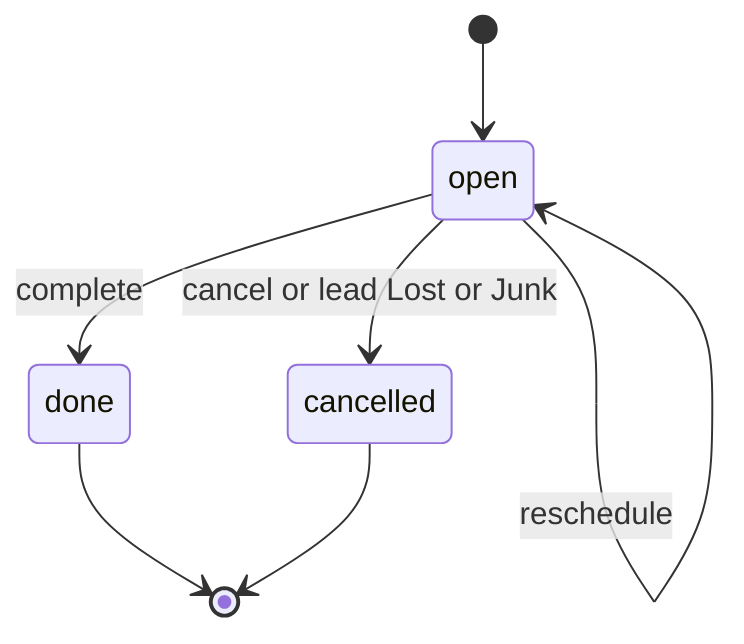

# Low-Level Design (LLD) — Module: engagement

| Version | Date | Author | Change |
|---|---|---|---|
| 0.1 | 2026-11-13 | Claude (tech lead; self-checked against HLD v0.2 and ADRs — no separate architect review run) | Initial draft (batch 2) |

Conventions: [LLD-common](LLD-common.md). Ranges: API-100 – 119, TBL-050 – 059.

## 1. Module overview
One-tap actions and follow-through: the activity timeline, calls with outcomes and outcome automation, WhatsApp click-to-chat, email via Gmail, directions, notes, follow-ups with reminders, the first-contact SLA, and the offline outbox endpoint.

| Linked | IDs |
|---|---|
| FRs | FR-035, FR-044 – FR-050, FR-081 (server side) |
| UCs | UC-005 |
| SCRs | SCR-004 (timeline, actions), SCR-006 (call outcome), SCR-007 (composer), SCR-008 (follow-ups), SCR-021 (customer timeline) |
| Rules | RULE-025, RULE-026, RULE-051, RULE-057 |

## 2. Code structure
```
packages/domain/src/engagement/
  sla.ts            # addBusinessMinutes(start, mins, calendar), slaStatus(now, lead)   (RULE-025)
  outcomes.ts       # applyOutcomeRules(streak, outcome, rules) -> {stage?, followUpInDays?, tags?, streak}  (RULE-026)
  templates.ts      # render("Hi {{name}}", vars), waLink(phone, text)
apps/api/src/modules/engagement/
  timeline.routes.ts  activities.service.ts  followups.service.ts  email.service.ts  email.task.ts
  outbox.routes.ts    sla.job.ts  reminders.job.ts  engagement.spec.ts
apps/web/src/features/engagement/
  ActionBar.tsx  CallOutcomeSheet.tsx  Composer.tsx  FollowUpList.tsx  useCallReturn.ts (visibilitychange)
apps/web/src/lib/outbox.ts   # IndexedDB queue (idb), ordered replay, 7-day flag (RULE-051)
```

## 3. Class / component diagram


## 4. Sequence diagrams

### 4.1 Call with outcome (happy path)


### 4.2 Email send with retries and quota (error paths)


## 5. API contracts
| ID | Method / path | Roles / permission | FR | Notes |
|---|---|---|---|---|
| API-100 | GET /timeline/{recordType}/{recordId}?types=&cursor= | record read scope | FR-035 | Customer timeline includes `leadIds` of converted leads (FR-035 AC1) |
| API-101 | POST /activities | `activity:create` | FR-044, FR-046, FR-048 | `{clientId, recordType, recordId, type: call\|whatsapp\|note\|visit, status?, note?, templateId?, deviceAt}`; `clientId` makes replay idempotent |
| API-102 | POST /activities/{id}/outcome | author or record scope | FR-044, FR-045 | `{outcomeId, note?, followUp?{dueAt,type}}` |
| API-103 | GET /follow-ups?bucket=today\|overdue\|upcoming&ownerId=&cursor= | `activity:read` | FR-049 | Scoped |
| API-104 | POST /follow-ups | `activity:create` | FR-049 | `{clientId, recordType, recordId, dueAt, type, note}` |
| API-105 | PATCH /follow-ups/{id} | owner or manager scope | FR-049 | `{action: complete\|reschedule\|cancel, dueAt?}` + If-Match |
| API-106 | POST /messages/whatsapp | `activity:create` | FR-046 | `{recordType, recordId, templateId, vars?, text?}` → `{url: "https://wa.me/91…?text=…", activityId}` |
| API-107 | POST /emails | `activity:create` | FR-047 | `{recordType, recordId, to[], cc[], subject, html, attachments:[{fileId}\|{documentRef}]}`; ≤ 20 MB; `202 {emailId}` |
| API-108 | GET /emails/{id} · POST /emails/{id}/retry | author | FR-047 | Status `queued \| sent \| failed` |
| API-109 | POST /outbox | signed in | FR-081 | `{items:[{clientId, kind, payload, deviceAt}] ≤ 50}` → per-item `{clientId, status: ok\|duplicate\|rejected, error?}`; applied in order |
| API-110 | GET /me/email-quota | signed in | FR-047 | `{used, limit, resetsAt}` |

### API-102 — Call outcome
Request:
```json
{ "outcomeId": "oc_no_answer", "note": "Switched off", "followUp": { "dueAt": "2026-11-15T05:30:00Z", "type": "call" } }
```
`200`:
```json
{ "activity": { "id": "a1", "type": "call", "outcome": "No answer", "status": "done" },
  "effects": { "streak": 3, "tagsAdded": ["unreachable"], "followUpId": "f9", "stage": null } }
```

## 6. Database design


### TBL-050 — activities/{id}
| Column | Type | Null | Default | Constraint / index | Notes |
|---|---|---|---|---|---|
| id | string | N | `clientId` when given | | idempotent replay |
| recordType / recordId | enum / string | N | — | index `(recordType, recordId, occurredAt desc)` | lead \| customer |
| customerId | ref | Y | — | index `(customerId, occurredAt desc)` | copied on conversion so the customer timeline includes lead history |
| ownerId | ref | N | — | | scope (owner of the record at write time) |
| type | enum | N | — | | call, whatsapp, email, note, visit, stage, assign, file, quote, invoice, payment, system |
| status | enum | Y | done | | `pending` (call without outcome), `done`, `failed` |
| outcomeId / outcomeLabel | ref / string | Y | — | | |
| note | string | Y | — | ≤ 5,000 | PII free text |
| meta | map | Y | — | | `{templateId, emailId, from, to, quoteId…}` |
| occurredAt / deviceAt / receivedAt / clockSkew | ts / ts / ts / bool | | | | E-22 |
| userId | ref | N | — | | author (kept even after reassignment, FR-081 AC4) |

### TBL-051 — followUps/{id}
`{ recordType, recordId, ownerId, dueAt, type, note, status: open|done|cancelled, remindedAt?, completedAt?, version }`; index `(ownerId, status, dueAt)`; `(status, dueAt)` for the reminder job.

### TBL-052 — emails/{id}
`{ recordType, recordId, userId, to[], cc[], subject, bodyRef (Drive or inline ≤ 100 KB), attachments[], status, attempts, gmailMessageId?, error?, createdAt }`. PII (addresses) retained with the record; purged with it.

### TBL-053 — emailQuota (doc `engagement/emailQuota`)
`{ buckets: { "2026-11-13T05": n, … } }` hourly buckets, rolling 24 h sum; incremented in the enqueue transaction (RULE-057).

## 7. State machines

Email: `queued → sent | failed`, `failed → queued` on Retry. Call activity: `pending → done`.

## 8. Validation & business rules
| Rule ID | Where enforced | Implementation | Error code |
|---|---|---|---|
| RULE-025 | `domain/engagement/sla.ts`; activities service | `slaDueAt = addBusinessMinutes(enquiryAt, sla, calendar)`; first call/whatsapp/email by a user sets `firstContactAt`, `slaStatus = met` | — |
| RULE-026 | `domain/engagement/outcomes.ts` | streak counts consecutive `no_answer\|busy`; any other outcome resets; rule fires at N | — |
| RULE-051 | `/outbox` + client `outbox.ts` | allowed kinds `note, call_outcome, follow_up`; ordered by device seq; server-wins for fields; notes appended | `OUTBOX_KIND_NOT_ALLOWED` |
| RULE-057 | `EmailService.queue` | rolling 24 h ≤ `EMAIL_DAILY_LIMIT` | `EMAIL_DAILY_LIMIT` 429 |
| FR-046 AC2 | `/messages/whatsapp` | lead.phoneValid required | `PHONE_REQUIRED` 422 |
| FR-047 | attachments | total ≤ 20 MB | `ATTACHMENTS_TOO_LARGE` 422 |
| FR-049 AC3/AC4 | lead events | `moveOwner` on assign; `cancelOpenFor` on lost/junk, same tx | — |

## 9. Error code catalogue
| Code | HTTP | Message (user-facing) | Cause |
|---|---|---|---|
| EMAIL_DAILY_LIMIT | 429 | Daily email limit reached — try tomorrow or use WhatsApp. | RULE-057 |
| GOOGLE_NOT_CONNECTED | 409 | Email not set up — ask your admin. | No Gmail scope |
| PHONE_REQUIRED | 422 | Add a valid mobile number first. | WhatsApp/Call without phone |
| ATTACHMENTS_TOO_LARGE | 422 | Attachments must total 20 MB or less. | FR-047 |
| OUTBOX_KIND_NOT_ALLOWED | 422 | This action needs an internet connection. | RULE-051 |

## 10. Events, jobs & schedules
| Job | Trigger | Action |
|---|---|---|
| `sla.check` | Scheduler every 1 min (`jobs` tick) | `slaStatus == pending && slaDueAt <= now` → `breached`, N-004 to owner (+ manager in Team) |
| `followups.remind` | every 1 min | `status == open && dueAt <= now && !remindedAt` → N-003 push, set `remindedAt` |
| `email.send` | `email-send` queue | Gmail `users.messages.send` (MIME built with attachments from Drive); 3 attempts over 5 min |
| Listeners | `lead.assigned`, `lead.stage(lost/junk)` | move / cancel follow-ups |

## 11. Caching
Timeline pages are cached client-side and in IndexedDB for offline (last 200 records). Message templates via API-051 (10 min).

## 12. Configuration / env vars
| Var | Required | Default | Description |
|---|---|---|---|
| EMAIL_DAILY_LIMIT | N | 450 | RULE-057 |
| EMAIL_MAX_ATTACH_MB | N | 20 | FR-047 |
| OUTBOX_MAX_BATCH | N | 50 | API-109 |

SLA minutes and business hours come from `settings/sla` (TBL-001), not env.

## 13. Logging & audit events
Audit: `activity.create`, `call.outcome`, `followup.create/complete/reschedule/cancel`, `email.send` (subject kept, addresses masked), `whatsapp.open`. Metrics: `email.failed`, `sla.breached`, `outbox.rejected`.

## 14. Front-end design
| SCR | Route | Components (CMP) | Data fetching | State | Forms / validation |
|---|---|---|---|---|---|
| SCR-006 Call outcome | bottom sheet over record | CMP-016, CMP-005 (outcome radios), CMP-006, CMP-007 | API-101 on tap Call, API-102 on save | `useCallReturn` stores pending call in sessionStorage | ≤ 3 taps (NFR-014) |
| SCR-007 Composer | sheet (mobile) / dialog | CMP-004 template, CMP-006 preview, CMP-032 attachments | API-106 / API-107, API-110 | — | Gmail disconnected → mailto fallback |
| SCR-008 Follow-ups | `/follow-ups` | CMP-014 tabs, CMP-010, CMP-019 overdue | API-103 | tab in URL | reschedule via CMP-007 |
| Timeline | SCR-004, SCR-021 | CMP-028, CMP-040 sync badge | API-100 | merged with outbox pending items | — |

## 15. Unit-test plan
| Unit | Scenarios |
|---|---|
| sla | 10:00 + 15 → 10:15; 21:00 → next day 09:15; Saturday 18:50 + 15 → Monday 09:05; Sunday start |
| outcomes | 3 × no answer → unreachable + follow-up 2 d; connected resets; busy counts |
| templates | variables filled; missing var left blank; wa.me encoding of spaces, newlines and `&` |
| Routes | outcome sets SLA met; outbox duplicate clientId → `duplicate`; outbox invoice kind rejected; email over quota 429; follow-ups move on reassign; cancelled on lost |
| email task | 3 failures → failed activity; success writes gmailMessageId |

## 16. Open questions
None.
