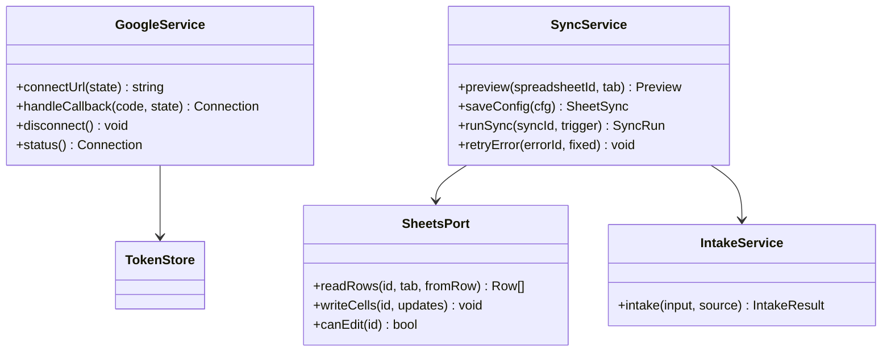
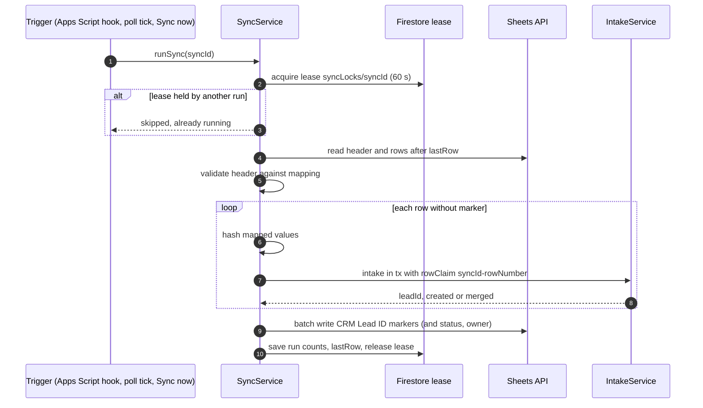
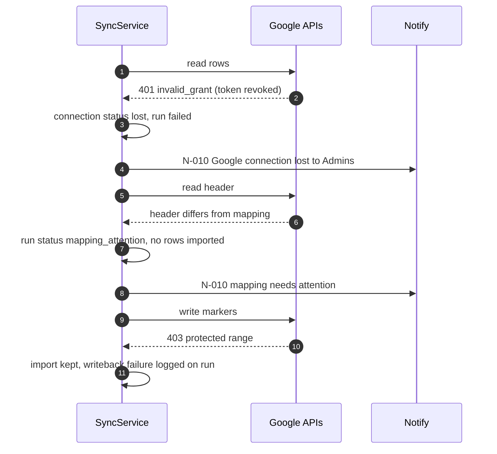
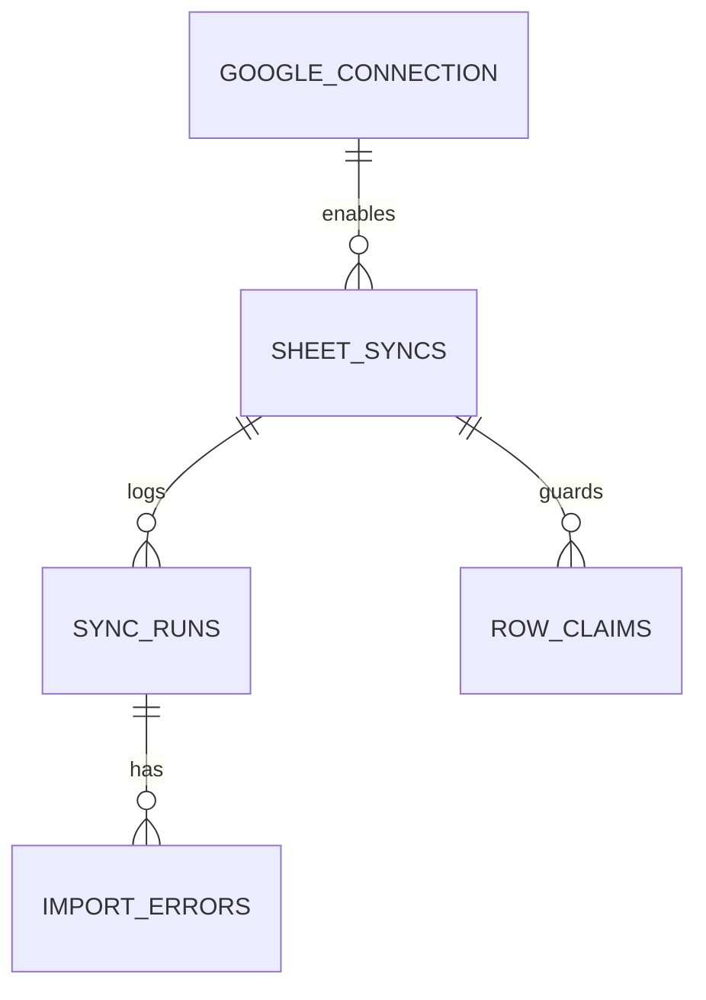
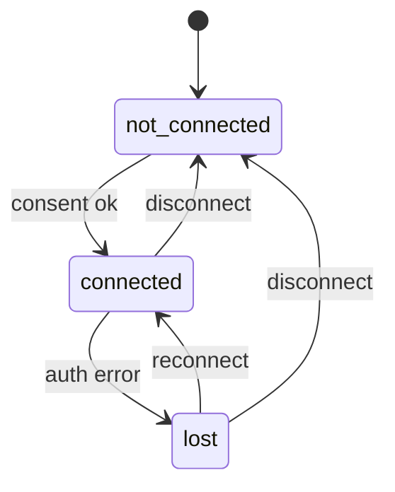

# Low-Level Design (LLD) — Module: google

| Version | Date | Author | Change |
|---|---|---|---|
| 0.1 | 2026-11-13 | Claude (tech lead; self-checked against HLD v0.2 and ADRs — no separate architect review run) | Initial draft (batch 2) |

Conventions: [LLD-common](LLD-common.md). Ranges: API-120 – 139, TBL-060 – 069. ADR references: Google integration ADR (scopes `drive.file`, `gmail.send`, `spreadsheets`; Picker).

## 1. Module overview
Connects the client's Google account (OAuth, refresh token in Secret Manager), manages Sheet sync configurations, runs exactly-once imports with write-back, keeps the sync log and import-error queue, and raises connection-health alerts. Drive and Gmail adapters used by other modules live here too.

| Linked | IDs |
|---|---|
| FRs | FR-037 – FR-043 |
| UCs | UC-003 |
| SCRs | SCR-029 |
| Rules | RULE-018, RULE-024 |
| INT | INT-001 – INT-005 |

## 2. Code structure
```
packages/adapters/src/google/
  oauth.ts  sheets.ts  drive.ts  gmail.ts  tokenStore.ts (Secret Manager)  errors.ts (auth vs transient)
packages/domain/src/sync/
  mapping.ts   # validateMapping(headers, mapping) -> {ok, missing}; rowToLead(row, mapping, defaults)
  rowHash.ts   # sha256(canonical mapped values)
apps/api/src/modules/google/
  google.routes.ts  google.service.ts  sync.service.ts  sync.task.ts  writeback.task.ts  health.job.ts  google.spec.ts
apps/web/src/app/settings/google/   # SCR-029
```

## 3. Class / component diagram


## 4. Sequence diagrams

### 4.1 Sync run — exactly-once import


### 4.2 Error paths


## 5. API contracts
| ID | Method / path | Roles / permission | FR | Notes |
|---|---|---|---|---|
| API-120 | GET /admin/google | `settings:read` | FR-037, FR-043 | `{status: not_connected\|connected\|lost, email, scopes[], features:{drive,gmail,sheets}, lastError}` |
| API-121 | POST /admin/google/connect | `settings:write` | FR-037 | `{authUrl}` with PKCE + `state` (stored 10 min) |
| API-122 | GET /oauth/google/callback?code=&state= | public (state-bound) | FR-037 | Stores refresh token in Secret Manager, redirects to `/settings/google?connected=1` |
| API-123 | POST /admin/google/disconnect | `settings:write` | FR-037 AC3 | Revokes and deletes token |
| API-124 | GET /admin/google/picker-token | `settings:write` | FR-038 | Short-lived access token + developer key for Google Picker |
| API-125 | POST /admin/sheets/preview | `settings:write` | FR-038 | `{spreadsheetId, tab}` → `{headers, rows[5], canEdit}` |
| API-126 | POST /admin/sheets | `settings:write` | FR-038, FR-040 AC4 | Create config; blocks if no phone/email mapped or `!canEdit` |
| API-127 | GET /admin/sheets · PATCH/DELETE /admin/sheets/{id} | `settings:*` | FR-038 | Multiple sheets |
| API-128 | POST /admin/sheets/{id}/sync | `settings:write` | FR-039 | Sync now → `202 {runId}` |
| API-129 | POST /hooks/sheets/{id} | HMAC `X-SS-Signature` (per-sync secret) | FR-039 | Body `{ts}`; ±5 min replay window; enqueues run |
| API-130 | GET /admin/sheets/{id}/runs?cursor= | `settings:read` | FR-042 | RPT-010 source |
| API-131 | GET /admin/import-errors?syncId=&status= | `settings:read` | FR-042 | |
| API-132 | POST /admin/import-errors/{id}/retry · /dismiss | `settings:write` | FR-042 AC2 | Retry takes corrected `fields` |
| API-133 | GET /admin/sheets/{id}/apps-script | `settings:write` | FR-039 | Returns script text with hook URL and secret (shown once per rotate) |

### API-126 — Create sheet sync
```json
{ "spreadsheetId": "1AbC…", "tab": "Leads", "headerRow": 1,
  "mapping": { "name": "Full Name", "phone": "Phone", "email": "Email", "city": "City", "enquiryAt": "Timestamp" },
  "defaults": { "sourceId": "src_meta_ads", "stage": "new" }, "markerColumn": "CRM Lead ID",
  "mode": "webhook", "pollMinutes": 4, "writeBack": { "status": true, "owner": true }, "backfillDays": 30 }
```
`201 { "id": "ss1", "markerColumnLetter": "H", "version": 1 }`. Errors `422 MAPPING_CONTACT_REQUIRED`, `422 SHEET_NOT_EDITABLE`.

## 6. Database design


### TBL-060 — googleConnection (doc `integrations/google`)
`{ status, email, scopes[], secretVersion, connectedAt, connectedBy, lastErrorAt, lastError, consecutiveFailures }`. The token itself is only in Secret Manager (`google-refresh-token`).

### TBL-061 — sheetSyncs/{id}
| Column | Type | Notes |
|---|---|---|
| spreadsheetId, tab, headerRow, headersSnapshot[] | string / int / string[] | snapshot used to detect header change (FR-038 AC2) |
| mapping, defaults, markerColumn | map / map / string | |
| mode / pollMinutes | `webhook \| poll` / 1–4 | webhook mode also polls every 15 min (FR-039 AC3) |
| writeBack | `{status, owner}` | marker is always written (RULE-024) |
| hookSecretHash | string | HMAC secret stored in Secret Manager; hash here for rotation |
| lastRow, lastRunAt, nextPollAt, status | int / ts / ts / enum | `ok \| mapping_attention \| failing` ; index `(status, nextPollAt)` |

### TBL-062 — syncRuns/{id}
`{ syncId, trigger: webhook|poll|manual|safety, startedAt, endedAt, read, created, merged, skipped, failed, writebackFailed, status, error? }`; index `(syncId, startedAt desc)`; TTL 180 days.

### TBL-063 — importErrors/{id}
`{ syncId, runId, rowNumber, rowData (masked for list view; full for Admin edit), reason, status: open|resolved|dismissed, resolvedLeadId? }`; TTL 180 days after resolve.

### TBL-064 — rowClaims/{syncId}-{rowNumber}
`{ hash, leadId, claimedAt }` created inside the intake transaction (`create` fails if it exists → concurrent run skips). Second guard: `rowClaims` by `{syncId}-h-{hash}` within 10 minutes (E-30, marker column deleted).

### TBL-065 — syncLocks/{syncId}
Lease `{ holder, expiresAt }` (60 s, renewed every 200 rows).

## 7. State machines

Sheet sync status: `ok → mapping_attention` (header changed) `→ ok` (mapping re-saved); `ok → failing` (3 consecutive failed runs) `→ ok` (successful run).

## 8. Validation & business rules
| Rule ID | Where enforced | Implementation | Error code |
|---|---|---|---|
| RULE-018 / FR-038 AC1 | `domain/sync/mapping.ts` | mapping must include phone or email | `MAPPING_CONTACT_REQUIRED` 422 |
| FR-040 AC4 | `SyncService.saveConfig` | `drive.files.get(capabilities.canEdit)` | `SHEET_NOT_EDITABLE` 422 |
| RULE-024 | sync loop | skip rows with marker; claim row in tx; stamped-row edits logged `changed_after_import` | — |
| FR-042 AC1 | `rowToLead` | missing valid phone and email → import error | — |
| FR-039 hook | HMAC verify, timestamp window, per-sync rate 30/min | | `SIGNATURE_INVALID` 401 |

## 9. Error code catalogue
| Code | HTTP | Message (user-facing) | Cause |
|---|---|---|---|
| MAPPING_CONTACT_REQUIRED | 422 | Map a Phone or Email column. | FR-038 AC1 |
| SHEET_NOT_EDITABLE | 422 | SaleSphere needs edit access to mark imported rows. | FR-040 AC4 |
| GOOGLE_NOT_CONNECTED | 409 | Connect Google first. | Any sheet/drive/gmail call |
| GOOGLE_SCOPE_MISSING | 409 | Not available — reconnect to enable. | Declined scope (FR-037 AC2) |
| OAUTH_STATE_INVALID | 400 | Connection attempt expired — try again. | State mismatch / expired |
| SIGNATURE_INVALID | 401 | — | Bad Apps Script signature |

## 10. Events, jobs & schedules
| Job | Trigger | Action |
|---|---|---|
| `sheets.poll` | `jobs` tick every 1 min | syncs with `nextPollAt <= now` → enqueue `sheet-sync` task |
| `sheet.sync` | Cloud Task (dedupe name `sync-{id}-{minute}`) | §4.1 |
| `sheet.writeback` | `sheet-writeback` queue, on lead stage/owner change when enabled | update status/owner cells by marker row lookup |
| `google.health` | every 5 min | if `consecutiveFailures ≥ 3` or auth error → `lost`, N-010 (FR-043 within 15 min) |
| Catch-up | on reconnect | immediate sync of all configs (FR-043 AC2) |

## 11. Caching
Access token cached in memory per instance until 5 min before expiry. Sheet headers not cached (read each run).

## 12. Configuration / env vars
| Var | Required | Default | Description |
|---|---|---|---|
| GOOGLE_CLIENT_ID | Y | — | OAuth client (per install project) |
| GOOGLE_CLIENT_SECRET | Y (secret) | — | Secret Manager |
| GOOGLE_PICKER_API_KEY | Y | — | Browser key restricted to app origin |
| GOOGLE_REDIRECT_URI | Y | `https://<host>/api/v1/oauth/google/callback` | |
| SYNC_SAFETY_POLL_MIN | N | 15 | FR-039 AC3 |

## 13. Logging & audit events
Audit: `google.connect`, `google.disconnect`, `sheet_sync.create/update/delete`, `sheet_sync.run` (counts only), `import_error.retry/dismiss`. Logs: run metrics `{read, created, merged, failed, ms}` (no row data).

## 14. Front-end design
| SCR | Route | Components (CMP) | Data fetching | State | Forms / validation |
|---|---|---|---|---|---|
| SCR-029 Google & Sheet sync | `/settings/google` | CMP-018 status banner, CMP-012 cards, CMP-033 stepper (pick → map → options), CMP-009 runs and errors, CMP-015 retry dialog | API-120, API-124 (Picker), API-125–133 | wizard local state | mapping Zod; phone or email required |

## 15. Unit-test plan
| Unit | Scenarios |
|---|---|
| mapping | missing phone & email → error; header change detected; defaults applied |
| rowHash | canonical ordering and whitespace; identical rows → same hash (still claimed separately by row number) |
| sync (emulator + fake Sheets) | webhook + poll concurrent → 1 lead (FR-040 AC1); stamped row edited → `changed_after_import`; rows re-sorted → no re-import; write-back 403 → import kept; invalid row → error queue; retry fixed → lead created |
| oauth | state mismatch 400; declined gmail scope → feature flag off; disconnect revokes |
| health | invalid_grant → status lost + N-010 |

## 16. Open questions
None.
