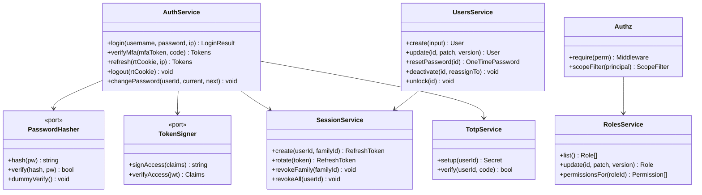
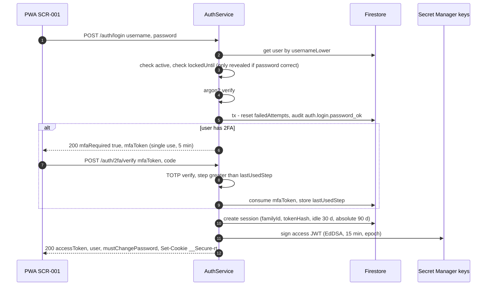
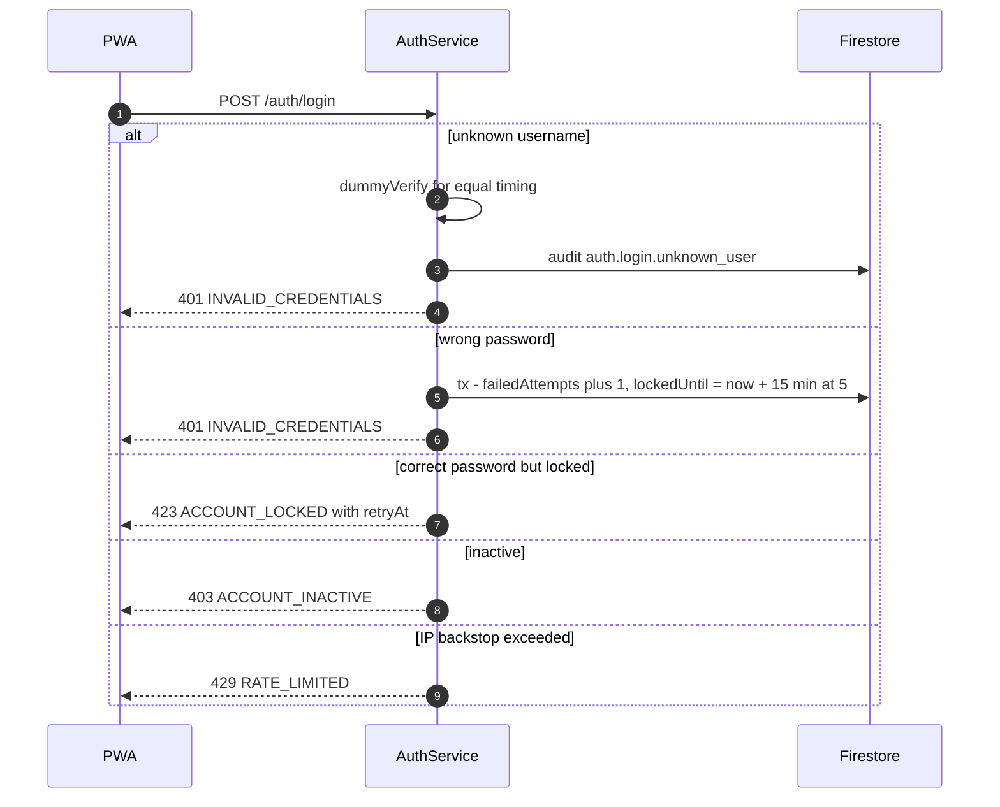
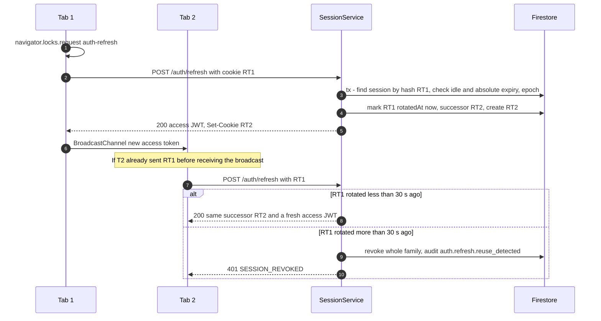
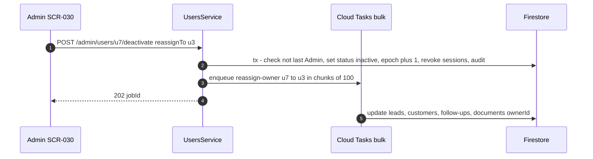
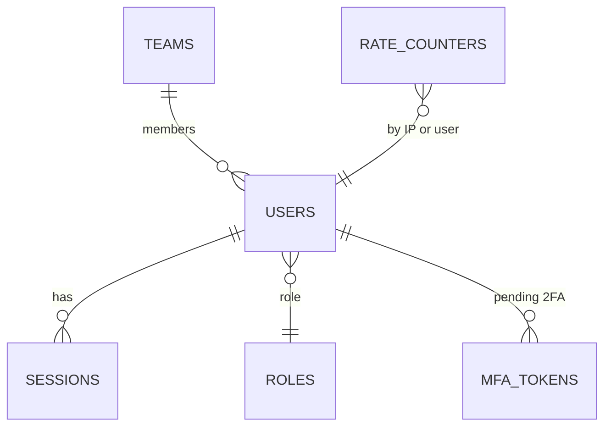
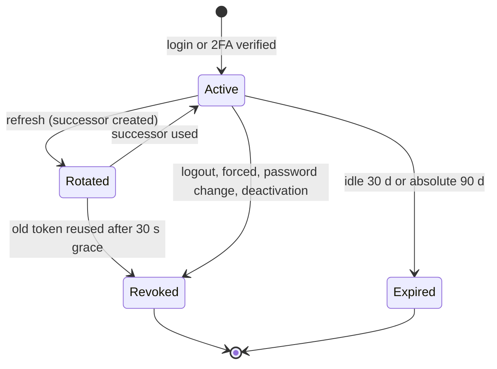

# Low-Level Design (LLD) — Module: identity

| Version | Date | Author | Change |
|---|---|---|---|
| 0.1 | 2026-11-13 | Claude (tech lead; self-checked against HLD v0.2 and ADRs — no separate architect review run) | Initial draft (batch 1) |

Conventions: [LLD-common](LLD-common.md). Ranges: API-010 – 039, TBL-010 – 019. Security design: HLD §9, ADR-005.

## 1. Module overview
Covers:
- sign-in, 2FA, refresh/sign-out, the password policy and lockout
- user self-service
- user administration, roles and permissions, teams
- sessions and forced logout
- the support user

| Linked | IDs |
|---|---|
| FRs | FR-007, FR-008, FR-009, FR-010, FR-011, FR-012, FR-013, FR-014, FR-089 |
| UCs | UC-001 |
| PFs | PF-011 |
| SCRs | SCR-001 (Sign in), SCR-030 (Users & roles), SCR-033 (My account), SCR-036 (role-filtered nav) |
| Rules | RULE-002, RULE-005 – RULE-011, RULE-048, RULE-056 |

## 2. Code structure
```
packages/domain/src/identity/
  password-policy.ts   lockout.ts   permissions.ts (catalogue + role defaults)   scope.ts
apps/api/src/modules/identity/
  auth.routes.ts        # API-010..016
  me.routes.ts          # API-017..019
  admin-users.routes.ts # API-020..029
  admin-roles.routes.ts # API-030..035
  auth.service.ts  session.service.ts  totp.service.ts  users.service.ts  roles.service.ts
  identity.repo.ts  identity.spec.ts  auth.negative.spec.ts
apps/api/src/http/pipeline/{authn,epoch,authz}.ts
apps/web/src/app/login/       apps/web/src/app/account/      apps/web/src/app/settings/users/
apps/web/src/lib/auth/        # token store, single-flight refresh (Web Locks + BroadcastChannel)
```

## 3. Class / component diagram


## 4. Sequence diagrams

### 4.1 Sign in with 2FA — happy path (FR-007, FR-012)


### 4.2 Sign in — error paths (FR-007 AC2/AC3/AC5, FR-008)


### 4.3 Refresh with rotation, grace window and reuse detection (FR-010)


### 4.4 Deactivate a user with reassignment (FR-011 AC2)


## 5. API contracts
All requests carry `X-Requested-With: SaleSphere`. Bodies are validated by Zod schemas in `@ss/contracts/identity`.

### API-010 — Sign in
| Item | Value |
|---|---|
| Method / path | POST /api/v1/auth/login |
| Auth / roles | None |
| Linked FR | FR-007, FR-008 |
| Idempotency | n/a (not idempotent by design) |
| Rate limit | Edge 60/min/IP; API backstop 60/min/IP; lockout 5 per username / 15 min |

Request:
```json
{ "username": "Priya.S", "password": "correct horse battery" }
```
`200` (no 2FA):
```json
{ "accessToken": "eyJhbGciOiJFZERTQSIsImtpZCI6ImsxIn0...", "expiresIn": 900,
  "user": { "id": "u3", "username": "priya.s", "fullName": "Priya Sharma", "role": "salesExecutive", "permissions": ["leads:read:own","leads:update:own","payments:create:own"] },
  "mustChangePassword": false }
```
`200` (2FA): `{ "mfaRequired": true, "mfaToken": "mfa_9d2…", "expiresIn": 300 }`

Errors:
- `401 INVALID_CREDENTIALS`
- `423 ACCOUNT_LOCKED` `{ "retryAt": "2026-11-13T04:45:00Z" }`
- `403 ACCOUNT_INACTIVE`
- `429 RATE_LIMITED`

### API-011 — Verify 2FA code
| Item | Value |
|---|---|
| Method / path | POST /api/v1/auth/2fa/verify |
| Auth / roles | `mfaToken` (single use, 5 min) |
| Linked FR | FR-012 |
| Rate limit | 5 wrong codes → counts as a failed login (FR-012 AC4) |

Request `{ "mfaToken": "mfa_9d2…", "code": "492811" }`. Responses:
- `200` as API-010 with cookie
- `401 MFA_CODE_INVALID`
- `401 MFA_TOKEN_EXPIRED`
- `423 ACCOUNT_LOCKED`

### API-012 — Refresh access token
| Item | Value |
|---|---|
| Method / path | POST /api/v1/auth/refresh |
| Auth / roles | `__Secure-rt` cookie; `Origin` must equal `PUBLIC_ORIGIN` |
| Linked FR | FR-010 |
| Idempotency | 30 s grace window returns the same successor |
| Rate limit | Edge 600/min/IP |

Responses:
- `200 { "accessToken": "…", "expiresIn": 900 }` + rotated cookie
- `401 SESSION_EXPIRED`
- `401 SESSION_REVOKED`

### API-013 — Sign out
POST /api/v1/auth/logout · cookie · FR-010 AC2 → `204`; the session is revoked and the cookie cleared.

### API-014 — Change password
| Item | Value |
|---|---|
| Method / path | POST /api/v1/auth/password |
| Auth / roles | Bearer (works while `mustChangePassword`) |
| Linked FR | FR-009 |

Request `{ "currentPassword": "…", "newPassword": "…" }`. Responses:
- `204`: other sessions are revoked and the epoch is incremented; the current session gets a new token
- `422 PASSWORD_POLICY` `{ "errors": [{ "code": "too_short", "min": 10 }] }`
- `401 INVALID_CREDENTIALS`

### API-015 — Current user
GET /api/v1/me · Bearer · FR-012, FR-013 → `200 { user, permissions, mode, notificationPrefs }`.

### API-016 — My login history
GET /api/v1/me/login-history?limit=50 · Bearer · FR-012 AC3 → `200 { "items": [ { "at": "…", "result": "success", "ip": "49.37.x.x", "device": "Chrome on Android" } ] }` (IP last octet masked).

### API-017 / API-018 / API-019 — 2FA setup, enable, disable (self)
| API | Method / path | Purpose | Response |
|---|---|---|---|
| API-017 | POST /api/v1/me/2fa/setup | Create pending secret | `200 { otpauthUrl, qrSvg }` |
| API-018 | POST /api/v1/me/2fa/enable `{ code }` | Confirm and enable | `204` / `422 MFA_CODE_INVALID` |
| API-019 | DELETE /api/v1/me/2fa `{ password, code }` | Disable | `204` |

Linked FR-012.

### API-020 — List users
| Item | Value |
|---|---|
| Method / path | GET /api/v1/admin/users?status=active&teamId=&cursor= |
| Auth / roles | Bearer; `users:read` (Admin; Sales Manager team read; Viewer) |
| Linked FR | FR-011 |

```json
{ "items": [ { "id": "u3", "username": "priya.s", "fullName": "Priya Sharma", "role": "salesExecutive", "teamIds": ["south"], "status": "active", "lockedUntil": null, "has2fa": false, "lastLoginAt": "2026-11-13T03:10:00Z", "version": 4 } ], "nextCursor": null }
```

### API-021 — Create user
| Item | Value |
|---|---|
| Method / path | POST /api/v1/admin/users |
| Auth / roles | Bearer; `users:create` (Admin) |
| Linked FR | FR-011, FR-004 AC2 |
| Idempotency | Idempotency-Key |

Request:
```json
{ "username": "meena.i", "fullName": "Meena Iyer", "phone": "+919812300000", "email": "meena@acme.in", "role": "accounts", "teamIds": [], "territoryIds": [] }
```
`201`:
```json
{ "user": { "id": "u9", "username": "meena.i", "status": "active", "mustChangePassword": true, "version": 1 }, "oneTimePassword": "Tq7-mZ4k-9Rw" }
```
Errors:
- `409 USERNAME_TAKEN`
- `422 SOLO_REQUIRES_ONE_USER`
- `400 VALIDATION_FAILED`

### API-022 — Update user
PATCH /api/v1/admin/users/{id} · If-Match · FR-011, FR-013 · body: any of fullName, phone, email, role, teamIds, territoryIds.
- A role or team change increments `tokenEpoch` (M-04).
- Errors: `422 LAST_ADMIN` (demoting the last Admin), `412 VERSION_CONFLICT`.

### API-023 — Reset password
POST /api/v1/admin/users/{id}/reset-password · FR-011 → `200 { "oneTimePassword": "…" }`; sets `mustChangePassword` and revokes all sessions.

### API-024 — Deactivate user
POST /api/v1/admin/users/{id}/deactivate · FR-011 AC2 · body `{ "reassignTo": "u3" }` (required if the user owns open records).
- `202 { jobId }`
- `422 LAST_ADMIN`
- `422 REASSIGN_REQUIRED` `{ "openLeads": 34, "openFollowUps": 12 }`

### API-025 / API-026 / API-027 — Reactivate, unlock, reset 2FA
| API | Path | FR | Effect |
|---|---|---|---|
| API-025 | POST /api/v1/admin/users/{id}/reactivate | FR-011 | `status=active`, `mustChangePassword` (new one-time password returned) |
| API-026 | POST /api/v1/admin/users/{id}/unlock | FR-008 AC3 | clears `lockedUntil` and `failedAttempts` |
| API-027 | DELETE /api/v1/admin/users/{id}/2fa | FR-012 AC2 | removes the 2FA secret; user notified |

### API-028 — List sessions
GET /api/v1/admin/sessions?userId=u3 · FR-010 AC3 → `{ items: [ { id, createdAt, lastUsedAt, device, ipMasked, current } ] }`.

### API-029 — Force logout
POST /api/v1/admin/users/{id}/force-logout · FR-010 AC3 → `204`. Revokes all sessions and increments the epoch, so it takes effect in ≤ 60 s (CR-003).

### API-030 / API-031 — Roles
| API | Method / path | Purpose |
|---|---|---|
| API-030 | GET /api/v1/admin/roles | List roles with permissions, `discountLimitPct`, `recordScope`, `canRecordPayments` (FR-014 AC1) |
| API-031 | PATCH /api/v1/admin/roles/{id} | Update `discountLimitPct` (0–100), `recordScope` (own/team/all, not for Admin), `canRecordPayments`. Increments the epoch of members. Errors: `422 ROLE_LOCKED` (Admin role permissions are immutable) |

PATCH body example:
```json
{ "discountLimitPct": 10, "canRecordPayments": true }
```

### API-032 / API-033 / API-034 — Teams (Team mode)
| API | Method / path | Purpose | Errors |
|---|---|---|---|
| API-032 | GET /api/v1/admin/teams | List teams | — |
| API-033 | POST /api/v1/admin/teams | Create team `{ name, managerId, memberIds }` | `422 TEAM_TOO_LARGE` (> 30 members, Firestore `in` limit) |
| API-034 | PATCH /api/v1/admin/teams/{id} | Update team | `422 MODULE_DISABLED` in Solo mode |

### API-035 — Support access
| Item | Value |
|---|---|
| Method / path | PUT /api/v1/admin/support-access |
| Auth / roles | Bearer; Admin |
| Linked FR | FR-089 |

Request `{ "enabled": true, "days": 2 }` (1–7). `200 { "enabled": true, "expiresAt": "2026-11-15T10:00:00Z", "username": "support", "oneTimePassword": "…" }` (the password is shown once). Errors: `422 SUPPORT_DAYS_RANGE`.

## 6. Database design



### TBL-010 — users
| Column | Type | Null | Default | Constraint / index | Notes |
|---|---|---|---|---|---|
| usernameLower | string | N | — | unique: doc `usernames/{usernameLower}` created in the same tx | RULE-005 |
| fullName | string | N | — | 2–80 | PII |
| phone / email | string | Y | null | E.164 / email | PII |
| roleId | ref roles | N | — | index `(roleId, status)` | |
| teamIds / territoryIds | array | N | [] | `array-contains` index | |
| status | string | N | active | active, inactive | |
| isSupport | bool | N | false | | RULE-056 |
| supportExpiresAt | ts | Y | null | | |
| passwordHash | string | N | — | Argon2id encoded | secret; never returned |
| passwordChangedAt | ts | N | — | | |
| mustChangePassword | bool | N | true | | RULE-009 |
| failedAttempts | int | N | 0 | | RULE-007 |
| lockedUntil | ts | Y | null | | |
| tokenEpoch | int | N | 1 | | forced logout ≤ 60 s |
| totp | map | Y | null | `{ secretEnc, enabledAt, lastUsedStep }` | AES-GCM with key from Secret Manager |
| lastLoginAt | ts | Y | null | | |
| notificationPrefs | map | N | all on | | FR-082 |
| base fields | — | — | — | — | |

### TBL-011 — sessions
| Column | Type | Null | Default | Constraint / index | Notes |
|---|---|---|---|---|---|
| userId | ref | N | — | index `(userId, revokedAt)` | |
| familyId | string | N | — | index | rotation family |
| tokenHash | string | N | — | doc lookup `sessionTokens/{tokenHash}` → sessionId | SHA-256 of 256-bit token |
| rotatedAt / successorHash | ts / string | Y | null | | 30 s grace window |
| createdAt / lastUsedAt | ts | N | — | | idle 30 d |
| absoluteExpiresAt | ts | N | created + 90 d | TTL policy (+30 d) | |
| revokedAt / revokeReason | ts / string | Y | null | logout, reuse, forced, password, deactivated | |
| device / ipMasked | string | Y | — | | from UA / IP |

### TBL-012 — roles
| Column | Type | Null | Default | Notes |
|---|---|---|---|---|
| key | string | N | — | admin, salesManager, salesExecutive, accounts, projectManager, viewer, support |
| name | string | N | — | display |
| permissions | array | N | seeded from FRD §3.2 | `module:action[:scope]` strings (catalogue in `domain/identity/permissions.ts`) |
| recordScope | string | N | per role | own, team, all |
| discountLimitPct | int | N | 0 / 10 / 20 / 100 | RULE-027 |
| canRecordPayments | bool | N | true for Sales Exec (RULE-048) | |
| system | bool | N | true | default roles can't be deleted |

### TBL-013 — teams
| Column | Type | Null | Default | Notes |
|---|---|---|---|---|
| name | string | N | — | unique per install |
| managerId | ref users | N | — | approver for RULE-027 |
| memberIds | array | N | [] | ≤ 30 |

### TBL-014 — mfaTokens (TTL)
| Column | Type | Null | Default | Notes |
|---|---|---|---|---|
| id | string | N | random 128-bit | single use |
| userId | ref | N | — | |
| attempts | int | N | 0 | 5 → counts as failed login |
| expiresAt | ts | N | now + 5 min | TTL policy |

### TBL-015 — rateCounters (TTL)
| Column | Type | Null | Default | Notes |
|---|---|---|---|---|
| id | string | N | — | `login-ip-{ipHash}-{yyyyMMddHHmm}` |
| count | int | N | 0 | incremented atomically; > 60 → 429 |
| expiresAt | ts | N | +2 min | TTL policy |

### TBL-016 — usernames (uniqueness index)
| Column | Type | Null | Notes |
|---|---|---|---|
| id = usernameLower | string | N | created and deleted in the same tx as the user |
| userId | ref | N | |

## 7. State machines
User account: per PROCESS-FLOWS §4.8 (`MustChangePassword → Active ⇄ Locked → Inactive → MustChangePassword`).
Session:


## 8. Validation & business rules
| Rule ID | Where enforced | Implementation | Error code |
|---|---|---|---|
| RULE-005 | `contracts` Zod + `usernames` uniqueness doc in tx | `^[a-z0-9._-]{3,32}$` after lower-casing | `USERNAME_TAKEN`, `VALIDATION_FAILED` |
| RULE-006 | `domain/identity/password-policy.ts` | min length (default 10), not containing the username, top-10k common list (bundled) | `PASSWORD_POLICY` |
| RULE-007 | `AuthService.login` tx + `rateCounters` | failedAttempts → lock at 5 for 15 min; per-IP counter | `ACCOUNT_LOCKED`, `RATE_LIMITED` |
| RULE-008 | `SessionService` | 15-min JWT; rotation; 30 s grace; idle 30 d; absolute 90 d; revoke on password/deactivate/force | `SESSION_EXPIRED`, `SESSION_REVOKED` |
| RULE-009 | `authz` | Principal flag `mcp=true` allows only API-014/015 | `PASSWORD_CHANGE_REQUIRED` (403) |
| RULE-010 | `UsersService.update/deactivate`, `RolesService` | Count active Admins in tx | `LAST_ADMIN` |
| RULE-011 | `authz.scopeFilter` | own/team/all from role; team members from `teams` (cached 60 s) | `NOT_FOUND` |
| RULE-002 | `UsersService.create/reactivate` | Solo: active non-support users must stay ≤ 1 | `SOLO_REQUIRES_ONE_USER` |
| RULE-048 | `RolesService` default + `payments` authz | `canRecordPayments` → adds `payments:create:{scope}` | `FORBIDDEN` |
| RULE-056 | `SupportAccessService` + `tick-daily`/`tick-1m` | ≤ 7 days; auto-disable at expiry; audited as Support | `SUPPORT_DAYS_RANGE` |

## 9. Error code catalogue
| Code | HTTP | Message (user-facing) | Cause |
|---|---|---|---|
| INVALID_CREDENTIALS | 401 | Username or password is incorrect. | Unknown user or wrong password |
| ACCOUNT_LOCKED | 423 | Too many attempts — try again at {time}. | RULE-007 |
| ACCOUNT_INACTIVE | 403 | Your account is inactive — contact your admin. | status inactive |
| MFA_CODE_INVALID | 401 | That code didn't match — check your authenticator's time. | TOTP failed or reused step |
| MFA_TOKEN_EXPIRED | 401 | Please sign in again. | > 5 min |
| SESSION_EXPIRED | 401 | Your session expired — please sign in again. | Idle/absolute |
| SESSION_REVOKED | 401 | You were signed out. Please sign in again. | Reuse, forced, epoch |
| PASSWORD_POLICY | 422 | Password must be at least {min} characters and not contain your username. | RULE-006 |
| PASSWORD_CHANGE_REQUIRED | 403 | Set a new password to continue. | RULE-009 |
| USERNAME_TAKEN | 409 | Username already taken. | RULE-005 |
| LAST_ADMIN | 422 | There must be at least one active admin. | RULE-010 |
| REASSIGN_REQUIRED | 422 | Choose who takes over {n} open leads and {m} follow-ups. | FR-011 AC2 |
| TEAM_TOO_LARGE | 422 | A team can have up to 30 members. | Firestore `in` limit |
| ROLE_LOCKED | 422 | The Admin role can't be changed. | System role |
| SUPPORT_DAYS_RANGE | 422 | Choose between 1 and 7 days. | RULE-056 |

## 10. Events, jobs & schedules
| Job | Trigger | Action |
|---|---|---|
| Support access expiry | `tick-1m` (hourly guard) | Disable expired support user, revoke sessions, notify Admins (N-012) |
| Reassign on deactivation | `bulk` Cloud Task | Chunked ownerId updates (100 per batch); progress on `jobs/{id}` |
| Session cleanup | Firestore TTL on `sessions.absoluteExpiresAt + 30 d`, `mfaTokens`, `rateCounters` | Automatic |

## 11. Caching
| Item | Cache | TTL |
|---|---|---|
| Role permissions, team membership | API LRU | 60 s |
| User `tokenEpoch` | API LRU | 60 s (≤ 60 s forced logout) |
| JWT verification keys | API memory | 10 min (by `kid`) |
| Access token (client) | Memory only (never storage); shared via BroadcastChannel | — |

## 12. Configuration / env vars
| Var | Required | Default | Description |
|---|---|---|---|
| JWT_SIGNING_KEY_REF | Y | — | Secret Manager name (Ed25519 private JWK, versions = kids) |
| TOTP_ENC_KEY_REF | Y | — | AES-256-GCM key for TOTP secrets |
| ARGON2_MEMORY_KIB / ARGON2_TIME / ARGON2_PARALLELISM | N | 19456 / 2 / 1 | OWASP minimum; raise if CPU allows |
| PASSWORD_MIN_LENGTH | N | 10 | Admin may raise (settings/security overrides) |
| SESSION_IDLE_DAYS / SESSION_ABSOLUTE_DAYS | N | 30 / 90 | |
| REFRESH_GRACE_SECONDS | N | 30 | H-02 |
| LOGIN_IP_LIMIT_PER_MIN | N | 60 | Backstop |

## 13. Logging & audit events
| Audit action | When | Fields (masked) |
|---|---|---|
| `auth.login.success` / `.password_ok` / `.failed` / `.unknown_user` / `.locked` | Every attempt | username (as typed, masked), ipMasked, device |
| `auth.mfa.success` / `.failed` | 2FA verify | |
| `auth.refresh.reuse_detected` | Reuse after grace | familyId |
| `auth.logout`, `auth.password.changed`, `auth.session.forced` | — | |
| `user.create` / `.update` / `.deactivate` / `.reactivate` / `.unlock` / `.reset_password` / `.reset_2fa` | Admin actions | diff (PII masked) |
| `role.update`, `team.create/update`, `support.enable/disable/expire` | Admin/system | |
| `authz.denied` | 403/404 from scope | route template, permission |

Logs never contain passwords, tokens or full IPs (pino redaction).

## 14. Front-end design
| SCR | Route | Components (CMP) | Data fetching | State | Forms / validation |
|---|---|---|---|---|---|
| SCR-001 Sign in | `/login` (+ `?step=change`, `?step=2fa`) | CMP-003, CMP-001, CMP-018 | API-002 (branding), API-010/011/014 mutations | Local step state; on success the auth store gets the token and the app redirects to the `returnTo` route | Zod `LoginSchema`; server errors → banner `role=alert`; focus to banner |
| SCR-033 My account | `/account` | CMP-012, CMP-003, CMP-005, CMP-009 (history), CMP-015 (2FA setup) | API-015, API-016, API-017/018/019, API-014 | — | Password policy hints live |
| SCR-030 Users & roles | `/settings/users`, `/settings/roles`, `/settings/teams`, `/settings/sessions`, `/settings/support` | CMP-014, CMP-009, CMP-016 (drawer), CMP-043 (deactivate/reset), CMP-004 (role, team) | API-020 – API-035; job polling API-008 for reassignment | URL tab state | `CreateUserSchema`; one-time password shown once with Copy and a "I've copied it" confirm |
| SCR-036 App shell | layout | CMP-023/024 | `/me` permissions → nav items filtered | `AuthContext { user, permissions, can(perm) }` | — |

**Client auth library (`lib/auth`):**
- `getAccessToken()`.
- `refreshSingleFlight()` uses `navigator.locks.request('ss-auth-refresh')` and broadcasts on `BroadcastChannel('ss-auth')`.
- On `SESSION_REVOKED`, it clears query caches and the outbox owner binding and redirects to `/login`.

## 15. Unit-test plan
| Unit | Scenarios |
|---|---|
| password-policy | min length; contains username (case-insensitive); common password; Unicode; exactly 10 chars passes |
| lockout | 4 fails OK; 5th locks 15 min; success resets; locked + correct → ACCOUNT_LOCKED only after password verified |
| AuthService.login (emulator) | unknown user timing within ±20 % of wrong-password (dummy verify); inactive; mustChangePassword flag; audit written |
| TOTP | valid code; previous step accepted (±1 window); reused step rejected; 5 wrong → failed login counted |
| SessionService | rotation creates successor; reuse within 30 s returns same successor; reuse at 31 s revokes family; idle 30 d and absolute 90 d expiry; logout revokes |
| epoch check | role change bumps epoch → old JWT rejected within cache TTL (test with TTL 0) |
| authz.scopeFilter | exec own; manager team (members from teams); admin all; support = admin minus privacy erase |
| UsersService | last Admin protection; Solo create blocked; deactivate requires reassign when owning records; username uniqueness under concurrent creates |
| Negative API suite (`auth.negative.spec.ts`) | IDOR on users/sessions; missing CSRF header; tampered JWT (alg none, wrong kid); expired JWT; refresh without Origin |

## 16. Open questions
None.
