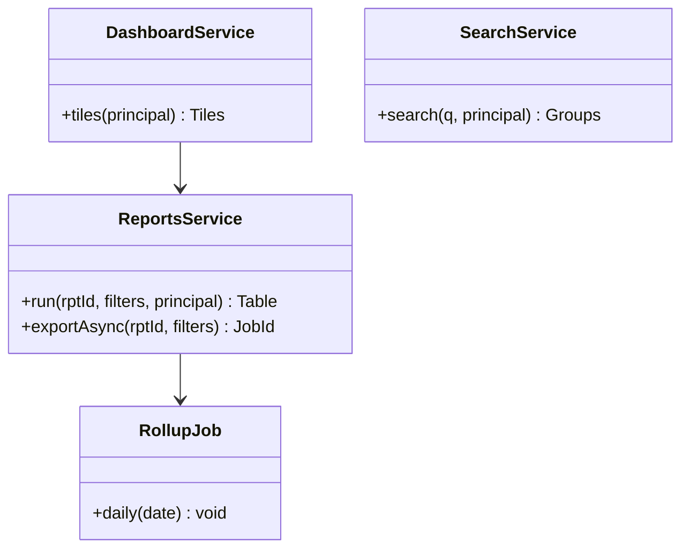
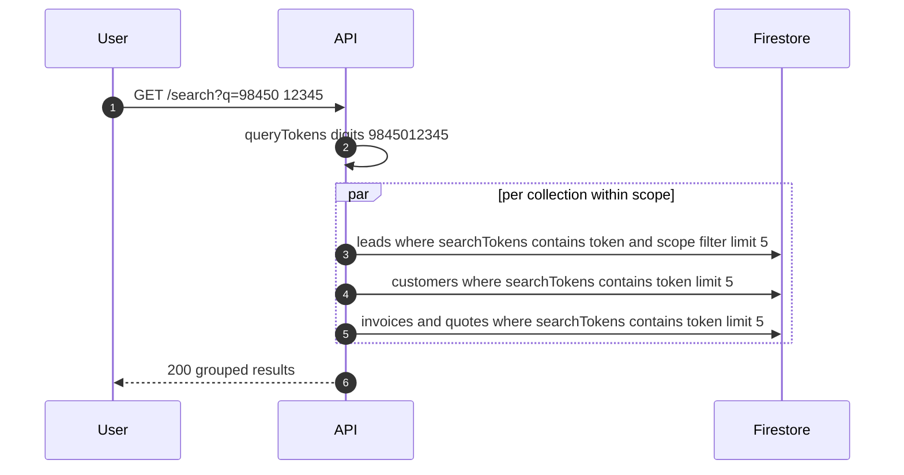
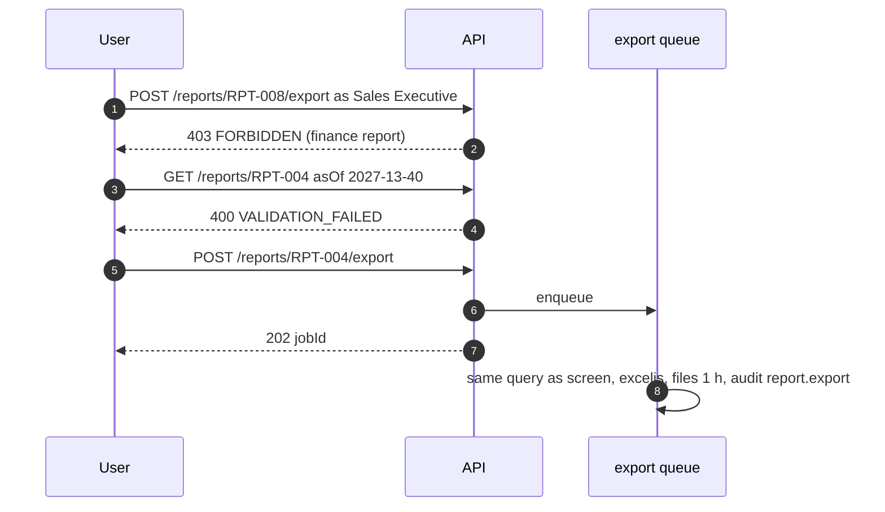
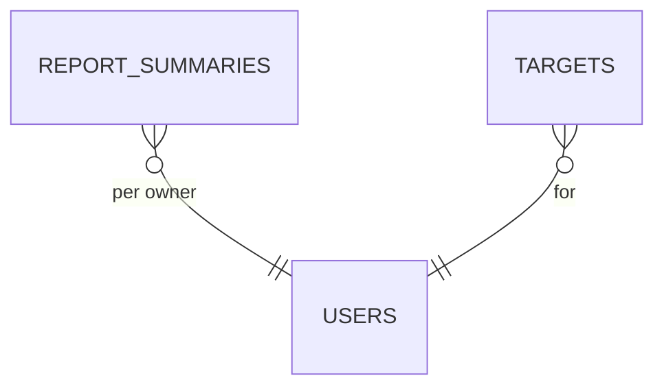

# Low-Level Design (LLD) — Module: insights

| Version | Date | Author | Change |
|---|---|---|---|
| 0.1 | 2026-11-13 | Claude (tech lead; self-checked against HLD v0.2 and ADRs — no separate architect review run) | Initial draft (batch 4) |

Conventions: [LLD-common](LLD-common.md). Ranges: API-225 – 239, TBL-100 – 104.

## 1. Module overview
Home dashboard, global search, and the reports RPT-002 – RPT-010 with Excel export, all limited to the user's scope.

| Linked | IDs |
|---|---|
| FRs | FR-050 AC3 (SLA report), FR-083, FR-084, FR-085 |
| SCRs | SCR-002, SCR-024, SCR-026 |
| Reports | RPT-001 – RPT-010 |
| Rules | RULE-011, RULE-039 |

## 2. Code structure
```
packages/domain/src/insights/
  search.ts       # tokens(record) and queryTokens(q): name prefixes, digits of phone (last 10 / last 4), doc numbers ("0142", "INV/25-26/0142")
  reports.ts      # pure aggregations over rows (pipeline, ageing, GST summary, SLA %)
apps/api/src/modules/insights/
  dashboard.routes.ts  search.routes.ts  reports.routes.ts  reports.service.ts  export.task.ts  rollup.job.ts  insights.spec.ts
apps/web/src/app/home/  apps/web/src/app/reports/  apps/web/src/features/search/CommandPalette.tsx
```

## 3. Class / component diagram


## 4. Sequence diagrams

### 4.1 Global search


### 4.2 Report export and error paths


## 5. API contracts
| ID | Method / path | Roles / permission | FR | Notes |
|---|---|---|---|---|
| API-225 | GET /dashboard | signed in (scoped) | FR-084 | Tiles per role; each tile has `link` to filtered list (AC2) |
| API-226 | GET /search?q=&types= | signed in (scoped) | FR-083 | `q` ≥ 2 chars; max 5 per group |
| API-227 | GET /reports | signed in | FR-085 | Reports allowed for the role |
| API-228 | GET /reports/{rptId}?…filters | per report (§3.2) | FR-085, FR-050 AC3 | `{columns, rows, totals}`; ≤ 2,000 rows on screen |
| API-229 | POST /reports/{rptId}/export | per report | FR-085 AC2 | 202 → API-008 → xlsx |
| API-230 | GET/PUT /admin/targets | `settings:write` / read scoped | FR-084 | Monthly target per user (optional) |

### API-225 — Dashboard (Sales Executive)
```json
{ "tiles": [
  { "id": "followups_today", "value": 6, "link": "/follow-ups?bucket=today" },
  { "id": "followups_overdue", "value": 2, "link": "/follow-ups?bucket=overdue", "tone": "danger" },
  { "id": "new_leads", "value": 4, "link": "/leads?stage=new" },
  { "id": "sla_breaches", "value": 1, "link": "/leads?sla=breached" },
  { "id": "quotes_awaiting", "value": 3, "link": "/sales?tab=quotes&status=sent" },
  { "id": "overdue_invoices", "value": 1, "amount": 4838000, "link": "/sales?tab=invoices&overdue=1" },
  { "id": "collections_month", "amount": 12500000 },
  { "id": "pipeline", "stages": [ { "stage": "interested", "count": 5, "value": 9000000 } ] },
  { "id": "target", "target": 50000000, "achieved": 31000000 } ] }
```

## 6. Database design


### TBL-100 — reportSummaries/{yyyymm}-{ownerId}
`{ month, ownerId, leadsCreated, leadsContactedInSla, leadsBySource{}, wonValue, invoicedNet, collected, tds, gstByRate{rate:{taxable,cgst,sgst,igst,b2b,b2c}} }` — rolled up daily for closed days; the current day is computed live and added. Keeps reports fast at NFR-011 volumes.

### TBL-101 — targets/{yyyymm}-{userId}
`{ month, userId, amount }`.

Search uses `searchTokens` arrays on leads (TBL-040), customers (TBL-085), contacts (TBL-086), quotations, invoices, payments (doc numbers) and files (name tokens). No separate index table.

## 7. State machines
N/A — read-only module.

## 8. Validation & business rules
| Rule ID | Where enforced | Implementation | Error code |
|---|---|---|---|
| RULE-011 | every query | scope filter appended; Team `in` chunks of 30 merged | — |
| §3.2 report access | `reports.catalogue.ts` | role → allowed reports; PM only orders, Accounts finance | 403 |
| FR-085 AC1 | `reports.ts` ageing | buckets sum to outstanding; advances separate column | — |
| FR-085 AC2 | export | same service function as screen; audited | — |
| RULE-037 | GST and sales reports | proforma excluded | — |

## 9. Error code catalogue
| Code | HTTP | Message (user-facing) | Cause |
|---|---|---|---|
| REPORT_TOO_LARGE | 422 | Too many rows to show — narrow the filters or export. | > 2,000 rows on screen |
| SEARCH_QUERY_SHORT | 422 | Type at least 2 characters. | q < 2 |

## 10. Events, jobs & schedules
| Job | Trigger | Action |
|---|---|---|
| `insights.rollup` | daily 01:00 IST | Recompute yesterday's TBL-100 rows from source collections (idempotent overwrite) |
| `report.export` | `export` queue | xlsx (exceljs) → files, 1 h expiry |

## 11. Caching
Dashboard response cached per user for 30 s in memory (instance-local) and 60 s in TanStack Query; invalidated client-side on own mutations.

## 12. Configuration / env vars
| Var | Required | Default | Description |
|---|---|---|---|
| REPORT_MAX_SCREEN_ROWS | N | 2000 | API-228 guard |
| SEARCH_MAX_PER_GROUP | N | 5 | API-226 |

## 13. Logging & audit events
Audit: `report.export`, `targets.update`. Search queries are not logged (may contain PII).

## 14. Front-end design
| SCR | Route | Components (CMP) | Data fetching | State | Forms / validation |
|---|---|---|---|---|---|
| SCR-002 Home | `/` | CMP-013 StatTile, CMP-038 ChartWrapper (pipeline bars), CMP-010 follow-up rows, CMP-018 setup checklist | API-225 | — | — |
| SCR-024 Search | Ctrl/Cmd+K overlay; `/search` on mobile | CMP-026 | API-226 debounced 200 ms | recent searches in memory only | ≥ 2 chars |
| SCR-026 Reports | `/reports`, `/reports/:rptId` | CMP-034 filters, CMP-009, CMP-038, CMP-001 Export | API-227–229 | filters in URL | date range ≤ 1 year |

## 15. Unit-test plan
| Unit | Scenarios |
|---|---|
| search.tokens | "98450 12345" matches +919845012345; "0142" matches INV/25-26/0142; name prefix "rav" |
| reports | pipeline weighted value; ageing sums equal outstanding; GST summary B2B vs B2C; SLA % |
| Routes | exec sees own tiles only; exec cannot open RPT-008; export audited |

## 16. Open questions
None.
