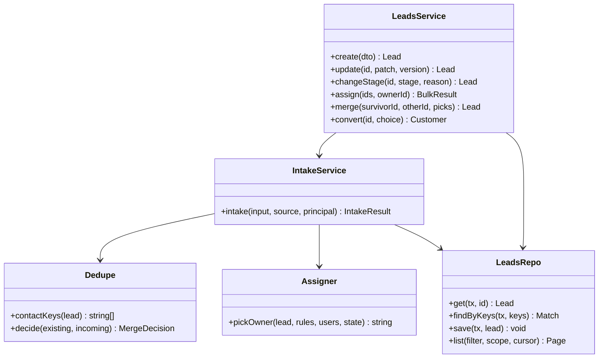
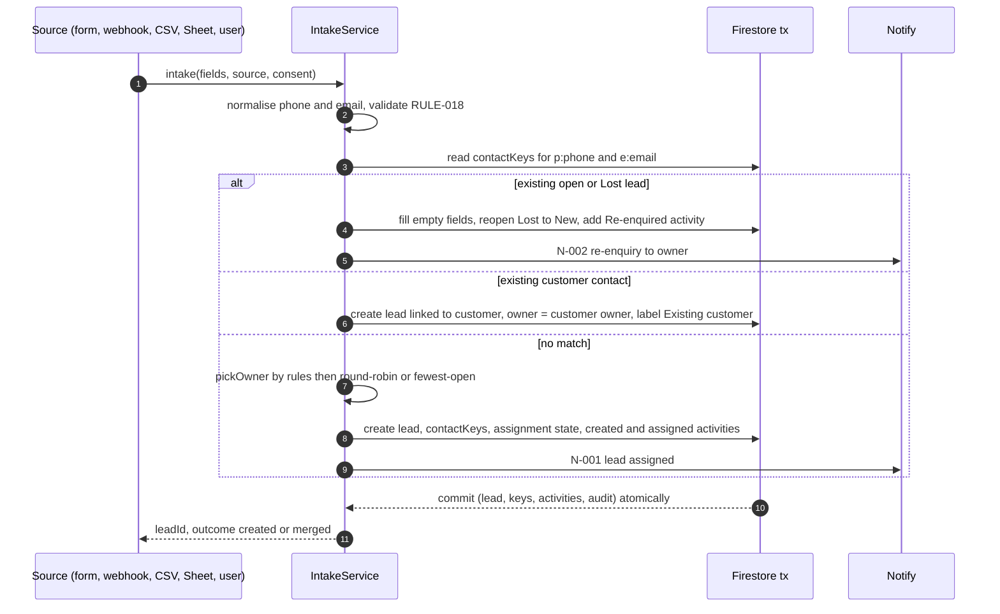
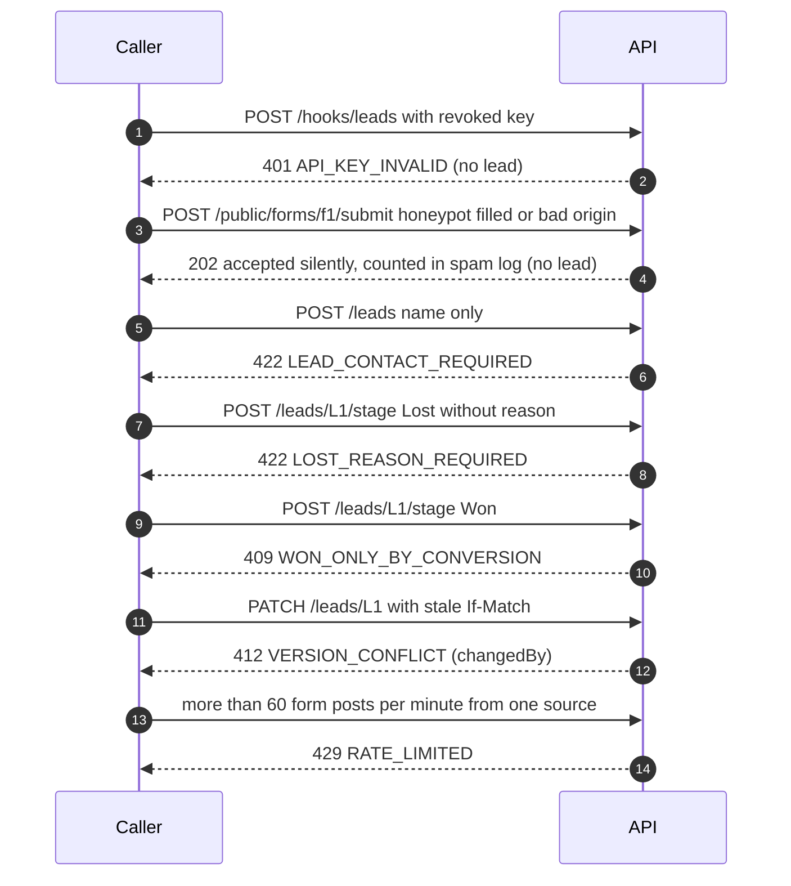
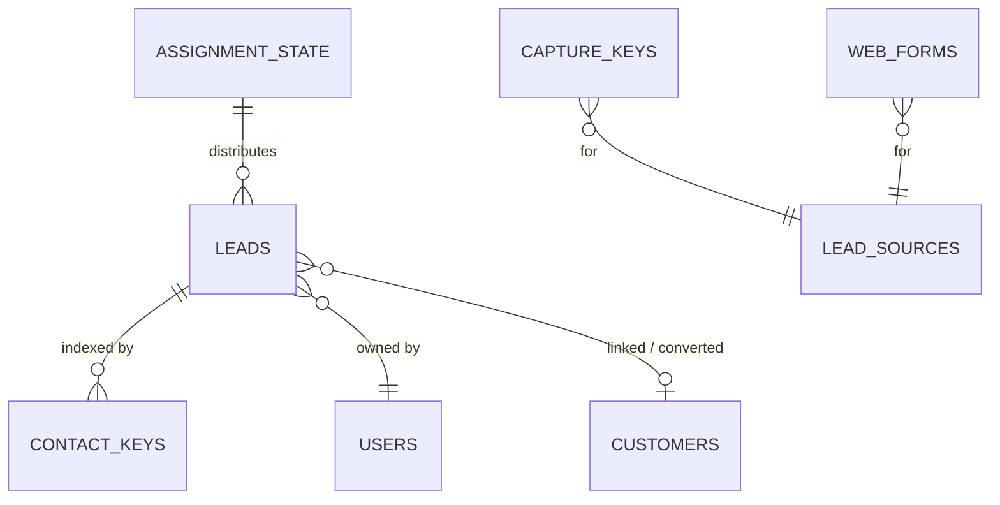
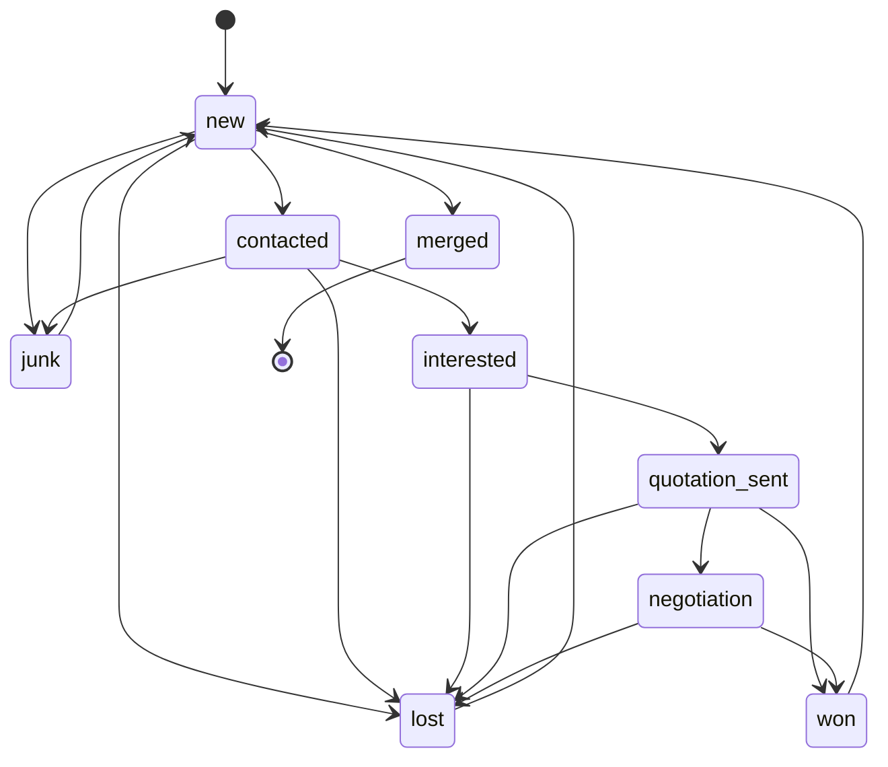

# Low-Level Design (LLD) — Module: leads

| Version | Date | Author | Change |
|---|---|---|---|
| 0.1 | 2026-11-13 | Claude (tech lead; self-checked against HLD v0.2 and ADRs — no separate architect review run) | Initial draft (batch 2) |

Conventions: [LLD-common](LLD-common.md). Ranges: API-070 – 099, TBL-040 – 049.

## 1. Module overview
Lead capture from every source (manual, CSV, web form, webhook; Sheet sync calls into this module), normalisation, dedupe and merge, assignment, stages, list and Kanban views, and conversion to a customer.

| Linked | IDs |
|---|---|
| FRs | FR-025 – FR-036, FR-086 (source / consent) |
| UCs | UC-004, UC-005, UC-006 |
| SCRs | SCR-003, SCR-004, SCR-005, SCR-009, SCR-034 (lead import), SCR-035 (web form) |
| Rules | RULE-011, RULE-018 – RULE-023, RULE-055, RULE-059 |
| PFs | PF-002 (lead capture), PF-003 (lead working) |

## 2. Code structure
```
packages/domain/src/leads/
  normalise.ts      # E.164 (libphonenumber-js, default IN), email trim/lower  (RULE-019)
  dedupe.ts         # contactKeys(lead) -> ["p:+91…","e:x@y"]; decideMerge(existing, incoming)  (RULE-020/021)
  assign.ts         # pickOwner(rules, users, state, lead)  (RULE-022)
  stages.ts         # canTransition(from, to, role), requiresReason  (RULE-023)
apps/api/src/modules/leads/
  leads.routes.ts  leads.service.ts  leads.repo.ts  capture.routes.ts (public form + webhook)
  intake.service.ts # single entry for ALL sources: normalise → dedupe (tx) → assign → notify
  import.task.ts    # CSV import job  leads.spec.ts
apps/web/src/app/leads/            # SCR-003, SCR-004, SCR-005
apps/web/src/features/leads/       # useLeads, LeadForm, KanbanView, ConvertDialog (SCR-009)
apps/web/public/embed/form.js      # SCR-035 embeddable form loader (no secrets)
```

## 3. Class / component diagram


## 4. Sequence diagrams

### 4.1 Intake (any source) — happy path and merge


### 4.2 Error paths


## 5. API contracts
All under `/api/v1`. Scope (RULE-011) is applied in the repository query for every list and in `assertInScope` for every id route; out-of-scope ids return `404`.

| ID | Method / path | Roles / permission | FR | Notes |
|---|---|---|---|---|
| API-070 | GET /leads?stage=&ownerId=&sourceId=&tag=&from=&to=&sla=&due=&q=&sort=&cursor=&limit= | `lead:read` | FR-034 | Cursor page, `limit ≤ 100` |
| API-071 | POST /leads | `lead:create` | FR-025, FR-028, FR-029, FR-031, FR-086 | Returns `201 {lead, outcome}`; `outcome = created \| merged \| linked_customer` |
| API-072 | GET /leads/{id} | `lead:read` | FR-033 | Includes `mergedIntoId` → client redirects |
| API-073 | PATCH /leads/{id} | `lead:update` + If-Match | FR-025 | Stage and owner not editable here |
| API-074 | POST /leads/{id}/stage | `lead:update` | FR-033 | `{stage, reasonId?}`; Won refused |
| API-075 | POST /leads/{id}/reopen | `lead:reopen` (Admin, Mgr) | FR-033 | Won/Lost/Junk → New |
| API-076 | POST /leads/bulk | `lead:assign` | FR-032 | `{ids ≤ 500, action: assign\|stage\|tag, …}` → `200 {ok:[], skipped:[{id,reason}]}` |
| API-077 | POST /leads/merge | `lead:merge` (Admin, Mgr) | FR-030 | `{survivorId, otherId, picks}` |
| API-078 | POST /leads/{id}/convert | `lead:update` | FR-036 | `{mode: new\|link, customerId?}` → `{customerId}` |
| API-079 | POST /leads/check-duplicate | `lead:create` | FR-029 AC2 | `{phone?, email?}` → matches (scoped, masked if out of scope) |
| API-080 | GET /leads/board?… | `lead:read` | FR-034 | Per-stage count and value (aggregation queries) + first 20 cards |
| API-081 | GET/PUT /me/saved-filters | signed in | FR-034 AC1 | Max 20 per user |
| API-082 | POST /leads/import | `lead:import` (Admin, Mgr) | FR-026 | Uses masters import pipeline (API-055/056) with `type=lead`; async 202 |
| API-083 | POST /public/forms/{formId}/submit | public, edge rate limit | FR-027, FR-086 | Origin allow-list, honeypot, min fill 3 s, consent if required |
| API-084 | POST /hooks/leads | `X-Api-Key` + Idempotency-Key | FR-027 | 24 h idempotency (RULE-059) |
| API-085 | GET/POST/DELETE /admin/lead-capture/keys | `settings:write` | FR-027 | Key shown once; stored as SHA-256 |
| API-086 | GET/PUT /admin/lead-capture/forms/{formId} | `settings:write` | FR-027 | Fields, allowed origins, consent required, default source |

### API-071 — Create lead
Request:
```json
{ "name": "Ravi Kumar", "phone": "098450 12345", "email": null, "company": "Ravi Designs", "city": "Bengaluru", "pincode": "560034",
  "interestProductId": "p_web_basic", "expectedValue": 2500000, "sourceId": "src_walkin", "notes": "Wants 5-page site", "tags": ["hot"], "assignAuto": false }
```
`201`:
```json
{ "outcome": "created", "lead": { "id": "L-000123", "name": "Ravi Kumar", "phone": "+919845012345", "phoneValid": true, "stage": "new", "ownerId": "u3",
  "consentBasis": "person_initiated", "enquiryAt": "2026-11-13T05:12:00Z", "slaDueAt": "2026-11-13T05:27:00Z", "version": 1 } }
```
Merge result: `200 { "outcome": "merged", "lead": { "id": "L-000077", … } }`.

### API-083 — Public form submit
```json
{ "fields": { "name": "Anita", "phone": "9876543210", "message": "Need logo" }, "consent": true, "hp": "", "renderedAt": 1763010000000, "idempotencyKey": "uuid" }
```
Always `202 { "ok": true }` (no lead id, no enumeration). Rejections are silent except `429` and `400` for malformed JSON.

## 6. Database design


### TBL-040 — leads/{id}
| Column | Type | Null | Default | Constraint / index | Notes |
|---|---|---|---|---|---|
| id | string | N | `L-` + 6-digit counter | | counter `counters/lead` |
| name | string | N | — | 1–120 | PII |
| phone / phoneRaw / phoneValid | string / string / bool | Y | — | | E.164; raw kept when invalid (RULE-019) |
| email | string | Y | — | lower-case | PII |
| company, city, pincode, state | string | Y | — | pincode `^\d{6}$` | |
| interestProductId, sourceId | ref | Y / N | — | index `(sourceId, createdAt desc)` | |
| expectedValue | int paise | Y | — | ≥ 0 | |
| consentBasis / consentAt / capturedBy | enum / ts / string | N | — | RULE-055 | `web_form_consent \| person_initiated \| imported_by_business \| existing_customer` |
| stage / stageReasonId / stageChangedAt | string / ref / ts | N | `new` | index `(ownerId, stage, updatedAt desc)`, `(stage, updatedAt desc)` | |
| ownerId | ref users | N | — | index `(ownerId, createdAt desc)` | denormalised for scope |
| labels | string[] | N | [] | | `existing_customer`, `check_number`, `unreachable`, `rule_fallback` |
| tags | string[] | N | [] | array-contains index | |
| enquiryAt / slaDueAt / firstContactAt / slaStatus | ts / ts / ts / enum | | | index `(slaStatus, slaDueAt)` | `pending \| met \| breached` |
| nextFollowUpAt | ts | Y | — | index `(ownerId, nextFollowUpAt)` | maintained by engagement |
| noAnswerStreak | int | N | 0 | | RULE-026 |
| customerId / mergedIntoId / convertedAt / junkAt | ref / ref / ts / ts | Y | — | index `(stage, junkAt)` | purge (FR-090) |
| sheet{syncId,row,hash} | map | Y | — | | set by google module |
| searchTokens | string[] | N | — | array-contains | name prefixes, phone digits (last 10, last 4), email |
| createdAt / updatedAt / createdBy / version / custom | | | | | common |

### TBL-041 — contactKeys/{key}
Uniqueness and dedupe index. `key` = `p:+919845012345` or `e:ravi@x.com`. Fields `{ leadId?, customerId?, contactId?, updatedAt }`. Read and written inside the intake transaction, which makes concurrent dedupe safe (E-01). Not written for invalid phones.

### TBL-042 — assignmentState (single doc `leads/_assign`)
`{ lastIndexByRule: { ruleId: n }, version }` — round-robin cursor, updated in the same tx as the lead.

### TBL-043 — captureKeys/{id}
`{ name, sourceId, keyHash (sha256), last4, createdBy, createdAt, revokedAt?, lastUsedAt }`.

### TBL-044 — webForms/{formId}
`{ sourceId, fields[], allowedOrigins[], consentRequired, consentText, minFillMs: 3000, active, spamCount, version }`.

### TBL-045 — savedFilters/{userId}
`{ items: [{ id, name, query }] }` (≤ 20).

## 7. State machines

Stages after `new` are master-configurable (FR-022); `won` (conversion / acceptance only), `lost`, `junk` and `merged` are system stages. `lost → new` is automatic on re-enquiry; other reopens need `lead:reopen`.

## 8. Validation & business rules
| Rule ID | Where enforced | Implementation | Error code |
|---|---|---|---|
| RULE-018 | contracts `LeadCreate` + intake | name 1–120 and (phoneValid or email) | `LEAD_CONTACT_REQUIRED` 422 |
| RULE-019 | `domain/leads/normalise.ts` | `parsePhoneNumberFromString(raw, 'IN')`; invalid → keep raw, label `check_number`, no key | — |
| RULE-020 / 021 | `IntakeService` in one tx | keys lookup → `decide()` → merge / link / create | — |
| RULE-022 | `domain/leads/assign.ts` | rules ordered territory → source → interest; strategy `round_robin \| fewest_open`; inactive filtered; default owner fallback; Solo → admin | — |
| RULE-023 | `domain/leads/stages.ts` | reason required for lost/junk; won blocked; reopen permission | `LOST_REASON_REQUIRED`, `WON_ONLY_BY_CONVERSION`, `REOPEN_FORBIDDEN` |
| RULE-011 | repo `scopeFilter(principal)` | own: `ownerId ==`; team: `ownerId in [≤30]` chunks; all | 404 |
| RULE-055 | form config | consentRequired && !consent → silent reject | — |
| RULE-059 | Idempotency middleware (TBL-000) | webhook | — |
| FR-032 | `LeadsService.bulk` | ≤ 500 ids, processed in tx chunks of 50, per-id result | `BULK_TOO_LARGE` 422 |

## 9. Error code catalogue
| Code | HTTP | Message (user-facing) | Cause |
|---|---|---|---|
| LEAD_CONTACT_REQUIRED | 422 | Add a phone number or email. | RULE-018 |
| LOST_REASON_REQUIRED | 422 | Choose a reason. | Lost/Junk without reason |
| WON_ONLY_BY_CONVERSION | 409 | Use "Convert to customer" to mark this lead as won. | Direct Won |
| REOPEN_FORBIDDEN | 403 | Only an admin or sales manager can reopen this lead. | RULE-023 |
| LEAD_MERGED | 409 | This lead was merged into another lead. | Write on merged lead (body has `mergedIntoId`) |
| BULK_TOO_LARGE | 422 | Select up to 500 leads at a time. | > 500 |
| API_KEY_INVALID | 401 | Invalid API key. | Webhook |
| CONVERT_ALREADY_DONE | 409 | This lead is already converted. | Second convert |

## 10. Events, jobs & schedules
| Job | Trigger | Action |
|---|---|---|
| `leads.import` | `bulk` Cloud Task (API-082) | Rows → `IntakeService.intake` with `consentBasis = imported_by_business`; in-file duplicates handled by the same key index (FR-026 AC2) |
| `leads.bulk` | inline ≤ 50, else `bulk` task | Assign/stage/tag per id; one N-001 summary per new owner |
| Outbound events | after commit | `lead.created`, `lead.assigned`, `lead.reenquired` → notify (push), engagement (SLA timer) |

## 11. Caching
Lookup options (sources, stages, reasons) from API-051 cached by TanStack Query 10 min. Board counts not cached server-side (aggregation queries are cheap at A-002 volumes).

## 12. Configuration / env vars
| Var | Required | Default | Description |
|---|---|---|---|
| LEAD_FORM_MIN_FILL_MS | N | 3000 | Bot guard |
| LEAD_FORM_RATE_PER_MIN | N | 60 | Per source (FR-027 AC4) |
| LEAD_BULK_MAX | N | 500 | FR-032 |

## 13. Logging & audit events
Audit actions: `lead.create`, `lead.update`, `lead.stage`, `lead.assign`, `lead.bulk`, `lead.merge`, `lead.convert`, `lead.reopen`, `lead.reenquiry`, `capture_key.create/revoke`, `web_form.update`. Logs: `intake.outcome` with `{source, outcome}` (no PII); spam counter.

## 14. Front-end design
| SCR | Route | Components (CMP) | Data fetching | State | Forms / validation |
|---|---|---|---|---|---|
| SCR-003 Leads | `/leads` (`?view=board`) | CMP-034, CMP-009 (desktop), CMP-010 swipe rows (mobile), CMP-011 Kanban, CMP-039 SLA chip, CMP-037 | `useInfiniteQuery(['leads',filters])` API-070; board API-080 | filters + view in URL; saved filters API-081 | Lost/Junk drop → CMP-015 reason dialog |
| SCR-004 Lead detail | `/leads/:id` | CMP-025, CMP-027 ActionBar, CMP-028 timeline, CMP-019, CMP-039, CMP-016 history | API-072 + API-100 timeline | offline cache (IndexedDB, last 200) | stage menu → API-074 |
| SCR-005 Lead form | `/leads/new`, `/leads/:id/edit` | CMP-008, CMP-003, CMP-036 PhoneInput, CMP-004, CMP-035 | API-079 on phone/email blur | RHF + Zod `LeadCreate` | AC1 message "Add a phone number or email" |
| SCR-009 Convert | dialog on SCR-004 | CMP-015, CMP-005 radio (link / new) | API-078 | — | — |
| SCR-034 Import | `/leads/import` | CMP-033 stepper, CMP-032, CMP-009 preview | API-082 → API-008 poll | wizard state | ≤ 5,000 rows |
| SCR-035 Web form | embed script | plain HTML form + tokens | API-083 | — | consent checkbox when required |

## 15. Unit-test plan
| Unit | Scenarios |
|---|---|
| normalise | "098450 12345" → +919845012345; "+44 20 7946 0958" kept UK; "12345" invalid + raw; email trim/lower |
| dedupe.decide | open → merge fill-empty only; lost → reopen; junk → log only; customer contact → link; no match → create |
| assign | round-robin A,B,C after B → C; territory 560034 in 560001–560099; all inactive → default + fallback label; Solo → admin; fewest open |
| stages | lost without reason; won blocked; exec reopen forbidden |
| Intake (emulator) | concurrent intakes of same phone → 1 lead + 1 re-enquiry (E-01); CSV with in-file duplicate → 1 created + 1 merged |
| Routes | create 201; scope 404; bulk with 3 out-of-scope skipped; webhook idempotent replay; revoked key 401; honeypot → 202 and no lead; 61st form post → 429 |

## 16. Open questions
None.
