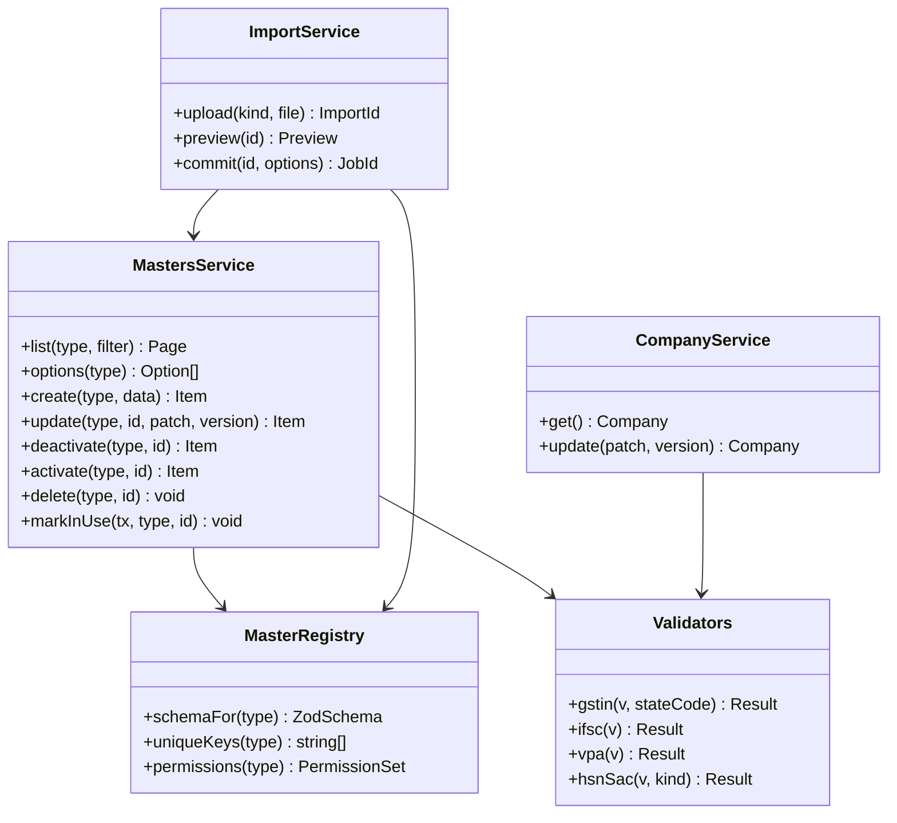
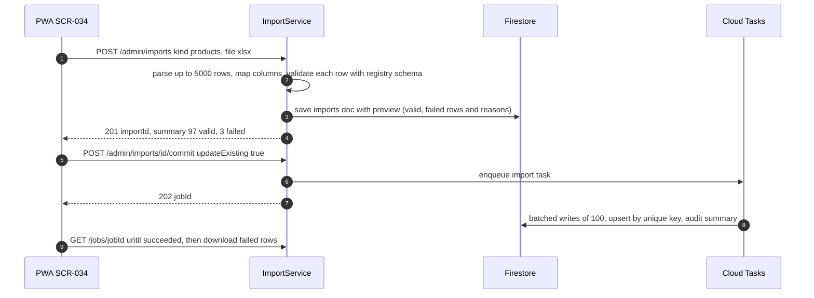
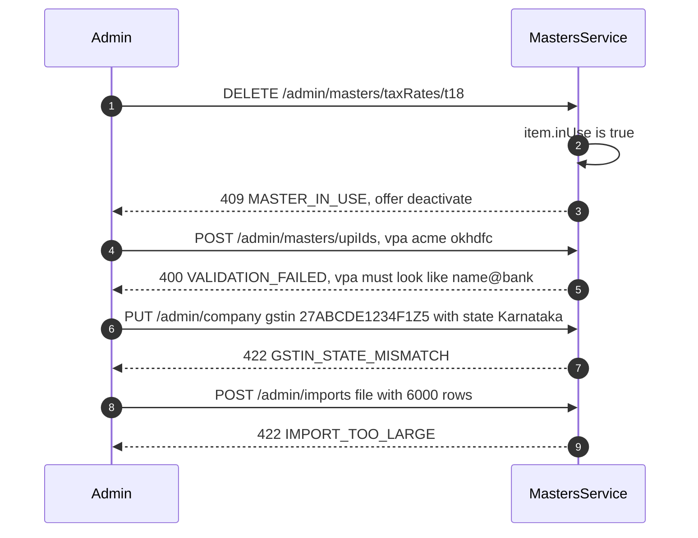
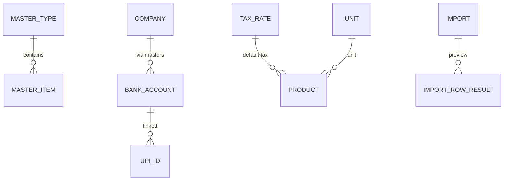

# Low-Level Design (LLD) — Module: masters

| Version | Date | Author | Change |
|---|---|---|---|
| 0.1 | 2026-11-13 | Claude (tech lead; self-checked against HLD v0.2 and ADRs — no separate architect review run) | Initial draft (batch 1) |

Conventions: [LLD-common](LLD-common.md). Ranges: API-045 – 069, TBL-030 – 039.

## 1. Module overview
The module covers:
- the company profile and GST status
- every master list
- lookups used by forms
- Excel/CSV import with preview
- deactivation instead of deletion for values already in use

| Linked | IDs |
|---|---|
| FRs | FR-017, FR-018, FR-019, FR-020, FR-021, FR-022, FR-023, FR-024 (FR-026 lead import reuses the import engine) |
| UCs | UC-002 (setup steps) |
| PFs | PF-008 |
| SCRs | SCR-027 (Company & GST), SCR-028 (Masters), SCR-034 (Import wizard) |
| Rules | RULE-013, RULE-014, RULE-015, RULE-016, RULE-017 |

## 2. Code structure
```
packages/contracts/src/masters/
  types.ts                 # MasterType enum + per-type Zod schema registry
  company.ts  import.ts
packages/domain/src/validators/
  gstin.ts  ifsc.ts  vpa.ts  hsn-sac.ts  pan.ts
apps/api/src/modules/masters/
  masters.routes.ts  masters.service.ts  masters.repo.ts
  company.routes.ts  company.service.ts
  import/ import.routes.ts  import.service.ts  parsers.ts (exceljs, papaparse)  import.task.ts
  masters.spec.ts
apps/web/src/app/settings/company/   apps/web/src/app/settings/masters/[type]/   apps/web/src/app/settings/import/
```

## 3. Class / component diagram


## 4. Sequence diagrams

### 4.1 Excel import — happy path (FR-023)


### 4.2 Error paths — delete in-use value, invalid formats


## 5. API contracts

### API-045 — List master items
| Item | Value |
|---|---|
| Method / path | GET /api/v1/admin/masters/{type}?status=active&q=&cursor= |
| Auth / roles | Bearer; `masters:read` (per type, see §8 permission map) |
| Linked FR | FR-018 – FR-022 |

`{type}` ∈ `bankAccounts, upiIds, products, productCategories, units, taxRates, paymentTerms, paymentModes, termsTemplates, messageTemplates, documentLayouts, leadSources, pipelineStages, lostReasons, junkReasons, callOutcomes, territories, tags, customerGroups, customerTypes, states`.

```json
{ "items": [ { "id": "p1", "code": "WEB-BASIC", "name": "Website – 5 pages", "type": "service", "hsnSac": "998314", "unitId": "nos", "ratePaise": 3000000, "costPaise": null, "taxRateId": "gst18", "status": "active", "inUse": true, "version": 3 } ], "nextCursor": null }
```

### API-046 — Create master item
| Item | Value |
|---|---|
| Method / path | POST /api/v1/admin/masters/{type} |
| Auth / roles | Bearer; `masters:create:{type}` |
| Linked FR | FR-018 – FR-022 |
| Idempotency | Idempotency-Key |

Request (`upiIds`):
```json
{ "vpa": "arjunwebstudio@okhdfcbank", "payeeName": "Arjun Web Studio", "bankAccountId": "b1", "isDefault": true, "trEnabled": true }
```
Responses:
- `201` item
- `400 VALIDATION_FAILED`
- `409 DUPLICATE_KEY` (e.g. product code)

### API-047 — Update master item
PATCH /api/v1/admin/masters/{type}/{id} · If-Match · FR-018 – FR-022.
- Setting `isDefault: true` unsets the previous default in the same transaction (RULE-014).
- Errors: `412`, `409 DUPLICATE_KEY`, `422 STAGE_IN_USE_MOVE_REQUIRED` (pipelineStages deactivation needs `moveTo`).

### API-048 / API-049 — Deactivate / activate
POST /api/v1/admin/masters/{type}/{id}/deactivate (body optional `{ "moveTo": "stageId" }` for stages) · POST …/activate · FR-024, FR-022 AC1 → `200` item.

### API-050 — Delete unused master item
DELETE /api/v1/admin/masters/{type}/{id} · FR-024 · `204`, or `409 MASTER_IN_USE` (`{ "canDeactivate": true }`).

### API-051 — Lookup options (any signed-in user)
| Item | Value |
|---|---|
| Method / path | GET /api/v1/masters/{type}/options |
| Auth / roles | Bearer; any role that uses the type in forms |
| Linked FR | FR-019 (catalogue search), FR-021 (templates), FR-022 |

`200 { "items": [ { "id": "p1", "label": "Website – 5 pages", "data": { "ratePaise": 3000000, "hsnSac": "998314", "taxRatePct": 18, "unit": "Nos" } } ] }`. Active items only; `Cache-Control: private, max-age=300`.

### API-052 / API-053 — Company profile
| API | Method / path | Linked FR |
|---|---|---|
| API-052 | GET /api/v1/admin/company | FR-017 |
| API-053 | PUT /api/v1/admin/company (If-Match) | FR-017 |

```json
{ "legalName": "Arjun Mehta", "tradeName": "Arjun Web Studio", "gstStatus": "registered", "gstin": "29AAAPM1234C1Z5", "stateCode": "29",
  "address": { "line1": "12, 4th Cross, Indiranagar", "city": "Bengaluru", "state": "Karnataka", "pincode": "560038" },
  "pan": "AAAPM1234C", "cin": null, "phone": "+919845000000", "email": "hello@arjunweb.studio", "website": "https://arjunweb.studio",
  "financialYear": { "startMonth": 4, "lockDate": "2026-03-31" } }
```
Errors:
- `422 GSTIN_STATE_MISMATCH`
- `422 GSTIN_FORMAT`
- `422 GST_MODE_CHANGE_WARNING`: switching registered ↔ not registered returns a `warning` and requires `confirm: true`. Existing documents are unchanged (E-26).

### API-054 — Download import template
GET /api/v1/admin/imports/templates/{kind} · `kind` ∈ products, customers, openLeads, openingInvoices · FR-023 → `.xlsx` with headers, an example row and a data-validation sheet.

### API-055 — Upload import file (preview)
| Item | Value |
|---|---|
| Method / path | POST /api/v1/admin/imports (multipart: `kind`, `file`, optional `mapping` JSON) |
| Auth / roles | Bearer; Admin (Sales Manager for `openLeads`) |
| Linked FR | FR-023, FR-026 |
| Rate limit | 20/user/hour; file ≤ 5 MB, ≤ 5,000 rows |

`201`:
```json
{ "importId": "imp_4", "kind": "products", "rows": 100, "valid": 97, "failed": 3,
  "failures": [ { "row": 12, "field": "hsnSac", "message": "SAC must be 6 digits" } ], "duplicatesExisting": 5, "columnsDetected": ["Code","Name","SAC","Rate","GST %"] }
```
Errors: `422 IMPORT_TOO_LARGE`, `422 IMPORT_UNREADABLE`, `422 IMPORT_MAPPING_REQUIRED`.

### API-056 — Commit import
POST /api/v1/admin/imports/{id}/commit `{ "updateExisting": true }` · Idempotency-Key · FR-023 AC1/AC2 → `202 { jobId }`. Result: `{ created, updated, skipped, failed, failedRowsFileId }`.

### API-057 — Get import
GET /api/v1/admin/imports/{id} → the preview and status (for revisiting the wizard).

## 6. Database design


### TBL-030 — masters/{type}/items/{id} (generic)
| Column | Type | Null | Default | Constraint / index | Notes |
|---|---|---|---|---|---|
| type | string | N | (path) | registry enum | |
| name / label | string | N | — | 1–120 | |
| code | string | Y | — | unique per type (doc `masterKeys/{type}-{codeLower}`) | products, units, tax rates |
| status | string | N | active | index `(status, name)` | active, inactive |
| inUse | bool | N | false | set true the first time a document references it | RULE-013 |
| isDefault | bool | N | false | ≤ 1 true per type (and per branch) in tx | RULE-014 |
| sortOrder | int | Y | — | | stages, outcomes |
| data | map | N | — | per-type Zod schema (TBL-031 – TBL-036) | |
| base fields | — | — | — | — | |

**Per-type `data` schemas:**

| TBL | Type | Key fields (validation) |
|---|---|---|
| TBL-031 | products | `type` goods/service · `hsnSac` (HSN 4–8 digits / SAC 6 digits; required for tax invoices on GST installs) · `unitId` · `ratePaise` ≥ 0 · `costPaise` · `taxRateId` · `categoryId` · `imageFileId` · `description` ≤ 1,000 |
| TBL-032 | bankAccounts / upiIds | bank: `bankName`, `accountNo` (6–18 digits, stored masked except last 4 in lists), `ifsc` (`^[A-Z]{4}0[A-Z0-9]{6}$`), `branch`, `accountType`, `showOnInvoice` · upi: `vpa` (`^[a-zA-Z0-9._-]{2,256}@[a-zA-Z]{2,64}$`), `payeeName` ≤ 50, `bankAccountId`, `trEnabled` (A-023) |
| TBL-033 | taxRates / paymentTerms / paymentModes / units | tax: `ratePct` ∈ {0, 0.25, 3, 5, 12, 18, 28} + `cessPct`, `inclusive` · terms: `days` 0–365, `advancePct` 0–100 · modes: `referenceRequired` (RULE-042) · units: `symbol`, `decimals` 0–3 |
| TBL-034 | termsTemplates / messageTemplates / documentLayouts | terms: `docType`, `text` ≤ 5,000 (plain text) · message: `channel` whatsapp/email, `purpose`, `subject`, `body` with variables from the allow-list (FR-021 AC1) · layout: `docType`, `accent`, `columns{}`, `showQr`, `footerText`, `declaration`, `jurisdiction`, `signatureFileId`, `stampFileId` |
| TBL-035 | leadSources / pipelineStages / lostReasons / junkReasons / callOutcomes | stage: `probabilityPct`, `requiredFields[]`, `system` (Won/Lost/Junk not deletable) · outcome: `countsAsContact`, `autoStageId`, `autoFollowUpDays`, `noAnswerRule { count, tag, followUpDays }` (RULE-026) |
| TBL-036 | territories / tags / customerGroups / customerTypes / states | territory: `pincodes[]`, `cities[]`, `teamId`, `userIds[]` · tag: `colorToken` · group: `creditDays`, `creditLimitPaise` · state: `gstCode` (2 digits, seeded, read-only) |

### TBL-037 — company (doc `settings/company`)
Fields as in API-052. `gstin` is validated by RULE-016 against `stateCode`; there is one GSTIN per install in the MVP (FRD F-09). `financialYear.lockDate` is used by RULE-015.

### TBL-038 — imports/{id}
| Column | Type | Null | Default | Notes |
|---|---|---|---|---|
| kind | string | N | — | products, customers, openLeads, openingInvoices |
| fileId | ref files | N | — | original upload (Drive, private) |
| mapping | map | N | auto-detected | column → field |
| summary | map | N | — | rows, valid, failed, duplicatesExisting |
| failures | array | N | [] | ≤ 5,000 `{ row, field, message }` |
| status | string | N | previewed | previewed, committing, done, failed |
| expiresAt | ts | N | +7 d | TTL |

### TBL-039 — masterKeys/{type}-{key} (uniqueness)
| Column | Type | Notes |
|---|---|---|
| itemId | ref | created and deleted in the same tx as the item |

## 7. State machines
Master item: `active ⇄ inactive`. `active → deleted` is allowed only when `inUse = false`.
Import: `previewed → committing → done | failed`. A preview expires after 7 days.

## 8. Validation & business rules
| Rule ID | Where enforced | Implementation | Error code |
|---|---|---|---|
| RULE-013 | `MastersService.delete`, `markInUse(tx)` called by referencing modules when a draft is first saved | `inUse` flag; delete only if false | `MASTER_IN_USE` (409) |
| RULE-014 | `update/create` with `isDefault` | Tx: unset the other default of the same type | — |
| RULE-015 | `CompanyService` (`lockDate`) + `domain/period.ts` | `assertOpenPeriod` used by sales/payments | `PERIOD_LOCKED` |
| RULE-016 | `domain/validators/gstin.ts` | Regex + state code + checksum (mod-36 check digit) | `GSTIN_FORMAT`, `GSTIN_STATE_MISMATCH` |
| RULE-017 | Product save (warning), sales issue (block) | `hsnSac` presence + format | warning flag / `HSN_SAC_REQUIRED` (sales) |
| FR-018 AC1/AC3 | `vpa.ts`, `ifsc.ts` | Regex | `VALIDATION_FAILED` |
| FR-021 AC1 | `messageTemplates` schema | Variables allow-list `{{name}}, {{company}}, {{amount}}, {{due_date}}, {{doc_no}}, {{link}}, {{pay_link}}, {{owner_name}}` | `TEMPLATE_UNKNOWN_VARIABLE` |
| FR-022 AC1 | Stage deactivate | Requires `moveTo` when open leads use the stage; leads moved by a `bulk` task | `STAGE_IN_USE_MOVE_REQUIRED` |
| FR-023 AC3 | Import upload | ≤ 5,000 rows, ≤ 5 MB | `IMPORT_TOO_LARGE` |
| A03 (CSV injection) | Import parser + exports | Cells starting with `= + - @` are stored as text; on export they are prefixed with `'` | — |

**Permission map per type (FRD §3.2):**

| Master types | Edit | Read |
|---|---|---|
| products, categories, units | Admin, Sales Manager, Accounts | everyone |
| bank, upi, tax, terms, modes, number series | Admin, Accounts | everyone |
| messageTemplates, termsTemplates, documentLayouts | Admin | everyone |
| sales masters | Admin, Sales Manager | everyone |

## 9. Error code catalogue
| Code | HTTP | Message (user-facing) | Cause |
|---|---|---|---|
| MASTER_IN_USE | 409 | This is used on existing records. Deactivate it instead. | RULE-013 |
| DUPLICATE_KEY | 409 | Code {code} already exists. | Unique key |
| GSTIN_FORMAT | 422 | This GSTIN doesn't look right — check the 15 characters. | RULE-016 |
| GSTIN_STATE_MISMATCH | 422 | GSTIN doesn't match the state {state} ({code}). | RULE-016 |
| GST_MODE_CHANGE_WARNING | 422 | Changing GST registration affects new invoices only. Confirm to continue. | E-26 |
| TEMPLATE_UNKNOWN_VARIABLE | 422 | Unknown variable {var}. You can use: {list}. | FR-021 |
| STAGE_IN_USE_MOVE_REQUIRED | 422 | {n} open leads are in this stage. Choose where to move them. | FR-022 |
| IMPORT_TOO_LARGE | 422 | Split into files of up to 5,000 rows. | FR-023 AC3 |
| IMPORT_UNREADABLE | 422 | We couldn't read this file. Use the template (.xlsx or .csv). | Parse error |
| IMPORT_MAPPING_REQUIRED | 422 | Match the required columns: {list}. | Missing mapping |

## 10. Events, jobs & schedules
| Job | Trigger | Action |
|---|---|---|
| `masters.import` | `bulk` Cloud Task | Upserts in batches of 100; audits one summary entry `import.commit` with counts; writes the failed-rows file |
| `masters.stageMove` | `bulk` Cloud Task | Moves leads from a deactivated stage |
| Seed | Provisioning | Loads `infra/provision/seeds/templates/web-it-services` (Q-023) |

## 11. Caching
| Item | Cache | TTL / invalidation |
|---|---|---|
| Lookups (API-051) | API LRU | 60 s |
| Lookups | Browser `max-age=300` | TanStack `staleTime` 5 min; invalidated after admin edits in the same tab |
| Company profile | API LRU | 60 s (used on every document render) |

## 12. Configuration / env vars
| Var | Required | Default | Description |
|---|---|---|---|
| IMPORT_MAX_ROWS | N | 5000 | FR-023 AC3 |
| IMPORT_MAX_BYTES | N | 5242880 | 5 MB |

## 13. Logging & audit events
| Action | When |
|---|---|
| `master.create/update/deactivate/activate/delete` | Item changes (diff) |
| `company.update` | Profile change |
| `company.gst_mode_change` | GST mode switched |
| `import.upload` / `import.commit` | Counts and kind (no row data in the audit log) |

## 14. Front-end design
| SCR | Route | Components (CMP) | Data fetching | State | Forms / validation |
|---|---|---|---|---|---|
| SCR-027 › Company & GST | `/settings/company` | CMP-008, CMP-003, CMP-004 (state), CMP-005 (GST registered), CMP-043 (mode change confirm) | API-052/053 | — | `CompanySchema`; GSTIN inline validation with state; success tick |
| SCR-028 Masters | `/settings/masters`, `/settings/masters/:type` | CMP-009, CMP-034, CMP-016 (edit drawer), CMP-019 (status), CMP-043 (delete), CMP-021 (empty) | API-045 – API-050 | Filter in URL | Per-type form generated from the registry schema (`FormRenderer` maps Zod → CMP-003/004/005/006); template editor with variable chips and preview |
| SCR-034 Import wizard | `/settings/import?kind=` | CMP-033, CMP-032, CMP-009, CMP-005 (update existing), CMP-018 | API-054 – API-057, job poll API-008 | Wizard step in URL | Client checks size and extension before upload |
| Lookups in forms (all modules) | — | CMP-004 combobox | `useMasterOptions(type)` → API-051 | Cached 5 min | — |

## 15. Unit-test plan
| Unit | Scenarios |
|---|---|
| gstin | valid `29ABCDE1234F1Z5`; wrong checksum; wrong state; lower-case normalised; 14 chars |
| ifsc / vpa / pan / hsnSac | valid and invalid examples per FR-018 AC1/AC3; SAC 998314 OK; HSN 3 digits fails |
| MastersService (emulator) | duplicate code → 409; default switch unsets the old one; delete when inUse → 409; deactivate keeps existing documents readable; stage deactivate with open leads requires moveTo |
| Template variables | unknown `{{gst}}` rejected; preview fills missing values with "" (FR-021 AC2) |
| ImportService | 100 rows / 3 invalid preview; update-existing on/off; 5,001 rows rejected; CSV formula injection neutralised; mapping auto-detect of "GST %" |
| Permissions | Accounts can edit taxRates but not messageTemplates; Sales Exec read-only lookups |

## 16. Open questions
None.
