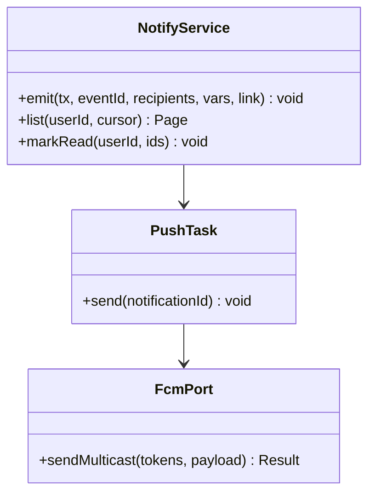
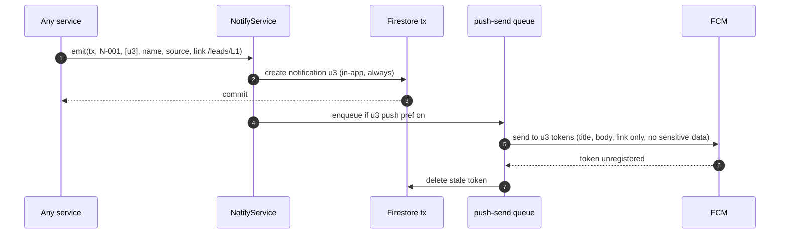
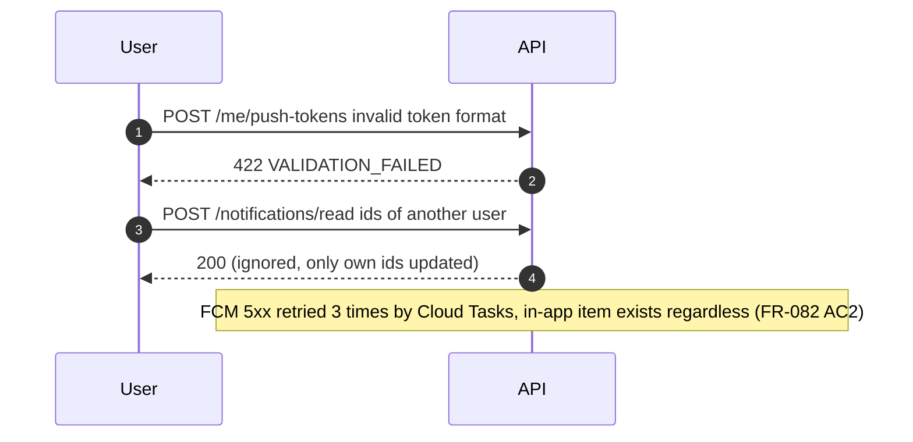
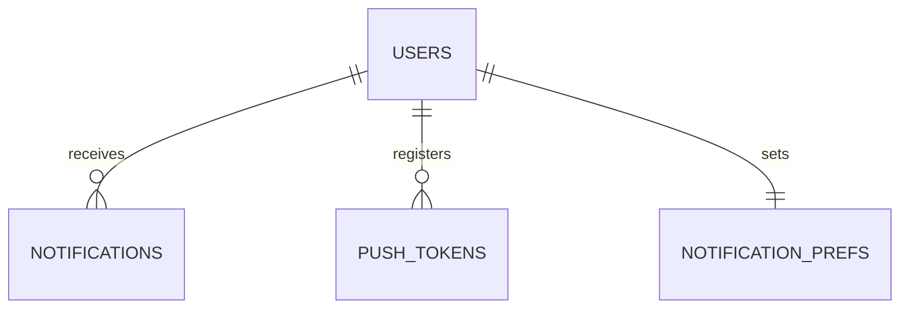

# Low-Level Design (LLD) — Module: notify

| Version | Date | Author | Change |
|---|---|---|---|
| 0.1 | 2026-11-13 | Claude (tech lead; self-checked against HLD v0.2 and ADRs — no separate architect review run) | Initial draft (batch 4) |

Conventions: [LLD-common](LLD-common.md). Ranges: API-215 – 224, TBL-095 – 099.

## 1. Module overview
In-app notification centre and web push (FCM) for the events N-001 – N-013, with per-user, per-event push opt-out. Customer-facing messages (N-014) are user-initiated in engagement and are not sent from here.

| Linked | IDs |
|---|---|
| FRs | FR-082 (also FR-043, FR-049, FR-050, FR-053, FR-058, FR-089 as event sources) |
| SCRs | SCR-025, SCR-033 (preferences), SCR-036 (badge) |
| Notifications | N-001 – N-013 |

## 2. Code structure
```
apps/api/src/modules/notify/
  notify.routes.ts  notify.service.ts (emit)  push.task.ts  catalogue.ts (N-xxx → template, deep link, default prefs)  notify.spec.ts
packages/adapters/src/fcm.ts
apps/web/src/sw.ts                      # Workbox SW + FCM onBackgroundMessage → showNotification, click → deep link
apps/web/src/features/notify/           # NotificationCentre (CMP-041), usePushPermission
```

## 3. Class / component diagram


## 4. Sequence diagrams

### 4.1 Emit and push


### 4.2 Error paths


## 5. API contracts
| ID | Method / path | Roles / permission | FR | Notes |
|---|---|---|---|---|
| API-215 | GET /notifications?unread=&cursor= | signed in | FR-082 | Own only; `{items, unreadCount}` |
| API-216 | POST /notifications/read | signed in | FR-082 | `{ids[] \| all: true}` |
| API-217 | POST /me/push-tokens | signed in | FR-082 | `{token, platform, userAgentHash}`; max 10 per user (oldest dropped) |
| API-218 | DELETE /me/push-tokens/{tokenHash} | signed in | FR-082 | On sign-out |
| API-219 | GET /me/notification-prefs · PUT /me/notification-prefs | signed in | FR-082 AC3 | `{push: {"N-007": false, …}}` |

`GET /notifications` item:
```json
{ "id": "n1", "event": "N-001", "title": "New lead: Ravi Kumar from Google Sheet", "link": "/leads/L-000123", "createdAt": "2026-11-13T05:12:00Z", "readAt": null }
```

## 6. Database design


### TBL-095 — notifications/{id}
`{ userId, event, title, body?, link, createdAt, readAt? }`; index `(userId, createdAt desc)`, `(userId, readAt)`; TTL 90 days. Titles contain names (PII) and are deleted with the person on erasure (privacy module queries by `refs`). Field `refs: [recordType:id]` supports that.

### TBL-096 — pushTokens/{sha256(token)}
`{ userId, token (encrypted), platform, createdAt, lastSuccessAt }`; index `(userId)`.

### TBL-097 — notificationPrefs/{userId}
`{ push: { [eventId]: bool } }`; default all on except N-007 for Admin in Team mode (noise).

## 7. State machines
N/A — notifications are `unread → read` only.

## 8. Validation & business rules
| Rule ID | Where enforced | Implementation | Error code |
|---|---|---|---|
| FR-082 AC2 | `emit` | in-app item always written, push optional | — |
| FR-082 AC3 | `push.task` | pref check at send time | — |
| NFR-010 / INT-008 | catalogue | push payload = title + link; no amounts or phone numbers | — |
| RULE-002 | catalogue | team-only events (N-005, manager copies) suppressed in Solo mode | — |

## 9. Error code catalogue
N/A — module uses common codes only (`VALIDATION_FAILED`, `UNAUTHENTICATED`).

## 10. Events, jobs & schedules
| Job | Trigger | Action |
|---|---|---|
| `push.send` | `push-send` queue | FCM multicast; delete tokens with `registration-token-not-registered` |
| Event map | N-001 assigned, N-002 re-enquiry, N-003 follow-up due, N-004 SLA, N-005/006 approval, N-007/008 quote, N-009 payment, N-010/011 Google/sync, N-012 support, N-013 lock | emitted by owning modules in their tx |

## 11. Caching
Unread count polled every 60 s while the app is visible, and refreshed on push receipt (SW `postMessage`).

## 12. Configuration / env vars
| Var | Required | Default | Description |
|---|---|---|---|
| FCM_VAPID_PUBLIC_KEY | Y | — | Web push key (public, in bootstrap config) |
| NOTIFICATION_TTL_DAYS | N | 90 | TBL-095 TTL |

## 13. Logging & audit events
Audit: `notification_prefs.update`. Metrics: `push.sent`, `push.failed`, `push.token_removed`.

## 14. Front-end design
| SCR | Route | Components (CMP) | Data fetching | State | Forms / validation |
|---|---|---|---|---|---|
| SCR-025 Notification centre | `/notifications` (sheet on mobile, popover on desktop) | CMP-041, CMP-021 empty | API-215, API-216 | unread badge in shell | — |
| SCR-033 prefs | `/me#notifications` | CMP-005 switches per event | API-219 | — | — |
| Permission prompt | after first lead opened | CMP-018 banner | `Notification.requestPermission` → API-217 | — | iOS: only when installed (R-007) |

## 15. Unit-test plan
| Unit | Scenarios |
|---|---|
| catalogue | every N-001–N-013 has template, link and default; Solo suppresses manager copies |
| emit | in-app written in tx; push skipped when opted out; push enqueued otherwise |
| push.task | stale token removed; payload has no phone/amount |

## 16. Open questions
None.
