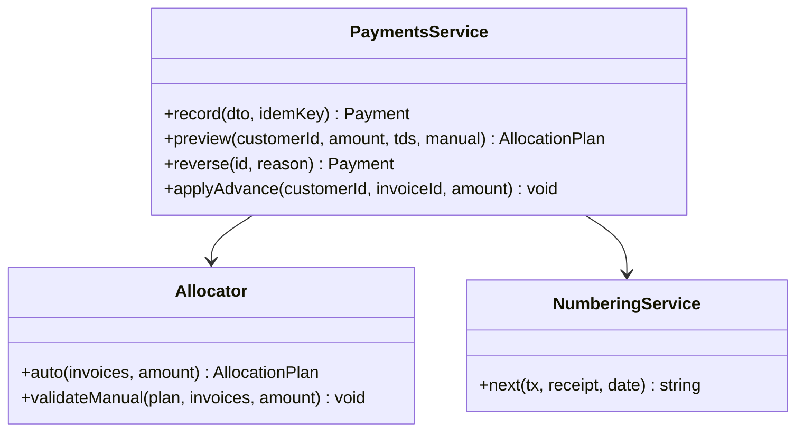
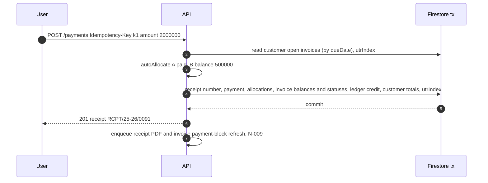
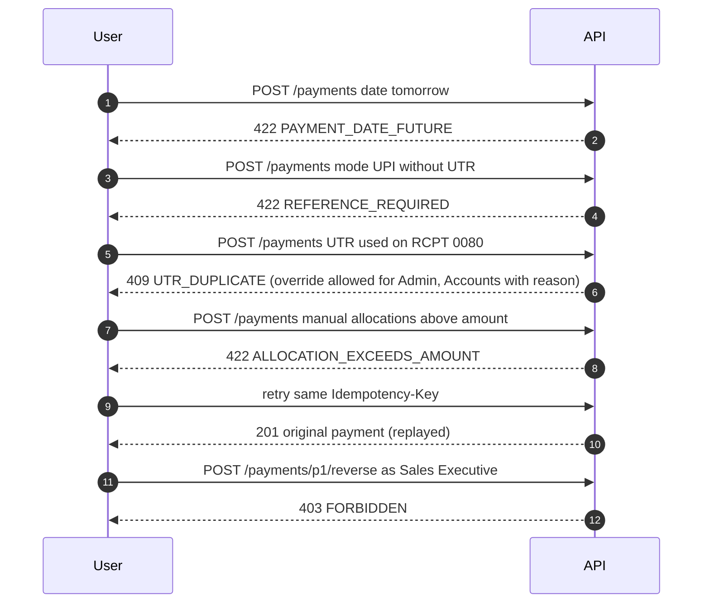
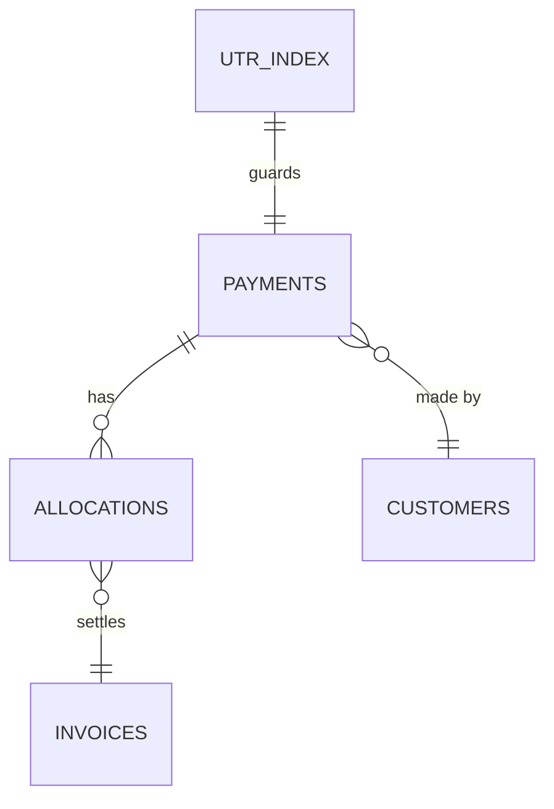
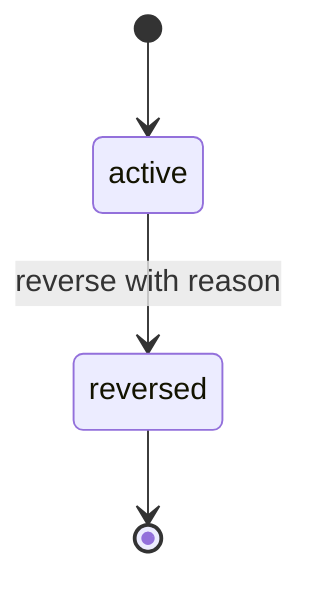

# Low-Level Design (LLD) — Module: payments

| Version | Date | Author | Change |
|---|---|---|---|
| 0.1 | 2026-11-13 | Claude (tech lead; self-checked against HLD v0.2 and ADRs — no separate architect review run) | Initial draft (batch 3) |

Conventions: [LLD-common](LLD-common.md). Ranges: API-180 – 189, TBL-080 – 084.

## 1. Module overview
Records customer payments (incl. TDS), allocates them oldest-due-first or manually, keeps on-account advances, issues numbered receipts and reverses payments. All balance changes for one payment commit in one Firestore transaction.

| Linked | IDs |
|---|---|
| FRs | FR-070 – FR-073 |
| UCs | UC-011 |
| SCRs | SCR-017, SCR-018 |
| Rules | RULE-040, RULE-042 – RULE-048, RULE-059 |
| PFs | PF-007 (collect payment), SEQ-06 |

## 2. Code structure
```
packages/domain/src/payments/
  allocate.ts     # autoAllocate(openInvoices, cash + tds) -> {allocations, advance}; validateManual()   (RULE-044, RULE-045)
  modes.ts        # referenceRequired(mode)   (RULE-042)
apps/api/src/modules/payments/
  payments.routes.ts  payments.service.ts  payments.repo.ts  payments.spec.ts
apps/web/src/app/sales/payments/   # SCR-017, SCR-018
```

## 3. Class / component diagram


## 4. Sequence diagrams

### 4.1 Record payment — happy path


### 4.2 Error paths


## 5. API contracts
| ID | Method / path | Roles / permission | FR | Notes |
|---|---|---|---|---|
| API-180 | GET /payments?customerId=&mode=&from=&to=&cursor= | `payment:read` | FR-070 | Scoped |
| API-181 | POST /payments | `payment:create` (RULE-048 per role) + Idempotency-Key | FR-070, FR-071, FR-072 | |
| API-182 | GET /payments/{id} | `payment:read` | FR-072 | Allocations + receipt link |
| API-183 | POST /payments/{id}/reverse | `payment:reverse` (Admin, Accounts) | FR-073 | `{reason}` |
| API-184 | POST /payments/preview | `payment:create` | FR-071 | Allocation plan without saving |
| API-185 | POST /customers/{id}/apply-advance | `payment:create` | FR-071 | `{invoiceId, amount}` |
| API-186 | GET /payments/utr-check?ref= | `payment:create` | FR-070 AC2 | `{usedBy: "RCPT/…"}` or `{}` |

### API-181 — Record payment
Request:
```json
{ "customerId": "c42", "date": "2026-11-13", "amount": 900000, "mode": "upi", "reference": "432112345678", "bankAccountId": "ba1",
  "tdsAmount": 100000, "tdsSection": "194J", "proofFileId": null, "note": null,
  "allocation": { "mode": "manual", "items": [ { "invoiceId": "i1", "amount": 1000000 } ] }, "utrOverrideReason": null }
```
`201`:
```json
{ "id": "p1", "receiptNo": "RCPT/25-26/0091", "status": "active", "allocations": [ { "invoiceId": "i1", "number": "INV/25-26/0142", "amount": 1000000, "invoiceBalanceAfter": 0 } ],
  "advance": 0, "receipt": { "pdfStatus": "pending" } }
```
Allocated amounts include TDS (RULE-045): `Σ allocations ≤ amount + tdsAmount`.

## 6. Database design


### TBL-080 — payments/{id}
| Column | Type | Null | Notes |
|---|---|---|---|
| receiptNo | string | N | RCPT series (RULE-003) |
| customerId / ownerId | ref | N | index `(customerId, date desc)`, `(ownerId, date desc)` |
| date | date | N | ≤ today IST, > lock date |
| amount / tdsAmount / tdsSection | int / int / string | N / Y / Y | amount > 0 |
| mode / reference / bankAccountId | enum / string / ref | N / C / Y | upi, neft, rtgs, imps, cheque, card, cash |
| allocations[] | array | N | `{invoiceId, number, amount}` (embedded; also mirrored in TBL-081) |
| advance | int | N | unallocated remainder |
| status / reversal | enum / map | N / Y | `active \| reversed`; `{by, at, reason}` |
| proofFileId / note / receiptPdf | ref / string / map | Y | |
| utrOverride | map | Y | `{by, reason}` (RULE-043) |

### TBL-081 — allocations/{paymentId}_{invoiceId}
`{ paymentId, invoiceId, customerId, amount, active }`; index `(invoiceId)` for the invoice's payment list.

### TBL-082 — utrIndex/{normalisedRef}
`{ paymentId, receiptNo }`; created in tx; deleted on reversal. Normalised = upper-case, no spaces.

### TBL-083 — customerAdvances (field on customers TBL-085 `totals.advance`) + ledger entries TBL-074
No separate collection: advances are the sum of `payment.advance` minus applied advances, kept on the customer totals and in the ledger.

## 7. State machines


## 8. Validation & business rules
| Rule ID | Where enforced | Implementation | Error code |
|---|---|---|---|
| RULE-042 | contracts + `modes.ts` | reference required except cash | `REFERENCE_REQUIRED` 422 |
| RULE-043 | tx `utrIndex` create | exists → 409 unless `utrOverrideReason` and role Admin/Accounts | `UTR_DUPLICATE` 409 |
| RULE-044 | `allocate.ts` | oldest dueDate first, tie by date then number; manual ≤ amount + tds and ≤ each balance | `ALLOCATION_EXCEEDS_AMOUNT`, `ALLOCATION_EXCEEDS_BALANCE` 422 |
| RULE-045 | allocate | TDS counts toward settlement | — |
| RULE-046 | reverse | role check; reason; allocations inactive; balances restored; receipt cancelled; ledger reversal debit | `REASON_REQUIRED` 422 |
| RULE-047 / RULE-015 | create | date ≤ today IST; > lockDate | `PAYMENT_DATE_FUTURE`, `PERIOD_LOCKED` 422 |
| RULE-048 | authz | `settings/permissions.execPaymentsEnabled` | 403 |
| RULE-059 | Idempotency middleware | 24 h replay | — |
| E-05 | tx | invoice read in same tx; balance never negative | `ALLOCATION_EXCEEDS_BALANCE` |

## 9. Error code catalogue
| Code | HTTP | Message (user-facing) | Cause |
|---|---|---|---|
| REFERENCE_REQUIRED | 422 | Enter the UTR or reference number. | RULE-042 |
| UTR_DUPLICATE | 409 | UTR already used on {receiptNo}. | RULE-043 |
| PAYMENT_DATE_FUTURE | 422 | Payment date can't be in the future. | RULE-047 |
| ALLOCATION_EXCEEDS_AMOUNT | 422 | Allocations are more than the amount received. | RULE-044 |
| ALLOCATION_EXCEEDS_BALANCE | 422 | {invoice} has only {balance} due. | RULE-044 |
| PAYMENT_ALREADY_REVERSED | 409 | This payment is already reversed. | Double reverse |

## 10. Events, jobs & schedules
| Job | Trigger | Action |
|---|---|---|
| receipt PDF | after commit → `pdf-render` | receipt PDF in Drive Payments folder |
| invoice payment block | after commit → `pdf-render` per touched invoice | new PDF version with current balance / PAID (FR-065) |
| N-009 | after commit | in-app to customer owner |

## 11. Caching
None.

## 12. Configuration / env vars
N/A — behaviour comes from settings (exec payments switch, lock date) and masters (payment modes, bank accounts).

## 13. Logging & audit events
Audit: `payment.create`, `payment.reverse`, `payment.utr_override`, `advance.apply`. Metrics: payments per mode (counts only).

## 14. Front-end design
| SCR | Route | Components (CMP) | Data fetching | State | Forms / validation |
|---|---|---|---|---|---|
| SCR-017 Record payment | `/sales/payments/new?invoiceId=` | CMP-035 AmountInput, CMP-004 mode/bank, CMP-007, CMP-032 proof, CMP-009 allocation table | API-184 preview (debounced), API-186 on UTR blur, API-181 with Idempotency-Key generated on form open | RHF | Zod `PaymentCreate`; amount defaults to balance (FR-070 AC1) |
| SCR-018 Payment detail | `/sales/payments/:id` | CMP-042 receipt, CMP-043 reverse confirm, CMP-019 | API-182, API-183 | — | reverse hidden for Exec |

## 15. Unit-test plan
| Unit | Scenarios |
|---|---|
| allocate | FR-071 AC1 (A paid, B 5,000); AC2 advance 5,000; AC3 TDS settles; AC4 manual over → error; ties by date |
| Service (emulator) | idempotent replay; UTR duplicate + override; reverse restores balance and status; concurrent payment + credit note never negative (E-05); exec disabled → 403 |

## 16. Open questions
None.
