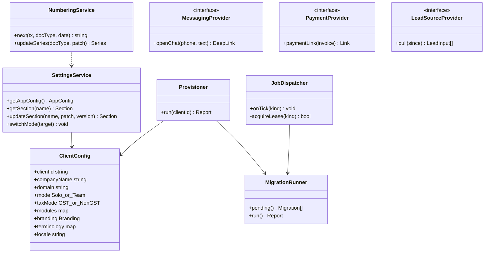
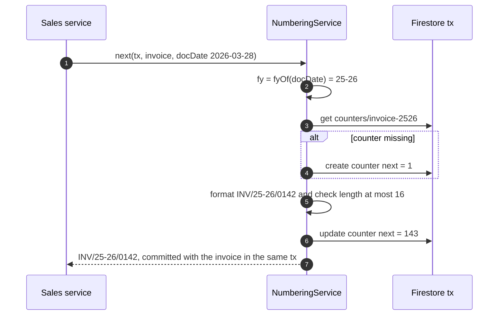
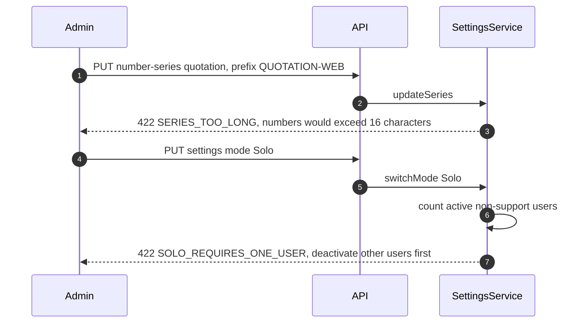
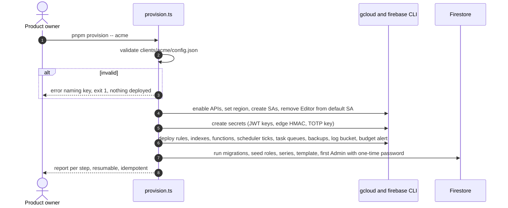
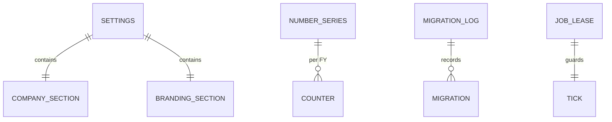

# Low-Level Design (LLD) — Module: platform

| Version | Date | Author | Change |
|---|---|---|---|
| 0.1 | 2026-11-13 | Claude (tech lead; self-checked against HLD v0.2 and ADRs — no separate architect review run) | Initial draft (batch 1) |

Conventions: [LLD-common](LLD-common.md). Ranges: API-001 – 009, TBL-001 – 009.

## 1. Module overview
The platform module covers:
- install configuration, provisioning and seeding
- branding and terminology
- Solo/Team mode and module switches
- number series and the counter
- data migrations and releases
- app bootstrap config
- health
- the job dispatcher
- integration extension points

| Linked | IDs |
|---|---|
| FRs | FR-001, FR-002, FR-003, FR-004, FR-005, FR-006, FR-091 |
| UCs | UC-002, UC-015 |
| PFs | PF-008, PF-009 |
| SCRs | SCR-027 (Settings home), SCR-036 (App shell), SCR-001 (branding on sign-in) |
| Rules | RULE-001, RULE-002, RULE-003, RULE-004 |

## 2. Code structure
```
packages/config/src/client-config.schema.ts     # ClientConfig (Zod) — FR-001
packages/domain/src/numbering.ts                 # format, FY, length check — RULE-003
packages/domain/src/mode.ts                      # Solo/Team rules — RULE-002
packages/adapters/src/providers/                 # FR-091 ports: messaging.ts, payment.ts, lead-source.ts (+ builtin impls)
apps/api/src/modules/platform/
  platform.routes.ts  settings.service.ts  numbering.service.ts  migrations/runner.ts  migrations/0001_init.ts
  jobs.dispatcher.ts  jobs.registry.ts  health.routes.ts  platform.spec.ts
infra/provision/provision.ts                     # pnpm provision -- <clientId>
infra/provision/seeds/{roles,number-series,templates/web-it-services}.json
apps/web/src/app/settings/(company|branding|terminology|mode|numbering|sla|about)/
apps/web/src/shell/                              # SCR-036
```

## 3. Class / component diagram


## 4. Sequence diagrams

### 4.1 Number allocation on issue — happy path (FR-005)


### 4.2 Error paths — numbering and mode


### 4.3 Provisioning (FR-002)


## 5. API contracts

### API-001 — Health
| Item | Value |
|---|---|
| Method / path | GET /api/v1/health |
| Auth / roles | None (edge-signed only) |
| Linked FR | NFR-015 (FR-006 version) |
| Idempotency | n/a (GET) |
| Rate limit | Edge 600/min/IP |

Response `200`:
```json
{ "status": "ok", "version": "v1.0.0", "firestore": "ok", "google": "connected", "lastTickAt": "2026-11-13T05:30:00Z" }
```
`503` when Firestore is unreachable or the last tick is more than 5 min old (problem+json `UNHEALTHY`).

### API-002 — App bootstrap config
| Item | Value |
|---|---|
| Method / path | GET /api/v1/app-config |
| Auth / roles | None (needed by sign-in screen); returns only non-sensitive branding/terminology/mode |
| Linked FR | FR-003, FR-004 |
| Idempotency | n/a |
| Rate limit | Edge 600/min/IP |

```json
{ "appName": "Arjun Web Studio", "branding": { "primary": "#2563EB", "logoLightUrl": "/assets/logo-light.svg", "logoDarkUrl": "/assets/logo-dark.svg" },
  "terminology": { "lead": "Enquiry", "customer": "Client" }, "mode": "Solo", "modules": { "salesOrders": false }, "taxMode": "GST", "locale": "en-IN", "version": "v1.0.0" }
```

### API-003 — Get settings section
| Item | Value |
|---|---|
| Method / path | GET /api/v1/admin/settings/{section} — `section ∈ company, branding, terminology, mode, modules, sla, security` |
| Auth / roles | Bearer; `settings:read` (Admin; Viewer read) |
| Linked FR | FR-003, FR-004, FR-017, FR-022 (SLA) |
| Idempotency | n/a |
| Rate limit | Edge 600/min |

Response `200` + `ETag`:
```json
{ "section": "sla", "version": 3, "data": { "firstContactMinutes": 15, "businessHours": { "days": ["MON","TUE","WED","THU","FRI","SAT"], "start": "09:00", "end": "19:00" } } }
```

### API-004 — Update settings section
| Item | Value |
|---|---|
| Method / path | PUT /api/v1/admin/settings/{section} |
| Auth / roles | Bearer; `settings:update` (Admin) |
| Linked FR | FR-003, FR-004 |
| Idempotency | If-Match required |
| Rate limit | Edge 600/min |

Request (branding):
```json
{ "appName": "Arjun Web Studio", "primary": "#2563EB", "emailSenderName": "Arjun Web Studio" }
```
Responses:
- `200` updated section + `ETag`
- `400` VALIDATION_FAILED
- `412` VERSION_CONFLICT
- `422`: `CONTRAST_TOO_LOW` (returns `suggestion`), `SOLO_REQUIRES_ONE_USER`, `MODULE_HAS_DATA` (switching off a module that has open records shows a warning but is allowed; the response carries `warning`)

### API-005 — List number series
| Item | Value |
|---|---|
| Method / path | GET /api/v1/admin/number-series |
| Auth / roles | Bearer; `settings:read` |
| Linked FR | FR-005 |

```json
{ "items": [ { "docType": "invoice", "prefix": "INV", "pattern": "{prefix}/{FY}/{seq}", "padding": 4, "fyReset": true, "next": { "25-26": 143 }, "preview": "INV/25-26/0143", "version": 2 } ] }
```

### API-006 — Update number series
| Item | Value |
|---|---|
| Method / path | PUT /api/v1/admin/number-series/{docType} |
| Auth / roles | Bearer; `settings:update` |
| Linked FR | FR-005 |
| Idempotency | If-Match |

Request:
```json
{ "prefix": "INV", "padding": 4, "fyReset": true, "nextOverride": null }
```
Responses:
- `200`
- `422 SERIES_TOO_LONG`
- `422 SERIES_INVALID_CHARS` (only letters, digits, `/`, `-`)
- `422 NEXT_BELOW_ISSUED` (an override can never be lower than the highest number already issued)

### API-007 — About / version & migrations
| Item | Value |
|---|---|
| Method / path | GET /api/v1/admin/about |
| Auth / roles | Bearer; `settings:read` |
| Linked FR | FR-006, UC-015 |

```json
{ "version": "v1.0.0", "deployedAt": "2026-11-20T10:00:00Z", "migrations": [ { "id": "0001_init", "appliedAt": "2026-11-13T09:00:00Z", "status": "applied" } ] }
```

### API-008 — Job status (shared)
| Item | Value |
|---|---|
| Method / path | GET /api/v1/jobs/{jobId} |
| Auth / roles | Bearer; requester or Admin |
| Linked FR | FR-023, FR-085, FR-087, FR-032 (async work) |

```json
{ "id": "job_7Fq", "kind": "export", "status": "succeeded", "progress": 100, "result": { "downloadUrl": "/api/v1/files/f_92/download", "expiresAt": "2026-11-13T12:00:00Z" } }
```

### API-009 — Switch mode (Solo ↔ Team)
| Item | Value |
|---|---|
| Method / path | POST /api/v1/admin/mode |
| Auth / roles | Bearer; Admin |
| Linked FR | FR-004 |
| Idempotency | If-Match on `settings/mode` |

Request `{ "mode": "Team" }`. Responses:
- `200`
- `422 SOLO_REQUIRES_ONE_USER` (Team → Solo with more than one active user; the support user is not counted, RULE-002)

## 6. Database design



### TBL-001 — settings/{section}
| Column | Type | Null | Default | Constraint / index | Notes |
|---|---|---|---|---|---|
| id | string | N | — | one of company, branding, terminology, mode, modules, sla, security, google | single docs |
| data | map | N | seeded from config.json | Zod schema per section | e.g. `mode: { mode: "Solo" }` |
| base fields | — | — | — | — | version, timestamps |

### TBL-002 — numberSeries/{docType}
| Column | Type | Null | Default | Constraint / index | Notes |
|---|---|---|---|---|---|
| docType | string | N | — | PK; quotation, salesOrder, taxInvoice, billOfSupply, proforma, creditNote, receipt, openingInvoice | |
| prefix | string | N | QT, SO, INV, BOS, PI, CN, RCPT, OB | `^[A-Z0-9-]{1,8}$` | |
| pattern | string | N | `{prefix}/{FY}/{seq}` | contains `{seq}` | |
| padding | int | N | 4 | 3–6 | |
| fyReset | bool | N | true | | |
| maxLength | int | N | 16 | fixed | RULE-003 / CGST Rule 46 |

### TBL-003 — counters/{docType}-{fyCode}
| Column | Type | Null | Default | Constraint / index | Notes |
|---|---|---|---|---|---|
| id | string | N | — | e.g. `taxInvoice-2526` | one doc per series per FY (hot-spot safe: ≤ 1 write/s) |
| next | int | N | 1 | ≥ 1, monotonic | updated only inside the issuing transaction |
| lastIssued | string | Y | null | | for audit/About |

### TBL-004 — migrations/{id}
| Column | Type | Null | Default | Notes |
|---|---|---|---|---|
| id | string | N | — | `0001_init` (ordered) |
| status | string | N | — | applied, failed |
| appliedAt, durationMs, releaseTag, error | mixed | Y | — | expand-only migrations (NFR-019) |

### TBL-005 — jobs/lease-{tick}
| Column | Type | Null | Default | Notes |
|---|---|---|---|---|
| holder | string | N | — | function execution ID |
| expiresAt | ts | N | now + 90 s | compare-and-set in tx (M-14) |
| lastRunAt | ts | Y | — | surfaced by API-001 |

### TBL-006 — releaseInfo (single doc `platform/release`)
| Column | Type | Null | Notes |
|---|---|---|---|
| version, deployedAt, deployedBy (CI run URL) | mixed | N | written by CI post-deploy (FR-006) |

**Client config file (not a table):** `clients/<id>/config.json`, validated by `ClientConfigSchema` (FR-001):

| Key | Type | Required | Validation |
|---|---|---|---|
| clientId | string | Y | `^[a-z0-9-]{3,30}$` |
| companyName | string | Y | 2–80 chars |
| domain | string | Y | hostname |
| gcpProjectId | string | Y | GCP project ID format |
| region | string | Y | must be `asia-south1` |
| mode | enum | Y | Solo, Team |
| taxMode | enum | Y | GST, NonGST |
| modules | map | N | salesOrders, reports, … (bool) |
| branding | map | Y | primary colour hex; logo files exist |
| terminology | map | N | known keys only |
| seedTemplate | string | Y | existing seed folder |
| locale | string | N | `en-IN` |
| cloudflareProject | string | Y | |

## 7. State machines
**Install mode:** `Solo ⇄ Team`. Solo → Team is always allowed. Team → Solo is allowed only when exactly one non-support user is active (RULE-002).
**Migration:** `pending → applied | failed`. A failed migration blocks that install's deploy and keeps the code on its previous version.

## 8. Validation & business rules
| Rule ID | Where enforced | Implementation | Error code |
|---|---|---|---|
| RULE-001 | Build, provision, API startup | `ClientConfigSchema.parse()`; startup fails fast | (build/provision error) |
| RULE-002 | `SettingsService.switchMode`, identity `createUser` | Count active users excluding the support user | `SOLO_REQUIRES_ONE_USER` |
| RULE-003 | `domain/numbering.ts` `format()`, `validateSeries()`; `NumberingService.next` in tx | FY from document date; max 16 chars; charset `[A-Za-z0-9/-]` | `SERIES_TOO_LONG`, `SERIES_INVALID_CHARS`, `NEXT_BELOW_ISSUED` |
| RULE-004 | `MigrationRunner` | Ordered, recorded, run-once, expand-only | (deploy failure) |
| FR-003 AC3 | `domain/contrast.ts` | WCAG ratio of primary vs white and vs `--color-surface`; < 4.5 → suggest darker shade | `CONTRAST_TOO_LOW` |
| FR-004 AC4 | `modules` middleware | Route registry tagged by module; disabled → 404 | `MODULE_DISABLED` |

## 9. Error code catalogue
| Code | HTTP | Message (user-facing) | Cause |
|---|---|---|---|
| SERIES_TOO_LONG | 422 | Numbers in this series would be longer than 16 characters. Use a shorter prefix. | RULE-003 |
| SERIES_INVALID_CHARS | 422 | Use only letters, numbers, "/" and "-". | RULE-003 |
| NEXT_BELOW_ISSUED | 422 | The next number can't be lower than one already issued ({last}). | Override guard |
| SOLO_REQUIRES_ONE_USER | 422 | Solo mode allows one active user. Deactivate other users first. | RULE-002 |
| CONTRAST_TOO_LOW | 422 | This colour is hard to read ({ratio}:1). Try {suggestion}. | FR-003 AC3 |
| UNHEALTHY | 503 | Service temporarily unavailable. | Health check |

## 10. Events, jobs & schedules
| Job | Trigger | Handler | Notes |
|---|---|---|---|
| `tick-1m` | Cloud Scheduler `* * * * *` → Pub/Sub `ticks` | `JobDispatcher.onTick('1m')` | Acquires lease; calls registered handlers: google.sheetPoll, engagement.reminders, engagement.slaCheck, documents.linkExpiry (hourly guard) |
| `tick-daily` | `30 20 * * *` UTC (02:00 IST) | `onTick('daily')` | insights.summaries, privacy.purgeJunk, documents.expireLinks, platform.healthReport |
| Release migrations | CI post-deploy | `MigrationRunner.run()` | Expand-only |
| Provisioning | Manual CLI | `Provisioner.run` | Idempotent steps with a report |

## 11. Caching
- `app-config` and settings: 60 s in-memory on the API.
- `app-config`: `Cache-Control: max-age=60` at the edge.
- PWA: `app-config` cached in a persisted query (offline shell branding).

## 12. Configuration / env vars
Common vars from [LLD-common §12](LLD-common.md#12-configuration--env-vars-common), plus:

| Var | Required | Default | Description |
|---|---|---|---|
| PROVISION_BILLING_ACCOUNT | N (CLI) | — | For budget alert creation |
| BUDGET_MONTHLY_INR | N | 500 | Budget alert threshold (NFR-012) |
| SEED_TEMPLATE | N | from config | Overrides seed |

## 13. Logging & audit events
| Event | Audit action |
|---|---|
| Settings section changed | `settings.update` (diff) |
| Mode switched | `settings.mode` |
| Number series changed | `numberSeries.update` |
| Migration applied/failed | `platform.migration` (system) |
| Provisioning step | provision report file in the run; first Admin created → `user.create` (system) |

## 14. Front-end design
| SCR | Route | Components (CMP) | Data fetching | State | Forms / validation |
|---|---|---|---|---|---|
| SCR-027 Settings home | `/settings`, `/settings/:section` | CMP-023 (desktop nav), CMP-008, CMP-003, CMP-005, CMP-001, CMP-018 | `useQuery(['platform','settings',section])` API-003; mutation API-004 with If-Match | Server state only | Zod section schemas from `@ss/contracts`; contrast warning inline |
| SCR-027 › Number series | `/settings/numbering` | CMP-009, CMP-016, CMP-003 | API-005/006 | — | Live preview `INV/25-26/0143`; length counter |
| SCR-027 › About | `/settings/about` | CMP-012, CMP-009 | API-007 | — | — |
| SCR-036 App shell | `*` (layout) | CMP-023, CMP-024, CMP-025, CMP-026 trigger, CMP-040, CMP-018, CMP-017 | API-002 at boot (persisted) | `useAppConfig()` context: terminology, mode, modules | — |
| SCR-001 (branding) | `/login` | — | API-002 | — | — |

## 15. Unit-test plan
| Unit | Scenarios |
|---|---|
| `ClientConfigSchema` | valid config; missing companyName; region ≠ asia-south1; bad hex colour; unknown terminology key |
| `numbering.format/validateSeries` | `INV/25-26/0142`; padding 6; 17-char result rejected; invalid char; FY of 31-03 vs 01-04 (IST); back-dated doc uses its own FY (FR-005 AC6) |
| `NumberingService.next` (emulator) | 20 parallel transactions → 20 distinct consecutive numbers (NFR-020); counter auto-created; new FY restarts at 1 |
| `mode` | Team → Solo with 2 active users blocked; support user ignored; Solo → Team allowed |
| `contrast` | `#2563EB` ok; `#93C5FD` fails with suggestion |
| `MigrationRunner` | runs pending in order; skips applied; failure records status and stops |
| `JobDispatcher` | lease acquired once under concurrent ticks; expired lease taken over |
| Provider ports | built-in messaging returns `wa.me` link; payment provider returns UPI link (delegates to sales domain) |

## 16. Open questions
None.
