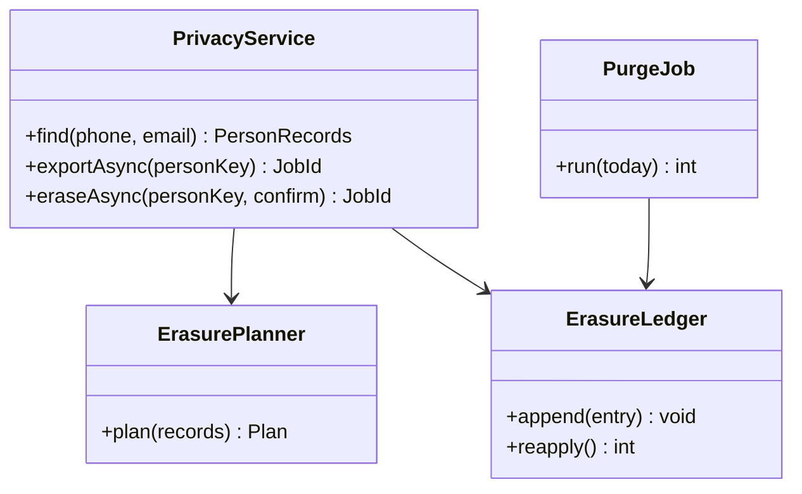
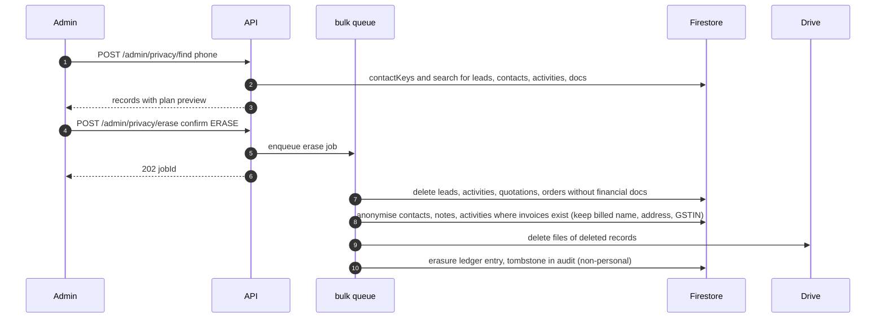
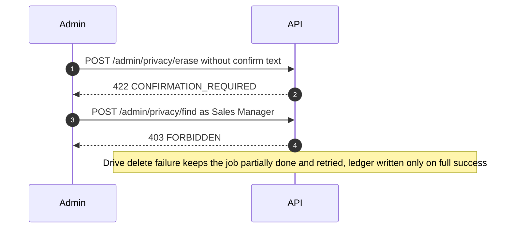
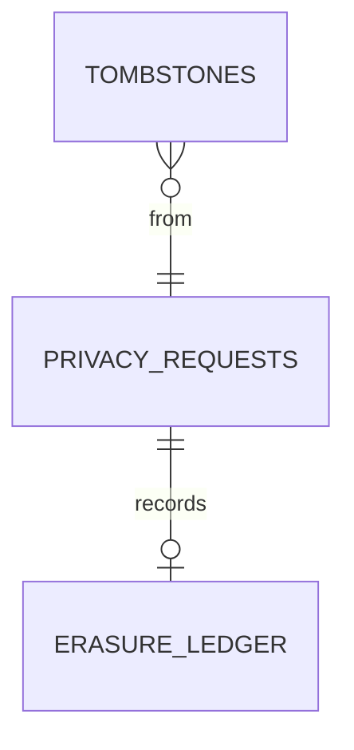
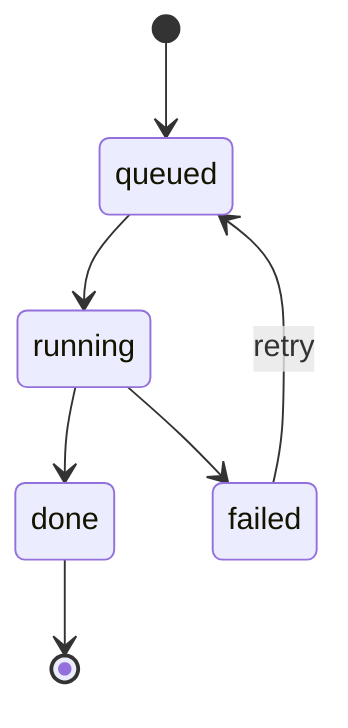

# Low-Level Design (LLD) — Module: privacy

| Version | Date | Author | Change |
|---|---|---|---|
| 0.1 | 2026-11-13 | Claude (tech lead; self-checked against HLD v0.2 and ADRs — no separate architect review run) | Initial draft (batch 4) |

Conventions: [LLD-common](LLD-common.md). Ranges: API-240 – 249, TBL-105 – 109. Support access (FR-089) is in [LLD-identity](LLD-identity.md) API-035.

## 1. Module overview
DPDP data-principal requests (find, export, erase/anonymise) and the automatic retention purge of Junk leads, with an erasure ledger that is re-applied after any backup restore (CR-001).

| Linked | IDs |
|---|---|
| FRs | FR-086 (display), FR-087, FR-088, FR-090 |
| UCs | UC-014 |
| SCRs | SCR-032 |
| Rules | RULE-012, RULE-052 – RULE-054 |

## 2. Code structure
```
packages/domain/src/privacy/
  plan.ts        # erasurePlan(person) -> {deletes[], anonymises[], keeps[]}  (RULE-054)
apps/api/src/modules/privacy/
  privacy.routes.ts  privacy.service.ts  erase.task.ts  export.task.ts  purge.job.ts  ledger.ts (re-apply)  privacy.spec.ts
apps/web/src/app/settings/privacy/   # SCR-032
```

## 3. Class / component diagram


## 4. Sequence diagrams

### 4.1 Erase a person


### 4.2 Error paths


## 5. API contracts
| ID | Method / path | Roles / permission | FR | Notes |
|---|---|---|---|---|
| API-240 | POST /admin/privacy/find | `privacy:execute` (Admin) | FR-087, FR-088 | `{phone?, email?}` (body, not URL — no PII in URLs) → records grouped + `plan` |
| API-241 | POST /admin/privacy/export | `privacy:execute` | FR-087 | `{personKey}` → 202; JSON + xlsx zip in files (1 h) |
| API-242 | POST /admin/privacy/erase | `privacy:execute` | FR-088 | `{personKey, confirm: "ERASE"}` → 202 |
| API-243 | GET /admin/privacy/requests?cursor= | `privacy:execute` | FR-087, FR-088 | History (masked) |

`personKey` = opaque id returned by API-240 (server-side map of the normalised contact keys, 30 min TTL), so later calls carry no PII.

## 6. Database design


### TBL-105 — privacyRequests/{id}
`{ type: export|erase, keysMasked[], requestedBy, at, status: queued|done|failed, counts{deleted, anonymised, files}, jobId, completedAt }`.

### TBL-106 — erasureLedger/{id}
`{ keysHash[] (sha256 of normalised phone/email), recordRefs[], mode: delete|anonymise, at }` — used by `ledger.reapply()` after a restore so erased data does not come back (CR-001).

### TBL-107 — tombstones/{recordType}-{id}
`{ recordType, id, reason: erased_on_request|retention_purge, at }` — no personal data (FR-088 AC1, FR-090).

### TBL-108 — personKeys/{key} (TTL 30 min)
`{ contactKeys[], createdBy, expiresAt }`.

## 7. State machines


## 8. Validation & business rules
| Rule ID | Where enforced | Implementation | Error code |
|---|---|---|---|
| RULE-054 | `domain/privacy/plan.ts` | financial docs = issued invoices, credit notes, payments, receipts; none → delete all; else anonymise and keep invoice snapshot legal fields | — |
| RULE-012 | audit | audit entries untouched (already masked); tombstone only | — |
| RULE-052 | `purge.job.ts` | `stage == junk && junkAt <= today − 3 calendar months (IST)` | — |
| RULE-053 | purge + erase | never auto-delete financial docs, customers with them, or audit entries | — |
| NFR-010 | erase/export | job completes ≤ 5 min (batched writes of 400) | — |
| FR-088 | confirm | typed "ERASE" | `CONFIRMATION_REQUIRED` 422 |

## 9. Error code catalogue
| Code | HTTP | Message (user-facing) | Cause |
|---|---|---|---|
| CONFIRMATION_REQUIRED | 422 | Type ERASE to confirm. | Missing confirm |
| PERSON_KEY_EXPIRED | 410 | Search again — this result expired. | personKey TTL |
| NOTHING_FOUND | 404 | No records found for this phone or email. | find |

## 10. Events, jobs & schedules
| Job | Trigger | Action |
|---|---|---|
| `privacy.erase` | `bulk` queue | §4.1 |
| `privacy.export` | `export` queue | collect records → JSON + xlsx |
| `retention.purge` | daily 02:00 IST | RULE-052 deletes (lead, activities, files, contactKeys, notifications refs) + tombstone |
| `ledger.reapply` | manual runbook step after restore | re-run erasures from TBL-106 |

## 11. Caching
None.

## 12. Configuration / env vars
| Var | Required | Default | Description |
|---|---|---|---|
| JUNK_RETENTION_MONTHS | N | 3 | RULE-052 (Q-019) |
| PRIVACY_KEY_TTL_MIN | N | 30 | TBL-108 |

## 13. Logging & audit events
Audit: `privacy.find` (keys masked), `privacy.export`, `privacy.erase` (counts), `retention.purge` (counts). No PII in logs.

## 14. Front-end design
| SCR | Route | Components (CMP) | Data fetching | State | Forms / validation |
|---|---|---|---|---|---|
| SCR-032 Privacy requests | `/settings/privacy` | CMP-036 PhoneInput, CMP-003 email, CMP-009 records, CMP-018 plan summary, CMP-043 confirm (type ERASE) | API-240–243 → API-008 | personKey in memory | phone or email required |

## 15. Unit-test plan
| Unit | Scenarios |
|---|---|
| plan | FR-088 AC1 lead only → delete; AC2 contact on invoice → anonymise, keep billed name; AC3 quote without invoice → delete quote |
| purge | FR-090 AC1 dates (01-08 deleted on 02-11; 15-08 kept until 16-11); AC2 reopened not deleted; financial never deleted |
| ledger | reapply deletes restored records |
| Routes | non-admin 403; confirm required; export contains all leads/contacts/activities for phone |

## 16. Open questions
None. (Q-030 on DPDP log retention stays open at project level — see STATUS.)
