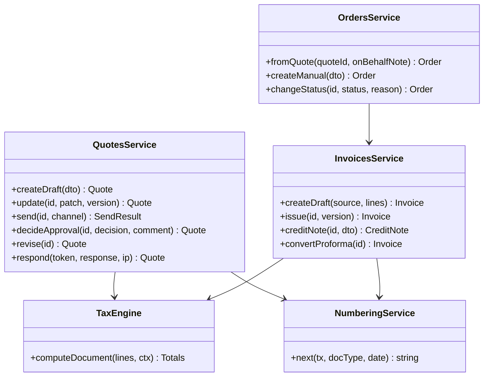
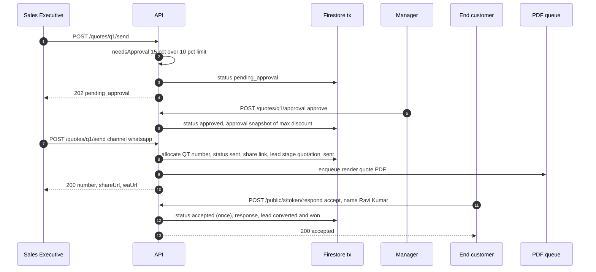
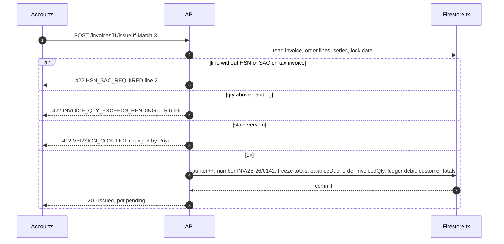
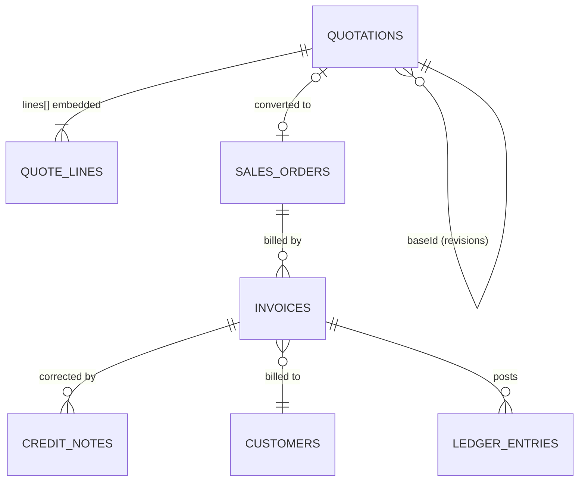
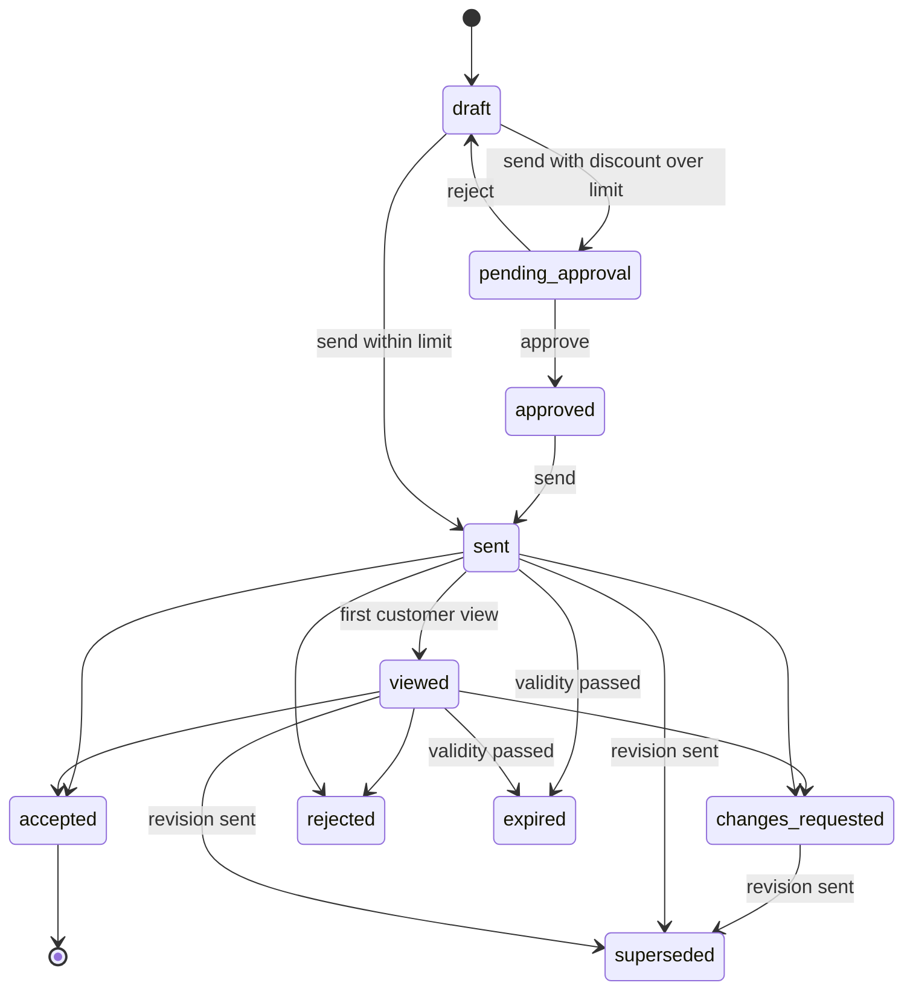

# Low-Level Design (LLD) — Module: sales

| Version | Date | Author | Change |
|---|---|---|---|
| 0.1 | 2026-11-13 | Claude (tech lead; self-checked against HLD v0.2 and ADRs — no separate architect review run) | Initial draft (batch 3) |

Conventions: [LLD-common](LLD-common.md). Ranges: API-140 – 179, TBL-070 – 079.

## 1. Module overview
Quotations (draft → approval → send → customer response → revisions → expiry), sales orders (incl. the silent order when the Orders module is off), invoices (tax invoice, bill of supply, proforma), issue with atomic numbering, credit notes and invoice cancellation. Tax and totals come from the shared domain engine so the browser preview and the server agree exactly.

| Linked | IDs |
|---|---|
| FRs | FR-051 – FR-069 |
| UCs | UC-007 – UC-010, UC-012 |
| SCRs | SCR-010, SCR-011, SCR-012 (actions), SCR-013, SCR-014, SCR-015, SCR-016 (data), SCR-019, SCR-023 |
| Rules | RULE-003, RULE-015 – RULE-017, RULE-027 – RULE-041, RULE-058 |
| PFs | PF-005 (quote to order), PF-006 (invoice), SEQ-04, SEQ-05 |

## 2. Code structure
```
packages/domain/src/sales/
  tax.ts         # placeOfSupply(), split(taxable, ratePct, intra) -> {cgst,sgst,igst}   (RULE-034)
  totals.ts      # computeLine(), computeDocument() incl. round-off and amount in words   (RULE-035)
  words.ts       # Indian numbering words ("Forty-Eight Thousand Three Hundred Eighty")
  numbering.ts   # format({prefix, fy, seq, pad}), fyOf(date), trRef()                  (RULE-003, RULE-041)
  upi.ts         # buildUpiUri({vpa, payee, amount, docNo, tr})                           (RULE-041)
  approval.ts    # needsApproval(lines, overallPct, roleLimit, mode)                      (RULE-027)
  quoteStatus.ts invoiceStatus.ts orderStatus.ts  # transition tables
  invoicing.ts   # pendingQty(orderLine, invoiced, credited), dueDate(), ageingBucket()   (RULE-033, RULE-039)
apps/api/src/modules/sales/
  quotes.routes.ts quotes.service.ts orders.routes.ts orders.service.ts
  invoices.routes.ts invoices.service.ts creditnotes.service.ts public-quote.routes.ts
  sales.repo.ts numbering.service.ts expiry.job.ts sales.spec.ts
apps/web/src/app/sales/   # SCR-023 hub, quotes/, orders/, invoices/
apps/web/src/features/sales/LineItemEditor.tsx TotalsBlock.tsx DocumentPreview.tsx
```

## 3. Class / component diagram


## 4. Sequence diagrams

### 4.1 Send quote (with approval) and customer acceptance


### 4.2 Issue invoice and error paths


## 5. API contracts
| ID | Method / path | Roles / permission | FR | Notes |
|---|---|---|---|---|
| API-140 | GET /quotes?status=&partyId=&ownerId=&cursor= | `quote:read` | FR-051 | Scoped |
| API-141 | POST /quotes | `quote:create` | FR-051, FR-052 | Draft; server recomputes totals |
| API-142 | GET /quotes/{id} | `quote:read` | FR-054, FR-058 | Includes `revisions[]`, `viewCount`, `lastViewedAt` |
| API-143 | PATCH /quotes/{id} | `quote:update` + If-Match | FR-051 | Draft / changes_requested only |
| API-144 | DELETE /quotes/{id} | creator, draft only | — | RULE-036 note |
| API-145 | POST /quotes/{id}/send | `quote:update` | FR-053, FR-056 | `{channel: whatsapp\|email\|link}` → `200 {number, shareUrl, waUrl?}` or `202 {status: pending_approval}` |
| API-146 | POST /quotes/{id}/approval | `quote:approve` | FR-053 | `{decision: approve\|reject, comment}`; self-approval refused unless Admin |
| API-147 | POST /quotes/{id}/revise | `quote:update` | FR-054 | New draft R(n+1) |
| API-148 | GET /quotes/{id}/compare?with={revId} | `quote:read` | FR-054 AC3 | Line and total diffs |
| API-149 | POST /quotes/{id}/pdf | `quote:read` | FR-055 AC2 | Regenerate → 202 job |
| API-150 | POST /sales/calc | signed in | FR-052 | Totals preview (same engine) |
| API-151 | POST /public/s/{token}/respond | public, token | FR-057 | `{type: accept\|changes\|reject, name?, comment?}`; idempotent per token |
| API-152 | POST /quotes/{id}/create-invoice | `invoice:create` | FR-059 AC4 | Silent order + draft invoice when Orders module off |
| API-155 | GET /orders · POST /orders | `order:read` / `order:create` | FR-059 | `{quoteId, onBehalfNote?}` or manual lines; existing order returned (AC2) |
| API-156 | GET /orders/{id} · PATCH /orders/{id} | `order:read` / `order:update` | FR-059, FR-061 | Lines with `ordered, invoiced, pending` |
| API-157 | POST /orders/{id}/status | `order:status` (Admin, PM, owner) | FR-060 | `{status, reason?}` |
| API-160 | GET /invoices?type=&status=&customerId=&overdue=&cursor= | `invoice:read` | FR-062 | Scoped |
| API-161 | POST /invoices | `invoice:create` | FR-062, FR-063 | `{source: {orderId}\|{quoteId}\|{proformaId}\|manual, type, lines[{orderLineId, qty}]}` |
| API-162 | GET /invoices/{id} · PATCH /invoices/{id} | `invoice:read` / `invoice:update` | FR-065 | Issued: only `notes` patchable |
| API-163 | DELETE /invoices/{id} | creator, draft only | — | |
| API-164 | POST /invoices/{id}/issue | `invoice:issue` + If-Match | FR-064, FR-065 | Atomic number |
| API-165 | POST /invoices/{id}/credit-notes | `invoice:credit` | FR-066 | `{mode: full\|lines\|amount, lines?, amount?, reason, date}` |
| API-166 | GET /credit-notes/{id} | `invoice:read` | FR-066 | |
| API-167 | POST /invoices/{id}/convert | `invoice:create` | FR-063 AC2 | Proforma → tax invoice / bill of supply draft |
| API-168 | POST /invoices/{id}/pdf | `invoice:read` | FR-067 | Regenerate → 202 |
| API-169 | GET /invoices/{id}/upi | `invoice:read` | FR-068 | `{uri, amount, qrSvg}` for current balance |

### API-141 — Create quotation
Request:
```json
{ "partyType": "lead", "partyId": "L-000123", "date": "2026-11-13", "validDays": 15, "placeOfSupply": "29",
  "lines": [ { "kind": "item", "productId": "p_web_basic", "description": "Website – Basic (5 pages)", "qty": 2, "unit": "nos", "rate": 1000000, "discountPct": 10, "taxRatePct": 18, "hsnSac": "998314" },
             { "kind": "heading", "description": "Hosting" } ],
  "overallDiscountPct": 0, "paymentTermId": "pt_50_advance", "termsText": "…", "notes": null }
```
`201`:
```json
{ "id": "q1", "status": "draft", "number": null, "revision": 0, "intraState": true,
  "totals": { "subTotal": 2000000, "discountTotal": 200000, "taxable": 1800000, "cgst": 162000, "sgst": 162000, "igst": 0, "roundOff": 0, "grandTotal": 2124000, "inWords": "Rupees Twenty-One Thousand Two Hundred Forty Only" }, "version": 1 }
```

### API-164 — Issue invoice
`200 { "id": "i1", "number": "INV/25-26/0142", "status": "issued", "balanceDue": 4838000, "dueDate": "2026-12-16", "pdf": { "status": "pending", "jobId": "job_7" } }`.

## 6. Database design


### TBL-070 — quotations/{id}
| Column | Type | Null | Notes |
|---|---|---|---|
| baseId / revision / number / displayNumber | ref / int / string / string | Y until sent | `QT/25-26/0007`, display `QT/25-26/0007-R1` (RULE-028) |
| partyType / partyId / customerId / leadId / ownerId | enum / ref | N | index `(ownerId, status, updatedAt desc)`, `(partyId, createdAt desc)` |
| date / validUntil / placeOfSupply / intraState | date / date / string(2) / bool | N | |
| status | enum | N | draft, pending_approval, approved, sent, viewed, changes_requested, accepted, rejected, expired, superseded; index `(status, validUntil)` |
| lines[] | array ≤ 200 | N | `{kind, productId, description, qty (milli-units int), unit, rate, discountPct, discountAmt, taxRatePct, hsnSac, gross, discount, taxable, cgst, sgst, igst, total}` |
| totals | map | N | paise |
| maxDiscountPct / approval | number / map | Y | `{requestedAt, by, at, decision, comment, approvedMaxPct}` |
| response | map | Y | `{type, name, comment, at, ipMasked}` |
| viewCount / lastViewedAt / firstViewedAt | int / ts | | FR-058 |
| orderId / shareLinkId / pdf{fileId,status,attempts} | ref / ref / map | Y | |
| termsText / paymentTermId / notes / version | | | |

### TBL-071 — salesOrders/{id}
`{ number (SO/…), quoteId?, customerId, ownerId, hidden (silent order, FR-059 AC4), status, statusHistory[], expectedDelivery, customerPoRef, lines[{id, productId, description, qty, unit, rate, …, invoicedQty, creditedQty}], totals, invoicedPct, receivedPct, version }`. Unique `quoteId` via `orderByQuote/{quoteId}` doc (RULE-031).

### TBL-072 — invoices/{id}
| Column | Type | Notes |
|---|---|---|
| type | enum | tax_invoice, bill_of_supply, proforma |
| number / seriesType / fy | string / string / string | number null while draft |
| orderId / quoteId / customerId / ownerId | ref | index `(customerId, dueDate)`, `(ownerId, status, dueDate)` |
| date / dueDate / placeOfSupply / intraState | date | |
| company / billTo / shipTo | map snapshots | frozen at issue (PII snapshot) |
| lines[] / totals | array / map | as quotations, plus `orderLineId` |
| status | enum | draft, issued, partly_paid, paid, cancelled; proforma: draft, issued, converted |
| paid / tds / credited / balanceDue | int paise | RULE-040; index `(status, dueDate)` for overdue |
| upi{vpaId, vpa, payee, trEnabled} | map | snapshot of default UPI at issue (RULE-014) |
| pdf{fileId, status, version} | map | payment block refreshed as new version |
| convertedToId / cancelledByCnId | ref | |

### TBL-073 — creditNotes/{id}
`{ number (CN/…), invoiceId, customerId, date, reason, mode, lines[{invoiceLineIdx, qty}], amount, taxSplit{cgst,sgst,igst}, onAccountCredit, version }`.

### TBL-074 — ledgerEntries/{id}
Append-only customer ledger written in the same tx as the business event: `{ customerId, date, kind: invoice|credit_note|payment|tds|reversal|advance_applied, docId, docNumber, debit, credit, createdAt }`; index `(customerId, date, createdAt)`. Source for statements (FR-076) and ageing.

### TBL-075 — orderByQuote/{quoteId}
`{ orderId }` uniqueness guard.

## 7. State machines

Invoice: `draft → issued → partly_paid → paid`; `issued/partly_paid → cancelled` (full credit note); proforma `issued → converted`. Order: `confirmed → in_progress → delivered → closed`; `on_hold ↔ confirmed/in_progress`; `→ cancelled` (RULE-032).

## 8. Validation & business rules
| Rule ID | Where enforced | Implementation | Error code |
|---|---|---|---|
| RULE-003 | `NumberingService.next(tx)` | counter `counters/{docType}-{fy}` incremented in the issuing tx; length ≤ 16 checked at series save | `SERIES_TOO_LONG` (platform) |
| RULE-015 | issue/create/credit | `date <= settings.lockDate` refused | `PERIOD_LOCKED` 422 |
| RULE-016/017 | issue | GSTIN pattern; HSN/SAC per line on tax invoice | `HSN_SAC_REQUIRED` 422 |
| RULE-027 | `domain/sales/approval.ts` | Team mode; max(line %, overall %) > role limit; self-approval only Admin; re-approval if > `approvedMaxPct` | `APPROVAL_REQUIRED` 202 path, `SELF_APPROVAL` 403 |
| RULE-028 | quotes service | sent+ immutable; revise creates R(n+1); sending R(n+1) supersedes R(n) in same tx | `QUOTE_LOCKED` 409 |
| RULE-029/030 | respond | latest, unexpired, sent/viewed; acceptance final (tx check status) | `QUOTE_NOT_ACCEPTABLE` 409 |
| RULE-031 | `orderByQuote` create | existing → return it | — |
| RULE-032 | order cancel | invoices not fully credited exist | `ORDER_HAS_INVOICES` 409 |
| RULE-033 | invoice draft/issue | qty ≤ ordered − (invoiced − credited) | `INVOICE_QTY_EXCEEDS_PENDING` 422 |
| RULE-034/035 | `domain/sales/tax.ts`, `totals.ts` | integer paise; half-up per line; round-off optional | — |
| RULE-036 | routes | no edit of issued; delete only draft | `DOCUMENT_ISSUED` 409 |
| RULE-037 | invoice type | proforma own series; excluded from balances/ledger | — |
| RULE-038 | credit note | Σ credits ≤ grandTotal; excess over balance → on-account credit | `CREDIT_EXCEEDS_TOTAL` 422 |
| RULE-039 | `invoicing.ts` | `dueDate = date + termDays`; overdue by IST date | — |
| RULE-058 | If-Match | version check in tx | `VERSION_CONFLICT` 412 |

## 9. Error code catalogue
| Code | HTTP | Message (user-facing) | Cause |
|---|---|---|---|
| HSN_SAC_REQUIRED | 422 | Add an HSN/SAC code to line {n}. | RULE-017 |
| INVOICE_QTY_EXCEEDS_PENDING | 422 | Only {n} left to invoice. | RULE-033 |
| PERIOD_LOCKED | 422 | This date is in a locked period. | RULE-015 |
| QUOTE_LOCKED | 409 | Sent quotations can't be edited — create a revision. | RULE-028 |
| QUOTE_NOT_ACCEPTABLE | 409 | This quotation can no longer be accepted. | RULE-030 |
| QUOTE_EXPIRED | 410 | This quotation expired on {date}. | RULE-029 |
| SELF_APPROVAL | 403 | You can't approve your own quotation. | RULE-027 |
| ORDER_HAS_INVOICES | 409 | Credit the invoices first. | RULE-032 |
| DOCUMENT_ISSUED | 409 | Issued documents can't be changed. | RULE-036 |
| CREDIT_EXCEEDS_TOTAL | 422 | Credit notes can't exceed the invoice total. | RULE-038 |
| ACCEPT_ON_BEHALF_NOTE_REQUIRED | 422 | Add a note to accept on the customer's behalf. | FR-059 AC3 |

## 10. Events, jobs & schedules
| Job | Trigger | Action |
|---|---|---|
| `quotes.expire` | daily 00:05 IST | `status in [sent, viewed] && validUntil < today(IST)` → expired (FR-058 AC2) |
| `pdf.render` | `pdf-render` queue after send/issue/credit/payment change | documents module renders; 3 retries then `pdf.status = failed` + in-app alert |
| Events | after commit | `quote.sent/viewed/accepted/changes/rejected` → notify N-005–N-008; `quote.accepted` → leads convert; `invoice.issued`, `credit_note.issued` → customers totals (same tx), documents PDF |

## 11. Caching
None server-side (financial data must be current). Products and tax rates via API-051 (10 min client cache).

## 12. Configuration / env vars
| Var | Required | Default | Description |
|---|---|---|---|
| QUOTE_MAX_LINES | N | 200 | Size guard |
| PDF_MAX_ATTEMPTS | N | 3 | FR-055 AC2 |

Validity days, payment terms, role discount limits and round-off come from masters/settings.

## 13. Logging & audit events
Audit: `quote.create/update/delete/send/approve/reject_approval/revise/respond/expire`, `order.create/update/status/accept_on_behalf`, `invoice.create/update/delete/issue/convert`, `credit_note.issue`. Metric: `numbering.allocated` per series.

## 14. Front-end design
| SCR | Route | Components (CMP) | Data fetching | State | Forms / validation |
|---|---|---|---|---|---|
| SCR-023 Sales hub | `/sales?tab=quotes\|orders\|invoices\|payments` | CMP-014, CMP-009, CMP-019, CMP-034 | API-140/155/160/180 | tab in URL | — |
| SCR-010 Quote builder | `/sales/quotes/new`, `/:id/edit` | CMP-029 LineItemEditor, CMP-030 TotalsBlock, CMP-004 product search, CMP-007 | `@ss/domain` totals live; save API-141/143 | RHF field array | Zod `QuoteDraft` |
| SCR-011 Quote detail | `/sales/quotes/:id` | CMP-042, CMP-019, CMP-015 approval, CMP-043 | API-142, API-145–149 | — | — |
| SCR-013 Order detail | `/sales/orders/:id` | CMP-009 ordered/invoiced/pending, CMP-013 | API-156, 157 | — | cancel reason |
| SCR-014 Invoice builder | `/sales/invoices/new?orderId=` | CMP-029 (qty capped), CMP-030 | API-161/162 | RHF | pending cap |
| SCR-015 Invoice detail | `/sales/invoices/:id` | CMP-042, CMP-031 UPI block, CMP-019 | API-162, API-169 | — | Issue confirm CMP-043 |
| SCR-019 Credit note | dialog | CMP-015, CMP-029 (select lines), CMP-006 reason | API-165 | — | reason required |

## 15. Unit-test plan
| Unit | Scenarios |
|---|---|
| totals | FR-052 AC1 (21,240.00), AC2 (IGST 3,240.00), AC3 round-off +0.40 and words, AC4 non-GST; half-up on odd paise; overall discount spread |
| tax | KA→KA CGST/SGST; KA→MH IGST; services without address → company state |
| numbering | `INV/25-26/0142`; FY from date 31-03 vs 01-04 (E-21); length > 16 rejected; tr `INV2526-0142` |
| upi | FR-068 AC1 exact URI; AC6 payee 50 chars; AC7 no tr; amount 2 decimals |
| approval | 15 % > 10 %; Solo none; re-approval only on increase |
| invoicing | pending 10 − 4 = 6; credit restores; due Net 15; ageing buckets 0/1–30/31–60/61–90/90+ |
| Services (emulator) | concurrent issue → distinct consecutive numbers (E-04); issue failure consumes no number; accept double-tap → one acceptance; revision supersedes; order cancel blocked |

## 16. Open questions
None.
