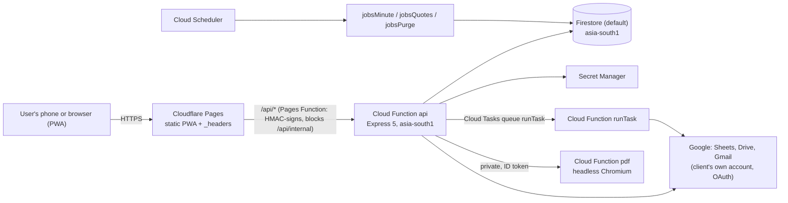

# Runbook — SaleSphere CRM

| Version | Date | Author | Change |
|---|---|---|---|
| 1.0 | 2026-11-14 | Claude (Architect + QA) | First release runbook (Phase 13) |

Audience: the person who installs and operates SaleSphere for a client (the product owner or their support engineer). Commands assume Git Bash or a Linux/macOS shell with `gcloud`, `firebase-tools` and Node 22.

## 1. Architecture summary



- One isolated install per client: its own Firebase project, Cloudflare Pages project, Google account and secrets (ADR-001, ADR-006).
- All data access goes through the API. `infra/firestore.rules` denies all client access.
- Source of truth for design: `docs/06-hld/HLD.md`. Every function is defined in `apps/api/src/functions.ts`.

## 2. Environments

| Environment | Purpose | Data | Deployed by |
|---|---|---|---|
| local | Development | In-memory DB + fake Google (`pnpm dev`) or Firestore emulator (`FIRESTORE_EMULATOR_HOST`) | Developer |
| CI | Every PR and push to `main` | In-memory, discarded | `.github/workflows/ci.yml` |
| staging | Release rehearsal | Synthetic | `deploy.yml` → environment `staging` |
| client-&lt;id&gt; | Production, one per client | Client data | `deploy.yml` → environment `client-<id>` (required reviewer) |

## 3. First-time setup for a new client

Run these once per client. Steps marked **(owner)** need the client's or product owner's accounts. Claude cannot do them.

1. **Client config (FR-001).** Copy `clients/example/` to `clients/<id>/`. Fill in `config.json`, then run `CLIENT_ID=<id> pnpm --filter @ss/web build`. The build stops and names any invalid key.
2. **Firebase project (owner).** Create the project on the Blaze plan. Create Firestore in Native mode, location `asia-south1`. Enable the Cloud Functions, Cloud Tasks, Cloud Scheduler, Secret Manager and Cloud Run APIs.
3. **Secrets (owner).** See §5. Create the four secrets in that project's Secret Manager.
4. **Google OAuth client (owner).** In Google Cloud console → Credentials, create a Web client. Set the redirect URI to `https://<domain>/api/v1/oauth/google/callback`. Add the Sheets, Drive (file) and Gmail-send scopes. Put the client ID in the functions environment and the secret in `GOOGLE_CLIENT_SECRET`.
5. **Backups (NFR-006, CR-001):**
   ```bash
   gcloud firestore backups schedules create --project=<project> --database='(default)' --recurrence=daily --retention=7d
   gcloud firestore backups schedules create --project=<project> --database='(default)' --recurrence=weekly --day-of-week=SUN --retention=5w
   ```
6. **Logs (HLD §13):** create a log exclusion for `run.googleapis.com/requests` on the `api` service. Re-create the `_Default` bucket in `asia-south1` with 30-day retention.
7. **Cloudflare (owner)** — either a **Worker** (repo root `wrangler.jsonc`: build `pnpm run build`, deploy `npx wrangler deploy`; the `name` in `wrangler.jsonc` must equal the Worker name; set the secrets below under Settings → Variables and secrets) or a **Pages** project as follows.
   **Cloudflare Pages:** Create the project and attach the domain `crm.<client>.com`. Set the environment secrets `API_ORIGIN` (the `api` function URL, from `firebase functions:list`) and `EDGE_HMAC_SECRET` (the same value as in Secret Manager). Add a WAF rate-limiting rule: `/api/*`, 60 requests/min per IP, action block for 1 min.
8. **GitHub Environment `client-<id>` (owner).** Set the vars `CLIENT_ID`, `FIREBASE_PROJECT`, `GCP_WIF_PROVIDER`, `GCP_DEPLOY_SA`, `CF_PAGES_PROJECT` and `APP_URL`, and the secrets `CLOUDFLARE_API_TOKEN` and `CLOUDFLARE_ACCOUNT_ID`. Add a required reviewer. Grant the deploy service account Firebase Admin, Cloud Functions Admin, Service Account User and Datastore User through Workload Identity Federation.
9. **Deploy:** Actions → deploy → environment `client-<id>`, ref `v1.0.0` (see §4).
10. **Provision (FR-002):**
    ```bash
    GCLOUD_PROJECT=<project> DATA_ENC_KEY=<value> pnpm seed -- --admin admin --name "<Owner name>" --catalogue web
    ```
    The command prints a one-time temporary admin password; give it to the owner through a private channel. Re-running is safe and prints "already provisioned".
11. **Smoke test** (§8), then hand over (§12).

## 4. Deploy and rollback

### 4.1 Deploy (per client, `.github/workflows/deploy.yml`)

1. Tag the release on `main`: `git tag v1.0.0 && git push --tags` (CI must be green).
2. Actions → **deploy** → *Run workflow*, choosing the environment and the tag. The job then runs in order:
   1. lint, typecheck and tests
   2. client build (`CLIENT_ID`)
   3. **migrations** (`pnpm --filter @ss/api migrate`, expand-only; a failure stops the job before new code ships, FR-006 AC2)
   4. `firebase deploy --only functions,firestore:rules,firestore:indexes`
   5. `wrangler pages deploy`
   6. health check
3. Deploy staging first, then each client environment. One client's failure does not affect the others.
4. New composite indexes take minutes to build. Until they are ready, list queries can return `FAILED_PRECONDITION`; watch progress with `gcloud firestore indexes composite list`.

### 4.2 Rollback (NFR-019: ≤ 30 min)

| What failed | Action |
|---|---|
| Health check or error spike after a deploy | Re-run **deploy** with the previous tag. Migrations are expand-only, so old code runs on the migrated data. |
| Pages (UI) only | Cloudflare dashboard → Pages → Deployments → previous deployment → *Rollback*. |
| A function only | `gcloud run services update-traffic <function> --to-revisions=<previous>=100 --region asia-south1 --project <project>` |
| A migration failed | The install stays on the old version. Read `migrations/<id>.error` in Firestore, fix it, release a patch, then re-run. |

## 5. Configuration and secrets

All variables are documented in `.env.example`. In production the API **refuses to start** if a secret is missing (`assertProductionSecrets`).

| Secret (Secret Manager) | Used by | How to generate | Rotation |
|---|---|---|---|
| `JWT_PRIVATE_JWK` | api, runTask, jobs | `node -e "import('jose').then(async j=>{const k=await j.generateKeyPair('EdDSA',{extractable:true});console.log(JSON.stringify(await j.exportJWK(k.privateKey)))})"` (run inside `apps/api`) | Yearly. Rotating signs everyone out; refresh tokens re-issue on next sign-in. |
| `EDGE_HMAC_SECRET` | api + Cloudflare Pages | `openssl rand -hex 32` | Yearly: set the new value in Pages and Secret Manager together; there are about 60 s of 401s in between. |
| `GOOGLE_CLIENT_SECRET` | api, runTask, jobs | Google Cloud console | When Google requires it |
| `DATA_ENC_KEY` | api, runTask, jobs | `openssl rand -base64 32` | **Do not rotate** without a re-seal migration; existing share-link URLs cannot be shown again (they still work, because lookup uses the hash). |

Non-secret settings (`APP_ORIGIN`, `GOOGLE_CLIENT_ID`, `GOOGLE_REDIRECT_URI`, `PDF_FUNCTION_URL`, `CLIENT_NAME`, tunables) go in `apps/api/dist/.env.<project>` or functions params at deploy time.

## 6. Monitoring and alerts (HLD §13)

| Signal | Where | Alert threshold | First response |
|---|---|---|---|
| Uptime `GET /api/v1/health` | Cloud Monitoring uptime check, 5 min | 2 failures in a row | §7.1 |
| API 5xx rate | Log-based metric `api_5xx_count` | > 2 % for 10 min | §7.2 |
| Scheduler tick missing | `jobsMinute` logs | > 5 min without a tick | §7.3 |
| Sheet sync lag / failures | `sync_lag_seconds`, `sync_failed_rows`; in-app N-011 | lag > 10 min | §7.4 |
| PDF failures | `pdf_fail_count` | > 5 in 1 h | §7.5 |
| Google connection broken | In-app N-010 banner | any | §7.4 |
| Account lockouts | `auth_lockouts` | spike | §7.6 |
| Budget | Billing budget | 50 / 90 / 100 % | Review usage |

Logs are pino JSON in Cloud Logging. Filter by `jsonPayload.requestId` (also returned to users in error responses as `requestId`). PII is redacted at source.

## 7. Common incidents

| # | Symptom | Likely cause | Fix |
|---|---|---|---|
| 7.1 | Site down / health failing | Bad deploy, Cloudflare or GCP incident | Check the GCP and Cloudflare status pages; roll back (§4.2) |
| 7.2 | Many 5xx | Missing composite index (`FAILED_PRECONDITION` in logs), missing secret at start-up, Google outage | Index: wait for the build or add it via `node infra/gen-indexes.mjs` and redeploy. Secret: §5 |
| 7.3 | Reminders/SLA alerts stopped | Scheduler job paused or failing | `gcloud scheduler jobs list --location asia-south1`, resume; check `jobsMinute` logs |
| 7.4 | Sheet leads not arriving | Google token revoked; sheet header changed (status *mapping attention*); Apps Script trigger removed | Settings → Google → *Reconnect*; fix the mapping; the 15-min safety poll catches up automatically |
| 7.5 | PDFs stuck "pending" | `pdf` function cold start or crash | Documents stay valid as web links; *Regenerate PDF* on the document; check `pdf` logs |
| 7.6 | User locked out | 5 failed sign-ins (FR-008) | Settings → Users → *Unlock*, or the user waits 15 min |
| 7.7 | All API calls 401 `EDGE_SIGNATURE_INVALID` | `EDGE_HMAC_SECRET` differs between Pages and Secret Manager, or the edge clock is off | Set the same value in both and redeploy Pages |
| 7.8 | 404 "This module is not enabled" | Module switched off (FR-004) | Settings → Mode, SLA & modules |
| 7.9 | Last admin lost access | Password forgotten and no other admin | Re-run `pnpm seed` (does not reset an existing admin), or use support access (FR-089), or reset the admin's `passwordHash` with a support-approved script, audited |

## 8. Smoke test after every deploy (≈ 5 min)

1. `curl https://<domain>/api/v1/health` returns `{"status":"ok"}`.
2. Sign in as admin, open Home, Leads, Sales and Settings with no errors.
3. Create a test lead, then delete or mark it junk.
4. Open a recent quote's share link in a private window; it renders.
5. Settings → Google shows *Connected*; *Sync now* on one sheet succeeds.
6. Check the `api` logs for 5 minutes: no new error types.

## 9. Backup and restore (HLD §14)

- Backups are daily (kept 7 days) and weekly (kept 5 weeks), created in §3 step 5. List them: `gcloud firestore backups list --project=<project> --location=asia-south1`.
- **Restore** (NFR-006: RTO ≤ 8 h, RPO ≤ 24 h). Restore to a **new** database, never over the live one:
  ```bash
  gcloud firestore databases restore --project=<project> --source-backup=<backup-name> --destination-database=restore-<date>
  ```
  Compare and copy the needed collections back with a reviewed script, using the audit log to reconcile. Record the incident.
- Erased personal data (FR-088) can remain in backups for up to about 35 days (CR-001). Tell the requester this in the erasure confirmation.
- Drive files live in the client's own Google Drive and follow Google's retention.
- Restore drill: once before go-live and then every quarter (go-live checklist item O-5).

## 10. Routine operations

| Task | Frequency | How |
|---|---|---|
| Dependency audit | Every release (CI) | `pnpm audit --prod`; triage High and above |
| Review lockouts and support access | Monthly | Settings → Audit log, filter on `auth.*` and `support.*` |
| Junk lead purge | Automatic (daily 02:00 IST) | `jobsPurge`; retention 3 months (FR-090) |
| Index drift | When list queries change | Re-record query shapes and run `node infra/gen-indexes.mjs` (header of the script) |
| Traceability | Every release | `node infra/rtm-coverage.mjs` |

## 11. Contacts and escalation

| Role | Who | Contact |
|---|---|---|
| Product owner / L2 support | Q-031 — to be named by the product owner | — |
| Client admin (per install) | Named at handover | Recorded in the client's handover sheet |
| Google / Firebase support | Client's billing account | console.cloud.google.com/support |
| Cloudflare support | Client's account | dash.cloudflare.com |

## 12. Handover to a client

Give the client: the URL, the admin username and temporary password (privately), the PWA install steps for phones, how to connect Google (Settings → Google), the support contact, and this runbook's §7 table.
