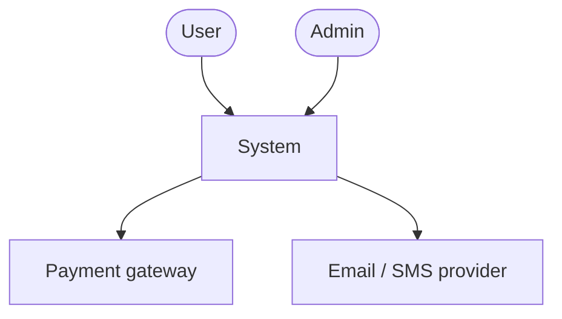
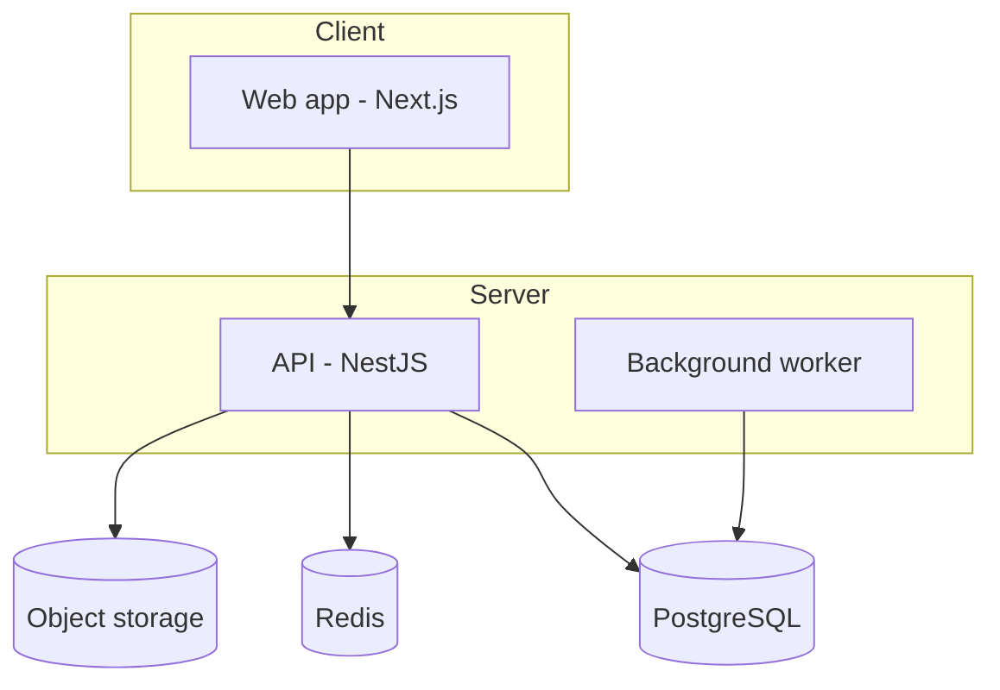
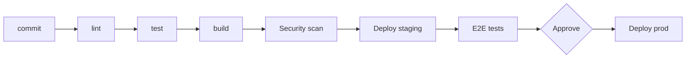

# High-Level Design (HLD) — {Project Name}

| Version | Date | Author | Change |
|---|---|---|---|
| 0.1 | | | Initial draft |

## 1. Introduction
Purpose, scope, references (BRD, FRD, Solution Design).

## 2. Architecture goals & constraints
Key NFRs driving the design; constraints.

## 3. System context (C4 level 1)

## 4. Containers (C4 level 2)

| Container | Technology | Responsibility | Scales by |
|---|---|---|---|

## 5. Logical architecture / modules
| Module | Responsibilities | Owns data | Linked FRs |
|---|---|---|---|

## 6. Technology stack
| Layer | Choice | Why | ADR |
|---|---|---|---|

## 7. Integration design
| ID | System | Protocol | Direction | Auth | Frequency | Error handling / retries | Idempotency |
|---|---|---|---|---|---|---|---|

## 8. Data architecture
Conceptual ER (Mermaid erDiagram), data ownership, classification, retention, backup.

## 9. Security architecture
- Authentication & session management
- Authorisation (RBAC / ABAC) matrix
- Data protection (encryption in transit / at rest, PII masking)
- Secrets management
- OWASP Top 10 control mapping
- Audit logging
- Compliance mapping

## 10. NFR realisation
| NFR ID | Requirement | Design mechanism | Verification |
|---|---|---|---|

## 11. Deployment architecture
Environments, topology diagram, network, domains, CDN.

## 12. CI/CD

## 13. Observability
Logs, metrics, traces, dashboards, alerts, SLOs.

## 14. Resilience & DR
Failure modes, timeouts/retries, RPO/RTO, backup/restore.

## 15. Architecture decisions
List of ADRs.

## 16. Risks, assumptions, open questions

## 17. Sign-off
