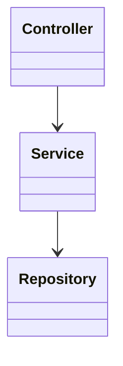
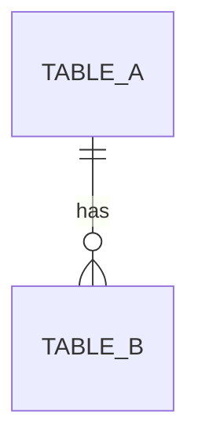

# Low-Level Design (LLD) — Module: {module}

| Version | Date | Author | Change |
|---|---|---|---|
| 0.1 | | | Initial draft |

## 1. Module overview
Responsibilities, linked FRs, UCs, SCRs.

## 2. Code structure
```
apps/api/src/modules/{module}/
  {module}.controller.ts
  {module}.service.ts
  {module}.repository.ts
  dto/
  entities/
  {module}.spec.ts
apps/web/app/(app)/{module}/
  page.tsx
  [id]/page.tsx
  components/
```

## 3. Class / component diagram


## 4. Sequence diagrams
### 4.1 {Flow} — happy path
### 4.2 {Flow} — error paths

## 5. API contracts
### API-001 — {Name}
| Item | Value |
|---|---|
| Method / path | POST /api/v1/... |
| Auth / roles | Bearer JWT / ROLE_X |
| Linked FR | FR-00x |
| Idempotency | Idempotency-Key header |
| Rate limit | |

Request:
```json
{}
```
Responses: `201` …, `400` validation (problem+json), `401`, `403`, `404`, `409`, `422`, `500`
```json
{}
```

## 6. Database design

### TBL-001 — {table}
| Column | Type | Null | Default | Constraint / index | Notes |
|---|---|---|---|---|---|
| id | uuid | N | gen_random_uuid() | PK | |
| created_at / updated_at / created_by / updated_by | | | | | audit |
| deleted_at | timestamptz | Y | | | soft delete |

## 7. State machines

## 8. Validation & business rules
| Rule ID | Where enforced | Implementation | Error code |
|---|---|---|---|

## 9. Error code catalogue
| Code | HTTP | Message (user-facing) | Cause |
|---|---|---|---|

## 10. Events, jobs & schedules

## 11. Caching

## 12. Configuration / env vars
| Var | Required | Default | Description |
|---|---|---|---|

## 13. Logging & audit events

## 14. Front-end design
| SCR | Route | Components (CMP) | Data fetching | State | Forms / validation |
|---|---|---|---|---|---|

## 15. Unit-test plan
| Unit | Scenarios |
|---|---|

## 16. Open questions
