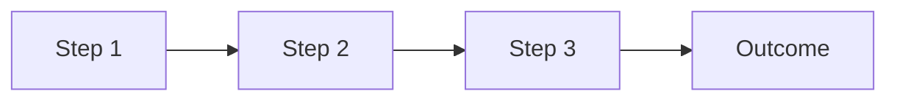
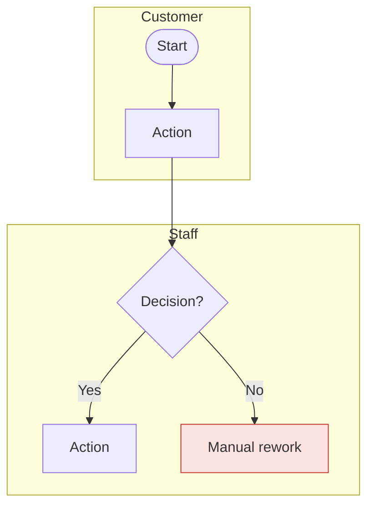
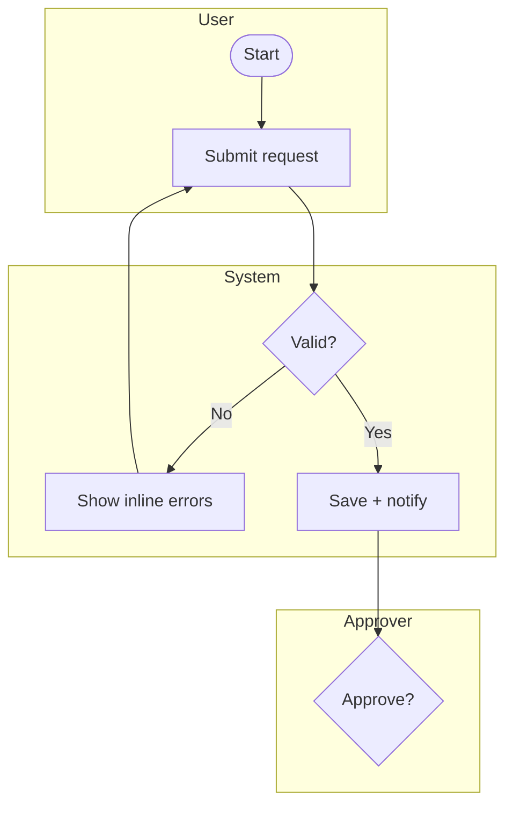
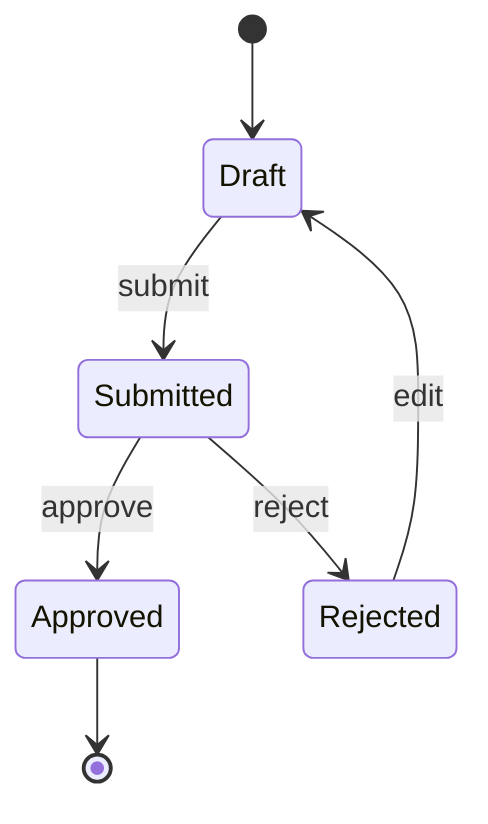
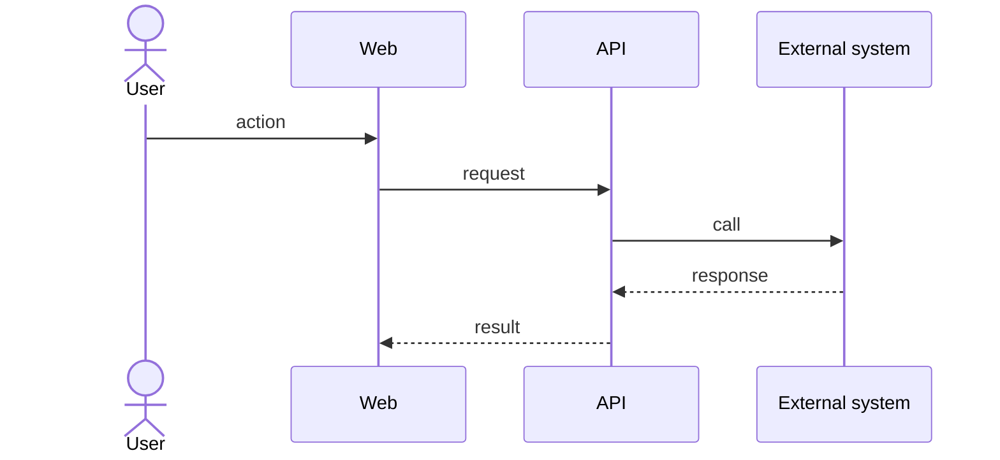

# Process Flows — {Project Name}

| Version | Date | Author | Change |
|---|---|---|---|
| 0.1 | | | Initial draft |

## 1. Process inventory
| ID | Process | Owner | Trigger | Frequency | Linked UC / FR |
|---|---|---|---|---|---|
| PF-001 | | | | | |

## 2. Level-0 value chain

## 3. Process details
### PF-001 — {Process name}

**AS-IS**

**Pain points → improvements**
| # | Pain point | Impact | TO-BE improvement | FR |
|---|---|---|---|---|

**TO-BE**

**Exceptions & SLAs**
| Step | Exception | Handling | SLA |
|---|---|---|---|

## 4. Entity lifecycles

## 5. Cross-system sequences

## 6. Open questions
