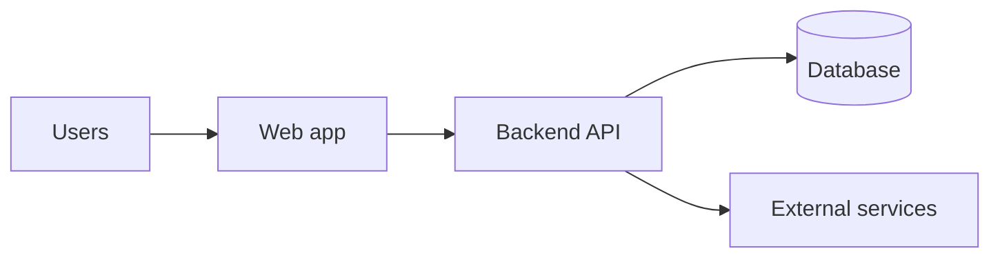

# Solution Design Document — {Project Name}

| Version | Date | Author | Change |
|---|---|---|---|
| 0.1 | | | Initial draft |

## 1. Executive summary

## 2. Business problem & requirements summary
Key BRs, top FR groups, critical NFRs.

## 3. Capability map
| Capability | Description | Linked FRs | Build / Buy / Reuse |
|---|---|---|---|

## 4. Solution options
### 4.1 Option A — {name}
### 4.2 Option B — {name}
### 4.3 Comparison
| Criterion | Weight | Option A | Option B | Option C |
|---|---|---|---|---|
| Business fit | 25% | | | |
| Time to market | 15% | | | |
| Total cost (3 yr) | 15% | | | |
| Scalability / performance | 10% | | | |
| Security & compliance | 15% | | | |
| Maintainability / skills | 10% | | | |
| Vendor lock-in | 10% | | | |
| **Weighted score** | | | | |

### 4.4 Recommendation & rationale

## 5. Solution overview

## 6. Integration landscape
| System | Purpose | Pattern (REST / webhook / batch / queue) | Owner |
|---|---|---|---|

## 7. Data strategy
Sources, ownership, migration, quality, retention, analytics.

## 8. Security & compliance approach

## 9. Deployment & hosting model

## 10. Migration & rollout
| Phase | Scope | Users | Date | Exit criteria |
|---|---|---|---|---|
| MVP | | | | |
| v1 | | | | |

## 11. Cost estimate (rough order of magnitude)
| Item | One-time | Monthly |
|---|---|---|

## 12. Risks & mitigations

## 13. Assumptions & open questions

## 14. Sign-off
