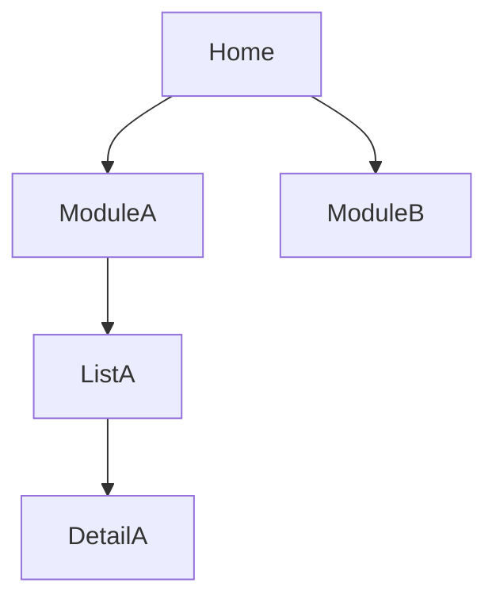

# UX Specification — {Project Name}

| Version | Date | Author | Change |
|---|---|---|---|
| 0.1 | | | Initial draft |

## 1. Design goals & principles
3–5 principles specific to this product (e.g. "Speed over ceremony for daily users").

## 2. Personas
### P-01 — {Name, role}
- **Context of use:** device, environment, frequency
- **Goals:**  **Frustrations:**  **Tech comfort:**
- **Jobs-to-be-done:** When … I want to … so I can …

## 3. Journey maps
### J-01 — {Journey}
| Stage | Actions | Thoughts | Emotion | Pain points | Opportunities |
|---|---|---|---|---|---|

## 4. Information architecture

Navigation model (top nav / side nav / tabs), role-based visibility table.

## 5. User flows
One Mermaid flowchart per UC, including error and empty paths.

## 6. Screen inventory
| SCR ID | Screen | Purpose | Roles | Linked FR / UC | Priority |
|---|---|---|---|---|---|

## 7. Screen specifications
### SCR-001 — {Screen}
- **Purpose / linked FRs:**
- **Layout:** header / main / aside / footer regions (see wireframe)
- **Components:** CMP-xxx …
- **Data displayed:** field, source, format
- **Actions:** primary, secondary, destructive (with confirmation)
- **Validation & messages:**
- **States:**
  | State | What the user sees |
  |---|---|
  | Default | |
  | Loading | skeleton … |
  | Empty | illustration + message + CTA |
  | Error | message + retry |
  | Partial data | |
  | Success | toast / redirect |
  | No permission | |
- **Responsive behaviour:** 360 / 768 / 1280
- **Accessibility:** focus order, landmarks, aria labels, keyboard shortcuts
- **Microcopy:** titles, buttons, helper text, errors

## 8. Interaction patterns
Forms, tables, search & filters, modals vs pages, notifications, confirmations, undo, file upload, date/time, pagination.

## 9. Content & tone of voice

## 10. Accessibility checklist (WCAG 2.2 AA)
- [ ] Contrast ≥ 4.5:1 text, 3:1 UI  - [ ] Visible focus  - [ ] Keyboard only works end to end
- [ ] Labels and error association  - [ ] Targets ≥ 44 px  - [ ] Reduced motion respected
- [ ] Headings and landmarks  - [ ] Alt text  - [ ] No info by colour alone

## 11. Usability test plan (optional)
Tasks, success criteria, participants.

## 12. Open questions
