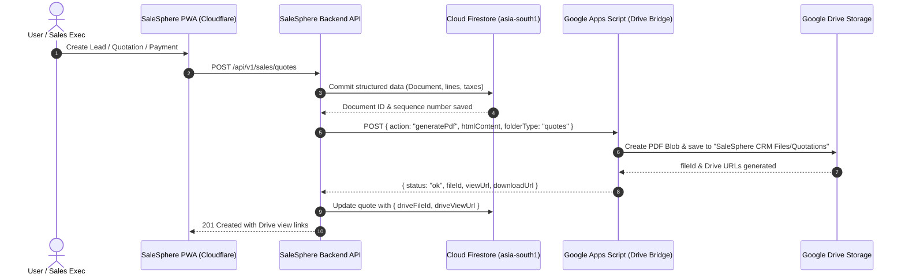

# Hybrid Data Architecture: Cloud Firestore + Google Drive (via Apps Script)

SaleSphere implements a **hybrid enterprise architecture**:
* **Structured Data in Cloud Firestore**: Leads, Customers, Quotations, Invoices, Payments, User Roles, and Audit Logs.
* **Unstructured Files & Media in Google Drive via Apps Script**: Quotation/Invoice PDFs, receipt photos, lead attachments, customer KYC documents.

---

## Architecture Diagram



---

## Part 1: Setting Up Cloud Firestore for Data

1. **Create or Open Firebase / GCP Project**:
   * Go to [Firebase Console](https://console.firebase.google.com/) or [Google Cloud Console](https://console.cloud.google.com/).
   * Create a project named `salesphere-prod`.
   * Enable **Cloud Firestore** in **Native mode** and select region **`asia-south1` (Mumbai)**.

2. **Deploy Rules & Composite Indexes**:
   ```bash
   # From the repository root:
   npx firebase-tools deploy --only firestore:rules,firestore:indexes --project salesphere-prod
   ```

3. **Generate Service Account Key**:
   * In Firebase Console → Project Settings → **Service accounts**.
   * Click **Generate new private key** (saves as `service-account.json`).
   * Place it in the backend environment:
     ```env
     GOOGLE_APPLICATION_CREDENTIALS=/path/to/service-account.json
     GCLOUD_PROJECT=salesphere-prod
     ```

4. **Seed Initial Data**:
   ```bash
   pnpm --filter @ss/api seed
   ```

---

## Part 2: Setting Up Google Drive via Apps Script (Zero-GCP Billing)

By using Google Apps Script as the storage microservice:
* File uploads and PDF generation consume **free Google Drive quota** rather than GCP Cloud Storage billing.
* Files are organized automatically inside your team's Google Drive.

### Step 1: Create the Apps Script Project
1. Open [Google Apps Script](https://script.google.com).
2. Click **New Project** and rename it to **SaleSphere Drive Storage**.
3. Replace the contents of `Code.gs` with the code in `infra/appscript/Code.gs`.
4. (Optional) Customize the `CONFIG.SHARED_SECRET` in `Code.gs` (e.g. `SaleSphere_Drive_Secret_2026`).

### Step 2: Deploy as a Web App
1. Click the blue **Deploy** button at the top right → **New deployment**.
2. Click the gear icon (⚙️) next to "Select type" and choose **Web app**.
3. Set the following settings:
   * **Description**: `SaleSphere Drive API v1`
   * **Execute as**: **Me (`your-email@gmail.com` / Google Workspace account)**
   * **Who has access**: **Anyone** *(Protected by your `SHARED_SECRET` in the payload)*
4. Click **Deploy**.
5. Grant permissions when prompted by Google (Allow access to Google Drive).
6. Copy the generated **Web App URL** (e.g. `https://script.google.com/macros/s/AKfycb.../exec`).

### Step 3: Configure Environment in SaleSphere
Set the following environment variables in your backend API or `.env`:
```env
GOOGLE_APPSCRIPT_URL=https://script.google.com/macros/s/AKfycb.../exec
GOOGLE_APPSCRIPT_SECRET=SaleSphere_Drive_Secret_2026
```

---

## Automatic Google Drive Folder Structure

The Apps Script microservice automatically initializes and manages the following folder hierarchy inside Google Drive:

```
📁 My Drive
└── 📁 SaleSphere CRM Files/
    ├── 📁 Quotations/            (Generated quote PDFs)
    ├── 📁 Invoices/              (GST tax invoice PDFs)
    ├── 📁 Payment Receipts/      (Receipt slips & payment proofs)
    ├── 📁 Lead Attachments/      (Requirements, RFPs, client photos)
    └── 📁 Customer KYC & Docs/   (GST certificates, contracts)
```

---

## Verifying the Setup

You can verify the Apps Script bridge with a simple curl command:
```bash
curl -X POST "https://script.google.com/macros/s/YOUR_SCRIPT_ID/exec" \
  -H "Content-Type: application/json" \
  -d '{"action": "ping", "secret": "SaleSphere_Drive_Secret_2026"}'
```
Expected response:
```json
{"status":"ok","time":"2026-11-14T17:30:00.000Z"}
```
